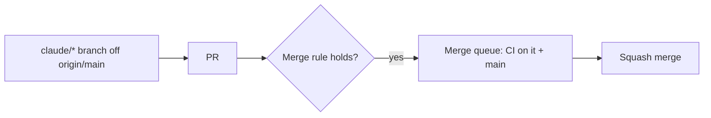

# Legallas: rules for every session in this repository

> **Write tables, numbers and charts, not prose: fewest words in docs, comments, PRs, issues and cards.**

| | |
|---|---|
| Owner | Colorado Startups: the whole product, Apache-2.0 |
| Status | Open to contributors, not on sale |
| Elsewhere | Install, setup, licensing, signing, sales, and their issues: not in this repository |
| Read too | `CONTRIBUTING.md` (outside contributors, merge paths, governance), `CODE_OF_CONDUCT.md`, `SECURITY.md`. `AGENTS.md` links here, so every coding agent has these rules |
| Web work | `web/README.md` first: setup, commands, Cloudflare rules |
| Plugins, skills, connectors, agents, tools | All stay on in the Claude desktop app for every Cowork and Code session. A session ignores what it does not need by not loading it; sub-sessions get the full suite too. Never turn one off app-wide or in this repo's settings ([Claudius: All on, app-wide](https://github.com/Colorado-Startups/claudius/blob/main/templates/claude/README.md#all-on-app-wide)) |
| "core", "pro" | In the code, the two slots a room's entry picks from: `worker/room.ts` or `worker/entry-pro.ts`, `mcp/index.ts` or `mcp/entry-pro.ts`. Both here, same licence. Core never imports pro |

## Start here

| Work | Lives in |
|---|---|
| Bugs, errors, quick fixes | GitHub issues |
| Ideas, questions | GitHub Discussions; a maintainer turns an accepted idea into a card |
| Features, improvements | Cards on the org's Legallas Project board, which sets the order |

Each says its goal, customer, files and done when. The product and why: `docs/product.md`.

**Read in batches.** Every tool call re-reads the whole context, 140K tokens or more: put independent reads in one command or one message of parallel calls, and read only the lines you need.

| Path | What's there |
|---|---|
| `web/` | The room, on a Cloudflare Worker: `src/` (Astro pages), `worker/` (gate, routes), `migrations/` (D1), `scripts/` (sync, PII guard, members, evals), `fixtures/` (the fictional room). Start with `web/README.md` |
| `web/mcp/` | The remote MCP server each member's AI connects to. Tools: `contract.ts`. Views an AI draws (MCP Apps): `apps/` |
| `web/connect/` | Setup guides for each AI, the Microsoft 365 Copilot package |
| `web/scripts/law/` | The law library builder |
| `Sources/`, `Tests/` | The Swift package: `LegallasCore` (case model), `LegallasMCP` (local MCP server), `LegallasExtraction`, `LegallasExtract` (OCR, text) |
| `LegallasApp/` | The Mac case tracker (SwiftUI) |
| `docs/` | `docs/product.md`, `docs/design/` (document and law map, law pack plan, rooms and grants, AI connectors), `docs/checklist/`, `docs/licences/` |

**Get a worktree.** Never switch branches in the main clone: other sessions share it. The clone pushes; its `pre-push` hook covers every worktree. From the clone's root:

```bash
git worktree add .claude/worktrees/<name> -b claude/<name> origin/main
```

Opening or updating a PR: the `pull-request` skill.

## No case data, ever

| ✗ Never here | In code, comments, tests, fixtures, commit messages, PRs, logs |
|---|---|
| Customer data | A customer's documents, case details, party or counsel names, hostnames, account IDs, settings |
| A room's settings | Its files (`web/wrangler.jsonc`, `web/wrangler.mcp.jsonc`, `web/legallas.config.json`) are never committed. The examples hold placeholders |

| Rule | |
|---|---|
| Test data | Only the fictional fixture: Doe v. Harbor Labs, control prefix `DOE`, invented dates and story |
| Rewriting a fixture | Change its shape, not just nouns: a real story with new names is still that story |
| Generated files | Rebuilt from their sources (`node connect/copilot/mcp-tools.ts`), never patched by hand: Base64 hides text from a pattern scan |
| A sample | Its distance from a real matter comes from invented facts, not from leaving the product's subject. A fictional founder dispute is fine (the product is about them); who did what, when and for how much is made up from scratch |
| Hosting | Colorado Startups hosts no customer's room and never sees a customer's data |
| Case patterns | A contributor with access to a customer's case runs a local `pre-push` hook that scans outgoing changes for them. They stay in the clone's `.git/info`, never here: this repository keeps generic checks only |
| PR, issue and comment text | The pre-push hook never sees it. From `web/`: `node scripts/case-text-scan.ts draft <file>` before posting; `repo <owner/name>` scans every body, comment and edit revision (the make-public gate). Counts only, never the words |

## Tests run in the cloud

| Where | What runs |
|---|---|
| A laptop or desktop | Only seconds-long checks, one at a time, no package install: one test file, from `web/` (`node --test worker/source-kind.test.ts`). Never test suites, builds, renders or GPU work. A worktree has no `node_modules`: a test importing an npm package fails (`ERR_MODULE_NOT_FOUND`), so CI runs it |
| A Claude Code cloud session or a Codespace | Anything needing packages or time: a generated file (`node connect/copilot/mcp-tools.ts`), a type check |
| CI or another cloud lane | Full test suites, Swift builds, browser runs, evals. Each workflow in `.github/workflows/` says where its jobs run |
| Self-hosted runners | None |

CI minutes are limited: batch commits, push when you expect green.

| CI job | Runs |
|---|---|
| `checks`, every PR, Linux | Secret scan, workflow lint. `web/` changed: also `npm run check`, `npm test`, `npm run build`, the Worker dry runs. `quality-speed/` changed: its tests, page folder check, goal check, build and publish guard. Blacksmith's free minutes first, then GitHub-hosted `ubuntu-latest` |
| `swift`, `swift-ocr`, `office-mac`, macOS | Only when their paths change: 10x minutes |
| `ci-ok`, `dco` | The required checks. `ci-ok` takes seconds on `ubuntu-slim`. Merge queue: `ci-ok` reruns in full; `dco` passed on the head |

| By hand | `fixture-room.yml`, `replica-eval.yml`, `people-eval.yml`, `claude-confinement.yml`, `sample-room-extract.yml`, `sample-room-lab.yml`, `board-card.yml`, `settings-apply.yml`: each header says when |
|---|---|

## CI lanes and cost

| | |
|---|---|
| Map | The `ci` process map (`quality-speed/process/maps.json`, drawn on the Process page): route, skip, Blacksmith, GitHub-hosted, `ci-ok`, queue. Each step's rule and live metric live there, and the money on the Actions page. No figures here: they drift |
| Pace | Set by those metrics, never asked of the owner. All included minutes may be used (the owner, 2026-11-06); the enterprise's $0 Stop-usage budget stops CI past them |
| Blacksmith | Counts `ci.yml` and `quality-speed.yml`; count any other workflow before it moves there. Only stop: `.github/scripts/build_minutes_guard.py`. Runners stall: set the `CI_RUNNER` repository variable to `"ubuntu-latest"`, quotes included; delete it to give the guard back the choice |
| Mac jobs | Only when their paths change; not on a push to main identical to a PR head CI passed; no rerun without a reason. A manual run (`workflow_dispatch`) checks every area |
| ✗ | A Hugging Face Space as a runner: self-hosted, its content policy bars remote management tools, a free Space sleeps |

## Pull requests



| Rule | |
|---|---|
| Branch | Every change: a PR from `claude/*` off `origin/main`. Never push to `main` |
| Merge | Squash only |
| Every commit | Verified signature, `Signed-off-by` line (`git commit -s`, the DCO) |
| Merge rule | Required checks (`ci-ok`, `dco`) green on the head, then the merge queue (squash). Quality, speed, consumption and security are measured on their pages |
| To the owner | Only billing, major product, major security and major privacy decisions |
| Questions | The session that started yours (`SendMessage`), else the person in your session |
