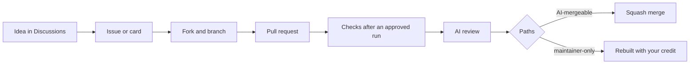

# Contributing

Thank you for helping. Legallas is open to anyone in the Colorado Startups community, under Apache-2.0 and the [code of conduct](CODE_OF_CONDUCT.md). Every contribution takes the same path, and AI agents run most of it.

## 1. Start

| You have | Do |
|---|---|
| An idea or an improvement | Open a [Discussion in Ideas](https://github.com/Colorado-Startups/legallas/discussions/categories/ideas). A maintainer turns an accepted idea into a card on the Legallas Project board, which sets the order |
| A question | Ask in [Q&A](https://github.com/Colorado-Startups/legallas/discussions/categories/q-a) |
| A bug or a quick fix | Open an [issue](https://github.com/Colorado-Startups/legallas/issues/new/choose) with the bug or quick fix form |
| A security problem, or case data that leaked | [`SECURITY.md`](SECURITY.md); never a public issue |
| An old `#N` in the docs or code | Issue and PR numbers from before the public launch refer to private history, not to items in this repository |
| Time now | Pick a [`good first issue`](https://github.com/Colorado-Startups/legallas/labels/good%20first%20issue) or a [`help wanted`](https://github.com/Colorado-Startups/legallas/labels/help%20wanted) |

## 2. Run it

[`README.md`](README.md) sets up a fictional room to try, and [`web/README.md`](web/README.md) lists every command. Agents working here also read [`CLAUDE.md`](CLAUDE.md).

| Where | What runs |
|---|---|
| Your machine | One test file, from `web/`: `node --test worker/source-kind.test.ts`. A test that imports an npm package needs `npm ci` first |
| CI, on your pull request | The full test suites, builds, secret scan and Swift jobs. A fork's run waits for a maintainer's approval and gets no secrets |

## 3. Change it

| Rule | Why |
|---|---|
| One change per pull request, with a test for code | Small pull requests review fast |
| Open it against `main`; squash merges only, through the merge queue | One commit per change |
| Sign off each commit: `git commit -s` | Under the [Developer Certificate of Origin](https://developercertificate.org/), you certify you may submit it under this repository's licence, Apache-2.0. The `dco` check requires it. `main` also needs a verified signature, which the squash merge adds |
| ✗ Never commit case data, a room's settings or a secret | Case data is a customer's documents, party or counsel names and settings. A room's settings are `wrangler.jsonc`, `wrangler.mcp.jsonc` and `web/legallas.config.json`. The examples hold placeholders only |
| Tests use the fictional fixture: Doe v. Harbor Labs, control prefix `DOE` | No real matter, ever. [`CLAUDE.md`](CLAUDE.md) has the full rule |
| Baseline checklists describe legal documents | Each item keeps its public source; every list says it is not legal advice. No lawyer signs off on the product; it tells each customer to have their own lawyer do that |
| Changing a baseline checklist | Edit `docs/checklist/baseline.toml`, run `npm run checklist` in `web/`: the README and the room's copy are generated from it |
| Say so when an AI tool wrote part of the change | Reviewers read it with that in mind |

## 4. Review and merge

| Your PR changes | What happens |
|---|---|
| Only paths on `ai_mergeable` in [`tools/merge_policy.json`](tools/merge_policy.json), beside `tools/merge_policy.py`: tests, design notes, connector guides, page plans | An AI agent reviews it at its head commit and squash-merges it once `ci-ok` and `dco` pass |
| Any other path: the room's code, migrations, templates, checklists, dependencies, CI, hooks, these docs | A maintainer rebuilds it as its own PR with you as `Co-authored-by`, and links the new PR from yours |

Check your paths first: `python3 -I tools/merge_policy.py --base origin/main`. Agents never approve a PR.

## 5. Governance

Colorado Startups owns the project. AI agents run its day-to-day work under Git Crafter's [rules](https://github.com/SoulCraft-Org/git-crafter/tree/main/rules); people hold the seats below.

| Decision | Who decides |
|---|---|
| An idea becomes an issue or a card | A maintainer, in Discussions |
| An AI-mergeable PR merges | An AI agent, after `ci-ok` and `dco` pass (section 4) |
| A PR on any other path | A maintainer rebuilds it with credit, or reviews it |
| Product, vision and spending | Colorado Startups |
| The merge policy, the gates, the licence, these rules | Colorado Startups, by pull request |

### The maintainer seat

| Question | Rule |
|---|---|
| Who may ask | A contributor with five merged pull requests over three months who keeps the code of conduct |
| Who decides | Colorado Startups |
| What the seat can do | Review and merge PRs on maintainer-only paths; turn ideas into issues or cards; welcome new contributors |
| What stays Colorado Startups' | The merge policy, the gates, secrets, deploy settings and production |
| How it ends | Stepping down at any time, or six months with no review; Colorado Startups can end it |

Every seat is held by a person. AI agents never hold one and never approve a pull request.

### Maintainers

| Maintainer | GitHub | Since | Can |
|---|---|---|---|
| Colorado Startups, owner | `@Colorado-Startups/maintainers` | 2026 | Everything: merge any PR, change these rules |
