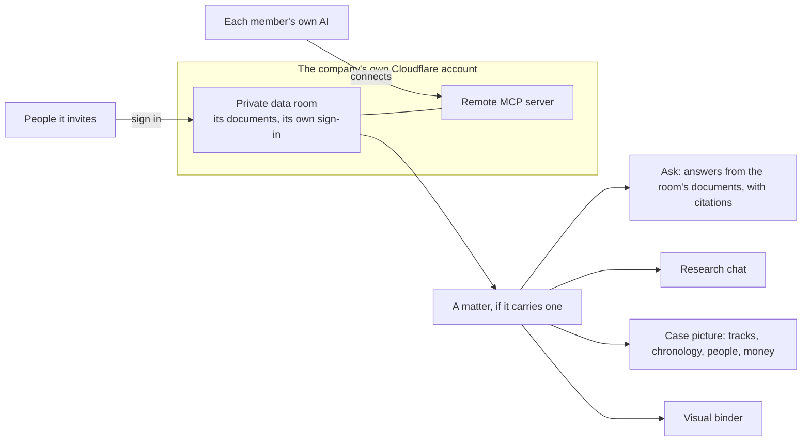

# Legallas

An AI agent for legal work under Colorado, Delaware and federal law. Not a lawyer or law firm. Have your own lawyer review before you sign, file or rely on anything.



| | |
|---|---|
| For | Founders, angels, angel groups, VC funds |
| Hosting | Colorado Startups hosts no customer's room and never sees a customer's documents |
| This repo | The whole product, Apache License 2.0 |
| Status | Open to contributors, not on sale |
| What and why | [docs/product.md](docs/product.md) |
| Contributing | [CONTRIBUTING.md](CONTRIBUTING.md), [CODE_OF_CONDUCT.md](CODE_OF_CONDUCT.md); agents also read [CLAUDE.md](CLAUDE.md) |
| Bugs, quick fixes | [Issues](https://github.com/Colorado-Startups/legallas/issues) |
| Ideas, questions | [Discussions](https://github.com/Colorado-Startups/legallas/discussions); accepted ideas become cards on the [Project board](https://github.com/orgs/Colorado-Startups/projects/6) |
| Security | [SECURITY.md](SECURITY.md): private reporting, never an issue |

## Layout

| Path | What it is |
|---|---|
| `web/` | The room (Astro on a Cloudflare Worker, with D1 and R2) and the MCP server (`web/mcp/`). Start with `web/README.md` |
| `web/connect/` | Connect your AI: guides for Claude, Microsoft 365 Copilot, Harvey and OpenCode with an open-weight model, the Copilot package, the kits' skill folder |
| `Sources/`, `Tests/`, `LegallasApp/` | The Mac case tracker and its local MCP server (Swift) |
| `docs/` | The product, the document and law map, the designs, the company checklist (`docs/checklist/`), the licence review. Start with `docs/product.md` |

## Set up a room

A room's settings live in files never committed: copy the examples and fill them in.

```bash
cd web
cp wrangler.example.jsonc wrangler.jsonc
cp wrangler.mcp.example.jsonc wrangler.mcp.jsonc
npm ci
npm run dev:seed   # a fictional room to try it on
npm run dev
```

| Until set | The room |
|---|---|
| Access team and audience (empty in the examples) | Refuses every request |

Before inviting members, from `web/`:

| Step | |
|---|---|
| `npm run harden -- --check` | Reads the account and zone: WAF, TLS, 2FA, Access MFA, backup, restore drill. Exit 0 all pass. `--apply` fixes the safe rows. `web/README.md`, "Edge rules" |
| [Operator records](docs/security/operator/README.md) | Copy to your own private store and fill in: policy, data map, vendors, risks, incidents, recovery, edge check, watch log |

## Licence

| File | Covers |
|---|---|
| [LICENSE](LICENSE), [NOTICE](NOTICE) | Apache License 2.0, for the code |
| [templates/LICENSE](templates/LICENSE) | CC0 1.0, for the original templates. Bundled third-party forms keep their own licences |
| [TRADEMARKS.md](TRADEMARKS.md) | The name, its search, and other companies' names (used only to say what Legallas works with; no endorsement) |
