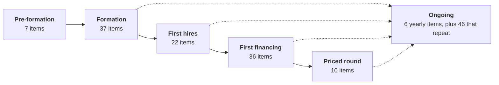
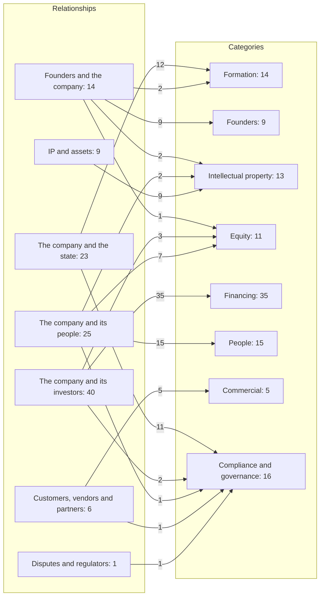

<!-- Generated from baseline.toml and README.template.md by web/scripts/checklist/generate.ts. Edit those, then run it. -->
# Baseline company checklist

> Legallas is an AI agent for legal work, not a lawyer or law firm. Using it creates no attorney-client relationship. AI can be wrong. Have your own lawyer review before you sign, file or rely on anything.
>
> **You aren't receiving legal advice from a licensed lawyer. No lawyer has reviewed this list. Tax items show the law with its source; have your own tax professional review.** Drafted 2026-10-31 by Claude from the public sources linked below.

The documents and agreements startups commonly keep. Generated from [`baseline.toml`](baseline.toml).

| | |
|---|---|
| Items | 118, in 8 categories |
| Entity types | Delaware C corporation, Colorado LLC, Colorado corporation, Delaware LLC |
| Covers | United States federal law, Delaware and Colorado; a company whose employees work in Colorado |
| Sources | 272 public links |
| Investor room | 10 folders |

## Overview

## How to read the tables

| Mark | Meaning |
|---|---|
| ● | First needed at this stage |
| ↻ | Repeats after that |
| † | A condition or deadline, listed under the table |
| Owner only | Holds personal data, such as Social Security numbers |

## The checklist

### Formation

| Item | Pre-formation | Formation | First hires | First financing | Priced round | Ongoing | Applies to | Provided by | Rooms |
|:--|:-:|:-:|:-:|:-:|:-:|:-:|:--|:--|:--|
| Entity type and state decision | ● |  |  |  |  |  | All | Founder, lawyer, accountant | Counsel |
| Company name availability check | ● |  |  |  |  |  | All | Founder | Counsel |
| Formation document filed with the state |  | ● |  |  |  |  | All | Lawyer, registered agent | Counsel, investors |
| Written consent and cumulative voting clauses in the Colorado articles |  | ● |  |  |  |  | Colorado corporation | Lawyer | Counsel, investors |
| Bylaws |  | ● |  |  |  |  | Delaware C corporation, Colorado corporation | Lawyer | Counsel, investors |
| Operating agreement |  | ● |  |  |  |  | Colorado LLC, Delaware LLC | Lawyer | Counsel, investors |
| Action of the incorporator |  | ● |  |  |  |  | Delaware C corporation, Colorado corporation | Lawyer | Counsel, investors |
| Organizational consent of the first board |  | ● |  |  |  |  | All | Lawyer | Counsel, investors |
| Initial stockholder consent |  | ● |  |  |  |  | Delaware C corporation, Colorado corporation | Lawyer | Counsel, investors |
| Employer identification number confirmation from the IRS |  | ● |  |  |  |  | All | Founder, accountant | Counsel, investors |
| Form 8822-B for a new responsible party † |  | ● |  |  |  |  | All | Founder, accountant | Counsel |
| Tax classification or S corporation election † |  | ● |  |  |  |  | Colorado LLC, Colorado corporation, Delaware LLC | Accountant | Counsel, investors |
| Authority to do business in each other state where it operates † |  | ● |  |  |  |  | All | Lawyer, registered agent | Counsel, investors |
| Company bank account, separate from the founders |  | ● |  |  |  |  | All | Founder | Counsel |

† Conditions and deadlines:

- **Form 8822-B for a new responsible party:** When the person the IRS has as the company's responsible party changes, such as a founder leaving. Deadline: Within 60 days of the change.
- **Tax classification or S corporation election:** Only if the company chooses a tax treatment other than its default. Deadline: Form 8832 can take effect no more than 75 days before it is filed, and no later than 12 months after. Form 2553 is due no more than 2 months and 15 days after the start of the tax year it is to take effect.
- **Authority to do business in each other state where it operates:** When the company does business outside its state of formation, such as a Delaware corporation working in Colorado.

### Founders

| Item | Pre-formation | Formation | First hires | First financing | Priced round | Ongoing | Applies to | Provided by | Rooms |
|:--|:-:|:-:|:-:|:-:|:-:|:-:|:--|:--|:--|
| Founders' written agreement on ownership, roles and vesting | ● |  |  |  |  |  | All | Founder, lawyer | Counsel |
| Review of each founder's agreements with past employers | ● |  |  |  |  |  | All | Founder, lawyer | Counsel |
| Founder stock purchase agreement |  | ● |  |  |  |  | All | Lawyer | Counsel, investors |
| Record of the securities exemption for founder stock or units |  | ● |  |  |  |  | All | Lawyer | Counsel, investors |
| Section 83(b) election with proof of timely filing † |  | ● |  |  |  |  | All | Founder, accountant, lawyer | Counsel, investors |
| Founder vesting schedule, repurchase right and acceleration terms |  | ● |  |  |  | ↻ | All | Lawyer, founder | Counsel, investors |
| Definitions of cause and good reason |  | ● |  |  |  |  | All | Lawyer | Counsel |
| Founder indemnification and advancement of legal costs |  | ● |  |  |  |  | All | Lawyer | Counsel |
| Check of who can remove a founder |  | ● |  |  |  |  | All | Lawyer, founder | Counsel |

† Conditions and deadlines:

- **Section 83(b) election with proof of timely filing:** When founder stock or capital interests are subject to vesting. A profits interest under Revenue Procedure 2001-43 need not file. Deadline: Within 30 days after the transfer of the shares or units; it cannot be extended. A last day on a weekend or legal holiday moves to the next business day.

### Intellectual property

| Item | Pre-formation | Formation | First hires | First financing | Priced round | Ongoing | Applies to | Provided by | Rooms |
|:--|:-:|:-:|:-:|:-:|:-:|:-:|:--|:--|:--|
| Founder technology and IP assignment |  | ● |  |  |  |  | All | Lawyer | Counsel, investors |
| Founder confidential information and invention assignment agreement |  | ● |  |  |  |  | All | Lawyer | Counsel, investors |
| Employee confidential information and invention assignment agreement |  |  | ● |  |  |  | All | Lawyer | Counsel, investors |
| Contractor IP assignment |  |  | ● |  |  |  | All | Lawyer | Counsel, investors |
| Trademark knockout search for the company and product names | ● |  |  |  |  |  | All | Founder, lawyer | Counsel |
| Federal trademark application or registration † |  | ● |  |  |  | ↻ | All | Lawyer | Counsel, investors |
| Colorado statement of trade name † |  | ● |  |  |  |  | All | Founder, registered agent | Counsel |
| Domain names registered to the company | ● |  |  |  |  | ↻ | All | Founder | Counsel, investors |
| Open-source licence inventory |  |  |  | ● |  | ↻ | All | Founder | Counsel, investors |
| Patent filings and invention records † |  |  |  | ● |  |  | All | Lawyer | Counsel, investors |
| Patent assignments recorded at the USPTO † |  |  |  | ● |  |  | All | Lawyer | Counsel, investors |
| Copyright registration † |  |  |  | ● |  |  | All | Founder, lawyer | Counsel |
| Copyright Office designation of a DMCA agent † |  |  |  | ● |  | ↻ | All | Founder, lawyer | Counsel |

† Conditions and deadlines:

- **Federal trademark application or registration:** When the company has a name or logo it plans to keep. Deadline: 15 U.S.C. 1051(d)(1): the statement of use is due "within six months after the date on which the notice of allowance" is issued; (d)(2) allows an extension for "one additional 6-month period". 15 U.S.C. 1058(a): the declaration is due "Within the 1-year period immediately preceding the expiration of 6 years following the date of registration", and again within the year before 10 years. The USPTO's pages, read 2026-11-07: claim use "Within six months of the Notice of Allowance (NOA) issue date" or within a granted extension; an office action response is due "within three months of the date specified in the heading of the email notice".
- **Colorado statement of trade name:** Only if the company does business in Colorado under a name other than its exact legal name.
- **Patent filings and invention records:** Only if the company has inventions it may patent. Deadline: A provisional application has "a pendency lasting 12 months from the date the provisional application is filed", and "can be filed up to 12 months following an inventor's public disclosure of the invention" (USPTO, read 2026-11-07). 35 U.S.C. 102(b)(1): "A disclosure made 1 year or less before the effective filing date of a claimed invention shall not be prior art" in the cases the statute lists; a disclosure can already cost foreign rights. 35 U.S.C. 41(b): maintenance fees are due at 3, 7 and 11 "years and 6 months after grant"; with a "grace period of 6 months" after each, and the patent expires at the end of the grace period if the fee is not paid. The USPTO: pay "without surcharge at 3 to 3.5 years, 7 to 7.5 years, and 11 to 11.5 years after the date of issue", or with a surcharge in the grace periods (read 2026-11-07).
- **Patent assignments recorded at the USPTO:** Only if a patent or patent application was assigned to the company. Deadline: Within 3 months of the assignment's date, or before a later sale or mortgage of the patent. 35 U.S.C. 261 makes an assignment void against a later buyer or lender who paid without notice "unless it is recorded in the Patent and Trademark Office within three months from its date or prior to the date of such subsequent purchase or mortgage" (MPEP 301, read 2026-11-07).
- **Copyright registration:** Only if the company publishes software, writing, images or other works it may need to enforce. Deadline: 17 U.S.C. 412(2): statutory damages and attorney's fees are not available for infringement that begins after first publication and before registration "unless such registration is made within three months after the first publication of the work."
- **Copyright Office designation of a DMCA agent:** Only if the company runs a service that stores material users post. Deadline: 37 CFR 201.38(c)(4): a designation "will expire and become invalid three years after it is registered with the Office" unless the service provider renews it by amending or resubmitting it.

### Equity

| Item | Pre-formation | Formation | First hires | First financing | Priced round | Ongoing | Applies to | Provided by | Rooms |
|:--|:-:|:-:|:-:|:-:|:-:|:-:|:--|:--|:--|
| Capitalization table |  | ● |  |  |  | ↻ | All | Founder, lawyer | Counsel, investors |
| Stock ledger with certificates or uncertificated share notices |  | ● |  |  |  | ↻ | Delaware C corporation, Colorado corporation | Lawyer | Counsel, investors |
| Member ledger: members, units and contributions |  | ● |  |  |  | ↻ | Colorado LLC, Delaware LLC | Lawyer | Counsel, investors |
| Equity incentive plan † |  |  | ● |  |  |  | Delaware C corporation, Colorado corporation | Lawyer | Counsel, investors |
| Unit incentive plan or profits interest grants |  |  | ● |  |  |  | Colorado LLC, Delaware LLC | Lawyer, accountant | Counsel, investors |
| Section 409A valuation by an independent appraiser |  |  | ● |  |  | ↻ | Delaware C corporation, Colorado corporation | Valuation firm | Counsel, investors |
| Option grant notices and award agreements |  |  | ● |  |  | ↻ | Delaware C corporation, Colorado corporation | Lawyer | Counsel, investors |
| Board consents approving each equity grant |  |  | ● |  |  | ↻ | All | Lawyer | Counsel, investors |
| Securities exemption records for equity grants (Rule 701) |  |  | ● |  |  | ↻ | All | Lawyer | Counsel, investors |
| Form 3921 for incentive stock option exercises † |  |  |  |  |  | ● | Delaware C corporation, Colorado corporation | Accountant | Counsel |
| Records supporting qualified small business stock (section 1202) |  | ● |  |  |  | ↻ | Delaware C corporation, Colorado corporation | Accountant | Counsel, investors |

† Conditions and deadlines:

- **Equity incentive plan:** Deadline: For incentive stock options, stockholders approve the plan within 12 months before or after the board adopts it.
- **Form 3921 for incentive stock option exercises:** Only in a year when someone exercises an incentive stock option. Deadline: Copy to the employee by January 31; to the IRS by February 28, or March 31 if filed electronically.

### Financing

| Item | Pre-formation | Formation | First hires | First financing | Priced round | Ongoing | Applies to | Provided by | Rooms |
|:--|:-:|:-:|:-:|:-:|:-:|:-:|:--|:--|:--|
| Pitch deck † |  |  |  | ● |  | ↻ | All | Founder | Counsel, investors |
| One or two page company summary † |  |  |  | ● |  | ↻ | All | Founder | Counsel, investors |
| Financial model with monthly profit and loss, burn and cash † |  |  |  | ● |  | ↻ | All | Founder | Counsel, investors |
| Use of funds, milestones and runway † |  |  |  | ● |  |  | All | Founder | Counsel, investors |
| Usage, retention cohorts and unit economics † |  |  |  | ● |  | ↻ | All | Founder | Counsel, investors |
| SAFE (simple agreement for future equity) |  |  |  | ● |  |  | Delaware C corporation, Colorado corporation | Lawyer | Counsel, investors |
| Pro rata and other side letters |  |  |  | ● |  |  | All | Lawyer | Counsel, investors |
| Convertible note purchase agreement and notes † |  |  |  | ● |  |  | All | Lawyer | Counsel, investors |
| Board and stockholder consents approving the financing |  |  |  | ● |  | ↻ | All | Lawyer | Counsel, investors |
| Investor accreditation questionnaires |  |  |  | ● |  | ↻ | All | Lawyer | Counsel |
| Record of the securities exemption decision |  |  |  | ● |  |  | All | Lawyer | Counsel |
| Pitch and solicitation log |  |  |  | ● |  | ↻ | All | Founder, lawyer | Counsel |
| Rule 506(c) verification record † |  |  |  | ● |  |  | All | Lawyer, accountant | Counsel |
| Rule 502(b) disclosure to non-accredited buyers † |  |  |  | ● |  |  | All | Lawyer, accountant | Counsel |
| Demo day checklist † |  |  |  | ● |  | ↻ | All | Founder, lawyer | Counsel |
| Testing-the-waters record † |  |  |  | ● |  |  | All | Founder, lawyer | Counsel |
| Finder or placement agent agreement, with a licence lookup † |  |  |  | ● |  |  | All | Lawyer | Counsel, investors |
| Form D and state notice filings † |  |  |  | ● |  | ↻ | All | Lawyer | Counsel, investors |
| EDGAR access: Form ID and account administrators † |  |  |  | ● |  | ↻ | All | Founder, lawyer | Counsel |
| State notices outside Rule 506: Delaware Form LOE and Colorado accredited notice † |  |  |  | ● |  |  | All | Lawyer | Counsel |
| Regulation CF offering: Form C and Colorado notice † |  |  |  | ● |  |  | All | Lawyer, accountant | Counsel |
| Regulation A offering: Form 1-A and Colorado notice † |  |  |  | ● |  |  | All | Lawyer, accountant | Counsel |
| Colorado crowdfunding: Form CF-1 and disclosure document † |  |  |  | ● |  |  | Colorado LLC, Colorado corporation | Lawyer, accountant | Counsel |
| Bad actor certifications (Rule 506(d)) |  |  |  | ● |  | ↻ | All | Lawyer | Counsel, investors |
| Conversion to a Delaware corporation † |  |  |  | ● |  |  | Colorado LLC, Colorado corporation, Delaware LLC | Lawyer, accountant | Counsel, investors |
| Amended operating agreement admitting investors † |  |  |  | ● |  |  | Colorado LLC, Delaware LLC | Lawyer, accountant | Counsel, investors |
| Term sheet |  |  |  |  | ● |  | Delaware C corporation, Colorado corporation | Lawyer | Counsel, investors |
| Preferred stock purchase agreement with disclosure schedule |  |  |  |  | ● |  | Delaware C corporation, Colorado corporation | Lawyer | Counsel, investors |
| Amended and restated certificate of incorporation |  |  |  |  | ● |  | Delaware C corporation, Colorado corporation | Lawyer | Counsel, investors |
| Investors' rights agreement |  |  |  |  | ● |  | Delaware C corporation, Colorado corporation | Lawyer | Counsel, investors |
| Voting agreement |  |  |  |  | ● |  | Delaware C corporation, Colorado corporation | Lawyer | Counsel, investors |
| Right of first refusal and co-sale agreement |  |  |  |  | ● |  | Delaware C corporation, Colorado corporation | Lawyer | Counsel, investors |
| Management rights letter † |  |  |  |  | ● |  | Delaware C corporation, Colorado corporation | Lawyer | Counsel, investors |
| Director indemnification agreements |  |  |  |  | ● |  | Delaware C corporation, Colorado corporation | Lawyer | Counsel, investors |
| Closing certificates and legal opinion |  |  |  |  | ● |  | Delaware C corporation, Colorado corporation | Lawyer, registered agent | Counsel, investors |

† Conditions and deadlines:

- **Pitch deck:** When the company raises money from investors.
- **One or two page company summary:** When the company raises money from investors.
- **Financial model with monthly profit and loss, burn and cash:** When the company raises money from investors.
- **Use of funds, milestones and runway:** When the company raises money from investors.
- **Usage, retention cohorts and unit economics:** When the company raises money and has users or customers.
- **Convertible note purchase agreement and notes:** Deadline: Track each note's maturity date.
- **Rule 506(c) verification record:** Only if the raise uses general solicitation under Rule 506(c).
- **Rule 502(b) disclosure to non-accredited buyers:** Only if a non-accredited buyer takes part in a Rule 506(b) offering.
- **Demo day checklist:** Only if the company pitches at a demo day or a similar event.
- **Testing-the-waters record:** Only if the company gauges interest before choosing an exemption.
- **Finder or placement agent agreement, with a licence lookup:** Only if someone is paid to help with the raise.
- **Form D and state notice filings:** Deadline: Form D within 15 days after the first sale; state notices by each state's own deadline.
- **EDGAR access: Form ID and account administrators:** Deadline: Well in advance of the first Form D (Rule 10, note 1). SEC staff take an average of two business days to review a Form ID, per its Form ID guide.
- **State notices outside Rule 506: Delaware Form LOE and Colorado accredited notice:** Only if the raise uses a state route outside Rule 506. Deadline: Within 15 days after the first sale in that state.
- **Regulation CF offering: Form C and Colorado notice:** Only if the raise uses Regulation CF. Deadline: Form C before the offering starts. The Colorado notice with Form C for a company based in Colorado; otherwise once residents reach 50 percent, within 30 days after the offering completes.
- **Regulation A offering: Form 1-A and Colorado notice:** Only if the raise uses Regulation A. Deadline: Colorado Tier 2 notice 21 days before a sale in Colorado.
- **Colorado crowdfunding: Form CF-1 and disclosure document:** Only if a Colorado entity raises under the Colorado crowdfunding exemption. Deadline: Notice 10 days before the offering; a quarterly report within 45 days after each quarter ends.
- **Conversion to a Delaware corporation:** Only if a Colorado entity or an LLC plans to raise venture money.
- **Amended operating agreement admitting investors:** Only if an LLC takes investors without converting.
- **Management rights letter:** Only if a venture fund asks for one.

### People

| Item | Pre-formation | Formation | First hires | First financing | Priced round | Ongoing | Applies to | Provided by | Rooms |
|:--|:-:|:-:|:-:|:-:|:-:|:-:|:--|:--|:--|
| Job postings with pay range and benefits † |  |  | ● |  |  | ↻ | All | Founder | Counsel |
| Signed offer letters |  |  | ● |  |  | ↻ | All | Founder, lawyer | Counsel, investors |
| Form I-9 for each employee † |  |  | ● |  |  | ↻ | All | Founder, payroll provider | Owner only |
| Form W-4 for each employee and a Colorado withholding account |  |  | ● |  |  |  | All | Payroll provider, accountant | Owner only |
| Annual Colorado wage statements and the DR 1093 † |  |  |  |  |  | ● | All | Payroll provider, accountant | Owner only |
| Colorado new hire reports † |  |  | ● |  |  | ↻ | All | Payroll provider, founder | Owner only |
| Colorado unemployment insurance employer account |  |  | ● |  |  |  | All | Payroll provider, accountant | Counsel |
| Colorado paid family and medical leave insurance (FAMLI) account |  |  | ● |  |  |  | All | Payroll provider, founder | Counsel |
| Paid sick leave policy |  |  | ● |  |  |  | All | Founder, lawyer | Counsel |
| Pay practices that meet Colorado wage rules † |  |  | ● |  |  | ↻ | All | Payroll provider, accountant, founder | Counsel |
| Required federal and Colorado workplace posters |  |  | ● |  |  | ↻ | All | Founder, payroll provider | Counsel |
| Noncompete and nonsolicit terms that meet Colorado law, with signed notice † |  |  | ● |  |  |  | All | Lawyer | Counsel |
| Contractor agreements, with a classification check |  |  | ● |  |  | ↻ | All | Lawyer, founder | Counsel, investors |
| Form W-9 from each contractor and Form 1099-NEC each year † |  |  | ● |  |  | ↻ | All | Accountant, payroll provider | Owner only |
| Advisor agreements |  | ● |  |  |  | ↻ | All | Founder, lawyer | Counsel, investors |

† Conditions and deadlines:

- **Job postings with pay range and benefits:** Deadline: C.R.S. 8-5-201, 2026, read 2026-11-13. The employer makes reasonable efforts to make each opening known to all employees "on the same calendar day and prior to the date on which the employer makes a selection decision" (subsection (1)). Then, "within thirty calendar days after a candidate who is selected to fill a job opportunity begins working in the position," the employer makes reasonable efforts to tell the people who will work with that person regularly the name, the new job title and how to show interest in similar openings (subsection (3)).
- **Form I-9 for each employee:** Deadline: 8 CFR 274a.2(b)(1), eCFR amended through 2026-10-14, read 2026-11-13. The employee completes section 1 "at the time of hire". The employer examines the documents and completes section 2 "within three business days of the hire". A job lasting less than three business days needs both at the time of hire.
- **Annual Colorado wage statements and the DR 1093:** Once the company has paid wages to an employee who works in Colorado. Deadline: C.R.S. 39-22-604(6)(a): the annual statement for each employee "shall be filed on or before the date established pursuant to section 6071 of the internal revenue code for filing similar federal statements." The Department of Revenue's DR 1093 page, for the Annual Transmittal of State W-2 Forms, points to January and a "January 31 deadline."
- **Colorado new hire reports:** Deadline: C.R.S. 26-13-125(6), 2026, read 2026-11-13: an employer reports a newly hired employee "within twenty calendar days after the date the employer hires the employee". Or, at the employer's election, with the first regularly scheduled payroll after the hire, if that payroll comes after the twenty days. A hire for less than thirty days isn't reported (subsection (3)).
- **Pay practices that meet Colorado wage rules:** Deadline: C.R.S. 8-4-103 and 8-4-109, 2026, read 2026-11-13. Pay periods run no longer than one calendar month or thirty days, whichever is longer, with pay "on regular paydays no later than ten days following the close of each pay period", unless employer and employee agree on another period (8-4-103(1)(a)). On a discharge, earned wages are "due and payable immediately" (8-4-109(1)(a)). On a resignation, they are due "upon the next regular payday" (8-4-109(1)(b)). Wages not paid "within fourteen days after a written demand is sent" bring an automatic penalty: the greater of two times the unpaid amount or $1,000, or if willful three times or $3,000 (8-4-109(3)(b)). The director may waive it in the limited case 8-4-109(3.5) sets out.
- **Noncompete and nonsolicit terms that meet Colorado law, with signed notice:** Only if an agreement limits competing or soliciting customers. Deadline: C.R.S. 8-2-113(4)(a), 2026, read 2026-11-13: a permitted covenant is void unless its notice and terms go to a prospective worker "before the worker accepts the employer's offer of employment". For a current worker, they go "at least fourteen days before the earlier of" the covenant's effective date and the effective date of the new pay or terms given for it.
- **Form W-9 from each contractor and Form 1099-NEC each year:** Deadline: Form 1099-NEC to the contractor and the IRS by January 31: section 6071(c) requires filing it "on or before January 31" (IRS instructions, read 2026-11-07).

### Commercial

| Item | Pre-formation | Formation | First hires | First financing | Priced round | Ongoing | Applies to | Provided by | Rooms |
|:--|:-:|:-:|:-:|:-:|:-:|:-:|:--|:--|:--|
| Nondisclosure agreements | ● |  |  |  |  |  | All | Lawyer | Counsel |
| Customer terms and signed customer contracts |  | ● |  |  |  | ↻ | All | Lawyer | Counsel, investors |
| Privacy policy |  | ● |  |  |  | ↻ | All | Lawyer | Counsel, investors |
| Data processing agreements † |  | ● |  |  |  |  | All | Lawyer | Counsel, investors |
| Key vendor and licence agreements |  | ● |  |  |  | ↻ | All | Founder | Counsel, investors |

† Conditions and deadlines:

- **Data processing agreements:** When the company processes personal data for customers, or vendors process personal data for the company.

### Compliance and governance

| Item | Pre-formation | Formation | First hires | First financing | Priced round | Ongoing | Applies to | Provided by | Rooms |
|:--|:-:|:-:|:-:|:-:|:-:|:-:|:--|:--|:--|
| Registered agent appointment |  | ● |  |  |  | ↻ | All | Registered agent | Counsel |
| Colorado sales tax license † |  |  |  | ● |  | ↻ | All | Founder, accountant | Owner only |
| Colorado sales and use tax on software from 2027 † |  |  |  | ● |  |  | All | Accountant | Owner only |
| Colorado periodic report † |  |  |  |  |  | ● | All | Registered agent, founder | Counsel |
| Delaware annual report and franchise tax † |  |  |  |  |  | ● | Delaware C corporation | Accountant, registered agent | Counsel, investors |
| Delaware LLC annual tax † |  |  |  |  |  | ● | Delaware LLC | Accountant, registered agent | Counsel, investors |
| Holder count against Section 12(g) † |  |  |  | ● |  | ↻ | All | Founder, lawyer | Counsel |
| Minute book: board and stockholder minutes and written consents |  | ● |  |  |  | ↻ | All | Lawyer | Counsel, investors |
| Certificates of good standing |  |  |  | ● |  | ↻ | All | Registered agent | Counsel, investors |
| Books, bank reconciliations and financial statements |  | ● |  |  |  | ↻ | All | Accountant, founder | Counsel, investors |
| Federal and state income tax returns † |  |  |  |  |  | ● | All | Accountant | Counsel, investors |
| Workers' compensation insurance |  |  | ● |  |  | ↻ | All | Insurance broker | Counsel, investors |
| General liability and cyber insurance |  | ● |  |  |  | ↻ | All | Insurance broker | Counsel, investors |
| Directors and officers insurance |  |  |  |  | ● | ↻ | All | Insurance broker | Counsel, investors |
| Written policy for protecting and disposing of personal information † |  | ● |  |  |  |  | All | Lawyer, founder | Counsel, investors |
| List of disputes, claims and government inquiries |  |  |  | ● |  | ↻ | All | Founder, lawyer | Counsel, investors |

† Conditions and deadlines:

- **Colorado sales tax license:** Only if the company sells at retail in Colorado. Deadline: C.R.S. 39-26-103(1)(a): selling at retail without a license is unlawful, and the license is "in force and effect until December 31 of the year following the year in which it is issued, unless sooner revoked." The fee is "a fee of sixteen dollars" with "an additional fifty-dollar deposit"; the licensee must renew on or before January 1 of the second year following the year in which the license is issued or renewed.
- **Colorado sales and use tax on software from 2027:** Only if the company sells, or buys for its own use, software in Colorado. Deadline: House Bill 26-1223, section 9: sections 2 and 3 "apply to the sale, storage, use, and consumption of tangible personal property on or after January 1, 2027." Section 2 amends C.R.S. 39-26-102(15)(c), the definition of tangible personal property that covers computer software.
- **Colorado periodic report:** For a Delaware company, once it has authority to do business in Colorado. Deadline: C.R.S. 7-90-501(4)(c)(I): the first periodic report is due "no later than the last day of the second calendar month following the first anniversary of the calendar month" the formation document or statement of foreign entity authority became effective; "thereafter, the periodic report shall be delivered to the secretary of state by each reporting entity annually." The Secretary of State says it can be filed "two months prior to the Periodic Report month or two months after without any penalty."
- **Delaware annual report and franchise tax:** Deadline: March 1.
- **Delaware LLC annual tax:** Deadline: June 1.
- **Holder count against Section 12(g):** Deadline: Within 120 days after the fiscal year end at which it crosses the line.
- **Federal and state income tax returns:** Deadline: Form 1120 by the 15th day of the 4th month after the tax year ends; Form 1065 or 1120-S by the 15th day of the 3rd month. Form 7004 gives an automatic extension of time to file. It doesn't extend the time to pay. The IRS, read 2026-11-07: a corporation's estimated tax "Installment payments are due by the 15th day of the 4th, 6th, 9th, and 12th months of the corporation's tax year" (Publication 542). Partners and S corporation shareholders "generally have to make estimated tax payments if they expect to owe tax of $1,000 or more" (estimated taxes). A qualified small business can apply part of its research credit to payroll tax; the election "must be made on or before the due date of the originally filed income tax return (including extensions)" (Form 6765 instructions).
- **Written policy for protecting and disposing of personal information:** When the company keeps personal information about Colorado residents, including its own employees. Deadline: Breach notices within 30 days after determining that a breach occurred.

## Due-diligence data-room index for investors

| Folder | What goes in |
|:--|:--|
| 1. Corporate records | Formation document filed with the state; Written consent and cumulative voting clauses in the Colorado articles; Bylaws; Operating agreement; Action of the incorporator; Organizational consent of the first board; Initial stockholder consent; Authority to do business in each other state where it operates; Minute book: board and stockholder minutes and written consents; Certificates of good standing |
| 2. Founders | Founder stock purchase agreement; Record of the securities exemption for founder stock or units; Section 83(b) election with proof of timely filing; Founder vesting schedule, repurchase right and acceleration terms |
| 3. Capitalization and equity | Capitalization table; Stock ledger with certificates or uncertificated share notices; Member ledger: members, units and contributions; Equity incentive plan; Unit incentive plan or profits interest grants; Section 409A valuation by an independent appraiser; Option grant notices and award agreements; Board consents approving each equity grant; Securities exemption records for equity grants (Rule 701); Records supporting qualified small business stock (section 1202) |
| 4. Raise and financings | Pitch deck; One or two page company summary; Financial model with monthly profit and loss, burn and cash; Use of funds, milestones and runway; Usage, retention cohorts and unit economics; SAFE (simple agreement for future equity); Pro rata and other side letters; Convertible note purchase agreement and notes; Board and stockholder consents approving the financing; Form D and state notice filings; Bad actor certifications (Rule 506(d)); Finder or placement agent agreement, with a licence lookup; Conversion to a Delaware corporation; Amended operating agreement admitting investors; Term sheet; Preferred stock purchase agreement with disclosure schedule; Amended and restated certificate of incorporation; Investors' rights agreement; Voting agreement; Right of first refusal and co-sale agreement; Management rights letter; Director indemnification agreements; Closing certificates and legal opinion |
| 5. Intellectual property | Founder technology and IP assignment; Founder confidential information and invention assignment agreement; Employee confidential information and invention assignment agreement; Contractor IP assignment; Federal trademark application or registration; Domain names registered to the company; Open-source licence inventory; Patent filings and invention records; Patent assignments recorded at the USPTO |
| 6. People | Signed offer letters; Contractor agreements, with a classification check; Advisor agreements |
| 7. Customers, vendors and privacy | Customer terms and signed customer contracts; Key vendor and licence agreements; Privacy policy; Data processing agreements; Written policy for protecting and disposing of personal information |
| 8. Finance and tax | Employer identification number confirmation from the IRS; Tax classification or S corporation election; Books, bank reconciliations and financial statements; Federal and state income tax returns; Delaware annual report and franchise tax; Delaware LLC annual tax |
| 9. Insurance | Workers' compensation insurance; General liability and cyber insurance; Directors and officers insurance |
| 10. Disputes and regulators | List of disputes, claims and government inquiries |

## Not on this list yet

| Topic | Why not |
|---|---|
| FinCEN beneficial ownership report | A final rule effective 2026-08-14 exempts companies formed in the United States ([FinCEN](https://www.fincen.gov/boi)) |
| Sales and use tax registration | Depends on what is sold and where; Colorado's home-rule cities add their own rules |
| Employees outside Colorado | Each state adds wage, leave, poster and registration rules; a later list per state |
| Benefit plans (401(k), health) | Optional and plan-specific |
| Industry licences, export controls, international entities | Outside a baseline list |
| Spousal consents | Needed when a founder lives in a community property state; Colorado is not one |
