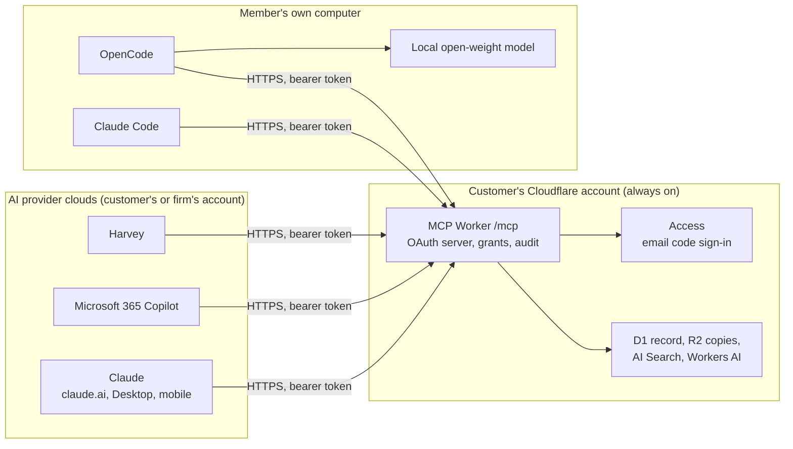
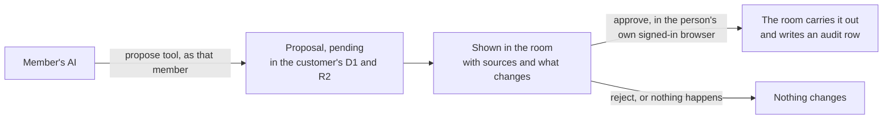
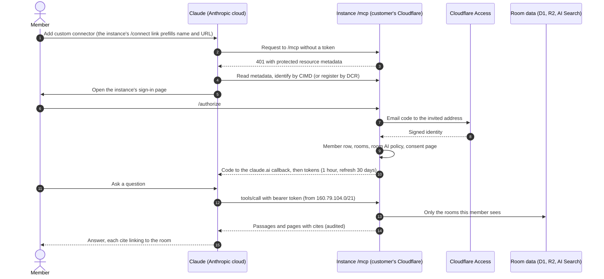
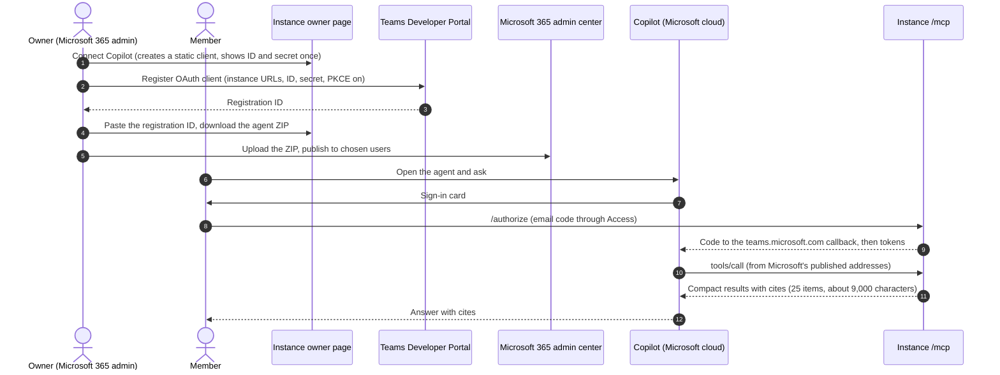
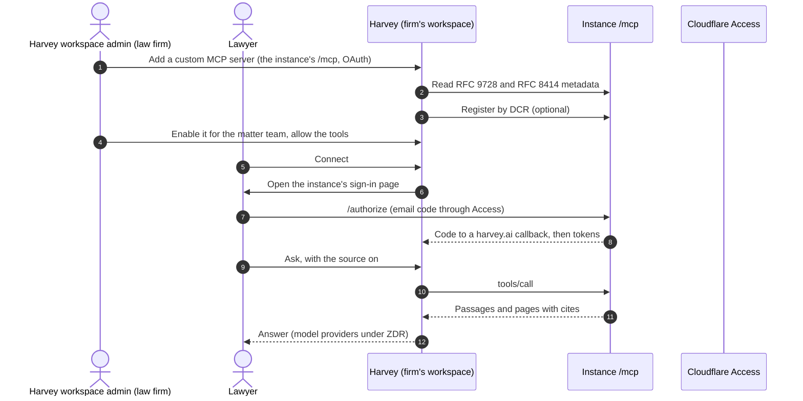
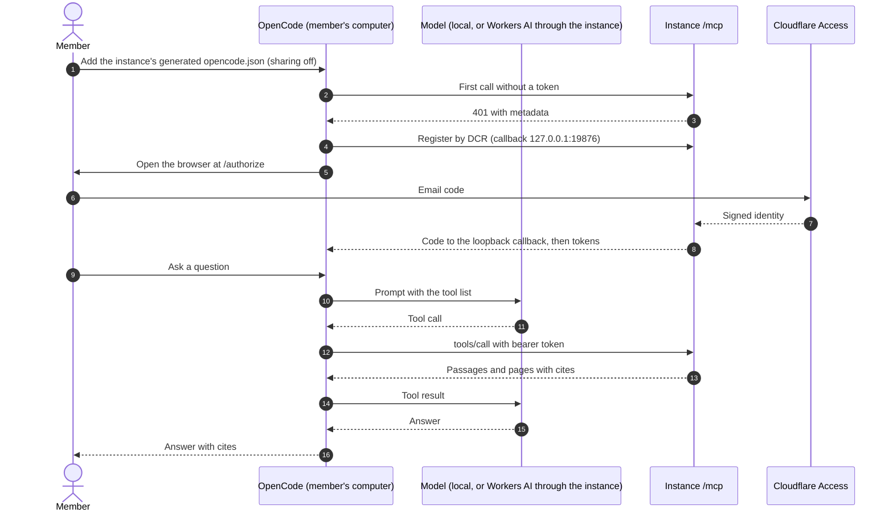
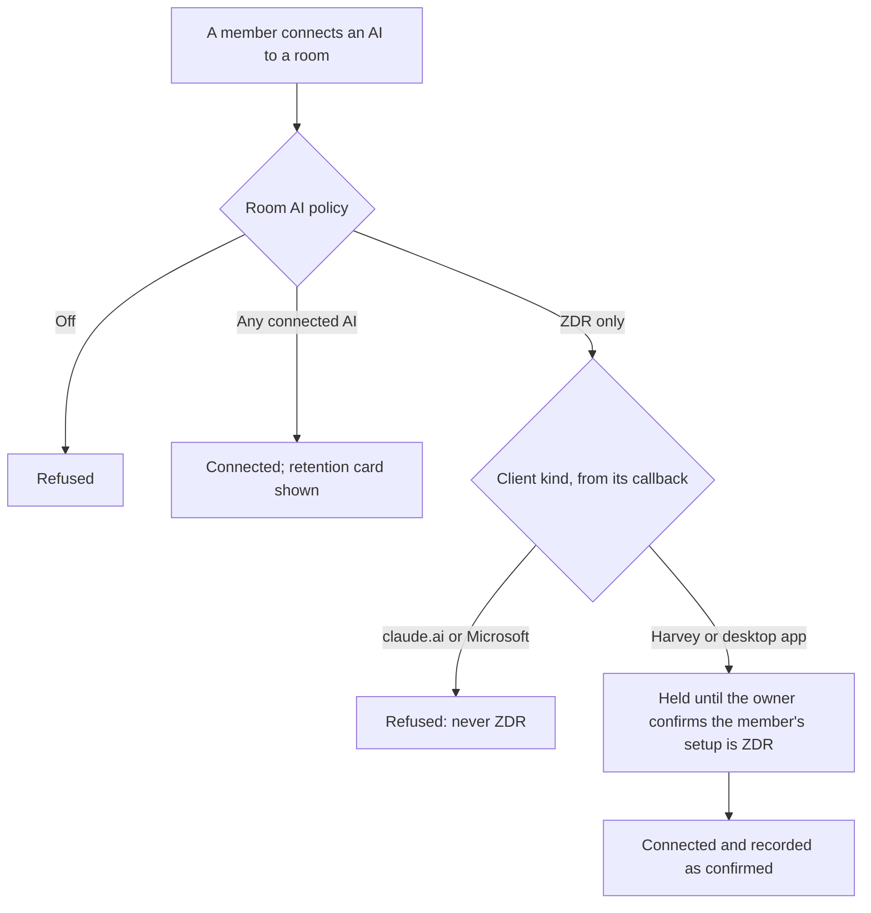
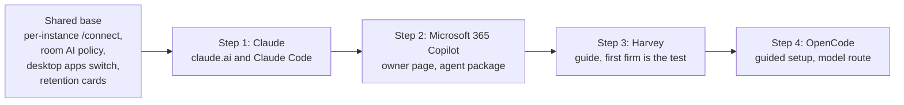

# AI connectors: the customer's own AI, connected to its Legallas instance

Status: design, 2026-10-31; "Ask's own model" added 2026-11-01. Docs only; nothing here changes code, accounts or settings. It expands the "AI" section of
[the product doc](../product.md).

- **Sources:** every vendor fact links to the vendor's own page, all read on 2026-10-31. The [Sources](#sources)
  table gives each page's own date where it shows one. Facts about the existing connector come from the code now in
  `web/mcp/` and `web/connect/`.
- **Zero data retention (ZDR):** the bar a customer can set for a room. A third party that reads case files or customer documents
  may not keep them, neither for 30 days nor for compliance.
- **Closed models:** only Claude, Microsoft 365 Copilot and Harvey (the owner, 2026-10-31); any open-weight model is fine.
  See [Which AI may connect](#which-ai-may-connect).

## In one screen

| Order | Connector | Why this order | Can it meet the ZDR bar? |
|---|---|---|---|
| 1 | **Claude** (claude.ai, Desktop, mobile, Claude Code) | Works today against the same server; what most founders and firms already pay for; small effort | Only through **Claude Code** under a ZDR arrangement (Enterprise, or an API agreement). No claude.ai plan is eligible |
| 2 | **Microsoft 365 Copilot** | The Windows and Microsoft 365 founders; the agent package builder exists; each customer registers its own sign-in | **No.** Copilot keeps prompts and answers in the user's mailbox until a retention policy deletes them |
| 3 | **Harvey** | For the founder's law firm; works through Harvey's "Bring Your Own MCP"; cannot be tested without a firm's workspace | **Partly.** Harvey's model providers are ZDR; Harvey itself keeps data for the period the firm sets |
| 4 | **Open-weight models**, through OpenCode, OpenRouter or another host | Later in 1.x; needs a guided setup for founders | **Yes**, with a local model, Workers AI in the customer's own Cloudflare, or a ZDR host such as Groq. OpenRouter only with its ZDR routing on and the providers pinned ([Ask's own model](#asks-own-model)) |

Before any connector, built-in Ask works out of the box on gpt-oss-120b in the customer's own Workers AI: "a simple
assister". "the heavy question and driving comes from the users OWN account", through a connector below. A customer can
also point Ask itself at an open-weight model on a host it chooses, off by default ([Ask's own model](#asks-own-model)).

Four design points carry every connector:

1. **One server.** Every AI reaches the instance's existing remote MCP connector; no connector needs its own backend.
2. **A per-room AI policy** (Decision 2): off, ZDR only, or any connected AI. A ZDR-only room refuses the AI kinds
   that can never qualify and holds the rest until the owner confirms them.
3. **A desktop apps switch** (Decision 4): Claude Code and OpenCode sign in through a loopback callback, which stays
   off until the owner turns it on.
4. **Propose and approve** ([below](#propose-and-approve)): an AI does as much of the work as it can, and a person approves
   the major steps in the room. No tool can approve.

## Which AI may connect

The owner's rule (2026-10-31): "The only closed models we can use are Claude, Copilot, and Harvey." Any open-weight model is
fine, whoever made it. The rule decides which models; the ZDR bar and the room AI policy (Decision 2) still decide
where each one may read.

| AI | Allowed? | How |
|---|---|---|
| Claude (claude.ai, Desktop, mobile, Claude Code) | Yes, closed | Section 1 |
| Microsoft 365 Copilot | Yes, closed | Section 2 |
| Harvey | Yes, closed | Section 3 |
| Open-weight models from any maker: OpenAI's gpt-oss, Google's Gemma, xAI's open weights, Meta's Llama and others | Yes | OpenCode (section 4) with a local model, Workers AI in the customer's own Cloudflare, or a ZDR host such as Groq, where every customer can turn ZDR on in its Data Controls [G1]. Built-in Ask on any OpenAI-compatible host, OpenRouter included, once its ZDR is confirmed and its providers pinned ([Ask's own model](#asks-own-model)) |
| Google Gemini: Gemini Enterprise, the Gemini app, the Gemini API | No | Gemini Enterprise's callback left the allowlist on 2026-10-31 (the closed-models rule) |
| ChatGPT and the OpenAI API | No | |
| xAI Grok: the app and the Grok API | No | |

A hosted open-weight model also follows the rule against providers run by a Chinese company or hosted in China
(section 4); Chinese open-weight models are fine on other hosts. OpenCode's Zen and Go gateways route to closed models
too (OpenAI's among them), so a generated config names an allowed model, never a gateway's default.

## What already exists (`web/mcp/`)

The room's remote MCP connector already accepts Claude, Microsoft 365 Copilot and Harvey (the callback allowlist below).
So each connector below is mostly packaging, setup pages and docs on one server.

| Part | Today | Legallas changes |
|---|---|---|
| MCP Worker (`web/mcp/`) | Stateless Streamable HTTP endpoint at `/mcp` (MCP TypeScript SDK v2, protocol 2026-07-28 plus 2025-era clients) | One per instance, in the customer's Cloudflare, on the instance's hostname |
| OAuth server | `@cloudflare/workers-oauth-provider`: OAuth 2.1 with PKCE, RFC 8414 and RFC 9728 metadata, dynamic client registration (DCR, RFC 7591), Client ID Metadata Documents (CIMD), static clients made on an admin page | Unchanged |
| Sign-in | Cloudflare Access one-time PIN to the invited email, then a `members` row check | Unchanged; the row also carries room grants ([rooms and grants](rooms-and-grants.md)) |
| Grants | One read scope; access tokens last 1 hour; refresh tokens rotate and end 30 days after sign-in | A second scope for proposing ([Propose and approve](#propose-and-approve)); otherwise unchanged |
| Callback allowlist | Claude, Microsoft and Harvey callbacks only; Gemini Enterprise's left on 2026-10-31 (the closed-models rule). Loopback is off by default (a security review, 2026-10-02). A refused callback is held for the owner to allow with one click | A desktop apps switch per instance (Decision 4) |
| Client kinds and result profiles | The callback host picks a profile: `standard` for Claude and Harvey; `compact` (25 items, about 9,000 characters) for Microsoft and unknown | Also picks what a ZDR-only room accepts (Decision 2) |
| Tools | Nine read-only tools (`readOnlyHint: true`): search, overview, list and get documents, read pages, visuals, comments, original file (small images to Claude only), law library | Rooms-aware; propose tools added ([Propose and approve](#propose-and-approve)) |
| Tool names | A default prefix, renamed per room by `MCP_TOOL_PREFIX` | Each instance takes its prefix from its assistant's name |
| Guards on every call | Re-reads the member row, a burst limit (60 a minute), a daily cap, the privilege filter, an audit row with the app's name | Unchanged; grants limit results to the member's rooms |
| `/connect` pages | Public setup pages for each AI, a security brief, an IT email | Generated per instance with the instance's own URLs |
| Copilot agent package | Builds a declarative agent ZIP from a Teams Developer Portal registration ID | Built per customer from its own registration (Decision 3) |

## The shape every connector shares

| Rule | Why |
|---|---|
| The AI calls the instance, signed in as one member; the instance calls no outside AI | Colorado Startups is never in the path; the customer's or firm's own AI account does the reasoning |
| Each member signs in personally with the room's email code; no shared keys | Removing a member ends every connection at once |
| Read tools today. Propose tools are core: an AI prepares the work, and a person approves it in the room at major steps | Nothing an AI says changes the record by itself |
| A result carries only what that member sees; privileged folders only for owner and counsel | The privilege guard holds for AI reads too |
| Every tool call is audited with the app's name | The owner sees which documents went to which AI |
| `/mcp`, `/token`, `/register` and the metadata paths stay public (no Access in front); `/authorize` and admin pages sit behind Access | Provider clouds call `/mcp` server to server and cannot pass an interactive Access login |
| The instance's hostname answers HTTPS from the internet (`workers.dev` or a customer domain; plan's open question) | Claude, Copilot and Harvey call from their own clouds |
| Optional hardening, later: a WAF rule that lets `/mcp` through only from published provider ranges (Anthropic [A9], Microsoft [M6]) when desktop apps and Harvey are off | Harvey publishes no ranges, and desktop apps call from anywhere |

### What leaves the instance

| Leaves | To whom | Never leaves |
|---|---|---|
| Tool results: passages, page text, document facts, comment threads, cites and room links | The member's AI provider, or only the member's computer (OpenCode with a local model) | Original files to any app but Claude; download links; storage keys, hashes, other members' data |
| Small embedded images (PNG, JPEG, WebP up to about 75 KB) | Claude only | Images to Copilot, Harvey or OpenCode |
| OAuth tokens for this one member | The AI's connector store | The member's email code (typed only into Cloudflare Access) |
| Nothing about the member's questions except tool arguments (search terms, document IDs) | The questions stay with the AI provider | |

## Propose and approve

The owner's rule: "Legallas should do as much as it can obviously with approvals by the user at major steps." Today every MCP tool is
read-only (`readOnlyHint: true` in `web/mcp/contract.ts`, held by `web/mcp/server.test.ts`). The write path adds proposals, not
writes: an AI can prepare anything, and only a person in the room makes it real.

| Work | The AI can | Approval |
|---|---|---|
| Read what its member can see | Do it | None |
| Draft a document, fill in a template, match documents to checklist items, pull out key facts, draft questions for counsel | Propose it. It stays a draft, outside the record | A person, in the room |
| Send a document for signature through a service the customer already uses | Prepare the envelope | Each send |
| File with a government | Prepare the package. Very few filings have an official software route ([Can an app file it?](document-set-and-law.md#can-an-app-file-it)), so most end with a person pressing the button on the agency's site | Each filing |
| Invite someone, change a grant, add to a room | Suggest it in words | The owner, on the Share page, as with any share |
| Delete, hide, or change an audit row | Nothing | Not offered to an AI |

| Rule | Why |
|---|---|
| Approving is never an MCP tool. It's a same-origin write in the person's own Access session | An AI can't approve its own proposal, and a prompt injected through a document can't either |
| The member whose AI made the proposal approves it, if their role allows that action. Sending for signature, filing and sharing take the owner. The owner sees every proposal | "approvals by the user at major steps", with the owner as the only one who shares (the owner, 2026-11-01) |
| A second OAuth scope, `case.propose`, next to `case.read` | A connection stays read-only until its member consents to proposing |
| A proposal is made as one member, and can use only what that member can see and do | The privilege guard and grants hold for writes too |
| A proposal records the `sha256` of each document it was built from, and approval is refused if one has changed. Counsel uploads have no hash today, so intake stores one first | A person never approves a stale draft |
| Every proposal, approval and rejection is recorded in a new append-only table, without document text | The same "never text" rule as today's audit log. `audit_log` has an action CHECK, so adding to it means a rebuild |
| Once the room's AI policy (Decision 2) exists, it also limits which AI may propose | A ZDR-only room stays ZDR only |
| A page, form or filing the AI read is data, never an instruction | Some public pages carry text addressed to agents |

`SECURITY.md` holds this line. The server is read-only, with one exception: a tool may create a pending proposal. No MCP tool changes
the record or approves anything.

The first slice, new draft documents behind the room setting `PROPOSALS_ENABLED`, is designed in
[Propose and approve](propose-and-approve.md).

## Comparison matrix

| | Claude (claude.ai, Desktop, mobile) | Claude Code | Microsoft 365 Copilot | Harvey | OpenCode |
|---|---|---|---|---|---|
| **For** | Founders and firms | ZDR setups; technical members | Founders and firms on Microsoft 365 | The founder's law firm | Later: founders who want models they control |
| **Where calls come from** | Anthropic's cloud, `160.79.104.0/21` [A6] [A9] | The member's computer [A6] | Microsoft's cloud, published fixed addresses [M6] | Harvey's cloud, on Azure [H1] [H5] | The member's computer |
| **Customer setup** | Member adds the link; on Team and Enterprise an Owner adds it first [A1] | One command, `claude mcp add --transport http` [A4] | Admin registers a sign-in client, uploads the agent ZIP [M4] [M8] | Harvey admin adds a custom MCP server [H1] | Install OpenCode and a local model, paste the instance's config [O3] [O5] |
| **Sign-in** | OAuth 2.1, PKCE; CIMD or DCR [A5] | OAuth, loopback callback, CIMD [A4] [A5] | OAuth through a Teams Developer Portal registration; DCR only through Agents Toolkit, with a client secret [M3] [M5] | OAuth 2.1, PKCE; DCR optional [H1] | OAuth, DCR, loopback `127.0.0.1:19876` [O3] [O4] |
| **Instance changes** | None | Desktop apps switch | Owner's "Connect Copilot" page (exists for firms today) | None | Desktop apps switch; a model route for the hosted option |
| **What leaves** | Tool results to Anthropic | Tool results to Anthropic, for inference | Compact tool results to Microsoft | Tool results to Harvey | Nothing (local model), or prompts to Workers AI in the customer's own account |
| **Provider keeps** | 30 days to 5 years; Enterprise indefinitely by default [A10] [A11] [A13] | Nothing under ZDR [A16]; otherwise as for its plan or API key | Prompts and answers in the user's mailbox until deleted [M22] [M23] | What the firm's retention policy says [H5] [H6] | Nothing (local), or nothing after processing (Workers AI) [C1] |
| **ZDR** | No, any plan [A14] | Yes: Enterprise through the account team, or an API agreement [A15] [A16] | No | Model providers only [H5] | Yes |
| **Customer cost (USD)** | $0 to $200 a month; Team $20 to $25 a seat [A18] | Enterprise from $20 a seat, 20 seats, plus usage [A18] | $21 a user a month (Business), or $30 (Microsoft 365 Copilot) [M17] [M18] | Not public; the firm's contract [H9] | Free app; Workers AI 10,000 neurons a day free [O2] [C3] |
| **Build effort** | Small | Small | Medium | Small (testing is the hard part) | Medium |
| **Order** | 1 | 1 | 2 | 3 | 4 |

Effort: small is up to about two days of work, medium up to about a week.

## 1. Claude

### How it connects

| Surface | Who adds the connector | Where tool calls come from | Sign-in |
|---|---|---|---|
| claude.ai, Claude Desktop, Cowork, mobile (custom connector) | Free, Pro, Max, Ultra: the member. Team: an Owner or Primary Owner. Enterprise: an Owner, or a custom role with "Manage access to Libraries" [A1]. Members then connect with their own account [A2]. Adding one on mobile is in beta [A3] | Anthropic's infrastructure [A6], from `160.79.104.0/21`, discovery included [A9] | OAuth with PKCE S256. Claude uses its published identity (CIMD) when the metadata advertises it and `none` as a token auth method; otherwise DCR, or a client ID the member types [A5] [A2]. Callback `https://claude.ai/api/mcp/auth_callback` [A5] |
| Claude Code, server added on the computer (`claude mcp add --transport http <name> <url>`) | The member [A4] | The member's own computer [A6] | `/mcp` opens the browser sign-in; loopback callback `http://localhost:PORT/callback` on a random port; Claude Code's CIMD declares `localhost` and `127.0.0.1` [A4] [A5] |
| Claude Code, using connectors added on claude.ai | Inherited from claude.ai, on by default | Anthropic's proxy, `mcp-proxy.anthropic.com`; off with `disableClaudeAiConnectors` or `ENABLE_CLAUDEAI_MCP_SERVERS=false` [A7] | The claude.ai grant |

Anthropic follows the MCP authorization specifications of 2025-03-26, 2025-06-18 and 2025-11-25, prefers Streamable
HTTP, and caps a tool result at about 150,000 characters and 240 seconds on claude.ai and Desktop [A8]. Claude Code
caps MCP output at 25,000 tokens by default (`MAX_MCP_OUTPUT_TOKENS`) [A4].

Claude Code with a server added on the computer follows the same steps, except that the browser returns the code to
`http://localhost:PORT/callback` and every call comes from the member's computer.

### Anthropic's legal plugins

| Plugin | Skills | Room tools they read | Who |
|---|---|---|---|
| `litigation-legal` | `chronology`, `claim-chart`, `privilege-log-review`, `legal-hold` | `legallas_case_overview`, `legallas_list_documents`, `legallas_search`, `legallas_read_pages` | Counsel, founders |
| `corporate-legal` | `diligence-issue-extraction`, `closing-checklist`, `tabular-review` | The 6 guest tools; the room is the data room in place of Box, Intralinks or Datasite | Investors, founders |

No new tools. The member names the room as the plugin's document source. Skill by skill:
[`web/connect/claude-ai.md`](../../web/connect/claude-ai.md#anthropics-legal-plugins-reading-the-room). Checked on the
fictional room by `fixture-room.yml` with `roles` (`web/scripts/kit-run.ts`).

### Retention and ZDR, per plan

| Plan | Retention of chats, including what tools returned into them | ZDR available? | Meets the bar? |
|---|---|---|---|
| Free, Pro, Max, Ultra with "help improve Claude" on | Up to 5 years, de-identified [A10] | No | No |
| Free, Pro, Max, Ultra with it off | 30 days [A11] | No | No |
| Team | Kept in the product for a consistent experience [A12] | No: Team and Enterprise interfaces "are not ZDR-eligible" [A14] | No |
| Enterprise, claude.ai and Desktop chat | Indefinitely by default; a custom period of at least 30 days [A13] | No [A14] | No |
| Enterprise, Claude Code with ZDR switched on by Anthropic's account team | Inference not kept. Cloud sessions, Remote Control, Artifacts and `/feedback` are switched off [A16] | Yes, per organization, not in the standard plan [A15] [A16] | Yes, when the server is added in Claude Code itself (not through claude.ai connectors) and no Covered Model is used |
| Commercial API key (Claude Code on an API key, or a client the customer builds) | Deleted within 30 days [A12] | Yes, by agreement [A15]. The API's own MCP connector feature is not eligible [A17] | Only under a ZDR agreement, with a client that calls MCP itself |

Caveats, even under ZDR:

- **Covered Models** (Fable 5 and 5.1, Mythos 5 and 5.1) need 30-day retention and are not offered under ZDR unless
  Anthropic allows it [A14].
- **Flagged content:** Anthropic may keep inputs and outputs flagged by its trust and safety systems for up to 2 years,
  and classifier scores for up to 7 years [A10] [A14].
- **Third-party servers:** Anthropic's ZDR does not cover data processed by MCP servers [A16]. Here the server is the
  customer's own instance, so nothing new is exposed.
- **The proxy:** Anthropic does not say how traffic through `mcp-proxy.anthropic.com` is kept under ZDR, so the ZDR
  setup turns claude.ai connectors off in Claude Code.

### Cost to the customer

| Plan | Price (USD) [A18] | Custom connectors |
|---|---|---|
| Free | $0 | One [A1] |
| Pro | $20 a month, or $17 a month billed yearly ($200 up front) | Yes |
| Max | $100 a month | Yes |
| Ultra | $200 a month | Yes |
| Team | Standard seat $25 a month, or $20 billed yearly; premium seat $125, or $100; 2 to 150 seats | Owners add them |
| Enterprise | From $20 a seat a month billed yearly, 20 seats minimum, plus usage at API rates; larger deals through sales | Owners add them; Claude Code ZDR through the account team |
| API | Per million tokens: Sonnet 5.5 $2 in and $10 out; Opus 5.5 $4 and $20 [A19] | Claude Code on an API key |

### Build effort: small

| Task | Size |
|---|---|
| Per-instance `/connect` page with the "Add to Claude" prefill links [A20]: one for members, one (`admin-settings`) for Team and Enterprise Owners | Small: the page exists; it takes the instance's URLs and name |
| Desktop apps switch: loopback callbacks on any port, off by default (Decision 4) | Small: the allowlist already matches loopback entries |
| Claude Code guide with the ZDR setup: add the server locally, `disableClaudeAiConnectors`, no Covered Models | Small: docs |
| Check the `standard` profile against Claude's 150,000-character and Claude Code's 25,000-token caps | Small: results run to about 130 KB with structured content |
| Connector eval on Colorado Startups' test instance with its own Claude test account (Decision 11) | Small |

**Directory listing:** a per-customer URL can be listed with a URL pattern, but only once the listing is Verified
[A20]. Custom connectors need no Anthropic review, so 1.0 uses them (Decision 6).

**Recommendation: first.** It works today and is what most founders and firms already pay for. The retention card
(Decision 9) says plainly that only Claude Code under a ZDR arrangement meets the bar.

## 2. Microsoft 365 Copilot

### Ways in, and the one to build

| Way in | How it works | Sign-in | Licence | Verdict |
|---|---|---|---|---|
| **Declarative agent with an MCP action** (the Legallas agent package) | Plugin manifest with a `RemoteMCPServer` runtime; tools found at run time or pinned in the package; Microsoft screens new or changed tools [M2]. Answers may get worse past 10 tools [M1]; the instance has nine | Entra SSO, DCR, OAuth authorization code or none; no API key [M3]. Static OAuth uses a Teams Developer Portal registration and the callback `https://teams.microsoft.com/api/platform/v1.0/oAuthRedirect` [M4]; the manifest names it by `reference_id` [M5] | Copilot licence, or pay-as-you-go (see Cost) | **Build first** (Pro): tested end to end on 2026-10-21 |
| **Federated connector** ("Connect to MCP server" in the admin center) | Copilot asks the server live as the signed-in user; nothing is indexed [M13]. Generally available [M29] | Entra SSO, OAuth through a Developer Portal registration ID, or none; no DCR. Global or AI Administrator sets it up [M14] | Microsoft 365 Copilot (or E7) for every user; Copilot Studio licences and pay-as-you-go do not count [M15] | **Document as the alternative** for tenants that already pay for Copilot |
| Copilot Studio agent | The MCP wizard makes a Power Platform custom connector; connector data policies apply; tools and resources, no prompts; Streamable HTTP only [M11] [M12] | None, API key, or OAuth (dynamic discovery, dynamic, or manual) [M11] | Copilot Studio for the maker | **Not recommended:** transcripts stored by default (Retention) |
| Synced Copilot connector (formerly Graph connector) | Crawls a copy of the content into the tenant's Microsoft Graph index [M16] | Graph connectors API | Copilot licence for Copilot grounding [M15] | **Rejected:** copies documents out of the instance and bypasses its grants and privilege guard |

DCR for the agent is possible but not yet practical. Microsoft requires the server to issue a client secret at
registration, the Developer Portal does not support DCR, and the agent's auth config has to come from Agents Toolkit, a
developer tool [M5]. So 1.0 uses a static client per customer, the path the admin page already supports.

A law firm does the same in its own tenant, with its own registration.

### Retention and ZDR

| Form | What Microsoft keeps | ZDR? | Meets the bar? |
|---|---|---|---|
| Microsoft 365 Copilot (agent or federated connector) | Each prompt and answer, with citations, as activity history in a hidden folder of the user's mailbox, under the customer's contract; not used to train models [M22] [M23]. Deleted by the user, or by a Purview policy; a "delete after 1 day" policy can take about 16 days to purge, and any hold stops deletion [M23]. Audit records keep metadata, including the plugin's name [M24]. No abuse-monitoring copy or human review [M22] | None found | No: kept for the customer's compliance tools until deleted. Microsoft documents no default expiry |
| Copilot Studio agent | Transcripts in Dataverse by default, removed after 30 days by a bulk-delete job that can be changed or turned off; session data up to 28 days in Copilot Studio's own storage regardless [M26] | No | No |
| Anthropic models inside Copilot | A Microsoft subprocessor under Microsoft's terms; on by default outside the EU, EFTA and UK. "Anthropic models with Data Retention" are off by default and keep most data up to 30 days [M27] | No | No |

Enterprise Data Protection applies (Microsoft as processor, the Data Protection Addendum, the EU Data Boundary except
web search and Anthropic models) [M25].

### Cost to the customer

| Licence | Price (USD) | Enough for the Legallas agent? |
|---|---|---|
| Microsoft 365 Copilot | $30 a user a month, billed yearly [M17] | Yes |
| Microsoft 365 Copilot Business (up to 300 users) | $21 a user a month billed yearly ($18 in the first year until 2026-12-31); $25.20 billed monthly [M18] [M19] | Yes |
| Copilot Chat only (included in Microsoft 365) | $0; agents grounded in instructions or public websites cost nothing more, tenant data is metered [M10]; pay-as-you-go messages at $0.01 [M20] | **Microsoft's pages disagree.** The extensibility table lists custom actions for Copilot Chat without usage billing [M7]; the Copilot overview says other agents are "pay-as-you-go only" [M9]. A test on 2026-10-21: with Copilot Chat alone the agent was listed but never called the server. Budget a Copilot licence or pay-as-you-go, and retest |
| Copilot Studio | $200 a month for 25,000 credits, or $0.01 a credit [M21]; no charge for Copilot-licensed users working as themselves [M28] | Not needed |

### Build effort: medium

| Task | Size |
|---|---|
| Owner page "Connect Microsoft 365 Copilot": creates the static client, shows the ten Developer Portal values to copy, takes the registration ID back | Small: static clients and the registration ID form exist |
| Agent package per instance: the instance's name, assistant name, icons and instructions, tools pinned from its own `tools/list` | Small to medium: builder and validator exist; the identity becomes configurable (Pro) |
| Federated connector guide | Small |
| Test tenant with a Copilot licence: settle the licence question, check the published addresses (Decision 11) | Small |
| DCR through Agents Toolkit | Later, if Microsoft adds it to the Developer Portal |

Government clouds (GCC, GCC High, DoD) stay unsupported: research for this design found no authenticated agent
actions there.

**Recommendation: second.** It reaches the Windows and Microsoft 365 founders Legallas targets. The retention card says
Copilot is never ZDR, so ZDR-only rooms refuse it (Decision 2).

## 3. Harvey

### What Harvey offers

| Option | What it is | Fit for Legallas |
|---|---|---|
| **Bring Your Own MCP** | A workspace administrator enables a custom MCP server; each user then completes OAuth for their own account; Harvey makes no MCP calls for users who have not signed in [H1] | **The path.** Works with the instance as it is |
| Connector Library (partner program) | Partner connectors that Harvey reviews tool by tool, pinning each tool's description and schema [H7] [H8]. Harvey recommends a security review before connecting a server the firm did not build [H1] | Later: apply when firms ask (Decision 7) |
| **Harvey API** (plainly: yes, documented) | A documented API, readable without signing in: Completion, Vault, history and audit exports, client matters, intake, and a Harvey MCP server [H4]. Tokens come from the workspace's settings, for the features the firm's Order Form allows [H2] [H3] | Not used: the instance would call Harvey with a firm's token, against "the AI calls the instance" |

Harvey's requirements for a server [H1]: OAuth 2.1 with PKCE S256, RFC 8414 and RFC 9728 metadata, HTTPS, DCR optional,
following the MCP authorization specification of 2025-11-25. Harvey's engineering blog adds that it also meets servers
that accept only a client Harvey pre-registers [H7]. The instance offers all of these. Harvey's callback URL is not
on a public page, so the instance keeps its existing allowlist entry for `harvey.ai` and its subdomains.

### Retention and ZDR

| Who | What is kept | Meets the bar? |
|---|---|---|
| Harvey's model providers | Harvey requires ZDR from them and forbids training on customer data [H5]; they delete request data once the request completes [H6] | Yes |
| Harvey itself | Hosted on Azure, in the US, EU and Switzerland, or Australia. The firm decides what to upload and how long it is kept, and can delete at any time [H5]. Retention can run from upload or from last use [H6]. How long chats keep tool results, and any minimum, are not public | Only if the firm's retention policy deletes promptly; ask the firm |

### Cost and build effort

- **Cost:** Harvey sells to firms through sales; there is no public price. Its mid-sized firm offering targets firms of
  about 15 to 150 lawyers [H9]. The firm pays, never the founder.
- **Build effort: small.** The Harvey guide (`web/connect/harvey.md`) works for any instance once its URLs are generated. The
  hard part is testing: Colorado Startups cannot buy a Harvey workspace for evals, so the first firm that connects is
  the live test (Decision 11).

**Recommendation: third.** Support it in the 1.0 docs as "for your law firm". Seek Harvey's partner review when firms
ask (Decision 7).

## 4. OpenCode with open-weight models

### How it connects

OpenCode is an open-source (MIT) AI agent from Anomaly, with a terminal UI, a desktop app in beta and an IDE extension
[O1] [O2]. It speaks remote MCP with OAuth:

| Part | Detail |
|---|---|
| Config | `opencode.json`, under `mcp.<name>`: `"type": "remote"`, `"url"`, optional `headers`, `oauth`, `enabled` [O3] |
| Sign-in | On a 401 it starts OAuth, registering by DCR when no client ID is set; `opencode mcp auth <name>` starts it by hand; tokens are kept in `~/.local/share/opencode/mcp-auth.json` [O3] |
| Callback | `http://127.0.0.1:19876/mcp/oauth/callback` by default [O4]. Needs the desktop apps switch (Decision 4) |
| Local models | Any OpenAI-compatible server: LM Studio (`http://127.0.0.1:1234/v1`), Ollama, llama.cpp [O5] |
| Hosted models | Any provider, added with `/connect` [O5]; OpenCode's own Zen and Go gateways [O6] [O7]. Under the closed-models rule, only open-weight models or Claude |

The hardware floor for local models is 16 GB of RAM, or 8 GB of video memory on Windows.

### What leaves the computer, and retention

| Model path | What leaves | Retention | Meets the bar? |
|---|---|---|---|
| **Local** (LM Studio, Ollama, llama.cpp) | Only the MCP calls to the instance | None outside the computer | Yes |
| **Workers AI in the customer's own Cloudflare** | Prompts to Cloudflare, in the account that already holds the documents | Cloudflare does not train on Workers AI content and keeps no inputs or outputs after processing, for standard inference [C1]. AI Gateway logging is on by default and must be off [C2] [C7] | Yes, with logging off and Cloudflare-hosted models only |
| **Groq, with ZDR on** | Prompts to Groq | With ZDR on in its Data Controls, Groq keeps no inputs or outputs, not even for reliability or abuse monitoring, and turns batch and fine-tuning off. Without it, Groq may log inputs and outputs for up to 30 days [G1] | Yes, with ZDR on and an open-weight model |
| OpenCode Zen or Go | Prompts to OpenCode's gateway and its providers | Mostly zero retention, but some routes keep 30 days (OpenAI and Anthropic among them), and some free models train on data [O6] [O7] | Only model by model, and only open-weight models or Claude; not recommended |

OpenCode defaults the generated config changes [O4] [O8] [O9] [O10]:

| Default | Risk | Generated config |
|---|---|---|
| `share: "manual"`: `/share` uploads a whole session to a public link | A member shares a chat full of document text | `"share": "disabled"` |
| Model list fetched from `models.opencode.ai` | No document data; a call home | `OPENCODE_DISABLE_MODELS_FETCH` in the guided setup |
| Update check (`autoupdate`) | No document data | Left on, so security fixes arrive |
| Telemetry | Not documented either way | Recheck at each OpenCode release |

**The hosted option, designed:** OpenCode calls an OpenAI-compatible route on the instance itself, not Cloudflare's
API with a member-held token. The route takes the member's OAuth token and forwards to Workers AI, whose API is
OpenAI-compatible [C4]. The spend guard and the audit then cover model calls too, and no Cloudflare API token sits on a
laptop (Decision 8). Tool-calling, Cloudflare-hosted open-weight models include `@cf/openai/gpt-oss-120b`,
`@cf/meta/llama-4-scout-17b-16e-instruct`, `@cf/moonshotai/kimi-k2.6` and `@cf/zai-org/glm-4.7-flash` [C5] [C6]
[C8] [C9]. All four are hosted by Cloudflare, so they pass the rule against Chinese-run hosted providers.

### Cost and build effort

- **Cost:** OpenCode is free [O2]. A local model costs only the hardware. Workers AI gives 10,000 neurons a day free,
  then $0.011 per 1,000 neurons, on the Workers Paid plan the room already needs [C3].
- **Build effort: medium.**

| Task | Size |
|---|---|
| Desktop apps switch (shared with Claude Code) | Small |
| `/connect` generates the member's `opencode.json`: the remote server with OAuth, sharing off, a local model block | Small |
| Guided setup for founders: OpenCode's desktop app, LM Studio, the config | Medium |
| Instance model route to Workers AI, under the member's token, the spend guard and the audit | Medium |
| Tool-calling evals of open-weight models on Colorado Startups' cloud lanes | Medium |

**Recommendation: fourth, later in 1.x.** It is the only path where a founder alone can meet the
ZDR bar without an enterprise agreement.

## Ask's own model

Built-in Ask is not a connector: the room itself calls a model with the passages it retrieved. Three backends, all in
`web/worker/` (code since 2026-11-01):

| Backend | When it answers | Room config | ZDR |
|---|---|---|---|
| **Workers AI**, gpt-oss-120b (`LEGALLAS_MODEL`) | By default, with no other account or key | Nothing to set | Yes: no training, nothing kept after processing [C1]; Ask calls it with no AI Gateway |
| **Groq**, `openai/gpt-oss-120b` | Only after the day's Workers AI neurons are spent | `ASK_GROQ`, secret `LEGALLAS_ASK_GROQ_API_KEY` | With ZDR on in its Data Controls [G1] |
| **The room's own host**: any open-weight model behind an OpenAI-compatible API, such as OpenRouter | Every question, instead of Workers AI, once its gate is open | `ASK_HOST` (`url`, `model`, optional `body`), secret `LEGALLAS_ASK_HOST_API_KEY` | Only as the host and its providers allow; the owner checks (`web/ASK-MODEL.md`) |

**One gate** (`ask-gate.ts`) holds both outside backends closed until every condition is met: `enabled`; `zdr_confirmed`,
the owner's word after reading the host's own data page; passing replica eval runs on that backend named in
`eval_runs`; for a host, an https URL and a model name; the key as a Worker secret; and a request that is not local
development. Closed, Ask answers on Workers AI exactly as before: the request, the prompt and the MCP tool list are byte
for byte the same, and nothing is logged while a backend is simply off. Turned on but closed, the Worker logs
`ask_host_closed` with the reason.

**Groq is a case of the host engine.** Both share one client (`ask-chat.ts`: one streamed call, no retry, errors carry the
status only) and the gate. What stays Groq's own is its fixed URL and model, its free plan's minute (the turn is trimmed
to it), its request body and its timing. Its gate checks the same conditions in the same order, so it is as strict as
before, and its request bytes and error words did not change.

**When the host fails** (a 429 or 402 included), Ask answers `model_unavailable` and gives the question back. It never
answers on Workers AI or Groq instead: the room chose that host, and a quiet switch would hide a broken setup. Groq is not
used while the host is on.

**OpenRouter** routes each request to one of many providers, each with its own data policy:

| Layer | What it keeps | What Legallas does |
|---|---|---|
| OpenRouter itself | No prompts unless the account opts in: input and output logging is off by default, and so is the option to let OpenRouter use prompts for a discount [OR1] [OR2]. One exception, ZDR traffic included: every request is screened for child sexual abuse material in flight, and content flagged as potential CSAM may be kept for human review, reporting and preservation the law requires; not for general retention or training (planned from 2026-10-27) [OR5] | `web/ASK-MODEL.md` tells the owner to leave both off and to weigh the exception |
| Its providers | Each provider's own policy. OpenRouter can enforce ZDR for the whole account, per model group or per request; `provider.zdr: true` routes only to endpoints with a ZDR policy, and `provider.data_collection: "deny"` leaves out providers that keep or train on data (default `"allow"`) [OR1] [OR3] [OR4] | On `openrouter.ai`, every request carries both, whatever `ASK_HOST.body` says. With no allowed endpoint, OpenRouter refuses and Ask says the model is unavailable |
| Which providers | `provider.only` lists the allowed providers; `allow_fallbacks: false` stops it reaching any other [OR3] | The owner pins the providers it checked in `ASK_HOST.body.provider`, leaving out any run by a Chinese company or hosted in China |

OpenRouter's ZDR covers provider inference; logging, tools and plugins have their own settings [OR4]. It is not absolute:
flagged content is the exception above [OR5], and each ZDR endpoint lists its provider's "Safety Retention" [OR1].

**The release gate.** `npm run eval:ask-replica -- --provider host` runs the replica on the host `ASK_HOST` describes, with
the whole turn as the room sends it; it refuses unless `zdr_confirmed` is set and the key is in `REPLICA_EVAL_HOST_API_KEY`.
The Replica eval workflow does not offer the host yet: that needs a new secret on the workflow (Decision 13), so until
then no host can earn `eval_runs`, and every room stays on Workers AI.

**Cost.** The host bills the customer per token. Legallas's spend guard covers Workers AI only; the daily question cap
per member still applies, and `web/ASK-MODEL.md` asks for a credit limit on the key.

## Which setups meet the ZDR bar

| Setup | Meets it? | Conditions |
|---|---|---|
| OpenCode with a local model | Yes | Sharing off |
| OpenCode with Workers AI through the instance | Yes | AI Gateway logging off; Cloudflare-hosted models |
| OpenCode with an open-weight model on Groq | Yes | ZDR on in Groq's Data Controls [G1] |
| Claude Code on Enterprise with Anthropic's ZDR | Yes | Server added in Claude Code; claude.ai connectors off; no Covered Models; flagged content may still be kept |
| Claude Code, or the customer's own client, on an API key with a ZDR agreement | Yes | The client calls MCP itself, not through the API's MCP connector feature |
| Harvey | Partly | Model providers are ZDR; Harvey keeps data for the firm's retention period |
| Claude on claude.ai, Desktop or mobile, any plan | No | |
| Microsoft 365 Copilot, any form | No | |
| OpenCode Zen or Go | Model by model | |
| Built-in Ask on Workers AI (the default) | Yes | No AI Gateway [C1] |
| Built-in Ask on Groq | Yes | ZDR on in Groq's Data Controls [G1] |
| Built-in Ask on the room's own host | Only as the host allows | The owner confirms the host and every provider it routes to keep nothing; on OpenRouter, Legallas forces ZDR routing and the owner pins checked providers with no Safety Retention. OpenRouter itself may keep content flagged as potential CSAM [OR1] [OR3] [OR5] |

How the room enforces it (Decision 2):

## Build order

| Step | Done when |
|---|---|
| Propose and approve | On a fixture room, an AI connected through the room's server proposes a comment on a document, and only a person's approval in the room posts it |
| Shared base | A fixture instance serves `/connect` with its own URLs; the room AI policy and the desktop apps switch work; each AI's retention card cites this doc |
| 1. Claude | A Colorado Startups Claude test account connects through claude.ai and through Claude Code and gets cited answers from the fixture |
| 2. Copilot | A test tenant uploads the instance-built agent and gets cited answers; the licence question is settled |
| 3. Harvey | The guide is generated per instance; the first firm's connection is recorded as the live test |
| 4. OpenCode | A member on Mac and on Windows follows the guided setup to a cited answer from a local model and from Workers AI |

## Decisions

The work proceeds on each recommendation; the owner can change any of them.

| # | Decision | Kind | Recommendation | Alternative |
|---|---|---|---|---|
| 1 | Build order | Product | Claude (with Claude Code), then Copilot, then Harvey, then OpenCode | Copilot first, for Windows founders |
| 2 | Room AI policy and its defaults | Major privacy | Every room has an AI policy: off, ZDR only, or any connected AI. Case rooms and privileged folders default to ZDR only; the company room defaults to any connected AI, with the retention card | ZDR only everywhere by default, which blocks claude.ai and Copilot until the owner opts in |
| 3 | Copilot sign-in | Major security | Each customer, and each firm, registers its own client in its own tenant; Colorado Startups keeps no shared registration, because that would hold sign-in secrets for every customer | One shared Colorado Startups registration (simpler setup; breaks "never hosts anything") |
| 4 | Desktop apps (loopback callbacks) | Major security | A per-instance switch, off by default; the owner turns it on for Claude Code and OpenCode | Always on (any program on a member's computer could then start a sign-in) |
| 5 | Copilot form | Product | The declarative agent package, with the federated connector as the documented alternative; no Copilot Studio or synced connectors | Federated connector only (no package to maintain; needs a Copilot licence for every user) |
| 6 | Claude directory | Product | Custom connectors in 1.0; apply for a Verified URL-pattern listing after launch | Apply before launch |
| 7 | Harvey | Product | Supported through Bring Your Own MCP in the 1.0 docs; seek Harvey's partner review when the first firm asks | Seek partner review before launch |
| 12 | Write path | Product, decided by the owner (2026-11-01) | Propose and approve, as above | None: the owner's rule |
| 8 | OpenCode hosted models | Product and security | Through a model route on the instance (Workers AI, Cloudflare-hosted models, spend guard, audit); LM Studio as the default local runner | Members use their own provider keys |
| 9 | Retention card | Product | Shown when an AI connects and on `/connect`, built from this doc's tables, rechecked each release | Docs only |
| 10 | Closed models | Product, decided by the owner (2026-10-31) | Only Claude, Microsoft 365 Copilot and Harvey; any open-weight model is fine. Gemini Enterprise's code path goes (its callback left the allowlist on 2026-10-31); ChatGPT, the OpenAI API and the xAI Grok API are out ([Which AI may connect](#which-ai-may-connect)) | None: the owner's rule |
| 13 | Replica eval lane for a room's own host | Major security | Add `host` to `replica-eval.yml`'s providers, with a `REPLICA_EVAL_HOST_API_KEY` secret on the `replica-eval` environment, passed only to the replica step on host runs (as Groq's key is). Until then no host can pass the release gate | Rooms run the host replica outside CI (against "evals run in CI") |
| 11 | Test accounts for connector evals | Billing | Colorado Startups buys one Claude Pro account ($20 a month) and one Microsoft 365 test tenant with one Copilot Business licence ($25.20 a month on an annual commitment [M18] [M19], plus a base plan), each within the $50-a-month cap per plan; Harvey is tested with the first firm | No paid test accounts; connectors tested only with customers |

## Sources

All read on 2026-10-31, except OR1 to OR5. OR1 to OR4 were read on 2026-11-01 through a web search of OpenRouter's own pages,
which did not load from the build machine, so they need a live read before a customer relies on them. OR1 and OR5 were
read again on 2026-11-06 through OpenRouter's documentation search; no lawyer has weighed them. "Page date" is
the date the page itself shows; a dash means it shows none.

| ID | Source | Page date |
|---|---|---|
| A1 | [Anthropic: Getting started with custom connectors using remote MCP](https://support.claude.com/en/articles/11175166-getting-started-with-custom-connectors-using-remote-mcp) | Updated 2026-10-30 |
| A2 | [Anthropic: Add a connector that isn't in the directory](https://claude.com/docs/connectors/custom/add-unlisted) | - |
| A3 | [Anthropic: Use connectors to extend Claude's capabilities](https://support.claude.com/en/articles/11176164-use-connectors-to-extend-claude-s-capabilities) | Updated 2026-10-30 |
| A4 | [Claude Code: Connect Claude Code to tools via MCP](https://code.claude.com/docs/en/mcp) | - |
| A5 | [Anthropic: Connector authentication](https://claude.com/docs/connectors/building/authentication) | - |
| A6 | [Anthropic: Lazy authentication](https://claude.com/docs/connectors/building/lazy-authentication) | - |
| A7 | [Claude Code: Network configuration](https://code.claude.com/docs/en/network-config) | - |
| A8 | [Anthropic: Building connectors](https://claude.com/docs/connectors/building) | - |
| A9 | [Claude API: IP addresses](https://platform.claude.com/docs/en/api/ip-addresses) | - |
| A10 | [Anthropic Privacy Center: How long do you store my data?](https://privacy.claude.com/en/articles/10023548-how-long-do-you-store-my-data) | 2026-07-01 |
| A11 | [Claude Code: Data usage](https://code.claude.com/docs/en/data-usage) | - |
| A12 | [Anthropic Privacy Center: How long do you store my organization's data?](https://privacy.claude.com/en/articles/7996866-how-long-do-you-store-my-organization-s-data) | 2026-07-01 |
| A13 | [Anthropic Privacy Center: Custom data retention controls for Enterprise plans](https://privacy.claude.com/en/articles/10440198-configure-custom-data-retention-controls-for-enterprise-plans) | Updated 2026-10-31 |
| A14 | [Claude API: API and data retention](https://platform.claude.com/docs/en/manage-claude/api-and-data-retention) | - |
| A15 | [Anthropic Privacy Center: Which products does a zero data retention agreement apply to?](https://privacy.claude.com/en/articles/8956058) | Updated before 2026-10-17 ("over 2 weeks ago") |
| A16 | [Claude Code: Zero data retention](https://code.claude.com/docs/en/zero-data-retention) | - |
| A17 | [Claude API: MCP connector](https://platform.claude.com/docs/en/agents-and-tools/mcp-connector) | - |
| A18 | [Claude pricing](https://claude.com/pricing) | - |
| A19 | [Claude API pricing](https://platform.claude.com/docs/en/about-claude/pricing) | - |
| A20 | [Anthropic: Directory connectors vs custom connectors](https://claude.com/docs/connectors/building/directory-vs-custom) | - |
| M1 | [Microsoft Learn: Plugins for declarative agents](https://learn.microsoft.com/en-us/microsoft-365/copilot/extensibility/overview-plugins) | 2026-10-28 |
| M2 | [Microsoft Learn: Dynamic tool discovery for MCP plugins](https://learn.microsoft.com/en-us/microsoft-365/copilot/extensibility/plugin-dynamic-tool-discovery) | 2026-10-28 |
| M3 | [Microsoft Learn: Plugin authentication](https://learn.microsoft.com/en-us/microsoft-365/copilot/extensibility/plugin-authentication) | 2026-10-28 |
| M4 | [Microsoft Learn: Build MCP plugins](https://learn.microsoft.com/en-us/microsoft-365/copilot/extensibility/build-mcp-plugins) | 2026-09-30 |
| M5 | [Microsoft Learn: Dynamic client registration for plugins](https://learn.microsoft.com/en-us/microsoft-365/copilot/extensibility/plugin-authentication-dynamic-client-registration) | 2026-08-28, updated 2026-08-31 |
| M6 | [Microsoft Learn: Federated connectors network requirements](https://learn.microsoft.com/en-us/microsoft-365/copilot/connectors/federated-connectors-network-requirements) | 2026-10-23 |
| M7 | [Microsoft Learn: Extensibility prerequisites](https://learn.microsoft.com/en-us/microsoft-365/copilot/extensibility/prerequisites) | 2026-09-30 |
| M8 | [Microsoft Learn: Publish plugins to your organization](https://learn.microsoft.com/en-us/microsoft-365/copilot/extensibility/publish-plugin-organization) | 2026-09-30 |
| M9 | [Microsoft Learn: Microsoft 365 Copilot overview](https://learn.microsoft.com/en-us/microsoft-365/copilot/copilot-overview) | 2026-10-28, updated 2026-10-31 |
| M10 | [Microsoft Learn: Cost considerations for extensibility](https://learn.microsoft.com/en-us/microsoft-365/copilot/extensibility/cost-considerations) | 2026-09-30 |
| M11 | [Microsoft Learn: Add an existing MCP server to an agent (Copilot Studio)](https://learn.microsoft.com/en-us/microsoft-copilot-studio/mcp-add-existing-server-to-agent) | 2026-05-28, updated 2026-10-15 |
| M12 | [Microsoft Learn: Extend your agent with MCP (Copilot Studio)](https://learn.microsoft.com/en-us/microsoft-copilot-studio/agent-extend-action-mcp) | 2026-08-26 |
| M13 | [Microsoft Learn: Federated connectors overview](https://learn.microsoft.com/en-us/microsoft-365/copilot/connectors/federated-connectors-overview) | 2026-10-19, updated 2026-10-28 |
| M14 | [Microsoft Learn: Set up custom federated connectors](https://learn.microsoft.com/en-us/microsoft-365/copilot/connectors/set-up-custom-federated-connectors) | 2026-10-19 |
| M15 | [Microsoft Learn: Copilot connectors prerequisites](https://learn.microsoft.com/en-us/microsoft-365/copilot/connectors/prerequisites) | 2026-06-01, updated 2026-09-25 |
| M16 | [Microsoft Learn: Copilot connectors overview](https://learn.microsoft.com/en-us/microsoft-365/copilot/connectors/overview) | 2026-10-06 |
| M17 | [Microsoft: Microsoft 365 Copilot enterprise pricing](https://www.microsoft.com/en-us/copilot/pricing/enterprise) | - |
| M18 | [Microsoft: Microsoft 365 Copilot business pricing](https://www.microsoft.com/en-us/copilot/pricing/business) | - |
| M19 | [Microsoft Learn: Copilot licence options](https://learn.microsoft.com/en-us/microsoft-365/copilot/copilot-license-options) | 2026-10-19 |
| M20 | [Microsoft Learn: Pay-as-you-go meters](https://learn.microsoft.com/en-us/microsoft-365/copilot/pay-as-you-go/pay-as-you-go-meters) | 2026-07-17, updated 2026-10-30 |
| M21 | [Microsoft: Copilot Studio pricing](https://www.microsoft.com/en-us/microsoft-365-copilot/pricing/copilot-studio) | - |
| M22 | [Microsoft Learn: Data, privacy and security for Microsoft 365 Copilot](https://learn.microsoft.com/en-us/microsoft-365/copilot/microsoft-365-copilot-privacy) | 2026-07-09, updated 2026-10-31 |
| M23 | [Microsoft Learn: Retention policies for Copilot](https://learn.microsoft.com/en-us/purview/retention-policies-copilot) | 2025-09-23, updated 2026-06-25 |
| M24 | [Microsoft Learn: Audit logs for Copilot](https://learn.microsoft.com/en-us/purview/audit-copilot) | 2026-08-26 |
| M25 | [Microsoft Learn: Enterprise data protection in Microsoft 365 Copilot](https://learn.microsoft.com/en-us/microsoft-365/copilot/enterprise-data-protection) | 2026-05-29 |
| M26 | [Microsoft Learn: Transcript controls (Copilot Studio)](https://learn.microsoft.com/en-us/microsoft-copilot-studio/admin-transcript-controls) | 2026-08-27 |
| M27 | [Microsoft Learn: AI providers operating as Microsoft subprocessors](https://learn.microsoft.com/en-us/microsoft-365/copilot/connect-to-ai-subprocessor) | 2026-09-18, updated 2026-10-31 |
| M28 | [Microsoft Learn: Copilot Studio messages and credits management](https://learn.microsoft.com/en-us/microsoft-copilot-studio/requirements-messages-management) | 2026-10-30 |
| M29 | [Microsoft Learn: Microsoft 365 Copilot release notes](https://learn.microsoft.com/en-us/microsoft-365/copilot/release-notes) (federated connectors, 2026-09-23 section) | 2026-09-03 |
| H1 | [Harvey Help Center: Connecting MCP Servers to Harvey](https://help.harvey.ai/articles/joining-harvey-mcp-connector-library) | Updated 2026-10-30 |
| H2 | [Harvey API guide: Introduction](https://developers.harvey.ai/guides/introduction.md) | - |
| H3 | [Harvey API guide: Authentication](https://developers.harvey.ai/guides/authentication.md) | - |
| H4 | [Harvey API guide: index](https://developers.harvey.ai/llms.txt) | - |
| H5 | [Harvey: Security](https://www.harvey.ai/security) | - |
| H6 | [Harvey blog: How Harvey manages customer data](https://www.harvey.ai/blog/how-harvey-manages-customer-data) | 2026-03-20 |
| H7 | [Harvey blog: How we built Harvey's connector library](https://www.harvey.ai/blog/how-we-built-harvey-connector-library) | 2026-10-01 |
| H8 | [Harvey: Connector Library](https://www.harvey.ai/platform/connector-library) | - |
| H9 | [Harvey: Mid-sized firms](https://www.harvey.ai/solutions/mid-sized-firms) | - |
| O1 | [OpenCode docs: Intro](https://opencode.ai/docs/) | Updated 2026-10-30 |
| O2 | [OpenCode on GitHub (MIT licence; v1.19.5 released 2026-10-28)](https://github.com/anomalyco/opencode) | - |
| O3 | [OpenCode docs: MCP servers](https://opencode.ai/docs/mcp-servers/) | Updated 2026-10-30 |
| O4 | [OpenCode config schema (`callbackPort`, `redirectUri`, `share`)](https://opencode.ai/config.json) | - |
| O5 | [OpenCode docs: Providers](https://opencode.ai/docs/providers/) | Updated 2026-10-30 |
| O6 | [OpenCode docs: Zen](https://opencode.ai/docs/zen/) | - |
| O7 | [OpenCode docs: Go](https://opencode.ai/v2/docs/console/go/) | - |
| O8 | [OpenCode docs: Enterprise](https://opencode.ai/docs/enterprise/) | Updated 2026-10-30 |
| O9 | [OpenCode docs: CLI](https://opencode.ai/docs/cli/) | Updated 2026-10-30 |
| O10 | [OpenCode docs: Config](https://opencode.ai/docs/config/) | Updated 2026-10-30 |
| C1 | [Cloudflare: Workers AI data usage](https://developers.cloudflare.com/workers-ai/platform/data-usage/) | Updated 2026-10-16 |
| C2 | [Cloudflare: AI Gateway logging](https://developers.cloudflare.com/ai-gateway/observability/logging/) | Updated 2026-10-26 |
| C3 | [Cloudflare: Workers AI pricing](https://developers.cloudflare.com/workers-ai/platform/pricing/) | Updated 2026-10-20 |
| C4 | [Cloudflare: Workers AI OpenAI-compatible endpoints](https://developers.cloudflare.com/workers-ai/configuration/open-ai-compatibility/) | Updated 2026-09-18 |
| C5 | [Cloudflare: gpt-oss-120b on Workers AI](https://developers.cloudflare.com/workers-ai/models/gpt-oss-120b/) | - |
| C6 | [Cloudflare: Llama 4 Scout on Workers AI](https://developers.cloudflare.com/workers-ai/models/llama-4-scout-17b-16e-instruct/) | - |
| C7 | [Cloudflare: Manage gateways (the default gateway logs)](https://developers.cloudflare.com/ai-gateway/configuration/manage-gateway/) | Updated 2026-09-15 |
| C8 | [Cloudflare: Kimi K2.6 on Workers AI](https://developers.cloudflare.com/workers-ai/models/kimi-k2.6/) | - |
| C9 | [Cloudflare: GLM 4.7 Flash on Workers AI](https://developers.cloudflare.com/workers-ai/models/glm-4.7-flash/) | - |
| G1 | [Groq: Your Data in GroqCloud](https://console.groq.com/docs/your-data) | - |
| OR1 | [OpenRouter: Zero Data Retention](https://openrouter.ai/docs/features/zdr) | - |
| OR2 | [OpenRouter: Privacy and logging](https://openrouter.ai/docs/features/privacy-and-logging) | - |
| OR3 | [OpenRouter: Provider routing](https://openrouter.ai/docs/guides/routing/provider-selection) | - |
| OR4 | [OpenRouter blog: Zero Data Retention, what it means for AI APIs](https://openrouter.ai/blog/insights/zero-data-retention/) | - |
| OR5 | [OpenRouter: Data collection](https://openrouter.ai/docs/guides/privacy/data-collection), "CSAM screening" | Planned update, 2026-10-27 |

[A1]: https://support.claude.com/en/articles/11175166-getting-started-with-custom-connectors-using-remote-mcp
[A2]: https://claude.com/docs/connectors/custom/add-unlisted
[A3]: https://support.claude.com/en/articles/11176164-use-connectors-to-extend-claude-s-capabilities
[A4]: https://code.claude.com/docs/en/mcp
[A5]: https://claude.com/docs/connectors/building/authentication
[A6]: https://claude.com/docs/connectors/building/lazy-authentication
[A7]: https://code.claude.com/docs/en/network-config
[A8]: https://claude.com/docs/connectors/building
[A9]: https://platform.claude.com/docs/en/api/ip-addresses
[A10]: https://privacy.claude.com/en/articles/10023548-how-long-do-you-store-my-data
[A11]: https://code.claude.com/docs/en/data-usage
[A12]: https://privacy.claude.com/en/articles/7996866-how-long-do-you-store-my-organization-s-data
[A13]: https://privacy.claude.com/en/articles/10440198-configure-custom-data-retention-controls-for-enterprise-plans
[A14]: https://platform.claude.com/docs/en/manage-claude/api-and-data-retention
[A15]: https://privacy.claude.com/en/articles/8956058
[A16]: https://code.claude.com/docs/en/zero-data-retention
[A17]: https://platform.claude.com/docs/en/agents-and-tools/mcp-connector
[A18]: https://claude.com/pricing
[A19]: https://platform.claude.com/docs/en/about-claude/pricing
[A20]: https://claude.com/docs/connectors/building/directory-vs-custom
[M1]: https://learn.microsoft.com/en-us/microsoft-365/copilot/extensibility/overview-plugins
[M2]: https://learn.microsoft.com/en-us/microsoft-365/copilot/extensibility/plugin-dynamic-tool-discovery
[M3]: https://learn.microsoft.com/en-us/microsoft-365/copilot/extensibility/plugin-authentication
[M4]: https://learn.microsoft.com/en-us/microsoft-365/copilot/extensibility/build-mcp-plugins
[M5]: https://learn.microsoft.com/en-us/microsoft-365/copilot/extensibility/plugin-authentication-dynamic-client-registration
[M6]: https://learn.microsoft.com/en-us/microsoft-365/copilot/connectors/federated-connectors-network-requirements
[M7]: https://learn.microsoft.com/en-us/microsoft-365/copilot/extensibility/prerequisites
[M8]: https://learn.microsoft.com/en-us/microsoft-365/copilot/extensibility/publish-plugin-organization
[M9]: https://learn.microsoft.com/en-us/microsoft-365/copilot/copilot-overview
[M10]: https://learn.microsoft.com/en-us/microsoft-365/copilot/extensibility/cost-considerations
[M11]: https://learn.microsoft.com/en-us/microsoft-copilot-studio/mcp-add-existing-server-to-agent
[M12]: https://learn.microsoft.com/en-us/microsoft-copilot-studio/agent-extend-action-mcp
[M13]: https://learn.microsoft.com/en-us/microsoft-365/copilot/connectors/federated-connectors-overview
[M14]: https://learn.microsoft.com/en-us/microsoft-365/copilot/connectors/set-up-custom-federated-connectors
[M15]: https://learn.microsoft.com/en-us/microsoft-365/copilot/connectors/prerequisites
[M16]: https://learn.microsoft.com/en-us/microsoft-365/copilot/connectors/overview
[M17]: https://www.microsoft.com/en-us/copilot/pricing/enterprise
[M18]: https://www.microsoft.com/en-us/copilot/pricing/business
[M19]: https://learn.microsoft.com/en-us/microsoft-365/copilot/copilot-license-options
[M20]: https://learn.microsoft.com/en-us/microsoft-365/copilot/pay-as-you-go/pay-as-you-go-meters
[M21]: https://www.microsoft.com/en-us/microsoft-365-copilot/pricing/copilot-studio
[M22]: https://learn.microsoft.com/en-us/microsoft-365/copilot/microsoft-365-copilot-privacy
[M23]: https://learn.microsoft.com/en-us/purview/retention-policies-copilot
[M24]: https://learn.microsoft.com/en-us/purview/audit-copilot
[M25]: https://learn.microsoft.com/en-us/microsoft-365/copilot/enterprise-data-protection
[M26]: https://learn.microsoft.com/en-us/microsoft-copilot-studio/admin-transcript-controls
[M27]: https://learn.microsoft.com/en-us/microsoft-365/copilot/connect-to-ai-subprocessor
[M28]: https://learn.microsoft.com/en-us/microsoft-copilot-studio/requirements-messages-management
[M29]: https://learn.microsoft.com/en-us/microsoft-365/copilot/release-notes
[H1]: https://help.harvey.ai/articles/joining-harvey-mcp-connector-library
[H2]: https://developers.harvey.ai/guides/introduction.md
[H3]: https://developers.harvey.ai/guides/authentication.md
[H4]: https://developers.harvey.ai/llms.txt
[H5]: https://www.harvey.ai/security
[H6]: https://www.harvey.ai/blog/how-harvey-manages-customer-data
[H7]: https://www.harvey.ai/blog/how-we-built-harvey-connector-library
[H8]: https://www.harvey.ai/platform/connector-library
[H9]: https://www.harvey.ai/solutions/mid-sized-firms
[O1]: https://opencode.ai/docs/
[O2]: https://github.com/anomalyco/opencode
[O3]: https://opencode.ai/docs/mcp-servers/
[O4]: https://opencode.ai/config.json
[O5]: https://opencode.ai/docs/providers/
[O6]: https://opencode.ai/docs/zen/
[O7]: https://opencode.ai/v2/docs/console/go/
[O8]: https://opencode.ai/docs/enterprise/
[O9]: https://opencode.ai/docs/cli/
[O10]: https://opencode.ai/docs/config/
[C1]: https://developers.cloudflare.com/workers-ai/platform/data-usage/
[C2]: https://developers.cloudflare.com/ai-gateway/observability/logging/
[C3]: https://developers.cloudflare.com/workers-ai/platform/pricing/
[C4]: https://developers.cloudflare.com/workers-ai/configuration/open-ai-compatibility/
[C5]: https://developers.cloudflare.com/workers-ai/models/gpt-oss-120b/
[C6]: https://developers.cloudflare.com/workers-ai/models/llama-4-scout-17b-16e-instruct/
[C7]: https://developers.cloudflare.com/ai-gateway/configuration/manage-gateway/
[C8]: https://developers.cloudflare.com/workers-ai/models/kimi-k2.6/
[C9]: https://developers.cloudflare.com/workers-ai/models/glm-4.7-flash/
[G1]: https://console.groq.com/docs/your-data
[OR1]: https://openrouter.ai/docs/features/zdr
[OR2]: https://openrouter.ai/docs/features/privacy-and-logging
[OR3]: https://openrouter.ai/docs/guides/routing/provider-selection
[OR4]: https://openrouter.ai/blog/insights/zero-data-retention/
[OR5]: https://openrouter.ai/docs/guides/privacy/data-collection
