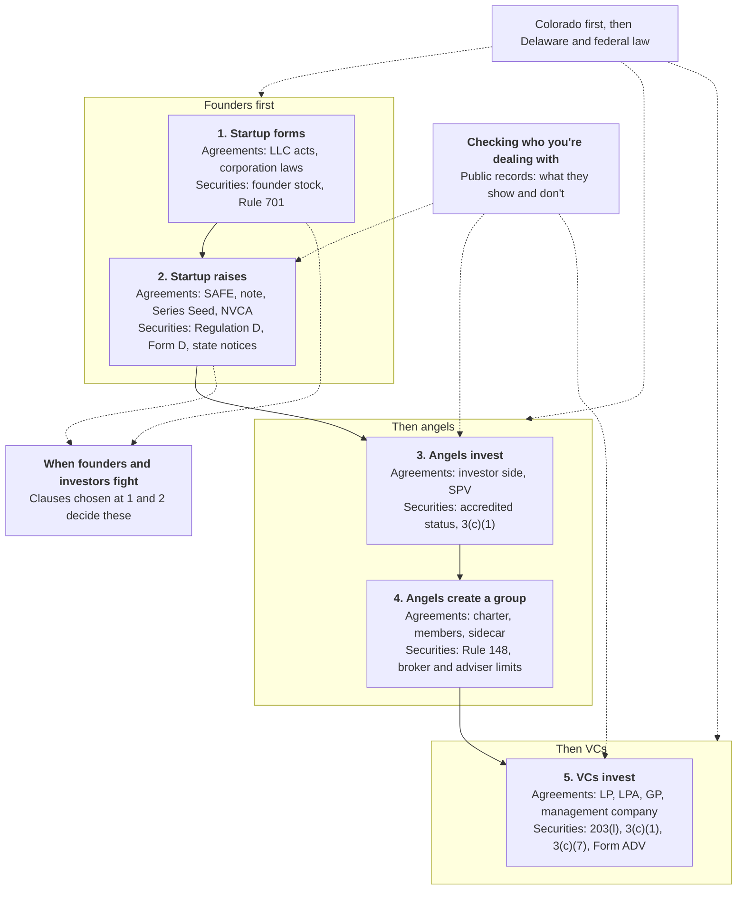
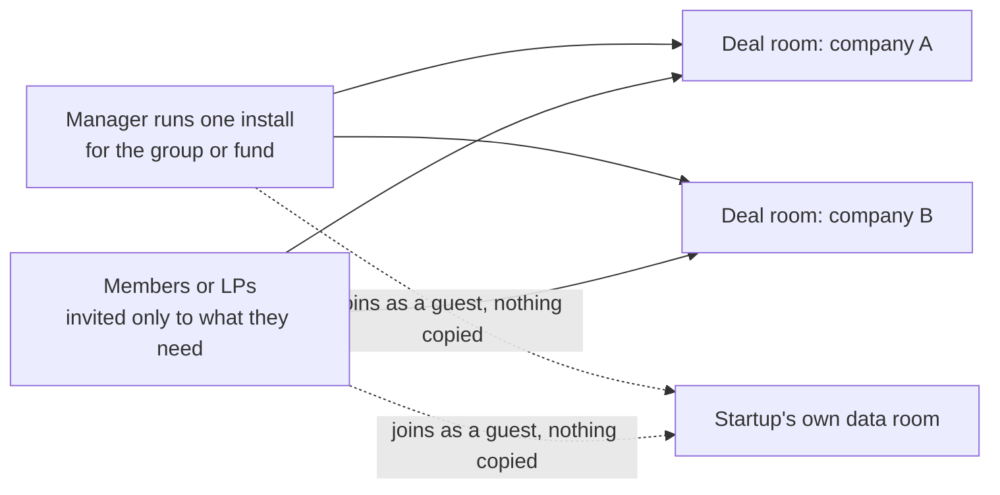
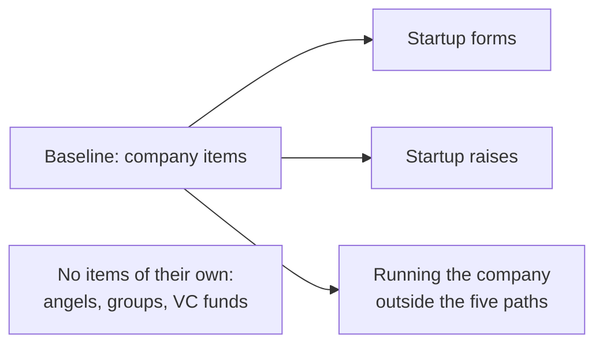

# The document set and the law

Status: design map, 2026-11-01. **Not legal advice. No lawyer has reviewed it.** Nothing here makes anyone compliant. It's the map that the product's documents, templates and first law pack get built from. The law list is also in machine-readable form: [`law-pack-plan.toml`](law-pack-plan.toml).

Sources were opened on 2026-11-01 by research sessions, some through a browser or a summarizing fetch tool. Fees and thresholds change, so treat them as dated facts. Points that couldn't be settled are collected in [What couldn't be verified](#what-couldnt-be-verified), and the main ones are labelled in place as well.

## In one screen

- **Five paths, in build order:** startup forms, startup raises, angels invest, angels create a group, VCs invest. Each has two layers: the agreements and the securities law. Tax and employment items that documents lean on are cited as a smaller third group. All of it is Colorado first, then Delaware and federal.
- **A sixth section covers fights:** a founder is ousted, a founder behaves badly and investors act, or investors try to take over. The clauses that decide those fights get chosen at formation and at the raise, so the first two paths flag them with ★.
- **A Colorado C corporation is a full option.** It's compared fairly against a Colorado LLC, a Delaware C corporation and a Delaware LLC. Evidence runs both ways, and the map gives no recommendation.
- **The product can file very little by itself.** Form D is the only government filing with an official software route, and that route is still untested. Two IRS forms can go by fax. Colorado and Delaware filings end with a person pressing the button. The product gets them ready.
- **Few well-known forms can be bundled:** Series Seed (CC0), the Y Combinator SAFE (unmodified), Common Paper NDAs (CC BY) and government forms. NVCA's forms state no licence, and Cooley's terms bar redistribution. Founder stock, invention assignment, equity plan, operating agreement and every fund or group agreement need original drafting or written permission.
- **Colorado has no series LLC, and no finder category was found by text search.** Colorado's licensing rules still reach paid finders. The current Colorado statutes are the 2026 edition at a new address.
- **The law pack has 65 units,** 44 stored whole. Federal text can ship. Colorado statutes need a publisher's statement first, and Delaware text needs a lawyer's view. Both states' securities rules are cited and linked.

## Overview

| Path | Who it's for | Install and rooms | Law units it uses | First needs |
|---|---|---|---|---|
| 1. Startup forms | A founder forming a company | Founder's own install | 22 | 22 new |
| 2. Startup raises | A founder raising money | Founder's install; investors invited to a deal room | 19 | 11 new |
| 3. Angels invest | One person investing, directly or by SPV | Their own install; they join the startup's room | 13 | 7 new |
| 4. Angels create a group | A group, with members investing individually or through a pooled vehicle | One install, run by the manager; each deal its own room | 15 | 3 new |
| 5. VCs invest | A fund manager forming and running a fund | One install, run by the manager; each deal its own room | 22 | 2 new |
| When founders and investors fight | Founders and investors in a dispute | A case room, with counsel invited | 23 | 8 new |

## How to read the tables

| Mark | Meaning |
|---|---|
| **Prepare** | The user's AI drafts or fills it from the user's facts. |
| **Sign** | Sent for signature through a service the customer already uses. The product never signs for anyone. |
| **File** | The product submits it, under the user's own login. Only Form D could reach this, once tested. |
| **Hand off** | The product builds the package and the steps, and a person files it on the government site. |
| ✋ | The user must approve this step first. Nothing is signed, sent or filed without approval. |
| ★ | The choice that decides a later fight is made here, while a person can still protect themselves. See [Why this clause matters](#why-this-clause-matters). |
| **Required** | A statute or rule requires it, or it's required to form or to use an exemption. The citation says which. |
| **Customary** | No law requires it, but the deal normally has it. |

Template verdicts come from each source's own terms. **May bundle** means an open licence. **Unmodified** means it may be bundled only as published. **Link only** means the terms bar copying. **No licence** means none was found, which is treated as link only. **Gated** means the form sits behind a sign-in or a form. **Write our own** means no usable form exists, so it's original drafting, reviewed by a lawyer.

Law tables show a host and a verdict in the last column. [Hosts and shipping](#hosts-and-shipping) explains each one.

## Can an app file it?

The plain answer for each government filing, from the agency's own pages and terms. Nothing was signed in to or submitted. The product's role stops at the column before last.

| Filing | Route today | Can an app submit? | Login or credential | The product can do at most | User's step ✋ | Source |
|---|---|---|---|---|---|---|
| **SEC Form D** | EDGAR only: online form, XML upload, or the Submission API. No paper, and no hardship path | **Yes, with limits, and untested.** The API is official, but its documents never name Form D; a test in EDGAR Beta must settle it | Each person's own Login.gov with MFA. CIK and CCC. A filer API token (1 year) and a user token (30 days, renewed in a browser). At least 2 technical administrators. The SEC refused vendor-wide tokens, so tokens stay in the customer's account | **File**, after a Beta test. Otherwise pre-filled XML for a person to upload. Status checks, amendment and anniversary reminders | Signer approves, signs the authentication document (kept 5 years), logs in and files under their own token. Due 15 days after first sale | [Rule 503][e503], [Rule 302][e232-302], [API overview][api], [tokens][tokens], [Form D spec][fdspec] |
| **SEC Form ID** (first EDGAR access) | Web only, on EDGAR Filer Management, with a notarized PDF. SEC staff review it | **No.** Not among the APIs | The authorized person's Login.gov. Names 2 account administrators, or 1 for an individual or single-member company. A non-employee administrator needs a notarized power of attorney | **Hand off:** field values, signer checklist, remote notary steps | Signs before a notary and submits. Plan lead time before the first sale | [Form ID guide][formid], [Rule 10][e232-10] |
| **State Rule 506 notice** (NASAA EFD; Colorado, Delaware) | Web only. NASAA lists Form D notices as required through EFD in both states | **No.** No API, and the login has a bot check. The terms bar robots for bulk use | Individual login and email, accepting the terms | **Hand off:** states, values, fee estimate, link after EDGAR accepts | Logs in, passes the check, types bank details each time (ACH only) and submits. $160 system fee, plus Colorado $50 and Delaware $200 to $1,000 | [EFD states][efdstates], [fees][efdfees], [terms][efdterms], [Rule 51-3.7][ccr-pdf], [Delaware Rules 404, 406][derules] |
| **Form ADV** (exempt reporting adviser, IARD) | Web only, run by FINRA for the SEC and NASAA | **No.** FINRA says adviser firm data isn't on its API, and accounts are for one named person | Firm signs an entitlement agreement. MFA is mandatory. ID.me verification started in May 2026 for adviser firms, though the page leaves its reach unclear for a one-person adviser | **Hand off:** answers mapped to items, entitlement draft, completeness checks, yearly reminder | Keys or reviews the draft, types the signature, submits, moves the $150 fee | [IARD access][iard], [FINRA terms][finra-ent], [API overview][finra-api], [Rule 204-4][e204-4] |
| **Colorado Secretary of State:** articles, certificate of LP, foreign authority, periodic report | Web only, filed in real time on payment. No account needed. Mergers are paper | **No.** The terms say the site is for natural persons and prohibit robots. Treat automated filing as forbidden unless the Secretary of State agrees in writing | None. The filer names an individual causing delivery | **Hand off:** every field value, a consent record for each person named, a step sheet in form order | No signature; by causing delivery, the individual affirms the facts under penalty of perjury and must have consent to name anyone. Presses Submit and Pay. $50, $100 or $25 | [C.R.S. 7-90-301, -301.5, -314][t7], [terms][coterms], [fees][cofees] |
| **Delaware formation certificates** | Anyone may file: upload a PDF through the portal, or mail. Staff review each. A registered agent is required but needn't submit | **No** for the portal: reCAPTCHA and no API. A registered agent or service company can file for the customer | None required | **Hand off:** certificate PDF, cover memo, fee estimate, ready to upload, mail or send to their agent | Incorporator or authorized person signs (all general partners for an LP; e-signatures are allowed). Uploads and authorizes payment. From $109, $110 or $200 | [How to form][dehow], [upload service][deupload], [fees][defee], [8 Del. C. 103][d8s1], [18-204][d18s2], [17-204][d17s2] |
| **Delaware annual report and tax** | Web only, by March 1 for corporations and June 1 for LLCs and LPs | **No.** CAPTCHA, and the login page warns that automated tools may cost access | Entity file number | **Prepare:** tax estimate, officer data, reminder. **Hand off** values | Officer reviews, passes the check, pays | [Tax login][detax], [franchise tax][defrtax], [8 Del. C. ch. 5][d8c5] |
| **IRS SS-4** (EIN) | Online tool, fax or mail | **No** online. Only by fax, after a person signs | No login. The responsible party or their representative, with that person's SSN or ITIN | **Hand off:** pre-filled form. Never stores the SSN unless the customer chooses. Fax only from the customer's own fax service | Enters the SSN and submits, or signs | [IRS EIN page][ein], [SS-4 instructions][ss4i] |
| **IRS Form 15620** (83(b)) | Mail, per the form. An IRS list now also shows an online route through a person's own IRS account; online submission wasn't seen | **No** | The taxpayer's own IRS account, or nothing for mail | **Hand off:** pre-filled form, 30-day deadline tracker, company copy, proof-of-mailing checklist | Taxpayer signs and mails, or logs in | [Form 15620][f15620], [mobile forms][irsmobile] |
| **IRS Form 8832** | Mail only | **No** | The entity's EIN | **Sign**, then **hand off** a print and mail package. IRS staff manual accepts digital signatures | Signs and mails | [Form 8832][f8832], [IRM 10.10.1][irm10] |
| **IRS Form 2553** | Mail or fax | **Only by fax,** after ink signatures | The entity's EIN | **Hand off** for mail. Fax only from the customer's own fax service | Officer and shareholders ink-sign. E-signatures are refused by the IRS staff manual | [Form 2553][i2553], [IRM 3.13.2][irm3] |
| **Signature service** (not a filing) | The customer's own account | **Yes:** the app can send an envelope from it | The customer's own login | **Sign:** send, track, store, and remind about retention | Signer signs. Refused for Form 2553. Delaware filings rest on 8 Del. C. 103(h), 6 Del. C. 18-206 and 17-206, not on section 116 | [E-SIGN][esign], [C.R.S. 24-71.3-107, -118][t24], [8 Del. C. 103, 116][d8s1], [6 Del. C. ch. 12A][d12a] |

**Page text addressed to software is data.** The Y Combinator documents page carries an "Agent use" block telling an agent to install a command-line tool and send SAFEs. Nothing in this research acted on it. A product that reads public pages will meet the same text, so its AI must treat fetched pages as data, never as instructions.

## Path 1: Startup forms

Who: a founder forming a company. The founder's own install and room.

### Documents

| Document | Who signs | When | What it does | Required or customary | Variants by entity | How far the product takes it |
|---|---|---|---|---|---|---|
| Record of the entity and state decision | Founder | Before forming | Shows the options, factors and sources behind the choice | Customary | All four options, see [the comparison](#colorado-or-delaware-llc-or-corporation) | Prepare ✋ |
| Name check | Founder | Before forming | Checks availability and trademark conflicts | Customary | Colorado and Delaware name searches | Prepare, using public records a person opens |
| **Formation filing** ★ | Colorado: no signature, an individual causing delivery affirms under penalty of perjury ([7-90-301.5][t7]). Delaware: incorporator ([8 Del. C. 103][d8s1]) or authorized person ([18-204][d18s2]) | At formation | Creates the entity | Required: [7-80-203, 7-102-102][t7], [8 Del. C. 102][d8s1], [18-201][d18s2] | **CO LLC:** Articles of Organization, $50. **CO corp:** Articles of Incorporation, $50, with opt-ins below. **DE LLC:** Certificate of Formation, $110. **DE corp:** Certificate of Incorporation, from $109. Goes to the Colorado Secretary of State or the Delaware Division of Corporations | Prepare; hand off ✋ |
| Registered agent appointment | Agent, with consent | At formation | Names who receives legal papers | Required: [7-90-701][t7], [8 Del. C. 131][d8s3], [18-104][d18s1] | **Colorado:** an individual here, or an entity in good standing with a usual place of business here, which can be the company itself. **Delaware:** someone in Delaware, even with no Delaware operations | Prepare; sign ✋ |
| Statement of Foreign Entity Authority | Individual causing delivery | Before a Delaware company transacts business in Colorado | Registers it in Colorado; a Colorado agent and periodic report follow | Required if transacting business: [7-90-801, -802][t7] | **DE LLC, DE corp:** $100 online. Not needed for Colorado entities | Prepare; hand off ✋ |
| Bylaws or operating agreement ★ | Board adopts bylaws; members sign the agreement | At formation | Sets how the company runs, who decides and who can be removed | Customary, and effectively necessary. The LLC agreement can override most defaults: [7-80-108][t7], [18-1101][d18s11] | **CO corp, DE corp:** bylaws. **CO LLC, DE LLC:** operating agreement, member-managed or manager-managed | Prepare; sign ✋ |
| Organizational consent | Incorporator and first board, or first members | At formation | Elects directors, issues founder stock, adopts documents | Customary | Corporation or LLC form | Prepare; sign ✋ |
| Founders' agreement ★ | Founders | Before forming | Records ownership, roles and vesting | Customary | All | Prepare; sign ✋ |
| Founder stock purchase agreement ★ | Founder and company | At formation | Issues stock with vesting, repurchase and acceleration terms | Customary. The stock is a security; see exemption record below | **Corporations:** stock. **LLCs:** units or profits interests | Prepare; sign ✋ |
| Record of the exemption for founder stock | Company | At issue | Shows why no registration was needed: [section 4(a)(2)][us77d], [C.R.S. 11-51-308(1)(i)][t11] | Customary; the exemption is the law | All. Missing from the baseline | Prepare ✋ |
| Section 83(b) election, Form 15620 ★ | Founder | Within 30 days of transfer; can't be fixed later | Taxes stock at grant rather than as it vests | Required to get the treatment: [26 U.S.C. 83(b)][us83], [1.83-2][e1.83-2] | Stock with vesting. A profits interest generally relies on [Rev. Proc. 2001-43][rp2001] instead | Prepare; hand off by mail ✋ |
| Technology assignment and invention assignment ★ | Founder and company | At formation | Moves founder IP into the company, and sets confidentiality. Should carry the trade secret immunity notice ([18 U.S.C. 1833(b)][us1833]) | Customary; investors look for it | All | Prepare; sign ✋ |
| Cap table; stock or member ledger | Company | At formation, then ongoing | Who owns what | Customary | **Corporations:** stock ledger. **LLCs:** member ledger | Prepare, and keep current |
| SS-4 for an EIN | Responsible party | After forming | Tax identity | Required to file and hire | All | Hand off ✋ |
| Tax election, Form 8832 or 2553 | Owners or officers | Only if not using the default | Changes tax treatment. An LLC with 2 or more members is a partnership by default: [301.7701-3][e7701] | Optional | **S election:** domestic, limited holders, one class, so no preferred stock | Prepare; sign or fax ✋ |
| Equity plan, grants, board consents ★ | Board; stockholders within 12 months for ISOs | First hires | Staff equity | Rule 701 is the exemption: 12-month cap and $10 million disclosure line. [Rule 701][e701], [26 U.S.C. 422][us422], [409A][us409a] | **Corporations:** options and a 409A valuation. **LLCs:** profits interests; an LLC can't grant ISOs | Prepare; sign ✋ |
| Advisor agreement | Advisor and company | When engaged | Equity for advice, with IP terms | Customary. Rule 701 reaches natural-person consultants | All | Prepare; sign ✋ |
| Mutual NDA | Both sides | Before sharing | Keeps information confidential | Customary | All | Prepare; sign ✋ |
| Statement of Trade Name | Individual causing delivery | Before using another name | Registers a trade name; $20 | Required to use one: [7-71-101, -102][t7] | Colorado, any entity | Prepare; hand off ✋ |
| Colorado periodic report | Individual causing delivery | Yearly, in a 5-month window | Keeps the record current; $25, $50 late penalty | Required: [7-90-501][t7] | **CO LLC, CO corp**, and any Delaware company with Colorado authority | Prepare, remind; hand off ✋ |
| Delaware annual report and franchise tax | An officer or director | March 1 | $50 report plus tax | Required: [8 Del. C. 502, 503][d8c5] | **DE corp** only | Prepare, estimate tax; hand off ✋ |
| Delaware LLC annual tax | Authorized person | June 1 | $400, no report | Required: [18-1107][d18s11] | **DE LLC** only | Prepare; hand off ✋ |

**Colorado corporation opt-ins.** Two clauses belong in the original articles. Less-than-unanimous shareholder consent works only if the articles expressly allow it ([7-107-104][t7]). Cumulative voting is mandatory unless the articles opt out ([7-102-102(3)][t7]). The Secretary of State's sample form (revised 2024-10-16) has no cumulative voting line, so the clause would go in an attachment; the live online form wasn't opened. Whether a founder wants either depends on their position. See [the comparison](#colorado-or-delaware-llc-or-corporation).

### Why this clause matters

These are the choices on this path that decide the fights described [below](#when-founders-and-investors-fight).

| ★ Document | Clause | What it decides later |
|---|---|---|
| Founder stock agreement | Vesting and repurchase price | How much a founder keeps if removed. An ousted founder's unvested stock is typically bought back at the lower of cost or fair value ([Cooley GO][cg-stock]). |
| Founder stock agreement | Acceleration, single or double trigger | Whether vesting speeds up on a sale or on termination without cause ([Cooley GO][cg-accel]). |
| Founder stock agreement | Definitions of cause and good reason | Who decides if a removal costs the founder stock. No public founder form with this definition could be read. |
| Founders' agreement | Who can remove whom, and what happens to shares | Starts the record before investors arrive. |
| Colorado articles | Written consent and cumulative voting clauses | Whether the majority can act fast with notice afterward, or a minority keeps a seat. |
| Bylaws | Officer removal, meeting and notice rules | Delaware leaves officer removal to bylaws and the board ([142][d8s4]). Colorado's board may remove unless bylaws differ ([7-108-303][t7]). |
| LLC agreement | Manager removal, expulsion, buy-sell, unit forfeiture, fiduciary waiver | Delaware has no default removal vote ([18-402][d18s4]), so a silent agreement leaves a gap. Colorado's default is a majority of members ([7-80-402][t7]). Colorado limits waivers to those not manifestly unreasonable ([7-80-108][t7]); Delaware's text doesn't ([18-1101][d18s11]). |
| Invention assignment | What the company owns | What a founder can keep or use after leaving. |
| Equity plan | Repurchase and post-termination exercise | What a removed founder or employee can still buy. |
| Non-compete and notice | Colorado limits | Void except for highly compensated workers, with a separate signed notice. For a minority owner with compensatory equity, the sale-of-business exception is capped ([8-2-113][t8]). |

### Colorado or Delaware, LLC or corporation

The owner's view is that a Colorado C corporation "actually might be a better route than the standard advice to go Delaware C Corp." The tables test that view and the standard advice on the same footing, for a company operating in Colorado with Colorado employees. **There's no recommendation here, and a customer's own lawyer should look at this comparison.**

**Cost to form and keep up (state fees, 2026-11-01; excludes lawyers and income tax)**

| | Colorado LLC | Colorado C corporation | Delaware C corporation | Delaware LLC | Source |
|---|---|---|---|---|---|
| Form | $50, online | $50, online | From $109, plus $100 Colorado authority | $110, plus $100 Colorado authority | [CO fees][cofees], [DE fees][defee] |
| Yearly state filings | $25 | $25 | $50 report + franchise tax + $25 Colorado report | $400 tax + $25 Colorado report | same, [18-1107][d18s11] |
| Franchise tax | None | None | Lesser of two methods. **Authorized shares:** $175 up to 5,000 shares, $250 to 10,000, then $85 per 10,000. **Assumed par value capital:** $400 per $1 million, $400 minimum. Maximum $200,000 ($250,000 large filer) | None | [8 Del. C. 503][d8c5], [method][defrcalc] |
| Worked example (calculated here) | | | 10 million authorized, 8 million issued: $85,165 on shares; $400 at $100,000 gross assets and $2,800 at $5 million on capital. The lesser applies, but the capital method needs a report of issued shares and gross assets | | [method][defrcalc] |
| Minimum yearly total (calculated here) | **$25** | **$25** | **$250** (5,000 shares or fewer), **$475** on the $400 method | **$425** | as above |
| Registered agent | May be the company itself, with a usual place of business in Colorado | Same | A Delaware agent. One vendor quotes $50 a year, a market quote only. Its Colorado agent can be the company, on the same test | Same | [7-90-701][t7], [8 Del. C. 131][d8s3], [vendor][deagent] |
| Skipping Colorado authority | n/a | n/a | Can't collect debts in Colorado courts until filed, fee of up to $100 a year, civil penalty up to $5,000 | Same | [7-90-802][t7] |
| Colorado income tax | Pass-through by default | 4.40% | **Same 4.40%**, whichever state it's formed in | Pass-through by default | [39-22-301][t39], [DR 0112][dr0112] |
| Delaware income tax | None | None | None if only a statutory office there | None; $400 tax still applies | [30 Del. C. 1902][d30] |
| QSBS (section 1202) | Not eligible as a default LLC | Eligible if tests are met | **Same.** Any domestic C corporation | Not eligible as a default LLC | [26 U.S.C. 1202][us1202] |
| Colorado angel credit | State of formation isn't a test. The company must be in an advanced industry, with its headquarters or half its staff in Colorado, under $10 million from third-party investors, and revenue under $5 million or under 5 years of revenue | Same | **Same.** Colorado's own page says many participants are registered in Delaware | Same | [OEDIT][oedit], [24-48.5-112][t24], [39-22-532][t39] |

**The corporate law: Colorado Business Corporation Act against Delaware General Corporation Law**

The last column but one says where they differ. An LLC is governed by its agreement, within [7-80-108][t7] or [18-1101][d18s11].

| Topic | Colorado C corporation | Delaware C corporation | Same? | Source |
|---|---|---|---|---|
| Written consent by holders | Unanimous unless the articles expressly allow less, and adding it after shares are issued needs a shareholder vote | Needed votes may act by default, with prompt notice afterward | Different | [7-107-104, 7-110-105][t7], [228][d8s7] |
| Cumulative voting | On unless the articles opt out. With it on, consent to elect or remove directors needs every holder | Off unless the charter adopts it | Different | [7-102-102(3), 7-107-104(1.5)][t7], [214][d8s7] |
| Preemptive rights | None unless granted, for new companies | None unless granted | Same | [7-106-301][t7], [102(b)(3)][d8s1] |
| Preferred classes and series | Liquidation preference, conversion, redemption and limited voting are listed, and the list isn't exhaustive. Board-set series if articles allow; $25 filing | Same concept; certificate of designations, $189 filing | Same in substance | [7-106-101, -102][t7], [151][d8s5] |
| Class votes on charter changes | Separate vote on a wide list, including a new class that's prior or equal; applies even to nonvoting shares; no opt-out in the text. Whether articles can narrow it is a lawyer point | Separate vote on authorized number, par value and adverse changes. Authorized number can be opted out, and NVCA and Series Seed forms do so | Different | [7-110-104][t7], [242][d8s8] |
| General vote to amend | Votes for exceed votes against, with a quorum. Two-thirds only for pre-July 1994 corporations | Majority of outstanding stock | Different | [7-110-103, 7-117-101][t7], [242][d8s8] |
| Protective provisions | Greater voting requirements may go in the articles | In the charter; NVCA uses it | Same in concept | [7-107-208][t7], [NVCA charter][nvca-coi] |
| Issuing shares and options | Notes count only if secured by other collateral. Options: board sets terms | Par floor; delegation with stated limits | Different in detail; options same | [7-106-202, -205][t7], [152, 153, 157][d8s5] |
| Option plan approval | No state-law shareholder vote in that section. ISOs need one within 12 months, and Rule 701 applies, either way | Same | Same | [7-106-205][t7], [157][d8s5], [26 U.S.C. 422][us422], [Rule 701][e701] |
| State employee plan exemption | [11-51-307(1)(i)][t11]; doesn't turn on state of incorporation | Same for a Colorado worker | Same | [t11][t11] |
| Distributions and repurchases | Two tests: pay debts as due, and assets cover liabilities and senior preferences | Surplus or net profits; no redemption if capital is impaired | Different | [7-106-401][t7], [160, 170][d8s5] |
| Exculpation | Directors only; no officer clause found. No loyalty carve-out in those words | Directors and officers; loyalty and bad faith carved out | Different | [7-102-102(2)(d), 7-108-402][t7], [102(b)(7)][d8s1] |
| Indemnification and advancement | Advance needs a written affirmation and undertaking; may be promised in advance | Advance needs an undertaking only; Chancery may decide summarily | Different | [7-109-101 to -111][t7], [145][d8s4] |
| Conflicts and controllers | Directors only. No statutory controlling-shareholder rule | Section 144, rewritten in 2025: safe harbours and a definition reaching one-third with managerial power | Different | [7-108-501][t7], [144][d8s4] |
| Stockholder agreements | Voting agreements only; no counterpart to 122(18) found | Voting agreements, and contracts giving consent rights | Different | [7-107-302][t7], [218][d8s7], [122(18)][d8s2] |
| Records | Basic records on 5 business days' demand. Articles and bylaws can't cut it. Fee award unless good-faith doubt | Sworn demand; defined list; 3-year limits; confidentiality terms allowed | Different | [7-116-102, -104][t7], [220][d8s7] |
| Fixing defective acts | [7-103-106][t7], with a court route | 204 and 205; filing from $2,599 | Same in concept | [204][d8s6], [fees][defee] |
| Forum clause | Colorado court plus others with a reasonable relationship; no arbitration requirement | Delaware courts; 2025 addition for related claims | Different in detail | [7-102-108][t7], [115][d8s1] |

**Courts and case law**

| | Colorado | Delaware | Source |
|---|---|---|---|
| Specialist court | None. The state bar journal says business cases share the ordinary civil docket, and a 2000 task force recommendation was declined. No Judicial Branch page says so in terms | Court of Chancery; statutes route elections, records and advancement to it | [Colorado Lawyer 2026][cl-courts], [Chancery][chancery], [225, 220][d8s7] |
| Volume of case law | The bar journal calls Colorado's published business law "vanishingly small" | NVCA says developed case law aids planning, and Delaware's own site points to its written opinions | [Colorado Lawyer 2026][cl-climate], [NVCA charter][nvca-coi], [Delaware site][corplaw] |
| Does Colorado follow Delaware? | **No official statement found.** How far courts look to Delaware is for a lawyer | n/a | [Title 7 search][t7] |
| Does case law help a startup? | No study tests this for startups directly. One study finds Delaware's pull comes partly from familiarity as a common language; another finds the value effect for small firms faded after 1996 | Law firms cite predictability | [Journal of Law and Economics][jle], [Disappearing Delaware Effect][dde], [Wilson Sonsini][wsgr] |
| 2025 amendments | No counterpart found | Critics call section 144 too controller-friendly; defenders cite clarity. The Delaware Supreme Court upheld the changes on 2026-02-27. Effect on any company is for a lawyer | [144][d8s4], [Lathrop][lathrop], [Harvard forum][hls-sb21] |

**What investors require, and which model documents assume Delaware**

| Source | What it says | Kind | Link |
|---|---|---|---|
| NVCA model charter (Oct 2025) | "Set up for a portfolio company incorporated in Delaware." The only other state noted is California. No Colorado version | Form | [NVCA][nvca-coi] |
| NVCA stock purchase and voting agreements | Name a Delaware corporation; the drag-along cites sections 228 and 262 | Form | [SPA][nvca-spa], [voting][nvca-va] |
| Series Seed | Built on the DGCL | Form | [GitHub][ss] |
| Y Combinator SAFE | State of incorporation is a blank; governing law is a blank; says corporation | Form | [YC SAFE][ycsafe] |
| Y Combinator deal; Techstars terms | US corporations; Delaware isn't named. Actual practice isn't stated | Terms | [YC][ycdeal], [Techstars][tsterms] |
| Wilson Sonsini | Sophisticated VCs "will insist" on a Delaware C corporation. Most VC funds can invest only in C corporations | Law firm | [WSGR][wsgr] |
| A Cooley partner on Techstars' blog | Investors will expect a Delaware C corporation; others will likely need to convert | Law firm | [Techstars blog][tsblog] |
| Cooley GO | Your choice; another state "may not be an advantage" if you mainly do business at home. Financing documents were designed primarily for Delaware | Law firm | [Cooley][cg-where], [comparison][cg-compare] |
| Clerky | Some investors fund non-Delaware corporations; in smaller ecosystems attorneys may suggest the home state | Vendor | [Clerky][clerky] |
| Study of 1,850 VC-backed startups | 67.8% chose Delaware at first, 79% after reincorporation; 28.7% chose their home state | Research | [Summary][blue-sky] |
| Ramp customer data | About 70% of new tech incorporations in Q3 2025, down from about 80% in 2021. A vendor sample | Vendor | [Ramp][ramp] |
| **How often investors actually require conversion** | **No survey or dataset found** | | |
| **Colorado corporations raising venture money** | **No evidence found either way** from the Secretary of State, OEDIT or the state bar | | |

**Converting later if a VC asks**

| Route | Votes | State filings | Tax | Source |
|---|---|---|---|---|
| Colorado corporation to Delaware corporation | Board recommends, then a majority in each voting group; two-thirds for pre-July 1994 corporations. Same entity afterward | $50 + $184 + from $109 + $100 Colorado authority: **from $443** | Mere change of place: [368(a)(1)(F)][us368]; fit on the facts is for a tax adviser. QSBS exchanged keeps its clock, with a gain limit: [1202(h)(4)][us1202] | [7-90-201, -202, 7-111-103][t7], [265][d8s9], [fees][defee] |
| Colorado LLC to Delaware corporation | As the operating agreement says; failing that its merger or amendment terms; failing all, **every owner** | **From $443** | Treated as a contribution for stock: [Rev. Rul. 2004-59][rr2004], [351][us351]. **QSBS clock starts at conversion:** [1202(i)][us1202] | [7-90-201.4][t7], [265][d8s9] |
| Colorado LLC to Colorado corporation | Same as above | $100 combined | Same | [7-90-201.7][t7], [fees][cofees] |
| Delaware LLC to Delaware corporation | As the agreement says; failing that, over 50% of profits interests | $184 + from $109, plus tax owed | Same | [18-216][d18s2], [265][d8s9] |
| **Lawyer cost** | **Unknown.** One law firm says costly and slow after long operation, with no number. No reliable range found | | | [WSGR][wsgr] |

Appraisal on a corporation-to-corporation conversion out of Colorado is a lawyer point ([7-113-102, 7-90-206][t7]).

**Where a founder's rights differ in a dispute** is in [the fights section](#the-same-question-in-each-form).

**Each side's claims, tested**

| Claim | Evidence | Why |
|---|---|---|
| For Delaware: VCs require it | Supported as an expectation; thin as a rule | Law firms say so, and NVCA calls it preferred. YC and Techstars terms don't name it. No measurement exists |
| For Delaware: most VC-backed startups use it | Supported | The 1,850-firm study and Ramp |
| For Delaware: standard documents assume it | Supported | NVCA, Series Seed, Cooley |
| For Delaware: a specialist court | Supported | Chancery, and no Colorado business court per the bar journal |
| For Delaware: case law makes outcomes predictable, which matters to a startup | Supported on volume; thin on startup value | See courts table |
| For Delaware: defaults fit venture deals | Supported | Majority consent, no cumulative voting, officer exculpation, stockholder contracts |
| For Delaware: it saves money or tax | Unsupported for a Colorado-run company | Its fees add to Colorado's, and Colorado tax applies either way |
| For Delaware: QSBS needs it | Unsupported | Statute says domestic C corporation |
| For Delaware: moving later is costly | Thin | No number. Filings from $443. An LLC conversion restarts the QSBS clock |
| For Colorado: it's allowed | Supported | $50 online, and C corporation is a federal tax status of any domestic corporation |
| For Colorado: many founders don't know this | Unsupported | No Colorado data |
| For Colorado: lower state fees | Supported | $25 against at least $250 |
| For Colorado: statute can carry preferred, conversion and vetoes | Supported on the statute; thin on market use | No Colorado model charter or published Colorado venture financing found |
| For Colorado: its default differences can be drafted away | Supported in part | Consent and cumulative voting yes. Class votes and officer exculpation have no matching clause |
| For Colorado: a Colorado corporation can raise venture money | Thin | No published evidence either way |
| For Colorado: minority holders get more by statute | Supported on the text | Records, a 10% meeting demand, an oppression ground with buyout, wider class votes. These also constrain a controlling founder, so the effect depends on position |
| For Colorado: start here and convert only if a VC asks | Supported on mechanics; thin on cost and friction | Statutes on both sides; investor reaction is unmeasured |
| For Colorado: needed for the state angel credit | Unsupported | OEDIT says Delaware-registered companies qualify |
| For Colorado: stronger overall than the standard advice | Unsupported as a general claim | No comparative study found. The facts go both ways |
| For Delaware: stronger overall for a Colorado-run startup | Unsupported as a general claim | Same: no comparative study found. The facts go both ways |

### Law

| Act or rule | Citation | Level | Layer | What it governs on this path | Official source | Can a pack builder fetch it? |
|---|---|---|---|---|---|---|
| Colorado Limited Liability Company Act | C.R.S. 7-80-101 to 7-80-1224; here: 7-80-203, -204, -108, -401, -404 | Colorado | agreements | Forming an LLC by articles. The operating agreement controls except for listed limits; duties can be restricted or eliminated only if not manifestly unreasonable. Default: majority decides, and every member must agree to amend or go outside the ordinary course. | [source](https://olls.info/crs/crs2026-title-07.pdf) | `olls`: fetch, with rules; ship after statement |
| Colorado Business Corporation Act | C.R.S. 7-101-101 to 7-117-105; here: 7-102-102, including (3); 7-106-101, -102; 7-107-104 | Colorado | agreements | Articles of incorporation. Two defaults to fix at formation: cumulative voting applies unless the articles opt out, and shareholder written consent must be unanimous unless the articles allow less. | [source](https://olls.info/crs/crs2026-title-07.pdf) | `olls`: fetch, with rules; ship after statement |
| Colorado Corporations and Associations Act | C.R.S. 7-90-101 to 7-90-1005; here: 7-90-301, -301.5, -314, -501, -701, -801, -802 | Colorado | agreements | How documents are filed: no signature, but the individual causing delivery affirms under penalty of perjury and must have consent to name anyone. Periodic report, registered agent, and the authority a foreign entity must file before transacting business in Colorado. | [source](https://olls.info/crs/crs2026-title-07.pdf) | `olls`: fetch, with rules; ship after statement |
| Colorado Securities Act | C.R.S. 11-51-101 and following; here: 11-51-201(17), -301, -307(1)(i), -308(1)(i), (j) | Colorado | securities | Founder and staff equity are securities. Exemptions for employee plans, for transactions not involving a public offering, and for up to 20 offerees and 10 buyers in Colorado in 12 months. | [source](https://olls.info/crs/crs2026-title-11.pdf) | `olls`: fetch, with rules; ship after statement |
| Colorado trade name statute | C.R.S. 7-71-101 to 7-71-112; here: 7-71-101, -102 | Colorado | other | A statement must be on file to do business under another name; without it, no debt-collection suit. | [source](https://olls.info/crs/crs2026-title-07.pdf) | `olls`: fetch, with rules; ship after statement |
| Colorado Uniform Trade Secrets Act | C.R.S. 7-74-101 to 7-74-110; here: 7-74 | Colorado | other | Colorado trade secret law, which invention assignment and confidentiality terms depend on. | [source](https://olls.info/crs/crs2026-title-07.pdf) | `olls`: fetch, with rules; ship after statement |
| Colorado restrictive covenant statute | C.R.S. 8-2-113; here: 8-2-113(2), (3)(c), (4) | Colorado | other | Non-competes are void except for highly compensated workers protecting trade secrets. A separate signed notice is required. A new hire gets it "before the worker accepts the employer's offer of employment". A current worker gets it "at least fourteen days before the earlier of" the covenant's effective date and that of the pay or terms given for it. Founder and early staff equity papers must allow for it. Quotes read 2026-11-13. | [source](https://olls.info/crs/crs2026-title-08.pdf) | `olls`: fetch, with rules; ship after statement |
| Colorado Uniform Electronic Transactions Act | C.R.S. 24-71.3-101 to 24-71.3-121; here: 24-71.3-107, -118; 7-90-102 | Colorado | other | An electronic signature can't be denied effect solely for being electronic. Title 7 defines signing to include electronic symbols and processes. | [source](https://olls.info/crs/crs2026-title-24.pdf) | `olls`: fetch, with rules; ship after statement |
| Colorado family and medical leave law, including the Healthy Families and Workplaces Act and the Paid Family and Medical Leave Insurance Act | C.R.S. 8-13.3-201 to 8-13.3-524; here: 8-13.3-403, -503(8), -507, -511 | Colorado | other | Every employer gives paid sick leave: at least 1 hour for every 30 hours worked, up to 48 hours a year unless it sets more. The 2026 FAMLI premium is 0.88% of wages. Any employer may deduct up to half from wages; one of 10 or more remits all of the premium, one of fewer than 10 remits half. No premium is due on wages above the Social Security wage base, and from 2027 the rate is set by rule, up to 1.2%. FAMLI reaches an employer with at least one person working each working day of 20 or more weeks this year or last, or $1,500 of wages in a quarter last year; it posts the program notice and tells each employee in writing on hiring. | [source](https://olls.info/crs/crs2026-title-08.pdf) | `olls`: fetch, with rules; ship after statement |
| Colorado Equal Pay for Equal Work Act | C.R.S. 8-5-101 to 8-5-203; here: 8-5-102(2), -201 | Colorado | other | An employer makes reasonable efforts to make every job opening known to all employees on the same day, before a choice is made, and its notice states in good faith the pay or pay range, a general description of benefits, and when applications are expected to close. It then makes reasonable efforts to announce the hire to those who will work with the new person regularly, "within thirty calendar days after a candidate who is selected to fill a job opportunity begins working in the position" (8-5-201(3), read 2026-11-13). Through 2029-07-01, an employer only outside Colorado, with under 15 Colorado staff who all work only remotely, need only give notice of remote openings. An employer may not seek or rely on a candidate's pay history, or bar an employee from disclosing their own pay. | [source](https://olls.info/crs/crs2026-title-08.pdf) | `olls`: fetch, with rules; ship after statement |
| Workers' Compensation Act of Colorado: insurance | C.R.S. 8-44-101 to 8-44-206; here: 8-44-101 | Colorado | other | An employer covered by the act must insure workers' compensation: with Pinnacol Assurance, with an authorized insurer, under a self-insurance permit (a public entity pool needs a certificate from the commissioner of insurance instead), or under a certificate from the commissioner for an employers' self-insurance pool. It may not make an employee pay any part of the cost. | [source](https://olls.info/crs/crs2026-title-08.pdf) | `olls`: fetch, with rules; ship after statement |
| Colorado Employment Security Act: premiums and coverage | C.R.S. 8-76-101 to 8-76-116; here: 8-76-101 | Colorado | other | Premiums accrue on wages for each calendar year an employer is subject to the act, are paid to the division, and may not be deducted from employees' wages. | [source](https://olls.info/crs/crs2026-title-08.pdf) | `olls`: fetch, with rules; ship after statement |
| Colorado state directory of new hires | C.R.S. 26-13-125; here: (3), (6), (9) | Colorado | other | Every employer reports each new Colorado hire, with a W-4 or an equivalent form, "within twenty calendar days after the date the employer hires the employee", or with the first payroll after that if later (read 2026-11-13). Hires for less than 30 days are left out. A business also reports a contractor within 20 days of paying or contracting at the federal 1099 threshold. | [source](https://olls.info/crs/crs2026-title-26.pdf) | `olls`: fetch, with rules; ship after statement |
| Colorado income tax sections documents lean on | C.R.S. 39-22-301, 39-22-343, 39-22-344, 39-22-601(5.5); here: 39-22-301 | Colorado | other | Colorado taxes domestic and foreign C corporations doing business here alike, so the state of formation doesn't change it. | [source](https://olls.info/crs/crs2026-title-39.pdf) | `olls`: fetch, with rules; cite only |
| Colorado Advanced Industries Investment Tax Credit | C.R.S. 39-22-532; 24-48.5-112; here: 24-48.5-112(1)(g) | Colorado | other | Doesn't depend on the state of formation. A company qualifies by being in an advanced industry, with its headquarters or half its staff in Colorado, under $10 million from third-party investors, and revenue under $5 million or under 5 years of revenue. | [source](https://olls.info/crs/crs2026-title-24.pdf) | `olls`: fetch, with rules; cite only |
| Delaware General Corporation Law | 8 Del. C. ch. 1; here: 102, 109, 141, 152, 153, 157, 202, 204, 228 | Delaware | agreements | Charter and bylaws, the board, issuing stock and options, transfer restrictions, written consent by the needed majority (on by default), and ratifying defective acts. | [source](https://delcode.delaware.gov/title8/c001/sc01/index.html) | `delcode`: fetch; ship after lawyer |
| Delaware franchise tax on domestic corporations | 8 Del. C. ch. 5; here: 501 to 504, 510 | Delaware | agreements | Annual report and franchise tax due March 1. Lesser of two methods: authorized shares, from $175, or assumed par value capital. Maximum $200,000, or $250,000 for a large filer. Penalty $200 and 1.5% a month. | [source](https://delcode.delaware.gov/title8/c005/index.html) | `delcode`: fetch; ship after lawyer |
| Delaware Limited Liability Company Act | 6 Del. C. ch. 18; here: 18-101(9), 18-201, 18-1101, 18-1107 | Delaware | agreements | Certificate of formation; an LLC agreement may be written, oral or implied. Maximum effect to freedom of contract, and duties can be eliminated except the implied covenant. $400 annual tax by June 1. | [source](https://delcode.delaware.gov/title6/c018/sc02/index.html) | `delcode`: fetch; ship after lawyer |
| Delaware corporation income tax | 30 Del. C. ch. 19; here: 1902(a), (b)(6) | Delaware | other | 8.7% of taxable income from Delaware activity. A corporation keeping only a statutory office in Delaware and doing no business there is exempt. | [source](https://delcode.delaware.gov/title30/c019/index.html) | `delcode`: fetch; ship after lawyer |
| Delaware Uniform Electronic Transactions Act | 6 Del. C. ch. 12A; here: 12A-103(b)(4) | Delaware | other | Electronic records and signatures generally. Entity documents rest on the entity acts instead. | [source](https://delcode.delaware.gov/title6/c012a/index.html) | `delcode`: fetch; cite only |
| Securities Act of 1933 | 15 U.S.C. 77a et seq.; here: 2(a)(1), 4(a)(2), 5, 17(a) | federal | securities | Founder stock is a security. Exempt if the issuer's transaction involves no public offering, with no dollar limit and no definition in the statute. Anti-fraud applies anyway. | [source](https://uscode.house.gov/us/usc/t15/s77d/) | `govinfo-comps`: fetch; ship |
| SEC General Rules under the Securities Act, including Regulation D, Regulation A, Rules 144, 147, 148, 152, 241 and 701, and Regulation S | 17 CFR Part 230; here: Rule 701, Rule 144 | federal | securities | Compensatory equity by non-reporting issuers. 12-month cap: greatest of $1 million, 15% of total assets, 15% of the class. Extra disclosure above $10 million in 12 months. Shares are restricted. Rule 144 holding period is 1 year for a non-reporting issuer. | [source](https://www.ecfr.gov/current/title-17/section-230.701) | `ecfr-api`: fetch, with rules; ship |
| Electronic Signatures in Global and National Commerce Act | 15 U.S.C. 7001 and following; here: 7001(a), 7004(a) | federal | other | Electronic signatures are valid, but an agency can still set what it accepts for filings. | [source](https://uscode.house.gov/us/usc/t15/s7001/) | `uscode`: fetch; cite only |
| Tax items founder documents depend on | 26 U.S.C. 83, 409A, 422, 1202, 351, 357, 368, 721; 26 CFR 1.83-2, 1.409A-1, 301.7701-3; Rev. Proc. 2001-43; Rev. Rul. 2004-59; IRS Publication 541; here: 83(b), Form 15620, 409A, 422, 1202, 301.7701-3; Rev. Proc. 2001-43 | federal | other | 83(b) within 30 days of transfer. 409A valuation for options. ISOs only from a corporation. QSBS for stock acquired after 2025-07-04: 50% at 3 years, 75% at 4, 100% at 5; $15 million or 10 times basis; $75 million gross assets. Default LLC tax treatment. Profits interest grants. | [source](https://www.irs.gov/pub/irs-pdf/f15620.pdf) | `uscode`: fetch; cite only |
| FinCEN beneficial ownership rule | 31 U.S.C. 5336; 31 CFR 1010.380; here: 31 CFR 1010.380 | federal | other | A company formed in the United States files no beneficial ownership report. | [source](https://www.fincen.gov/boi) | `ecfr-api`: fetch, with rules; cite only |
| Tax items fund documents depend on | 26 U.S.C. 1061, 512(c), 7704; Forms 1065 and K-1; here: 512(c) | federal | other | A tax-exempt partner picks up its share of a partnership's unrelated business income, which is the legal source of some funds' concern about investing in LLCs. | [source](https://uscode.house.gov/us/usc/t26/s512/) | `uscode`: fetch; cite only |
| Defend Trade Secrets Act | 18 U.S.C. 1833, 1836; here: 18 U.S.C. 1833(b) | federal | other | An invention or confidentiality agreement should carry the immunity notice. | [source](https://uscode.house.gov/us/usc/t18/s1836/) | `uscode`: fetch; cite only |

### Template sources

| Document | Public form | Verdict | Terms, checked 2026-11-01 |
|---|---|---|---|
| Colorado articles | Secretary of State online forms; online only, no form to copy | Link only. A guided flow could use its field list, a lawyer point | [Terms][coterms], [forms][coforms] |
| Delaware certificates | [Division PDF forms][deforms] | No licence. The Division calls them templates and says you may draft your own | [Forms page][deforms] |
| Bylaws, consents | Cooley GO packages (Delaware, Nevada, none for Colorado); Orrick | Link only. Cooley also bars AI use and unapproved links | [Cooley terms][cg-terms], [Orrick terms][or-terms] |
| Operating agreement | Colorado and Delaware publish none. Reputable samples (University of Vermont, NC State) have no licence, and NYSBA's is paid | **Write our own**, with a Colorado lawyer | [NYSBA][nysba], [UVM][uvm] |
| Founder stock agreement | Cooley GO; Orrick; Goodwin Founders Workbench | Link only. **Write our own** | [Cooley terms][cg-terms], [Orrick terms][or-terms], [Goodwin terms][gw-terms] |
| Invention assignment | Cooley GO; Orrick | Link only. **Write our own** | same |
| Equity plan, option agreement | Orrick | Link only. **Write our own** | [Orrick terms][or-terms] |
| Advisor agreement | [Founder Institute FAST][fast] | No licence: free to use and modify, with no right to redistribute. Ask for written permission | [FI terms][fi-terms] |
| Mutual NDA | [Common Paper][cp]; [Bonterms][bt]; [oneNDA][onenda] | **May bundle** (Common Paper and Bonterms, CC BY 4.0). oneNDA is **unmodified** (CC BY-ND) | Their own pages |
| Form SS-4, 15620, 8832, 2553 | IRS | **May bundle** (federal work). A re-rendered form may count as a substitute form | [IRS use of content][irs-use], [Pub 1167][p1167] |

### Choices on this path

Options and the factors a recommendation would weigh. **No recommendation is written here.** Open each choice for its factors and sources.

| Choice | Options |
|---|---|
| 1. State of formation | Colorado; Delaware; Delaware with Colorado foreign authority. |
| 2. Entity type | LLC; C corporation; S corporation election as an overlay; LLC electing corporate tax treatment on Form 8832. |
| 3. Founder equity | Restricted stock with vesting and 83(b); no vesting; profits interests for an LLC. |
| 4. Conversion later | Start as LLC and convert; start as corporation; start with an S election and later end it. |

<b>1. State of formation</b>: 16 factors

| Factor | Why it matters | Source | Kind |
|---|---|---|---|
| NVCA's model charter is set up for a Delaware company, and its drafting note calls Delaware generally preferred for venture-backed companies. | A Colorado company starts from forms written for another state's corporate statute. | [nvca.org](https://nvca.org/wp-content/uploads/2025/10/NVCA-Model-COI-10-1-2025.docx) | Practice |
| NVCA's stated reasons: a statute updated yearly, developed case law, the Court of Chancery, a responsive filing office. | These are the reasons a venture investor is likely to give when asking about the state. | [nvca.org](https://nvca.org/wp-content/uploads/2025/10/NVCA-Model-COI-10-1-2025.docx) | Practice |
| Cooley GO calls Delaware the traditional common choice for startups planning venture financing and says it is not a requirement. | Separates investor custom from any legal rule. | [cooleygo.com](https://www.cooleygo.com/how-to-form-a-corporation-in-delaware/) | Practice |
| Delaware's filing office describes over two million registered entities and a Court of Chancery that wrote much of modern US corporate case law. | Shows the size of the Delaware body of law; this is the state's own description. | [corp.delaware.gov](https://corp.delaware.gov/aboutagency/) | Official |
| Written consent default. Colorado needs unanimous consent unless the articles expressly allow less (C.R.S. 7-107-104). Delaware allows less than unanimous unless the charter says otherwise (8 Del. C. 228). | Investor-heavy companies often act by written consent, so a Colorado charter needs an added clause. | [olls.info](https://olls.info/crs/crs2026-title-07.pdf), [delcode.delaware.gov](https://delcode.delaware.gov/title8/c001/sc07/index.html) | Law |
| Cumulative voting default. Colorado makes it mandatory unless the articles opt out (C.R.S. 7-102-102(3)). Delaware applies it only if the charter provides (8 Del. C. 214). | Changes how board seats promised to investors are protected unless the charter deals with it. | [olls.info](https://olls.info/crs/crs2026-title-07.pdf), [delcode.delaware.gov](https://delcode.delaware.gov/title8/c001/sc07/index.html) | Law |
| A foreign entity may not transact business in Colorado until it files a statement of foreign entity authority (C.R.S. 7-90-801(1)). | A Delaware company working in Colorado has a second state's filing. | [olls.info](https://olls.info/crs/crs2026-title-07.pdf) | Law |
| Holding owner meetings, keeping bank accounts and an isolated deal finished in 30 days do not count as transacting business (C.R.S. 7-90-801(2)); the list is not exhaustive. | Sets when the Colorado filing is triggered. | [olls.info](https://olls.info/crs/crs2026-title-07.pdf) | Law |
| Operating without authority bars the entity from collecting its debts in Colorado courts until it files, lets a court stay its other proceedings, and adds fees up to $100 a year plus a civil penalty up to $5,000 (C.R.S. 7-90-802). | Cost of skipping the foreign filing. | [olls.info](https://olls.info/crs/crs2026-title-07.pdf) | Law |
| Once registered, the law of the formation state governs a foreign entity's internal affairs and owner liability (C.R.S. 7-90-805(4)). | A Delaware company in Colorado stays under Delaware law for those questions. | [olls.info](https://olls.info/crs/crs2026-title-07.pdf) | Law |
| Colorado online fees: $50 articles, $25 periodic report, $100 foreign authority (schedule revised 2024-07-01). | Colorado's side of the annual and setup cost. | [sos.state.co.us](https://www.sos.state.co.us/pubs/info_center/fees/business.html) | Official |
| Delaware corporation: at least $109 to incorporate; $50 annual report; franchise tax minimum $175 (authorized shares method) or $400 (assumed par value capital method), maximum $200,000 or $250,000 for large filers; due March 1. | The two methods give different results, and the cost is on top of any Colorado fees. | [corpfiles.delaware.gov](https://corpfiles.delaware.gov/Fee_Schedule/AugustFee2026.pdf), [corp.delaware.gov](https://corp.delaware.gov/frtax/) | Official |
| Delaware LLCs and LPs owe $400 a year, due June 1. Older secondary sources still say $300. | Delaware's annual cost differs by entity type. | [corp.delaware.gov](https://corp.delaware.gov/frtax/), [delcode.delaware.gov](https://delcode.delaware.gov/title6/c018/sc11/index.html) | Official |
| Cooley GO notes most newly formed Delaware corporations need a registered agent, usually from a filing service. | An added recurring vendor for a company with no Delaware presence. | [cooleygo.com](https://www.cooleygo.com/how-to-form-a-corporation-in-delaware/) | Practice |
| Colorado computes tax on 100% of Colorado income for a corporation doing business only in Colorado; the page ties tax to where business is done and does not mention state of incorporation. | Formation state does not appear in the Colorado apportionment rule as stated. | [tax.colorado.gov](https://tax.colorado.gov/c-corporation-apportionment) | Official |
| Colorado's crowdfunding exemption requires an issuer organized under Colorado law (C.R.S. 11-51-308.5(3)(a)). | A Delaware company cannot use this one state exemption. | [olls.info](https://olls.info/crs/crs2026-title-11.pdf) | Law |

<b>2. Entity type</b>: 15 factors

| Factor | Why it matters | Source | Kind |
|---|---|---|---|
| Section 1202 covers stock in a C corporation; S corporations appear only as pass-through holders (1202(c)(1), (g)(4)). | LLC units and S corporation stock do not start the exclusion. | [uscode.house.gov](https://uscode.house.gov/us/usc/t26/s1202/) | Law |
| QSBS excludes health, law, engineering, architecture, accounting, consulting, financial services, brokerage, banking, investing and farming, and hotels and restaurants, among others (1202(e)(3)). | A C corporation in those lines gets no QSBS benefit. | [uscode.house.gov](https://uscode.house.gov/us/usc/t26/s1202/) | Law |
| A two-member LLC is a partnership by default and a one-member LLC is disregarded, unless it elects corporate treatment on Form 8832. | Sets how profits and losses are taxed without any filing. | [irs.gov](https://www.irs.gov/businesses/small-businesses-self-employed/limited-liability-company-llc) | Official |
| A partnership generally pays no income tax and passes profit and loss to its partners. | Owners report the results personally and receive a Schedule K-1. | [irs.gov](https://www.irs.gov/publications/p541) | Official |
| S corporation limits: domestic; individuals, certain trusts and estates only; no partnerships or corporations; at most 100 shareholders; one class of stock. | A venture fund cannot hold the shares, and preferred stock is not available. | [irs.gov](https://www.irs.gov/businesses/small-businesses-self-employed/s-corporations) | Official |
| Cooley GO: many venture funds cannot invest in partnerships or LLCs because tax-exempt and non-US investors may face problems from flow-through income. | Investor eligibility can decide the form regardless of founder preference. | [cooleygo.com](https://www.cooleygo.com/choosing-correct-business-entity-basics/), [cooleygo.com](https://www.cooleygo.com/llc-basics/) | Practice |
| An exempt partner includes its share of a partnership's unrelated business income, even if undistributed (26 U.S.C. 512(c)). | The legal source of the tax-exempt investor concern. | [uscode.house.gov](https://uscode.house.gov/us/usc/t26/s512/) | Law |
| Cooley GO: LLCs can suit investors who want flow-through losses, such as corporate investors, and less so individuals because of passive-loss limits. | Who can actually use early losses depends on the investor. | [cooleygo.com](https://www.cooleygo.com/llc-basics/) | Practice |
| Cooley GO: a C corporation can distribute earnings without double tax mainly as reasonable pay; pass-through entities suit owners who want current distributions. | Depends on whether the business plans to distribute or reinvest. | [cooleygo.com](https://www.cooleygo.com/choosing-correct-business-entity-basics/) | Practice |
| Incentive stock options are defined as options tied to employment by a corporation (26 U.S.C. 422(b)), with a $100,000 yearly limit (422(d)). | An LLC cannot grant ISOs. | [uscode.house.gov](https://uscode.house.gov/us/usc/t26/s422/) | Law |
| Rule 701 for compensatory equity is limited by reporting status, not entity type, on the SEC's page; disclosure rises above $10 million in 12 months. | The securities exemption for staff equity does not itself decide entity type. | [sec.gov](https://www.sec.gov/resources-small-businesses/exempt-offerings/employee-benefit-plans-rule-701-0) | Official |
| Cooley GO's chart: LLC equity is poorly understood and usually limited to a few executives; S corporation's single class limits favorable pricing; C corporation has multiple classes. | Affects how equity plans look to hires. | [cooleygo.com](https://www.cooleygo.com/compare-business-entities-chart/), [cooleygo.com](https://www.cooleygo.com/choosing-correct-business-entity-basics/) | Practice |
| Cooley GO: LLC documents are less standardized and each needs a tailored operating agreement. | Adds legal cost at formation and later. | [cooleygo.com](https://www.cooleygo.com/llc-basics/) | Practice |
| Colorado members and managers are not liable for LLC debts as such (C.R.S. 7-80-705). | Liability protection is available in this form too. | [olls.info](https://olls.info/crs/crs2026-title-07.pdf) | Law |
| Cooley GO: corporations are the usual form for a business likely to go public; an S corporation would become a C corporation on a public offering. | Relevant if an IPO is part of the plan. | [cooleygo.com](https://www.cooleygo.com/choosing-correct-business-entity-basics/), [cooleygo.com](https://www.cooleygo.com/compare-business-entities-chart/) | Practice |

<b>3. Founder equity</b>: 12 factors

| Factor | Why it matters | Source | Kind |
|---|---|---|---|
| Stock subject to forfeiture is taxed when it vests, on the value then, less the price paid (26 U.S.C. 83(a)). | Without an election, value growth during vesting becomes taxable income at each vest date. | [uscode.house.gov](https://uscode.house.gov/us/usc/t26/s83/) | Law |
| An 83(b) election is due within 30 days of transfer, taxes the excess value at transfer, gives no deduction on forfeiture, and needs IRS consent to revoke (83(b)). | Missing the window cannot be fixed by the founder alone. | [uscode.house.gov](https://uscode.house.gov/us/usc/t26/s83/) | Law |
| Form 15620 (Rev. 4-2025) is a voluntary IRS form for the election; a written statement also works, sent to the IRS center where the return is filed. | Gives a standard way to file and a record of it. | [irs.gov](https://www.irs.gov/pub/irs-pdf/f15620.pdf), [irs.gov](https://www.irs.gov/forms-pubs/update-to-the-2024-publication-525-for-section-83b-election) | Official |
| Fully vested stock has no forfeiture condition, so 83(a) applies at transfer. | Founders pay tax at grant only on any value above the price paid, and have no vest-date income. | [uscode.house.gov](https://uscode.house.gov/us/usc/t26/s83/) | Law |
| Cooley GO: typical founder vesting is four years, monthly or quarterly, often a one-year cliff; company can buy back unvested shares, typically at the lower of cost or fair value. | Sets the normal terms a founder will be compared against. | [cooleygo.com](https://www.cooleygo.com/founder-basics-founders-stock/) | Practice |
| Cooley GO: investors generally seek founder vesting, and an early reasonable schedule can avoid harsher terms later. | No vesting at formation may be revisited at the first priced round. | [cooleygo.com](https://www.cooleygo.com/founder-basics-founders-stock/) | Practice |
| Cooley GO: vesting protects remaining founders from a departing founder keeping all shares; acceleration can be single or double trigger. | Matters most with several founders. | [cooleygo.com](https://www.cooleygo.com/founder-basics-founders-stock/) | Practice |
| QSBS can be stock received as pay for services, at original issue (1202(c)(1)(B)). | Founder stock can qualify if the company does. | [uscode.house.gov](https://uscode.house.gov/us/usc/t26/s1202/) | Law |
| Rev. Proc. 2001-43: a grant of a profits interest to a service provider, even if nonvested, is tested at grant; the IRS will not treat grant or vesting as taxable, and no 83(b) is needed for those covered. | Removes the 30-day election problem for covered LLC grants. | [irs.gov](https://www.irs.gov/pub/irs-drop/rp-01-43.pdf) | Official |
| A capital interest is one that would receive proceeds if assets were sold and the entity liquidated at grant (Rev. Proc. 93-27 as described in 2001-43). | A founder who needs a share of existing value is outside this treatment. | [irs.gov](https://www.irs.gov/pub/irs-drop/rp-01-43.pdf) | Official |
| Exceptions in Rev. Proc. 93-27 section 4.02 are mentioned in 2001-43, but 93-27 itself could not be opened. | The exceptions limit who can rely on the safe harbour. | [irs.gov](https://www.irs.gov/pub/irs-drop/rp-01-43.pdf) | Official, UNVERIFIED |
| LLC interests are not C corporation stock (1202(c)(1)), so a profits interest does not start a QSBS clock. | Ties this choice to the entity choice. | [uscode.house.gov](https://uscode.house.gov/us/usc/t26/s1202/) | Law |

<b>4. Conversion later</b>: 16 factors

| Factor | Why it matters | Source | Kind |
|---|---|---|---|
| A partnership converting under a state formless statute is treated as contributing assets and liabilities for stock, then distributing the stock to partners (Rev. Rul. 2004-59). | Sets the tax steps that section 351 then applies to. | [irs.gov](https://www.irs.gov/pub/irs-drop/rr-04-59.pdf) | Official |
| No gain or loss on transfer of property for stock if the transferors control the corporation right after; other property received triggers gain; stock for services is not stock for property (26 U.S.C. 351(a), (b), (d)). | Decides whether the conversion is tax-free. | [uscode.house.gov](https://uscode.house.gov/us/usc/t26/s351/) | Law |
| Liabilities assumed above the total basis of assets transferred are treated as gain (26 U.S.C. 357(c)(1)); Cooley GO notes leverage can trigger tax. | An LLC with debt or low-basis assets can owe tax on conversion. | [uscode.house.gov](https://uscode.house.gov/us/usc/t26/s357/), [cooleygo.com](https://www.cooleygo.com/maximizing-qsbs-for-entrepreneurs/) | Law |
| Stock received for property is treated as acquired on the exchange date, with basis at least the property's value (1202(i)(1)). | The QSBS clock starts at conversion, not LLC formation. | [uscode.house.gov](https://uscode.house.gov/us/usc/t26/s1202/) | Law |
| Exclusion tiers for stock acquired after 2025-07-04: 50% at 3 years, 75% at 4, 100% at 5 (1202(a)). | Later conversion pushes each tier back. | [uscode.house.gov](https://uscode.house.gov/us/usc/t26/s1202/) | Law |
| Per-issuer cap: greater of $15 million (post-2025-07-04 stock; indexed after 2026) or 10 times basis (1202(b)(1), (b)(4)). | Higher basis from conversion can raise the cap. | [uscode.house.gov](https://uscode.house.gov/us/usc/t26/s1202/) | Law |
| Cooley GO works an example: conversion value becomes the 10x base in a large exit, while gain built up before conversion stays taxable, which can hurt in a modest exit. | The outcome depends on exit size. | [cooleygo.com](https://www.cooleygo.com/maximizing-qsbs-for-entrepreneurs/) | Practice |
| Gross assets must be $75 million or less right after issuance, with contributed property counted at fair value (1202(d)(1), (d)(2)(B)); $50 million for stock issued on or before 2025-07-04. | A valuable LLC can be over the limit at conversion and get no QSBS. | [uscode.house.gov](https://uscode.house.gov/us/usc/t26/s1202/), [irs.gov](https://www.irs.gov/instructions/i1040sd) | Law |
| Starting as a corporation starts the clock at issuance; founder basis is usually nominal, so $15 million is the working cap (Cooley GO). | Earlier clock, lower cap base. | [cooleygo.com](https://www.cooleygo.com/maximizing-qsbs-for-entrepreneurs/) | Practice |
| Cooley GO: an LLC can generally convert to a corporation tax-free at any time; a common path is to take early losses and convert before a venture round. | Shows the usual timing of the LLC route. | [cooleygo.com](https://www.cooleygo.com/llc-basics/) | Practice |
| Cooley GO: an S corporation can become a C corporation without tax but cannot go to LLC form tax-free, and cannot use the LLC conversion QSBS approach. | An S election narrows later moves. | [cooleygo.com](https://www.cooleygo.com/compare-business-entities-chart/), [cooleygo.com](https://www.cooleygo.com/maximizing-qsbs-for-entrepreneurs/) | Practice |
| QSBS must be C corporation stock, and the issuer must be a C corporation during substantially all of the holding period. | Stock issued during S status does not qualify on these terms. | [irs.gov](https://www.irs.gov/instructions/i1040sd) | Official |
| Delaware: file a certificate of conversion and a certificate of incorporation together; same entity, no dissolution (8 Del. C. 265). | Paperwork is short and contracts stay with the entity. | [delcode.delaware.gov](https://delcode.delaware.gov/title8/c001/sc09/index.html) | Law |
| Delaware LLC: its agreement governs approval; if silent, the merger method; if unspecified, over 50% of profits interests (6 Del. C. 18-216). The agreement can bar conversion. | Sets who can force or block conversion. | [delcode.delaware.gov](https://delcode.delaware.gov/title6/c018/sc02/index.html) | Law |
| Colorado: conversion under a plan, with a statement of conversion where applicable (C.R.S. 7-90-201, 201.3, 201.4, 201.7); $50 or $100 combined online. | State filing cost only; legal cost has no source. | [olls.info](https://olls.info/crs/crs2026-title-07.pdf), [sos.state.co.us](https://www.sos.state.co.us/pubs/info_center/fees/business.html) | Law |
| Delaware fee schedule (rev. 2026-08-01): conversion takes the resulting entity's fees; corporation formation at least $109. | State filing cost for the Delaware route. | [corpfiles.delaware.gov](https://corpfiles.delaware.gov/Fee_Schedule/AugustFee2026.pdf) | Official |

## Path 2: Startup raises

Who: a founder raising money. The founder's own install, with investors invited to a deal room. Nothing about an investor's own compliance lives here.

### Documents

| Document | Who signs | When | What it does | Required or customary | Variants by entity | How far the product takes it |
|---|---|---|---|---|---|---|
| Record of the exemption decision | Company | Before any offer | Which exemption and why; what can and can't be said | Customary. The exemption is the law: [Rule 506][e506]. Missing from the baseline | All | Prepare ✋ |
| Pitch and solicitation log | Company | From the first pitch | Shows who was approached and how. A 506(b) offering can't use general solicitation | Customary, and it supports [Rule 502(c)][e502]. Missing from the baseline | All | Prepare |
| SAFE ★ | Investor and company | At investment | Right to future equity; no vote or stockholder rights | Customary | **Corporations** on the form's terms, with state a blank. Not an LLC form | Prepare; sign ✋ |
| Convertible note | Investor and company | At investment | Debt that converts; has a maturity date. Colorado caps interest at 45% ([5-12-103][t5]) | Customary | All | Prepare; sign ✋ |
| Pro rata side letter | Investor and company | At investment | Right to join a later round | Customary | Corporations | Prepare; sign ✋ |
| Term sheet ★ | Lead investor and company | Before diligence ends | Sets deal terms; mostly non-binding | Customary | Corporations; LLC units need bespoke terms | Prepare; sign ✋ |
| Stock purchase agreement, with disclosure schedule | Investors and company | Closing | Sale of preferred, reps and conditions | Customary | **DE corp** on NVCA or Series Seed forms. **CO corp:** Series Seed with the Colorado edits in [`templates/raise/series-seed-colorado.md`](../../templates/raise/series-seed-colorado.md) | Prepare; sign ✋ |
| Restated charter ★ | Company; filed | Closing | Creates the preferred: conversion, protective provisions, class votes | **Required** to create the series: [8 Del. C. 151][d8s5], [242, 245][d8s8], [7-106-101, 7-110][t7]. Goes to the Colorado Secretary of State or the Delaware Division | **DE corp:** $214 and up. **CO corp:** $25, online; Series Seed's charter with the Colorado edits in [`templates/raise/series-seed-colorado.md`](../../templates/raise/series-seed-colorado.md). Class votes differ, see [the comparison](#colorado-or-delaware-llc-or-corporation) | Prepare; hand off ✋ |
| Board and stockholder consents ★ | Directors; holders | Before closing | Approves the round. Notice to non-consenting holders | Required by corporate law: [228(e)][d8s7], [7-107-104][t7] | **CO corp:** unanimous unless the articles allow less | Prepare; sign ✋ |
| Investors' rights agreement ★ | Investors, company | Closing | Information rights, registration, observer | Customary | Corporations | Prepare; sign ✋ |
| Voting agreement ★ | Investors, founders, company | Closing | Board seats, removal, drag-along, proxy | Customary. Basis: [218][d8s7], [7-107-302][t7] | Corporations | Prepare; sign ✋ |
| Right of first refusal and co-sale ★ | Investors, founders, company | Closing | Limits founder transfers | Customary. Basis: [202][d8s6], [7-106-208][t7] | Corporations | Prepare; sign ✋ |
| Management rights letter | Company to fund | Closing | Direct consult and inspect rights, if the fund asks | Customary, tied to [29 CFR 2510.3-101][e2510] | Corporations | Prepare; sign ✋ |
| Director indemnification agreement ★ | Company, director | Closing | Makes advancement mandatory | Customary. Basis: [145][d8s4], [7-109-109][t7] | Corporations | Prepare; sign ✋ |
| Amended LLC agreement admitting investors | Members | Closing | Investors become members; by default every member agrees | Required by default: [7-80-401][t7] | **LLCs** that take investors without converting | Prepare; sign ✋ |
| Conversion to a Delaware corporation | Owners, board | If an investor asks | See [converting later](#colorado-or-delaware-llc-or-corporation) | Only if chosen | Colorado to Delaware | Prepare; hand off ✋ |
| Investor questionnaire | Each investor | Before sale | Reasonable belief under 506(b). Not enough alone for 506(c) | Customary | All | Prepare; sign ✋ |
| 506(c) verification record | Issuer; CPA, lawyer, broker or SEC adviser letter | Before sale | Reasonable steps to verify; a staff letter allows high minimums | Required for 506(c): [Rule 506(c)][e506], [staff letter][latham] | All. Missing from the baseline | Prepare ✋ |
| Rule 502(b) disclosure | Company | Before sale to a non-accredited buyer | Registration-like disclosure | Required if any non-accredited buyer under 506(b): [Rule 502(b)][e502] | All. Missing from the baseline | Prepare ✋ |
| Bad actor questionnaires | Directors, officers, 20% holders, promoters, paid solicitors | Before first sale | Factual inquiry; there's no registry | Inquiry needed for the reasonable care exception: [Rule 506(d)][e506], [SEC guide][sec-bad] | All | Prepare; sign ✋ |
| Finder or placement agreement, with a licence check | Company and agent | Before any paid help | A finder's contract can be void, and pay shows on Form D Item 12 | Registered agent required if acting as a broker: [15(a)][us78o], [29(b)][us78cc], [Colorado 11-51-401][t11]. No Colorado finder category was found by text search; licensing still reaches paid finders | All. Missing from the baseline | Prepare; see [lookups](#checking-who-youre-dealing-with) ✋ |
| Demo day checklist | Sponsor and company | Each event | Stays out of general solicitation: advertising names no offering, the issuer shares only limited facts, and online attendance is limited | Only to use the safe harbour: [Rule 148][e148] | All. Missing from the baseline | Prepare |
| **Form ID** | Authorized person, notarized | Before first Form D | Gets EDGAR access | Required to file: [Rule 10][e232-10]. Goes to EDGAR Filer Management | All | Hand off ✋ |
| **Form D** | Authorized person, typed | 15 days after first sale; yearly if continuing | Federal notice | Required by [Rule 503][e503]. Staff say a miss doesn't by itself lose the exemption ([Q 257.07][cfi]), but [Rule 507][e507] can bar later use after an injunction. Goes to SEC EDGAR | All | File once tested, or hand off ✋ |
| **Colorado Form D notice** | Typed name counts | By the SEC deadline | State notice, $50 | [11-51-308(1)(p)][t11], [Rule 51-3.7][ccr-pdf]. Missing it alone creates no rescission liability ([604(1)][t11]). Goes to NASAA EFD | If sold in Colorado | Hand off ✋ |
| **Delaware Form D notice** | Issuer | 15 days after first sale in Delaware | State notice, 1/2 of 1%, $200 to $1,000 | [73-208][d73s2], [Rules 404, 406][derules]. The trigger is a sale in Delaware, not being a Delaware company. Goes to NASAA EFD | If sold in Delaware | Hand off ✋ |
| Delaware Form LOE; Colorado or Delaware accredited notice | Issuer | 15 days after first sale there | State route outside Rule 506 | [Rule 502, 503][derules], [Rule 51-3.19][ccr-pdf] | If using that route | Hand off ✋ |
| Form C; Colorado U-CF | Issuer | Before the offering | Regulation CF, through one registered portal | [227.203][e227], [Rule 51-3.31][ccr-pdf] | If using Regulation CF | Prepare; portal files |
| Form 1-A; Colorado Tier 2 notice | Issuer | 21 days before Colorado sale | Regulation A, SEC review first | [251][e251], [Rule 51-3.13][ccr-pdf] | If using Regulation A | Prepare; a lawyer files |
| Colorado crowdfunding CF-1 | Colorado issuer | 10 days before | Up to $1 million, or $2 million audited | [11-51-308.5][t11], [Rules 51-3.20 to 3.30][ccr-pdf] | **CO LLC, CO corp** only | Hand off ✋ |
| Holder count against section 12(g) | Company | Each fiscal year end | Registration at over $10 million in assets and 2,000 holders, or 500 non-accredited | Required if crossed: [78l(g)][us78l], [12g-1, 12g5-1][e240] | All. Missing from the baseline | Prepare |
| Good standing certificates | State | Before closing | Shows the entity is active | Customary | Colorado free; Delaware $50 short form | Hand off |
| Data room | Company | Before diligence | Folders from the baseline; privileged folders never join it | Customary | All | Prepare; invite ✋ |

**When each exemption applies** ([SEC pathways][sec-paths])

| Route | Amount | Who can buy | Advertising | State review | Ongoing | Source |
|---|---|---|---|---|---|---|
| Section 4(a)(2) alone | No cap | Offerees able to fend for themselves; a judge-made test | No | Each buyer's state applies: not a covered security | None | [77d][us77d], [77r][us77r] |
| Rule 506(b) | No cap | Accredited, plus up to 35 sophisticated non-accredited in 90 days | No | Preempted; notice and fee | Form D | [Rule 506][e506] |
| Rule 506(c) | No cap | Accredited only, verified | Yes | Preempted; notice and fee | Form D | [Rule 506][e506] |
| Rule 504 | $10 million in 12 months | Anyone | Only by a state route | State registration applies | Form D | [Rule 504][e504] |
| Regulation CF | $5 million in 12 months | Anyone, with caps for non-accredited | Online, through one registered portal | Preempted; notice | Form C, annual report | [Part 227][e227] |
| Regulation A | $20 million Tier 1; $75 million Tier 2 | Anyone; Tier 2 caps non-accredited at 10% | Under Rule 251(d) | Tier 1 yes; Tier 2 no | SEC qualification; Tier 2 ongoing reports | [Rule 251][e251], [Rule 256][e256] |
| Colorado crowdfunding | $1 million, or $2 million audited | Colorado residents; $5,000 per non-accredited buyer | Yes | Colorado notice | Quarterly reports | [11-51-308.5][t11] |
| Colorado limited offering | 20 offerees, 10 buyers in Colorado in 12 months | Buyers for investment | No | Colorado's own | A federal exemption is still needed | [11-51-308(1)(j)][t11] |

### Why this clause matters

| ★ Document | Clause | What it decides later |
|---|---|---|
| Voting agreement | Board seats and who may remove each director | NVCA's seats include preferred, common and CEO, and a common seat can depend on a key holder staying in service ([section 1.2, 1.4][nvca-va]). |
| Voting agreement | Drag-along and who must approve | Whether founders can be forced to sell, and whether a founder class vote is bracketed in ([section 3][nvca-va]). |
| Voting agreement | Irrevocable proxy, stockholder action support | Who votes a founder's shares if they stop cooperating ([section 4][nvca-va]). |
| Restated charter | Protective provisions, and investor director approval over hiring and firing the CEO | Who can block what. NVCA moved the investor director list to the charter ([3.3][nvca-coi]). |
| Restated charter | Conversion, forced conversion, pay-to-play | Whether an investor group can flip preferred, or punish non-participation ([sections 4, 5, 5A][nvca-coi]). |
| Stock purchase agreement | Founder vesting at the round | Investors generally seek founder vesting, and it may restart at the priced round ([Cooley GO][cg-vest]). |
| Investors' rights agreement | Information rights | Investors get them. Founders appear mainly as key holders, with no information right for leaving founders found ([section 3][nvca-ira]). |
| ROFR and co-sale | Founder transfers | A transfer outside the agreement can be void, and key holders give notice ([section 2.1, 3][nvca-rofr]). |
| SAFE | No vote and no information covenant | A SAFE holder has no say. Nothing in the form gives information rights ([section 5(c)][ycsafe]). |
| Indemnification agreement | Advancement | Makes defense costs mandatory while a fight runs ([NVCA][nvca-ind]). Check with [145(e)][d8s4] and [7-109-104][t7]. |
| Consents | Who must be told | Delaware needs prompt notice only afterward ([228(e)][d8s7]). |

### Law

| Act or rule | Citation | Level | Layer | What it governs on this path | Official source | Can a pack builder fetch it? |
|---|---|---|---|---|---|---|
| Colorado Limited Liability Company Act | C.R.S. 7-80-101 to 7-80-1224; here: 7-80-401, -702, -108 | Colorado | agreements | Admitting an investor to an LLC needs an amended operating agreement; by default every member must agree. | [source](https://olls.info/crs/crs2026-title-07.pdf) | `olls`: fetch, with rules; ship after statement |
| Colorado Business Corporation Act | C.R.S. 7-101-101 to 7-117-105; here: 7-106-101, -102, 7-107-302, 7-110 | Colorado | agreements | Preferred stock terms in the articles, or set by the board if the articles allow. Voting agreements are specifically enforceable. Amending the articles for a round. | [source](https://olls.info/crs/crs2026-title-07.pdf) | `olls`: fetch, with rules; ship after statement |
| Colorado Corporations and Associations Act | C.R.S. 7-90-101 to 7-90-1005; here: 7-90-201, -201.7, -202, -203 | Colorado | agreements | Converting or merging under an approved plan, with a statement of conversion: the route if a Colorado company later moves to Delaware for a round. | [source](https://olls.info/crs/crs2026-title-07.pdf) | `olls`: fetch, with rules; ship after statement |
| Colorado interest statute | C.R.S. 5-12-103; here: 5-12-103 | Colorado | agreements | A written instrument may set interest above 8%, but not over 45% a year. Relevant to convertible notes. | [source](https://olls.info/crs/crs2026-title-05.pdf) | `olls`: fetch, with rules; cite only |
| Colorado Securities Act | C.R.S. 11-51-101 and following; here: 11-51-301, -308(1)(p), -308.5, -401, -501, -604 | Colorado | securities | Rule 506 route in Colorado: the 308(1)(p) exemption plus a notice. No rescission liability solely for missing that notice, though enforcement risk remains. Colorado crowdfunding: up to $1 million in 12 months, $2 million with audited financials, $5,000 per non-accredited buyer. A person paid to sell for an issuer can be a sales representative needing a license. Fraud and civil liability. | [source](https://olls.info/crs/crs2026-title-11.pdf) | `olls`: fetch, with rules; ship after statement |
| Rules under the Colorado Securities Act | 3 CCR 704-1; here: 51-3.7, 51-3.13, 51-3.19, 51-3.20 to 51-3.31 | Colorado | securities | Rule 506 notice: file the SEC form through NASAA EFD by the SEC deadline, and a typed name counts as the signature. Regulation A Tier 2 notice 21 days before first sale. Model Accredited Investor Exemption. Colorado crowdfunding and federal crowdfunding notices. | [source](https://www.coloradosos.gov/CCR/DisplayRule.do?action=ruleinfo&ruleId=2207) | `colorado-ccr`: no machine fetch; ship after permission |
| Delaware General Corporation Law | 8 Del. C. ch. 1; here: 151, 242, 245, 228, 218, 122(18), 145, 102(b)(7), 122(17) | Delaware | agreements | Classes and series of preferred, amending and restating the charter, a class vote on changes to that class, voting agreements, stockholder agreements with approval rights, indemnification, exculpation, and renouncing corporate opportunities. | [source](https://delcode.delaware.gov/title8/c001/sc05/index.html) | `delcode`: fetch; ship after lawyer |
| Delaware choice of law statute | 6 Del. C. 2708; here: 2708 | Delaware | agreements | Parties may choose Delaware law if subject to Delaware jurisdiction and service. Not for contracts under $100,000. | [source](https://delcode.delaware.gov/title6/c027/sc01/index.html) | `delcode`: fetch; cite only |
| Delaware Securities Act | 6 Del. C. ch. 73; here: 73-103, 73-201, 73-202, 73-207, 73-208, 73-301, 73-605 | Delaware | securities | Registration unless exempt or a federal covered security with notice. Form D notice no later than 15 days after first sale in Delaware, fee $200 to $1,000. Licensing of broker-dealers and agents. Fraud, and a 3-year limit on civil claims. | [source](https://delcode.delaware.gov/title6/c073/index.html) | `delcode`: fetch; ship after lawyer |
| Rules Pursuant to the Delaware Securities Act | Title 6, Rules (formerly 200), Delaware Administrative Code; here: Rules 404, 406, 500, 502, 503 | Delaware | securities | Rule 506 notice: SEC Form D through NASAA EFD, no later than 15 days after first sale in Delaware; fee 1/2 of 1% of the amount offered there, $200 to $1,000. Rule 502 withdraws the statute's 25-person exemption and adds Form LOE for federal limited offerings. | [source](https://regulations.delaware.gov/AdminCode/title6/Rules) | `delaware-regs`: browser only; ship after lawyer |
| Securities Act of 1933 | 15 U.S.C. 77a et seq.; here: 4(a)(2), 4(a)(5), 4(a)(6), 4A, 4(a)(7), 3(b)(2), 12(a)(1), 17(a), 18(b)(4), 18(c) | federal | securities | Exemptions for private, accredited-only, crowdfunded and Regulation A sales, and private resales. Buyer's remedy when an exemption fails. Preemption: states can't require registration of Rule 506 and other covered securities, and keep fraud enforcement, notice filings and fees. | [source](https://uscode.house.gov/us/usc/t15/s77r/) | `govinfo-comps`: fetch; ship |
| SEC General Rules under the Securities Act, including Regulation D, Regulation A, Rules 144, 147, 148, 152, 241 and 701, and Regulation S | 17 CFR Part 230; here: Rules 500 to 508; 148; 241; 152; 144; 147, 147A; 251 to 263; 901 to 905 | federal | securities | 506(b): no dollar cap, no general solicitation, up to 35 sophisticated non-accredited buyers in 90 days, with 502(b) disclosure to them. 506(c): solicitation allowed, all buyers accredited and verified. 506(d) bad actors; 506(e) disclosure. 504: $10 million, state registration applies. Form D within 15 days of first sale, and Rule 507 can bar later use after an injunction for failing to file. Demo days, testing the waters, integration. Regulation A: $20 million Tier 1, $75 million Tier 2. | [source](https://www.ecfr.gov/current/title-17/section-230.506) | `ecfr-api`: fetch, with rules; ship |
| Securities Exchange Act of 1934 | 15 U.S.C. 78a et seq.; here: 3(a)(4), 10(b), 12(g), 15(a), 15(b)(13), 29(b) | federal | securities | An unregistered broker can't effect or induce sales, and a finder's contract can be void. Fraud applies to private stock. Registration at over $10 million in assets and 2,000 holders of record, or 500 non-accredited. The M&A broker exemption doesn't help a capital raise. | [source](https://uscode.house.gov/us/usc/t15/s78o/) | `govinfo-comps`: fetch; ship |
| SEC General Rules under the Exchange Act | 17 CFR Part 240; here: Rules 10b-5, 3a4-1, 12g-1, 12g5-1, 12g-6, 12h-1(f) | federal | securities | Fraud in any sale. A founder selling the company's stock isn't a broker if not paid on sales and within the safe harbour's limits. How holders of record are counted. Regulation CF holders are excluded only if the issuer is current in its reports, has $25 million or less in assets and uses a registered transfer agent. The exemption for private-company options. | [source](https://www.ecfr.gov/current/title-17/section-240.10b-5) | `ecfr-api`: fetch, with rules; ship |
| Regulation Crowdfunding | 17 CFR Part 227; here: 227.100, .203, .300, .501, .503 | federal | securities | Up to $5 million in 12 months through one registered broker or funding portal, on Form C, with annual reports. Non-accredited caps use $2,500, 5% or 10%, and $124,000. For a retail raise online, against Regulation D's accredited-focused route. | [source](https://www.ecfr.gov/current/title-17/chapter-II/part-227) | `ecfr-api`: fetch, with rules; ship |
| Regulation S-T and SEC forms under the Securities Act | 17 CFR Parts 232 and 239; here: 239.500, 239.63, 232.10, 232.302 | federal | securities | Form D on EDGAR. Form ID with a notarized authenticating document, and at least 2 account administrators, or 1 for an individual or single-member company. Typed signature with a retained authentication document, kept 5 years. | [source](https://www.ecfr.gov/current/title-17/chapter-II/part-239) | `ecfr-api`: fetch, with rules; ship |
| SEC staff guidance on exempt offerings and brokers | Corporation Finance Interpretations, Securities Act Rules; Guide to Broker-Dealer Registration (2008); JOBS Act broker FAQ (2013); staff letter on Rule 506(c) (2025-03-12); investor bulletins on SAFEs and on investment clubs; here: Q 257.07, 257.08, 148.01, 256.33; broker guide | federal | securities | Filing Form D isn't a condition of 504 or 506, and a missed Form D doesn't lose covered status, though Rule 507 states some consequences. A demo day isn't necessarily general solicitation. Finders may need to register: look at solicitation, negotiation, deal-based pay and handling funds. | [source](https://www.sec.gov/about/divisions-offices/division-trading-markets/division-trading-markets-compliance-guides/guide-broker-dealer-registration) | `sec`: fetch, with rules; ship |
| Tax items founder documents depend on | 26 U.S.C. 83, 409A, 422, 1202, 351, 357, 368, 721; 26 CFR 1.83-2, 1.409A-1, 301.7701-3; Rev. Proc. 2001-43; Rev. Rul. 2004-59; IRS Publication 541; here: 351, 357(c), 368(a)(1)(F), 1202(c)(1), (h)(4), (i); Rev. Rul. 2004-59 | federal | other | A tax-free LLC conversion, liabilities above basis treated as gain, a change of state as a mere change of place, and when the QSBS clock starts: at conversion, not at LLC formation, while QSBS exchanged in a corporate move keeps its clock with a gain limit. | [source](https://uscode.house.gov/us/usc/t26/s351/) | `uscode`: fetch; cite only |
| ERISA plan asset rule | 29 U.S.C. 1002(42); 29 CFR 2510.3-101; here: 2510.3-101(d) | federal | other | Why a fund may ask a company for a management rights letter at the round. | [source](https://www.ecfr.gov/current/title-29/section-2510.3-101) | `ecfr-api`: fetch, with rules; cite only |

### Template sources

| Document | Public form | Verdict | Terms, checked 2026-11-01 |
|---|---|---|---|
| SAFE, pro rata side letter | [Y Combinator][ycsafe] (US v1.2) | **Unmodified** (CC BY-ND 4.0, in each form's footer). Keep the footer. Filling it in is expected; YC asks to be consulted before publishing a modified version. Ship the byte-identical file and fill it on the user's machine | [Form footer][ycsafe] |
| SAFE user guide | Y Combinator | No licence. Link to it and write our own explanation | [YC terms][yc-terms] |
| Priced seed: term sheet, investment agreement, charter, consents | [Series Seed][ss], [Cooley's fork][ss-cooley] | **May bundle** (CC0, by README). Delaware only. seriesseed.com's certificate expired in 2020, so GitHub is the working home. Don't use Fenwick's or Cooley's name as endorsement | [README][ss] |
| Convertible note round | [Cooley's Series Seed fork][ss-cooley] | **May bundle** (CC0) | [README][ss-cooley] |
| Series A: charter, stock purchase, investors' rights, voting, ROFR and co-sale, management rights, indemnification, opinion | [NVCA model documents][nvca] (Voting updated June 2026) | **No licence.** "Free downloads" with no grant and no terms page. Cooley thanks NVCA for permission. Ask NVCA in writing | [NVCA page][nvca] |
| NVCA 2020 term sheet | [NVCA][nvca-ts] | No licence; no longer on NVCA's list | same |
| Series A term sheet | [YC][ycts]; [Wilson Sonsini generator][wsgr-gen] | No licence | [YC terms][yc-terms] |
| Cooley GO generators, including note and KISS | [Cooley GO][cg-docs] | Link only | [Cooley terms][cg-terms] |
| KISS; Techstars seed documents | 500 Global, Techstars | No licence; both gone at source | [Techstars terms][ts-terms] |
| Investor questionnaire | Cooley GO | Link only. **Write our own** | [Cooley terms][cg-terms] |
| Bad actor questionnaire; 502(b) disclosure; finder agreement; demo day checklist; LLC admission | None reputable | **Write our own** | |
| Form D, Form C, Form 1-A | SEC | **May bundle.** Cite the SEC, no seal. Filing is online, so a copy is a worksheet | [SEC][sec-terms] |

### Choices on this path

Options and the factors a recommendation would weigh. **No recommendation is written here.** Open each choice for its factors and sources.

| Choice | Options |
|---|---|
| 5. Instrument | SAFE; convertible note; priced seed such as Series Seed; priced Series A on NVCA forms; LLC units; Series SAFE Preferred (actual preferred stock with SAFE-like terms). |
| 6. Exemption | Rule 506(b); Rule 506(c); section 4(a)(2) alone; Regulation CF; Regulation A; Rule 504; Colorado intrastate or crowdfunding; Model Accredited Investor Exemption (Rule 51-3.19, state level only) and the limited offering exemption (C.R.S. 11-51-308(1)(j)). |
| 7. Use of finder or placement agent | None; registered broker-dealer; finder; capital acquisition broker (a limited FINRA category); issuer's own staff. |

<b>5. Instrument</b>: 19 factors

| Factor | Why it matters | Source | Kind |
|---|---|---|---|
| SEC bulletin: a SAFE is not common stock or a current equity stake; it promises equity only if a trigger occurs. | Holders have no owner rights until conversion. | [investor.gov](https://www.investor.gov/introduction-investing/general-resources/news-alerts/alerts-bulletins/investor-bulletins-52) | Official |
| SEC bulletin: a SAFE may never convert, for example if the company stays profitable and is not acquired, or raises money by means the SAFE does not name. | Investors can be left with nothing even if the company does well. | [investor.gov](https://www.investor.gov/introduction-investing/general-resources/news-alerts/alerts-bulletins/investor-bulletins-52) | Official |
| SEC bulletin: SAFE terms vary across offerings, including conversion, repurchase, dissolution and voting. | A form name does not settle the terms. | [investor.gov](https://www.investor.gov/introduction-investing/general-resources/news-alerts/alerts-bulletins/investor-bulletins-52) | Official |
| SEC bulletin: convertible notes are debt with repayment and interest, generally a current legal obligation. | Notes put a repayment claim on the company that SAFEs do not. | [investor.gov](https://www.investor.gov/introduction-investing/general-resources/news-alerts/alerts-bulletins/investor-bulletins-52) | Official |
| YC: SAFE and priced round have no maturity date; a note does and can force repayment or default. YC says notes accrue about 2-8%; Cooley GO says historically 6-10%, now about 4%. | Maturity creates a date when the company must negotiate or pay. | [ycombinator.com](https://www.ycombinator.com/safe/safe-vs-convertible-note), [cooleygo.com](https://www.cooleygo.com/convertible-debt/) | Practice |
| Cooley GO: notes usually convert automatically only at a qualified financing, often one to two times principal, with 15-25% discounts and possible caps. | Sets when and at what price notes turn into stock. | [cooleygo.com](https://www.cooleygo.com/convertible-debt/) | Practice |
| YC ranks legal cost: SAFE lowest (one document), note moderate, priced round highest. No dollar figures on the page. | Cost is relative only; see What couldn't be verified. | [ycombinator.com](https://www.ycombinator.com/safe/safe-vs-convertible-note) | Practice |
| YC: post-money SAFE ownership is exact once issued, a note is an estimate until conversion, a priced round is exact. | Affects how clearly founders can see dilution. | [ycombinator.com](https://www.ycombinator.com/safe/safe-vs-convertible-note) | Practice |
| YC's documents are offered for US companies, need board approval, and YC says it takes no responsibility for their use; its guide lets a company rescind a SAFE if the holder is not accredited at the priced round. | Non-accredited holders can affect the next round's exemption. | [ycombinator.com](https://www.ycombinator.com/documents), [bookface-static.ycombinator.com](https://bookface-static.ycombinator.com/assets/ycdc/SAFE%20User%20Guide-a47c6588327d73aa2799e61ed7c2cae9f1a0ee9acfa9c43b62039dc06e715832.pdf) | Practice |
| YC says the SAFE was meant to replace convertible notes for early rounds. | Context for why investors may expect one form. | [bookface-static.ycombinator.com](https://bookface-static.ycombinator.com/assets/ycdc/SAFE%20User%20Guide-a47c6588327d73aa2799e61ed7c2cae9f1a0ee9acfa9c43b62039dc06e715832.pdf) | Practice |
| Cooley GO: notes are now mainly for bridges; seed rounds use post-money SAFEs or priced equity; priced rounds grow more likely above about $5 million, varying with the market. | Sets what investors in a round of a given size tend to expect. | [cooleygo.com](https://www.cooleygo.com/difference-friends-family-seed-series-financings/) | Practice |
| Series Seed: short-form priced documents first shared under CC0, aimed at lower fundraising cost; Cooley GO maintains a fork. seriesseed.com itself would not open (expired certificate). | Gives a priced round with lighter paperwork than Series A forms. | [cooleygo.com](https://www.cooleygo.com/series-seed-equity-and-note-financing-documents-and-generators/) | Practice |
| Cooley GO: a lead investor wanting board representation and protective provisions can push a seed round toward priced equity. | Investor rights can decide the instrument. | [cooleygo.com](https://www.cooleygo.com/difference-friends-family-seed-series-financings/) | Practice |
| NVCA publishes model charter, stock purchase, investors' rights, voting, ROFR and co-sale, management rights and indemnification forms, updated 2020-2026; each must be tailored. | These are the usual base for a Series A. | [nvca.org](https://nvca.org/model-legal-documents/), [nvca.org](https://nvca.org/press_releases/nvca-releases-2025-updates-to-model-legal-documents/) | Practice |
| Cooley GO: Series A documents are the most extensive, with longer diligence and more counsel; a lead often takes a board seat; investors often end near 15-25% ownership. | Sets the time, cost and governance change. | [cooleygo.com](https://www.cooleygo.com/difference-friends-family-seed-series-financings/) | Practice |
| The IRS has not addressed whether a SAFE is stock under section 1202. If not, the clock starts at conversion. Notes are debt, so the same concern applies. | Instrument choice can shift the investor's QSBS clock. | [mintz.com](https://www.mintz.com/insights-center/viewpoints/2911/2026-02-03-mintztech-connect-feature-series-safe-preferred), [fbtgibbons.com](https://fbtgibbons.com/guide-to-the-federal-income-tax-treatment-of-safes/) | Practice |
| Mintz: Series SAFE Preferred is preferred stock under a filed charter, so its QSBS clock starts at investment, subject to other 1202 terms. | An option aimed at that one problem. | [mintz.com](https://www.mintz.com/insights-center/viewpoints/2911/2026-02-03-mintztech-connect-feature-series-safe-preferred) | Practice |
| LLC units: not C corporation stock (1202(c)(1)), pass through to holders with K-1s, and many venture funds cannot hold them (Cooley GO). | Limits who can invest and what tax benefit they can get. | [uscode.house.gov](https://uscode.house.gov/us/usc/t26/s1202/), [irs.gov](https://www.irs.gov/publications/p541), [cooleygo.com](https://www.cooleygo.com/choosing-correct-business-entity-basics/) | Law |
| Cooley GO: if a company dissolves before conversion, the SAFE holder is entitled to repayment, but there are likely no real assets left. | Shows the downside position against a note's debt claim. | [cooleygo.com](https://www.cooleygo.com/what-you-should-know-about-safes/) | Practice |

<b>6. Exemption</b>: 31 factors

| Factor | Why it matters | Source | Kind |
|---|---|---|---|
| 506(b): no general solicitation; no dollar cap and no cap on accredited investors. | Requires raising from people the company can reach without advertising. | [sec.gov](https://www.sec.gov/resources-small-businesses/exempt-offerings/private-placements-rule-506b) | Official |
| 506(c): general solicitation allowed; every purchaser must be accredited; issuer must take reasonable steps to verify. | Advertising is traded for verification and no non-accredited buyers. | [sec.gov](https://www.sec.gov/resources-small-businesses/exempt-offerings/general-solicitation-rule-506c) | Official |
| 506(b) allows up to 35 non-accredited purchasers in any 90 days, each sophisticated alone or with a representative. | Lets in friends and family, but only those who meet the test. | [sec.gov](https://www.sec.gov/resources-small-businesses/exempt-offerings/private-placements-rule-506b), [ecfr.gov](https://www.ecfr.gov/current/title-17/section-230.506) | Official |
| With non-accredited buyers, 506(b) requires disclosure similar to Regulation A plus Rule 506 financial information, and everything given to accredited buyers. | One non-accredited buyer changes the document work. | [sec.gov](https://www.sec.gov/resources-small-businesses/exempt-offerings/private-placements-rule-506b) | Official |
| SEC warns one sale to an ineligible purchaser may put the entire offering in violation of the Securities Act. | The cost of error applies to the whole round. | [sec.gov](https://www.sec.gov/resources-small-businesses/exempt-offerings/private-placements-rule-506b) | Official |
| 4(a)(2) alone: the test turns on whether offerees can look after themselves and have access to registration-type information; the issuer has the burden; no fixed headcount. | No checklist, so the issuer has to prove facts later. | [tile.loc.gov](https://tile.loc.gov/storage-services/service/ll/usrep/usrep346/usrep346119/usrep346119.pdf) | Law |
| Preemption covers rules under 4(a)(2), not 4(a)(2) itself (15 U.S.C. 77r(b)(4)(F)). SEC's table lists 4(a)(2) offerings as possibly subject to state registration, unlike 506, Reg CF and Tier 2. | Relying on the statute alone leaves each investor's state law in play. | [uscode.house.gov](https://uscode.house.gov/us/usc/t15/s77r/), [sec.gov](https://www.sec.gov/resources-small-businesses/exempt-offerings/frequently-asked-questions-about-exempt-offerings) | Law |
| Colorado exempts any transaction not involving a public offering (C.R.S. 11-51-308(1)(i)). | Covers the 4(a)(2) route for Colorado buyers; other states are separate. | [olls.info](https://olls.info/crs/crs2026-title-11.pdf), [securities.colorado.gov](https://securities.colorado.gov/exempt-transactions) | Law |
| States may still require notice filings and fees for covered securities and may suspend sales for failure (77r(c)(2), (c)(3)). State fraud authority stays (77r(c)(1)). | Preemption removes merit review, not filings or fraud claims. | [uscode.house.gov](https://uscode.house.gov/us/usc/t15/s77r/) | Law |
| Colorado notice: Form D through NASAA's EFD by the federal deadline, $50 (Rule 51-3.7; C.R.S. 11-51-308(1)(p)). | A small state step for 504 and 506. | [sos.state.co.us](https://www.sos.state.co.us/CCR/GenerateRulePdf.do?ruleVersionId=12350&fileName=3+CCR+704-1), [securities.colorado.gov](https://securities.colorado.gov/division-of-securities-forms-and-fees) | Law |
| Failure to file the Colorado notice or pay the fee alone does not create buyer liability under C.R.S. 11-51-604(1). | Limits, but does not remove, the effect of a missed filing. | [olls.info](https://olls.info/crs/crs2026-title-11.pdf) | Law |
| Form D is due within 15 days of the first sale, no fee, filed on EDGAR. | Applies to 504 and 506; needs EDGAR access set up in advance. | [sec.gov](https://www.sec.gov/resources-small-businesses/exempt-offerings/filing-form-d-notice), [sec.gov](https://www.sec.gov/resources-small-businesses/exempt-offerings) | Official |
| Rule 504: up to $10 million in 12 months; excludes reporting companies, investment companies and blank-check plans; each state's law applies. | Smaller cap and no state preemption. | [sec.gov](https://www.sec.gov/resources-small-businesses/exempt-offerings/exemption-limited-offerings-not-exceeding-10-million-rule-504-regulation-d) | Official |
| Regulation CF: $5 million in 12 months through one SEC- and FINRA-registered platform; US issuers only; advertising limited to a notice pointing to the platform. | Reaches any investor, but only through an intermediary. | [sec.gov](https://www.sec.gov/resources-small-businesses/small-business-compliance-guides/regulation-crowdfunding-guidance-issuers), [sec.gov](https://www.sec.gov/resources-small-businesses/exempt-offerings/regulation-crowdfunding) | Official |
| Reg CF non-accredited limits: greater of $2,500 or 5% if income or net worth is under $124,000; 10% if both are at least that; $124,000 overall in 12 months. | Caps how much each person can put in. | [sec.gov](https://www.sec.gov/resources-small-businesses/small-business-compliance-guides/regulation-crowdfunding-guidance-issuers) | Official |
| Reg CF financial statements: certified up to $124,000; reviewed to $618,000; first-timers reviewed to $1,235,000; audited above that or for repeat issuers. | Accountant cost rises with the round. | [sec.gov](https://www.sec.gov/resources-small-businesses/small-business-compliance-guides/regulation-crowdfunding-guidance-issuers) | Official |
| Reg CF ongoing: Form C-AR within 120 days of year end, on EDGAR and the website, until an exit condition is met; preempted as a covered security. | Adds yearly public reporting for a private company. | [sec.gov](https://www.sec.gov/resources-small-businesses/small-business-compliance-guides/regulation-crowdfunding-guidance-issuers), [uscode.house.gov](https://uscode.house.gov/us/usc/t15/s77r/) | Official |
| Regulation A: Tier 1 $20 million, Tier 2 $75 million; SEC must qualify the offering statement before sales; US or Canada issuers. | Allows a public-style offering with SEC review first. | [sec.gov](https://www.sec.gov/resources-small-businesses/small-business-compliance-guides/regulation-guidance-issuers), [sec.gov](https://www.sec.gov/resources-small-businesses/exempt-offerings/regulation) | Official |
| Reg A Tier 1 registers or qualifies in each state; Tier 2 is free of state qualification but may face notice filings. Colorado lists a $200 Tier 2 fee. | Tier sets the state workload. | [sec.gov](https://www.sec.gov/resources-small-businesses/small-business-compliance-guides/regulation-guidance-issuers), [securities.colorado.gov](https://securities.colorado.gov/division-of-securities-forms-and-fees) | Official |
| Tier 2 needs audited statements, Form 1-K, 1-SA and 1-U; non-accredited limit of 10% of income or net worth. Tier 1 files a 1-Z exit report only. | Tier 2 adds ongoing reports like a small public company. | [sec.gov](https://www.sec.gov/resources-small-businesses/small-business-compliance-guides/regulation-guidance-issuers) | Official |
| Federal intrastate: 3(a)(11) and Rule 147 need in-state principal place of business and a doing-business test, residency statements, and a six-month in-state resale limit. Rule 147A allows out-of-state access and incorporation. | One out-of-state sale can void the statutory exemption. | [sec.gov](https://www.sec.gov/resources-small-businesses/exempt-offerings/intrastate-offerings) | Official |
| 3(a)(11) offers are carved out of covered securities (77r(b)(4)(E)), so state law applies in full. | Intrastate means dealing with Colorado's rules directly. | [uscode.house.gov](https://uscode.house.gov/us/usc/t15/s77r/), [sec.gov](https://www.sec.gov/resources-small-businesses/exempt-offerings/intrastate-offerings) | Law |
| Colorado crowdfunding: Colorado-organized issuer meeting 3(a)(11) and Rule 147; $1 million per 12 months, $2 million with audited statements; $5,000 per non-accredited buyer. | Lower cap than Reg CF, with a Colorado-only reach. | [olls.info](https://olls.info/crs/crs2026-title-11.pdf) | Law |
| Colorado crowdfunding steps: notice 10 days before the offering, fee, disclosure document, escrow with a minimum at least half the maximum; quarterly report within 45 days of quarter end. | Sets setup time and adds quarterly reporting. | [olls.info](https://olls.info/crs/crs2026-title-11.pdf), [securities.colorado.gov](https://securities.colorado.gov/division-of-securities-forms-and-fees) | Law |
| Colorado crowdfunding is closed to investment companies and 3(c) funds (C.R.S. 11-51-308.5(3)(a)(V)), and to 506(d) bad actors. | Rules out funds and SPVs as issuers. | [olls.info](https://olls.info/crs/crs2026-title-11.pdf) | Law |
| Colorado limited offering: up to 20 offerees and 10 buyers in Colorado in 12 months, no commission except to licensed firms (C.R.S. 11-51-308(1)(j)). | A state exemption for very small Colorado rounds; a federal exemption is still needed. | [olls.info](https://olls.info/crs/crs2026-title-11.pdf) | Law |
| Colorado Model Accredited Investor Exemption: sales only to persons reasonably believed accredited; notice and general announcement within 15 days of first Colorado sale; $50. | State-level route; a federal exemption is still needed. | [sos.state.co.us](https://www.sos.state.co.us/CCR/GenerateRulePdf.do?ruleVersionId=12350&fileName=3+CCR+704-1), [securities.colorado.gov](https://securities.colorado.gov/exempt-transactions), [securities.colorado.gov](https://securities.colorado.gov/division-of-securities-forms-and-fees) | Law |
| Bad actor rules apply under Reg D, Reg A and Reg CF; events before each rule's date may need disclosure rather than disqualify. | A check on people around the company is needed before any of these. | [sec.gov](https://www.sec.gov/resources-small-businesses/exempt-offerings/frequently-asked-questions-about-exempt-offerings), [ecfr.gov](https://www.ecfr.gov/current/title-17/section-230.506) | Official |
| Rule 506 buyers get restricted securities; Rule 144 periods are six months or one year; Reg CF securities generally cannot be resold for one year. | Tells investors how long they are locked in. | [sec.gov](https://www.sec.gov/resources-small-businesses/exempt-offerings/private-placements-rule-506b), [sec.gov](https://www.sec.gov/resources-small-businesses/exempt-offerings/frequently-asked-questions-about-exempt-offerings), [sec.gov](https://www.sec.gov/resources-small-businesses/exempt-offerings/regulation-crowdfunding) | Official |
| Offerings are not integrated if each one meets its own exemption; a no-solicitation offering must not reach buyers through a solicitation or needs a prior substantive relationship; a 30-day safe harbour applies (Rule 152). | Affects running or sequencing two raises. | [ecfr.gov](https://www.ecfr.gov/current/title-17/section-230.152) | Law |
| Registration under Exchange Act 12(g) is required at $10 million assets and 2,000 holders of record or 500 non-accredited; employee plan holders are excluded, and Reg CF holders are excluded if the issuer is current in its reports, has $25 million or less in assets and uses a registered transfer agent (17 CFR 240.12g-6). | Broad retail holders can trigger public-company reporting. | [uscode.house.gov](https://uscode.house.gov/us/usc/t15/s78l/) | Law |

<b>7. Use of finder or placement agent</b>: 17 factors

| Factor | Why it matters | Source | Kind |
|---|---|---|---|
| Exchange Act 15(a)(1) makes it unlawful for an unregistered broker to effect or induce securities transactions. | The base rule for anyone paid to help sell. | [uscode.house.gov](https://uscode.house.gov/us/usc/t15/s78o/) | Law |
| SEC guide (2008, last reviewed 2009): broker status turns on activity, not title; soliciting, negotiating, handling funds and deal-based pay are the key signs. | A title of consultant or finder does not settle it. | [sec.gov](https://www.sec.gov/about/divisions-offices/division-trading-markets/division-trading-markets-compliance-guides/guide-broker-dealer-registration) | Official |
| The same guide says finders in angel or venture financings may need to register, and placement agents are not exempt because a sale is under Reg D. | Direct staff statement about this exact setting; it is old but still posted. | [sec.gov](https://www.sec.gov/about/divisions-offices/division-trading-markets/division-trading-markets-compliance-guides/guide-broker-dealer-registration) | Official |
| SEC proposed a finder exemption in October 2020: natural persons, accredited investors only, no general solicitation, two tiers. | The proposal is the only federal outline of a finder category. | [sec.gov](https://www.sec.gov/newsroom/press-releases/2020-248) | Official |
| A March 2026 petition to the SEC states the 2020 proposal was not adopted. No adopted order or later proposal. | No federal finder exemption can be relied on from these sources. | [sec.gov](https://www.sec.gov/files/rules/petitions/2026/petn4-890.pdf) | Practice |
| A contract made in violation of the Exchange Act is void as to the violator's rights (15 U.S.C. 78cc(b)). | An unregistered finder's fee claim, or the sale it produced, can be challenged. | [uscode.house.gov](https://uscode.house.gov/us/usc/t15/s78cc/) | Law |
| Colorado: no one may transact business as a broker-dealer or sales representative unless licensed or exempt; an issuer may not engage an unlicensed sales representative (C.R.S. 11-51-401(1), (2)). | State licensing applies separately from federal registration. | [olls.info](https://olls.info/crs/crs2026-title-11.pdf) | Law |
| A Colorado issuer's own individual is outside sales representative status only if selling is not the main job and pay is not tied to sales (C.R.S. 11-51-201(14)). | Bonuses tied to money raised can change staff status. | [olls.info](https://olls.info/crs/crs2026-title-11.pdf) | Law |
| Colorado buyers can recover from a broker-dealer or sales representative selling in violation of licensing (C.R.S. 11-51-604(2)), with limits for certain exempt sales. | Gives investors a remedy; the exception needs case-by-case checking. | [olls.info](https://olls.info/crs/crs2026-title-11.pdf) | Law |
| No Colorado finder licensing category in Title 11 by text search; finder appears only in a qualification filing item and a case note about a finder's license. | Absence is an inference, not a Division statement. | [olls.info](https://olls.info/crs/crs2026-title-11.pdf) | Law, UNVERIFIED |
| Paid solicitors are covered persons under the bad actor rule (17 CFR 230.506(d)(1)). | A finder's history can disqualify the issuer's offering. | [ecfr.gov](https://www.ecfr.gov/current/title-17/section-230.506) | Law |
| Form D Item 12 asks for each person paid in connection with sales, including finders, with CRD numbers; Item 15 asks for amounts. | Payments become public on the SEC filing. | [sec.gov](https://www.sec.gov/files/formd.pdf) | Official |
| The platform exemption (15 U.S.C. 77d(c)) requires no compensation in connection with the sale. | A paid finder cannot use it. | [uscode.house.gov](https://uscode.house.gov/us/usc/t15/s77d/), [sec.gov](https://www.sec.gov/divisions/marketreg/exemption-broker-dealer-registration-jobs-act-faq.htm) | Law |
| Issuer staff: the issuer exemption in Rule 3a4-1 requires no pay based on securities transactions (as described in the SEC guide). | Sets the line for founders and employees who do the raising. | [sec.gov](https://www.sec.gov/about/divisions-offices/division-trading-markets/division-trading-markets-compliance-guides/guide-broker-dealer-registration) | Official |
| FINRA capital acquisition brokers may act as placement agents or finders for institutional investors, and may not hold customer funds or run certain platforms; qualified purchasers count as institutional. | A narrower registered route; does not reach ordinary angels. | [finra.org](https://www.finra.org/rules-guidance/rulebooks/capital-acquisition-broker-rules/016) | Official |
| The 2026 petition claims many registered broker-dealers will not take small raises. This is a law firm's advocacy, not a finding. | May limit access to a registered agent; no neutral data found. | [sec.gov](https://www.sec.gov/files/rules/petitions/2026/petn4-890.pdf) | Practice, UNVERIFIED |
| Colorado annual fees: broker-dealer $80, sales representative $15 (effective 2025-11-01). | State side only; federal registration cost has no source here. | [securities.colorado.gov](https://securities.colorado.gov/division-of-securities-forms-and-fees) | Official |

## Path 3: Angels invest

Who: one person investing their own money, directly or through an SPV. Their own install if they want records and checks, and they review a startup by joining that startup's data room, with nothing copied to their account.

**Plain answer on an angel's own duties:** buying in a private round triggers no securities filing by the angel, because Form D is the issuer's ([SEC][sec-506b]). What falls on the person is tax reporting when something happens. Being paid to introduce investors, or running an SPV for pay, changes the answer ([broker guide][sec-bd], [SEC club bulletin][sec-clubs]).

### Documents

| Document | Who signs | When | What it does | Required or customary | Variants | How far the product takes it |
|---|---|---|---|---|---|---|
| Accredited investor self-certification | Angel | Before buying | States which category applies | No law requires the angel to give it. The issuer needs a reasonable belief under 506(b) | Natural person or entity | Prepare; sign ✋ |
| Questionnaire | Angel | Before buying | More detail | Customary | Issuer's form | Prepare; sign ✋ |
| Verification letter | CPA, lawyer, registered broker or SEC adviser | Within the prior 3 months; 506(c) only | Confirms status for the issuer | One non-exclusive method: [Rule 506(c)(2)][e506] | | Prepare a request ✋ |
| High-minimum written representations | Angel | Before buying; 506(c) | States accredited status and no third-party financing | Staff view, not a rule: [letter][latham]. At least $200,000 for a natural person, in that letter's facts | | Prepare; sign ✋ |
| SAFE, note or stock purchase, from the investor's side | Angel and company | At investment | See [path 2](#path-2-startup-raises) | Customary | Corporation; LLC units pass tax through | Review; sign ✋ |
| Side letter | Angel and company | At investment | Pro rata, information, most favoured terms | Customary. A SAFE alone gives no information right | | Prepare; sign ✋ |
| Diligence notes | Angel | Before investing | What was reviewed, using the startup's own room | Customary | | Prepare |
| Checks on the company and people | Angel | Before investing | See [lookups](#checking-who-youre-dealing-with) | Customary | | Prepare; a person opens the records that bar machines |
| SPV subscription agreement and questionnaire | Angel, SPV manager | Before the SPV closes | Buys an interest in the SPV | Customary; platform documents | **Delaware LLC or LP** in vendor and firm materials ([AngelList][al-spv], [Carta][carta-spv]). Colorado LLC or LP is possible | Review; sign ✋ |
| SPV operating or LP agreement | Manager, investors | SPV close | Fees, carry, voting, exit | Customary | As above | Review; sign ✋ |
| Investment record | Angel | Ongoing | Date, amount, instrument, basis | Customary; IRS tells taxpayers to keep basis records ([8949][i8949]) | | Prepare, and keep current |
| QSBS record pack | Angel | From purchase | Original issue from a C corporation, date, basis, company's gross assets at or under $75 million | No form; the taxpayer's proof: [1202][us1202]. Ask the company for its statements at signing | Not for LLC units. Through a pass-through, only if the interest was held when the vehicle bought | Prepare |
| Section 1045 rollover record | Angel | Within 60 days of a sale | Held over 6 months; replacement bought in 60 days | Election and record: [1045][us1045] | | Prepare, remind |
| Form 8949 and Schedule D | Angel | Year of sale | Reports the sale, code Q or R | Required on a sale: [instructions][i8949] | | Prepare for the angel's tax preparer |
| Schedule K-1 from the SPV | SPV | Yearly | Share of tax items | Required of the SPV: [1065 instructions][i1065] | Through an SPV | Track |
| Colorado Advanced Industries credit application | Company certifies; investor applies within 90 days after investing | Company certified **before** the investment | 25% or 35%, up to $100,000; $10,000 minimum; first come | Optional: [OEDIT][oedit], [24-48.5-112][t24], [39-22-532][t39] | **Company:** advanced industry, Colorado location, under $10 million raised, revenue under $5 million or under 5 years of revenue. Delaware companies can qualify. **Investor:** not a C corporation, a founder, employee or contractor of the company or their spouse, in control of it, or already over $50,000 invested or 10% owned | Prepare ✋ |

### Law

| Act or rule | Citation | Level | Layer | What it governs on this path | Official source | Can a pack builder fetch it? |
|---|---|---|---|---|---|---|
| Colorado Limited Liability Company Act | C.R.S. 7-80-101 to 7-80-1224; here: 7-80-108, -408 | Colorado | agreements | An SPV formed as a Colorado LLC: its operating agreement sets fees, voting and exit; a member keeps inspection rights the agreement can't unreasonably cut. | [source](https://olls.info/crs/crs2026-title-07.pdf) | `olls`: fetch, with rules; ship after statement |
| Colorado Uniform Limited Partnership Act of 1981 | C.R.S. 7-62-101 to 7-62-1105; here: 7-62-201, -303 | Colorado | agreements | An SPV formed as a Colorado LP: a certificate, at least one general and one limited partner, and limited liability unless the partner takes part in control. | [source](https://olls.info/crs/crs2026-title-07.pdf) | `olls`: fetch, with rules; ship after statement |
| Colorado Securities Act | C.R.S. 11-51-101 and following; here: 11-51-501, -604(3), (4), (8), (9) | Colorado | securities | An angel's fraud claims. Limits: 2 years from the contract for unregistered or unlicensed sales; 3 years from discovery, 5 at most, for fraud. A compliant rescission offer bars suit. | [source](https://olls.info/crs/crs2026-title-11.pdf) | `olls`: fetch, with rules; ship after statement |
| Colorado Advanced Industries Investment Tax Credit | C.R.S. 39-22-532; 24-48.5-112; here: 39-22-532; 24-48.5-112(1)(f), (2) | Colorado | other | A 25% credit, 35% in rural or distressed areas, up to $100,000 per investment; minimum $10,000. An investor is out if a C corporation; a founder, employee or contractor of the company or their spouse; in control of it; or already over $50,000 invested or 10% owned. Apply within 90 days after investing. | [source](https://olls.info/crs/crs2026-title-24.pdf) | `olls`: fetch, with rules; cite only |
| Delaware Limited Liability Company Act | 6 Del. C. ch. 18; here: 18-101(9), 18-305 | Delaware | agreements | A single-deal SPV formed as a Delaware LLC: its agreement governs fees, voting and exit; a member has information rights the agreement can shape. | [source](https://delcode.delaware.gov/title6/c018/sc03/index.html) | `delcode`: fetch; ship after lawyer |
| Delaware Revised Uniform Limited Partnership Act | 6 Del. C. ch. 17; here: 17-201, 17-303 | Delaware | agreements | An SPV formed as a Delaware LP. All general partners sign the certificate. A limited partner is liable only if it takes part in control, and listed safe harbours protect common roles. | [source](https://delcode.delaware.gov/title6/c017/sc02/index.html) | `delcode`: fetch; ship after lawyer |
| SEC General Rules under the Securities Act, including Regulation D, Regulation A, Rules 144, 147, 148, 152, 241 and 701, and Regulation S | 17 CFR Part 230; here: Rules 501(a), 501(e), 506(c)(2), 144 | federal | securities | Who is accredited: income over $200,000 or $300,000 jointly in each of 2 years; net worth over $1 million excluding the primary residence; Series 7, 65 or 82 in good standing; insiders; entities. How a 506(c) issuer verifies. How an SPV counts as a purchaser. | [source](https://www.ecfr.gov/current/title-17/section-230.501) | `ecfr-api`: fetch, with rules; ship |
| SEC staff guidance on exempt offerings and brokers | Corporation Finance Interpretations, Securities Act Rules; Guide to Broker-Dealer Registration (2008); JOBS Act broker FAQ (2013); staff letter on Rule 506(c) (2025-03-12); investor bulletins on SAFEs and on investment clubs; here: Staff letter 2025-03-12; Q 256.36, 260.39 | federal | securities | A 506(c) issuer could reasonably conclude it verified on written representations and a high minimum: at least $200,000 for a natural person and $1 million for an entity, in the incoming letter's facts. A staff view with no legal force. | [source](https://www.sec.gov/rules-regulations/no-action-interpretive-exemptive-letters/division-corporation-finance-no-action/latham-watkins-503c-031225) | `sec`: fetch, with rules; ship |
| Investment Advisers Act of 1940 | 15 U.S.C. 80b-1 et seq.; here: 202(a)(11) | federal | securities | Anyone in the business of advising others on securities for pay is an adviser, which is the question for a paid SPV lead. An angel investing their own money isn't one on that account. | [source](https://uscode.house.gov/us/usc/t15/s80b-2/) | `govinfo-comps`: fetch; ship |
| SEC Rules under the Advisers Act | 17 CFR Part 275; here: Rule 203(l)-1 | federal | securities | Whether a single-deal SPV is a venture capital fund: bought directly from the company, no more than 20% non-qualifying. A secondary-purchase SPV sits in the 20% basket. | [source](https://www.ecfr.gov/current/title-17/chapter-II/part-275) | `ecfr-api`: fetch, with rules; ship |
| Investment Company Act of 1940 | 15 U.S.C. 80a-1 et seq.; here: 3(c)(1) | federal | securities | An SPV needs an exclusion: no more than 100 beneficial owners and no public offering, with look-through for a 10% holder that is itself a fund. | [source](https://uscode.house.gov/us/usc/t15/s80a-3/) | `govinfo-comps`: fetch; ship |
| SEC Rules under the Investment Company Act | 17 CFR Part 270; here: Rules 3c-1, 3c-6 | federal | securities | How beneficial owners are counted; transfers by gift or death aren't counted. | [source](https://www.ecfr.gov/current/title-17/chapter-II/part-270) | `ecfr-api`: fetch, with rules; ship. PARTIAL: see the plan |
| Tax items an angel's records depend on | 26 U.S.C. 67(h), 1202, 1045, 1244; Form 8949; here: 67(h), 1202, 1045, 1244; Form 8949 codes Q, R | federal | other | Original issue from a C corporation, gross assets at or under $75 million. Rollover into new QSBS within 60 days after holding over 6 months. Ordinary loss up to $50,000, or $100,000 joint, on small business stock. Keep basis records. Whether fees through a vehicle are deductible turns on 67(h), an inference from the section. | [source](https://uscode.house.gov/us/usc/t26/s1045/) | `uscode`: fetch; cite only |

### Template sources

| Document | Public form | Verdict | Terms |
|---|---|---|---|
| Accredited self-certification | Cooley GO questionnaire | Link only. **Write our own** | [Cooley terms][cg-terms] |
| SAFE, side letter | [Y Combinator][ycsafe] | **Unmodified** | Form footer |
| Convertible note | [ACA model note][aca-note] | Gated, behind an access form | No terms page found |
| Priced stock | [Series Seed][ss]; [NVCA][nvca] | **May bundle**; No licence | Path 2 |
| SPV agreement, subscription | AngelList, Sydecar, Carta, Allocations | Gated; inside platforms | [AngelList letter][angellist] is public |
| Investment and QSBS records | None | **Write our own** | |
| Form 8949, K-1 | IRS | **May bundle** | [IRS][irs-use] |

### Choices on this path

Options and the factors a recommendation would weigh. **No recommendation is written here.** Open each choice for its factors and sources.

| Choice | Options |
|---|---|
| 8. How an angel invests | Directly; through an SPV; through a group's pooled vehicle. |
| 9. Accredited status | Income; net worth; professional credentials; 506(c) verification route; insiders of the issuer; knowledgeable employees of a private fund; entity routes; family offices; minimum-investment route. |
| 10. Tax position | Section 1202 eligibility (exclude gain); section 1045 rollover (defer gain); neither. Records run across all three. |

<b>8. How an angel invests</b>: 16 factors

| Factor | Why it matters | Source | Kind |
|---|---|---|---|
| AngelList: an SPV is one entry on the company's cap table; its investors hold an interest in the SPV, not the startup, and lack direct voting and information rights. | The angel swaps direct rights for a simpler cap table and trust in a manager. | [angellist.com](https://angellist.com/learn/spv) | Practice |
| A vehicle relying on 3(c)(1) may have 100 beneficial owners, or 250 as a qualifying venture capital fund with $12 million or less (15 U.S.C. 80a-3(c)(1); Rule 3c-7). | Caps how many angels can join one vehicle. | [uscode.house.gov](https://uscode.house.gov/us/usc/t15/s80a-3/), [ecfr.gov](https://www.ecfr.gov/current/title-17/section-270.3c-7) | Law |
| To be a venture capital fund, an SPV must meet Rule 203(l)-1. Qualifying investments must come directly from the company; bought-from-holder shares fall in the 20% basket. | A secondary-purchase SPV may stay at the 100 limit. | [ecfr.gov](https://www.ecfr.gov/current/title-17/section-275.203(l)-1) | Law |
| Look-through: a company owning 10% or more of the vehicle's voting securities that is itself a 3(c)(1) or 3(c)(7) type fund has its holders counted (3(c)(1)(A)). | A fund investing into an angel vehicle can break the holder count. | [uscode.house.gov](https://uscode.house.gov/us/usc/t15/s80a-3/) | Law |
| Entity accreditation: all equity owners accredited ((a)(8)), or over $5 million in assets and not formed for this purchase ((a)(3)). | A new SPV usually depends on every member being accredited. | [ecfr.gov](https://www.ecfr.gov/current/title-17/section-230.501) | Law |
| Purchaser count under 506(b): an entity counts as one, unless formed for this purchase and not accredited under (a)(8), when each owner counts (Rule 501(e)(2)). | A mixed SPV can use up the startup's 35 slots. | [ecfr.gov](https://www.ecfr.gov/current/title-17/section-230.501) | Law |
| Direct investor must be accredited or fit the 35 non-accredited rule; a startup using 506(c) can take only accredited buyers. | Direct investing depends on the startup's exemption. | [sec.gov](https://www.sec.gov/resources-small-businesses/exempt-offerings/private-placements-rule-506b), [sec.gov](https://www.sec.gov/resources-small-businesses/exempt-offerings/general-solicitation-rule-506c) | Official |
| AngelList says GPs may charge carry and management fees on SPVs and that capital is usually called upfront; it gives no dollar setup cost. | Costs eat into returns; no neutral cost figure was found. | [angellist.com](https://angellist.com/learn/spv) | Practice |
| A law firm's paper on ACA's site (2011): sidecar funds often charge 2 to 2.5% of commitments, plus carry shared with those running the fund. | A dated benchmark for a group's pooled vehicle. | [angelcapitalassociation.org](https://www.angelcapitalassociation.org/), titled "SideCar Funds: An Introduction" | Practice, UNVERIFIED |
| SPVs are usually LLCs or LPs taxed as pass-through (AngelList); a partnership passes profit and loss to partners. | The angel gets a K-1 for each vehicle. | [angellist.com](https://angellist.com/learn/spv), [irs.gov](https://www.irs.gov/publications/p541) | Official |
| Through a pass-through, QSBS requires holding the interest on the date the entity bought the stock and continuously after, and the benefit is limited to the share held at purchase (1202(g)(2), (3)). | Joining a vehicle after it buys loses the benefit. | [uscode.house.gov](https://uscode.house.gov/us/usc/t26/s1202/), [irs.gov](https://www.irs.gov/instructions/i1040sd) | Law |
| A rollover can be elected by the entity, or by a partner who held for the entity's whole holding period and buys replacement stock personally within 60 days. | Who elects and buys changes with how the angel holds. | [irs.gov](https://www.irs.gov/instructions/i1040sd) | Official |
| Miscellaneous itemized deductions are suspended with no end date (26 U.S.C. 67(h)). The section does not name fund fees; applying it to them is an inference. | Fees through a vehicle may not be deductible by an individual. | [uscode.house.gov](https://uscode.house.gov/us/usc/t26/s67/) | Law, UNVERIFIED |
| Buying shares from the company itself meets original issue; buying from a holder does not (1202(c)(1)(B)). | Applies whichever path is used. | [uscode.house.gov](https://uscode.house.gov/us/usc/t26/s1202/) | Law |
| Anyone advising others on securities for pay as a business is an investment adviser (15 U.S.C. 80b-2(a)(11)). | A paid SPV lead needs an adviser answer; see choices 12 and 15. | [uscode.house.gov](https://uscode.house.gov/us/usc/t15/s80b-2/) | Law |
| ACA survey data: 64% of angel groups have members invest individually; 32% use a fund, LLC or SPV. | Shows both paths are common among groups. | [angelcapitalassociation.org](https://angelcapitalassociation.org/blog/post-pandemic-changes-in-investor-sentiment/) | Practice |

<b>9. Accredited status</b>: 13 factors

| Factor | Why it matters | Source | Kind |
|---|---|---|---|
| Income: over $200,000, or $300,000 joint with a spouse or spousal equivalent, in each of two years, with the same expected this year. | Falls away if income is uneven across those years. | [ecfr.gov](https://www.ecfr.gov/current/title-17/section-230.501), [sec.gov](https://www.sec.gov/resources-small-businesses/capital-raising-building-blocks/accredited-investors) | Law |
| Net worth: over $1 million alone or jointly, excluding the primary residence. | Does not depend on recent income. | [ecfr.gov](https://www.ecfr.gov/current/title-17/section-230.501), [sec.gov](https://www.sec.gov/resources-small-businesses/capital-raising-building-blocks/accredited-investors) | Law |
| Mortgage debt on the home is ignored up to its value, but debt above value and increases in the 60 days before sale count as liabilities. | Changes the number for people who refinanced recently. | [ecfr.gov](https://www.ecfr.gov/current/title-17/section-230.501) | Law |
| Credentials: Series 7, 65 or 82 in good standing. | Qualifies regardless of wealth, and can be checked publicly. | [sec.gov](https://www.sec.gov/resources-small-businesses/capital-raising-building-blocks/accredited-investors), [ecfr.gov](https://www.ecfr.gov/current/title-17/section-230.501) | Official |
| Insiders and fund staff: directors, executive officers and general partners of the issuer; knowledgeable employees for their own fund. | Covers people close to the deal. | [sec.gov](https://www.sec.gov/resources-small-businesses/capital-raising-building-blocks/accredited-investors), [ecfr.gov](https://www.ecfr.gov/current/title-17/section-230.501) | Official |
| Entities: over $5 million in assets or investments; all owners accredited; registered, state-registered and exempt reporting advisers; family offices over $5 million. | Decides how an SPV or family vehicle qualifies. | [sec.gov](https://www.sec.gov/resources-small-businesses/capital-raising-building-blocks/accredited-investors), [ecfr.gov](https://www.ecfr.gov/current/title-17/section-230.501) | Official |
| 506(b) standard: reasonable belief, on facts including the relationship and information held. | A lighter check than 506(c), but not nothing. | [sec.gov](https://www.sec.gov/resources-small-businesses/capital-raising-building-blocks/assessing-accredited-investors-under-regulation-d) | Official |
| 506(c) standard: reasonable steps to verify, considering investor type, information held, how the investor was solicited and offering terms. | A principles-based test the issuer must be able to show. | [sec.gov](https://www.sec.gov/resources-small-businesses/capital-raising-building-blocks/assessing-accredited-investors-under-regulation-d) | Official |
| Listed non-exclusive methods: two years of IRS income forms plus a statement; asset documents within three months plus a consumer report; written confirmation from a broker-dealer, SEC adviser, attorney or CPA. | Sets what an angel may be asked to hand over. | [ecfr.gov](https://www.ecfr.gov/current/title-17/section-230.506), [sec.gov](https://www.sec.gov/resources-small-businesses/capital-raising-building-blocks/assessing-accredited-investors-under-regulation-d) | Law |
| A prior verification allows a written statement at sale, good for five years. | Reduces repeat paperwork for active angels. | [ecfr.gov](https://www.ecfr.gov/current/title-17/section-230.506), [sec.gov](https://www.sec.gov/resources-small-businesses/capital-raising-building-blocks/assessing-accredited-investors-under-regulation-d) | Law |
| SEC page (April 2026): an investor simply checking a box, with nothing more, is insufficient under either 506(b) or 506(c). AngelList's page says 506(b) managers can rely on self-certification. | The two sources differ; the SEC page is the official one. | [sec.gov](https://www.sec.gov/resources-small-businesses/capital-raising-building-blocks/assessing-accredited-investors-under-regulation-d), [angellist.com](https://www.angellist.com/learn/506b-vs-506c-funds) | Official, UNVERIFIED |
| SEC staff letter (2025-03-12): a high minimum investment is a relevant factor; request used $200,000 for natural persons and $1,000,000 for entities, with written statements, no third-party financing of the minimum and no contrary knowledge. | An alternative to document review for larger checks; staff view, not a rule. | [sec.gov](https://www.sec.gov/rules-regulations/no-action-interpretive-exemptive-letters/division-corporation-finance-no-action/latham-watkins-503c-031225), [sec.gov](https://www.sec.gov/files/corpfin/no-action/latham-watkins506c-031225-incoming.pdf) | Official |
| ACA guidebook (2004) sample member forms have members state they are accredited under Rule 501. | A group's member statement may not meet what a 506(c) issuer needs. | [angelcapitalassociation.org](https://www.angelcapitalassociation.org/data/Documents/Resources/StartingaGroup/1b%20-%20Resources%20-%20Starting%20a%20Group/1%20StartGroup_GuidebookFinal.pdf) | Practice, UNVERIFIED |

<b>10. Tax position</b>: 16 factors

| Factor | Why it matters | Source | Kind |
|---|---|---|---|
| Stock acquired after 2025-07-04: exclude 50% at 3 years, 75% at 4, 100% at 5. Stock acquired from 2010-09-28 to 2025-07-04: 100% after 5 years (1202(a)). | Purchase date sets the schedule. | [uscode.house.gov](https://uscode.house.gov/us/usc/t26/s1202/) | Law |
| IRS 2025 Schedule D instructions describe only the 5-year rule; stock under the new tiers could not yet reach 3 years. | Filing instructions may lag the statute for 3- and 4-year sales. | [irs.gov](https://www.irs.gov/instructions/i1040sd) | Official |
| Limit per issuer: greater of $10 million (earlier stock) or $15 million (later stock), reduced by prior gain, or 10 times basis (1202(b)). | Caps the benefit on a big exit. | [uscode.house.gov](https://uscode.house.gov/us/usc/t26/s1202/) | Law |
| Must be acquired at original issue from a C corporation, for money, property or services (1202(c)(1)). | Seller, price and date at purchase are what later proof rests on. | [uscode.house.gov](https://uscode.house.gov/us/usc/t26/s1202/), [irs.gov](https://www.irs.gov/instructions/i1040sd) | Law |
| Issuer's gross assets at or under $75 million ($50 million if issued by 2025-07-04) before and right after issuance (1202(d)(1)). | Depends on company data the angel does not hold. | [uscode.house.gov](https://uscode.house.gov/us/usc/t26/s1202/), [irs.gov](https://www.irs.gov/instructions/i1040sd) | Law |
| Issuer must agree to file reports the Treasury requires (1202(d)(1)(C)). | Some investors may ask for this in deal papers. | [uscode.house.gov](https://uscode.house.gov/us/usc/t26/s1202/) | Law |
| 80% of assets in active qualified business for substantially all of the holding period; excluded trades include law, consulting and finance (1202(c)(2), (e)). | Depends on the company's facts over years, not only at purchase. | [uscode.house.gov](https://uscode.house.gov/us/usc/t26/s1202/), [irs.gov](https://www.irs.gov/instructions/i1040sd) | Law |
| Stock from converting other QSBS in the same corporation keeps status and holding period (1202(f)). | Preferred converted to common at exit keeps its clock. | [uscode.house.gov](https://uscode.house.gov/us/usc/t26/s1202/) | Law |
| Gifts, death and certain partnership distributions carry over holding period and method (1202(h)(1), (2)). Section 351 and reorganization exchanges have their own limits (1202(h)(4)). | An acquisition or estate plan can change the result. | [uscode.house.gov](https://uscode.house.gov/us/usc/t26/s1202/) | Law |
| Whether a SAFE is stock for 1202 has no IRS answer; if not, the clock starts at conversion. Notes are debt, so the same concern applies. | Both the SAFE issue date and the conversion date can matter later. | [mintz.com](https://www.mintz.com/insights-center/viewpoints/2911/2026-02-03-mintztech-connect-feature-series-safe-preferred), [fbtgibbons.com](https://fbtgibbons.com/guide-to-the-federal-income-tax-treatment-of-safes/) | Practice |
| Rollover (1045): non-corporate taxpayer; QSBS held over 6 months; replacement QSBS bought within 60 days of sale; gain deferred up to replacement cost; replacement basis reduced. | Deferral has a short and fixed window after sale. | [uscode.house.gov](https://uscode.house.gov/us/usc/t26/s1045/) | Law |
| Only the first 6 months of the replacement stock's holding count for active-business testing (section 1045). | Replacement companies have a short early test. | [uscode.house.gov](https://uscode.house.gov/us/usc/t26/s1045/) | Law |
| Rollover election is due by the return due date, with a 6-month late route on an amended return. | Sets the last point to decide. | [irs.gov](https://www.irs.gov/instructions/i1040sd) | Official |
| Reporting: Form 8949 with code Q (exclusion) or R (rollover), amount as a negative in column (g). | Shows what the return needs. | [irs.gov](https://www.irs.gov/instructions/i8949), [irs.gov](https://www.irs.gov/instructions/i1040sd) | Official |
| IRS instructions say you must keep accurate records showing basis, including purchase price and commissions. They set no QSBS-specific record list. | Records are the taxpayer's duty even though the list is not spelled out. | [irs.gov](https://www.irs.gov/instructions/i8949) | Official |
| The 50%, 60% or 75% exclusions need an AMT adjustment of 7% of the exclusion (2025 instructions). | Lower tiers carry an added item. | [irs.gov](https://www.irs.gov/instructions/i1040sd) | Official |

## Path 4: Angels create a group

Who: angels forming a group. Colorado has no angel group exemption in statute or rule ([Title 11 and 3 CCR 704-1 text searches][t11]). **No SEC or state statement written for angel groups on direct versus pooled investing was found**; the nearest guidance is the SEC's bulletin on investment clubs ([updated 2026-10-20][sec-clubs]) and an older Kauffman guidebook.

### How a group or fund uses Legallas

One install per group or fund, run by its manager. Each deal is its own room, and members are invited only to the rooms they need. To review a startup, they join the startup's own data room and nothing is copied to their account. A member who wants their own records buys their own install.

### Two kinds of group

| Question | Members invest individually | Pooled vehicle (LLC, LP, sidecar, per-deal SPV) | Source |
|---|---|---|---|
| Is a membership a security? | SEC's club bulletin: probably not if every member actively helps decide. Its self-directed club is the closest analogue | Likely. "If the club has even one passive member, it may be issuing securities" | [SEC clubs][sec-clubs] |
| Investment Company Act | The group holds no securities, so it generally doesn't arise | Needs an exclusion: 100 holders, or 250 with $12 million or less as a qualifying venture fund. A public website seeking members might be a public offering | [3(c)(1)][us80a3], [Rule 3c-7][e3c7] |
| Advisers Act | The SEC bulletin says a person paid for advice, or one member selecting for others, may be an adviser. Each member deciding, with no one paid, narrows the question | A manager paid to advise others may be an adviser: federal path through 203(l) or 203(m), with Form ADV | [202(a)(11)][us80b2], [203(l)][us80b3] |
| Colorado adviser | No Colorado statement found | Rule 51-4.11(IA) exemption, with filings through IARD and a $69 fee | [3 CCR 704-1][ccr-pdf] |
| Broker | The section 4(c) carve-out can fit if there's no compensation. Staff read compensation broadly, so dues funding paid staff who touch deals, or company fees, need review. No state cover | Carry-only staff letters exist on their own facts, for registered advisers with no management fee. Salaries and fees weren't in those facts | [77d(c)][us77d], [SEC FAQ][sec-jobs], [AngelList letter][angellist] |
| Filings | Each company files its own Form D | The vehicle also files Form D, state notices and its own bad actor inquiry | [Rule 503][e503] |
| Rule 148 sponsor status | The definition needs accredited members, regular meetings and defined processes | Same definition, but it excludes a group associated or affiliated with advisers. What that phrase means is unsettled, and a group whose manager also advises a sidecar should ask a lawyer ([law firm note][chapman]) | [Rule 148][e148] |
| Tax | Each angel's own basis | Form 1065, K-1s; QSBS only if the interest was held when the vehicle bought | [1202(g)][us1202] |
| How common | ACA survey: 64% of groups have members invest individually | 32% use a fund, LLC or SPV | [ACA survey][aca-survey] |

### Documents

| Document | Who signs | When | What it does | Required or customary | Variants | How far the product takes it |
|---|---|---|---|---|---|---|
| Entity formation | Founders | Start | Gives the group a legal shell; a loose network that does more than meet risks being a partnership ([7-64-202, -306][t7]) | Required only if an entity is used. Goes to the Colorado Secretary of State or Delaware Division | **None; unincorporated nonprofit** ([7-30-106][t7]); **nonprofit corporation** ([7-133-101][t7]; can't distribute gains); **Colorado LLC**, $50; **Delaware LLC**, $110 | Prepare; hand off ✋ |
| Series filing | Authorized person | Per series | One entity with a series per deal | **Delaware only:** protected series in the agreement, with notice in the certificate ([18-215][d18s2]); registered series by certificate, $110 and $100 a year ([18-218][d18s2]). **Colorado has no series LLC** ([Title 7][t7]). How Colorado treats a Delaware series is unsettled | Delaware LLC | Prepare; hand off ✋ |
| Group charter or bylaws | Founders or board | Start | Purpose, membership, decisions, member-led or manager-led | Customary | Both kinds | Prepare; sign ✋ |
| Membership agreement and accredited attestation | Each member | On joining | Attests status, states the group isn't a fund, broker or adviser, requires conflict disclosure | Customary. A group's member statement may not meet a 506(c) issuer's needs | Both kinds | Prepare; sign ✋ |
| Guest declaration | Guests | Before a meeting | Limits attendance | Customary | Both kinds | Prepare; sign ✋ |
| Confidentiality policy | Members | On joining | Keeps deal and member information private | Customary | Both kinds | Prepare; sign ✋ |
| Conflict of interest policy | Members, screeners | On joining; each deal | Disclosure and recusal | Customary | Both kinds | Prepare; sign ✋ |
| Deal screening process | Screening committee | Each deal | Application, screening, diligence | Customary, and Rule 148's definition needs defined processes | Both kinds | Prepare |
| Company fee schedule | Group | Each applicant | Application or presenting fees | Customary, with a warning: fees can raise broker questions. For a demo day, test them under Rule 148(a)(2)(iv) and (v): no pay for introductions, and none that would require broker or adviser registration | Both kinds | Prepare ✋ |
| Demo day checklist | Sponsor | Each event | Sponsor gives no advice, doesn't negotiate, charges attendees only reasonable administrative fees and takes no deal pay. Online attendance is limited to members or associates, people reasonably believed accredited, or invitees on disclosed experience criteria | Only to use the safe harbour: [Rule 148][e148] | Both kinds | Prepare |
| Sidecar or pooled fund agreement | Manager, investors | Fund close | Pools capital beside the group | Customary if pooled | Delaware LLC or LP, in a paper from about 2011; Colorado LLC or LP possible | Prepare; sign ✋ |
| Per-deal SPV documents | Manager, participating members | Per deal | Single-deal vehicle | Customary. See [the AngelList letter][angellist] | Pooled | Prepare; sign ✋ |
| Manager compensation agreement | Group or vehicle, manager | Before paying anyone | Salary, fee or carry; the terms drive the broker and adviser analysis | Customary | Both kinds | Prepare; sign ✋ |
| **Form D, state notices, Form ADV, K-1s** | Vehicle and manager | As in [path 5](#path-5-vcs-invest) | Same as a small venture fund | Required when a pooled vehicle sells interests | Pooled only | Hand off ✋ |

### Law

| Act or rule | Citation | Level | Layer | What it governs on this path | Official source | Can a pack builder fetch it? |
|---|---|---|---|---|---|---|
| Colorado Limited Liability Company Act | C.R.S. 7-80-101 to 7-80-1224; here: 7-80-105, -108; no series part | Colorado | agreements | A group formed as a Colorado LLC. Colorado has no series LLC, so one LLC can't hold deal-by-deal series under Colorado law. | [source](https://olls.info/crs/crs2026-title-07.pdf) | `olls`: fetch, with rules; ship after statement |
| Colorado Corporations and Associations Act | C.R.S. 7-90-101 to 7-90-1005; here: 7-90-801, -805(4) | Colorado | agreements | A Delaware LLC or series working in Colorado files for authority. Formation-state law governs its internal affairs; nothing found settles how Colorado treats a Delaware series. | [source](https://olls.info/crs/crs2026-title-07.pdf) | `olls`: fetch, with rules; ship after statement |
| Colorado Uniform Partnership Act (1997) | C.R.S. 7-64-101 to 7-64-1206; here: 7-64-202, -306 | Colorado | agreements | Co-owners of a business for profit form a partnership whether or not they intend to, and partners are jointly and severally liable. The risk for a loose network that does more than meet. | [source](https://olls.info/crs/crs2026-title-07.pdf) | `olls`: fetch, with rules; ship after statement |
| Colorado nonprofit forms: Uniform Unincorporated Nonprofit Association Act and Revised Nonprofit Corporation Act | C.R.S. 7-30; 7-121 to 7-137; here: 7-30-106, 7-133-101 | Colorado | agreements | An unincorporated nonprofit association is a separate entity, and a member isn't liable just by being a member. A nonprofit corporation can't make distributions except as authorized, so it can't pass investment gains to members in the usual way. | [source](https://olls.info/crs/crs2026-title-07.pdf) | `olls`: fetch, with rules; ship after statement. PARTIAL: see the plan |
| Colorado Securities Act | C.R.S. 11-51-101 and following; here: 11-51-201(2), (9.5), (14), -401 | Colorado | securities | A paid group manager can be a broker-dealer, sales representative or investment adviser under Colorado's definitions. No group exemption exists in statute or rule. | [source](https://olls.info/crs/crs2026-title-11.pdf) | `olls`: fetch, with rules; ship after statement |
| Rules under the Colorado Securities Act | 3 CCR 704-1; here: 51-4.11(IA) | Colorado | securities | An adviser solely to qualifying private funds is exempt from a Colorado license if it has no 506(d) event, files its exempt reporting adviser reports through IARD and pays the fee ($69). Extra terms apply to a non-venture 3(c)(1) fund: qualified clients only, disclosures, audited statements. | [source](https://www.coloradosos.gov/CCR/DisplayRule.do?action=ruleinfo&ruleId=2207) | `colorado-ccr`: no machine fetch; ship after permission |
| Delaware Limited Liability Company Act | 6 Del. C. ch. 18; here: 18-215, 18-218, 18-1107 | Delaware | agreements | Protected series, set up in the agreement with notice in the certificate and separate records. Registered series, formed by a filed certificate, $110 each and $100 a year. The route for one vehicle with a series per deal. | [source](https://delcode.delaware.gov/title6/c018/sc02/index.html) | `delcode`: fetch; ship after lawyer |
| Securities Act of 1933 | 15 U.S.C. 77a et seq.; here: 4(b), 4(c) (15 U.S.C. 77d(b), (c)) | federal | securities | No broker registration solely for running a Rule 506 platform or mechanism, co-investing, or giving due diligence and standard documents, if there's no pay tied to the sale, no holding of funds or securities, and no disqualification. It came from JOBS Act 201(c) and now sits at 77d(c). It doesn't lift state requirements. | [source](https://uscode.house.gov/us/usc/t15/s77d/) | `govinfo-comps`: fetch; ship |
| SEC General Rules under the Securities Act, including Regulation D, Regulation A, Rules 144, 147, 148, 152, 241 and 701, and Regulation S | 17 CFR Part 230; here: Rule 148 | federal | securities | Demo days aren't general solicitation if advertising names no offering, the sponsor gives no advice, doesn't negotiate, charges attendees only reasonable administrative fees and takes no pay for introductions or pay that would require broker or adviser registration, the issuer shares only limited facts, and online attendance is limited. An angel investor group means accredited investors with regular meetings and defined processes, not associated or affiliated with brokers, dealers or advisers; what that phrase means for a group with a sidecar manager is unsettled. | [source](https://www.ecfr.gov/current/title-17/section-230.148) | `ecfr-api`: fetch, with rules; ship |
| Securities Exchange Act of 1934 | 15 U.S.C. 78a et seq.; here: 3(a)(4), 15(a) | federal | securities | A manager paid on deals raises the broker question; pay tied to outcome is a key factor. | [source](https://uscode.house.gov/us/usc/t15/s78o/) | `govinfo-comps`: fetch; ship |
| SEC staff guidance on exempt offerings and brokers | Corporation Finance Interpretations, Securities Act Rules; Guide to Broker-Dealer Registration (2008); JOBS Act broker FAQ (2013); staff letter on Rule 506(c) (2025-03-12); investor bulletins on SAFEs and on investment clubs; here: JOBS Act FAQ; investment club bulletin (2026-10-20) | federal | securities | Compensation means any direct or indirect economic benefit, though profit from co-investing isn't. If a club has even one passive member it may be issuing securities. The nearest guidance: no SEC or state statement was found written for angel groups on direct versus pooled investing. | [source](https://www.sec.gov/divisions/marketreg/exemption-broker-dealer-registration-jobs-act-faq.htm) | `sec`: fetch, with rules; ship |
| Investment Advisers Act of 1940 | 15 U.S.C. 80b-1 et seq.; here: 202(a)(11), 203(l), 203(m) | federal | securities | A paid manager of a pooled vehicle needs an adviser position: venture capital fund adviser, private fund adviser under $150 million, or a state answer. | [source](https://uscode.house.gov/us/usc/t15/s80b-3/) | `govinfo-comps`: fetch; ship |
| SEC Rules under the Advisers Act | 17 CFR Part 275; here: Rules 203(l)-1, 203(m)-1, 204-4 | federal | securities | Pooled vehicle managers file as exempt reporting advisers on Form ADV through IARD. | [source](https://www.ecfr.gov/current/title-17/chapter-II/part-275) | `ecfr-api`: fetch, with rules; ship |
| Investment Company Act of 1940 | 15 U.S.C. 80a-1 et seq.; here: 3(c)(1) | federal | securities | A pooled vehicle: 100 holders, or 250 as a qualifying venture capital fund with $12 million or less. Members investing individually hold no securities through the group, so the question generally doesn't arise. | [source](https://uscode.house.gov/us/usc/t15/s80a-3/) | `govinfo-comps`: fetch; ship |
| SEC forms under the Advisers Act | 17 CFR Part 279; Form ADV and General Instructions; here: Form ADV, Instructions 4, 13 | federal | securities | A pooled vehicle's manager reports through IARD within 60 days of relying on the exemption, then yearly. | [source](https://www.sec.gov/files/formadv-instructions.pdf) | `sec`: fetch, with rules; ship |

### Template sources

| Document | Public form | Verdict | Terms |
|---|---|---|---|
| Charter, member agreement, conflicts, confidentiality, screening | Kauffman guidebook (2004) on ARI's site | Link only: "all rights reserved", and site terms bar commercial use. Useful as a reading source, and it predates the JOBS Act | [Kauffman terms][kauffman] |
| Same | ACA standard group documents; AngelBox | Gated, behind sign-in | [ACA][aca-docs] |
| Member code | [ACA Individual Code][aca-code] | No licence | |
| Group best practices | National Angel Organization (Canada, about 2007) | No licence | |
| Investment club agreement | BetterInvesting | Gated (members); chapter PDFs link only | [Terms][bi-terms] |
| Club guidance | [SEC bulletin][sec-clubs] | **May bundle**, as guidance | [SEC][sec-terms] |
| Sidecar, series or SPV agreement; manager compensation; demo day checklist | None reputable | **Write our own** | |

### Choices on this path

Options and the factors a recommendation would weigh. **No recommendation is written here.** Open each choice for its factors and sources.

| Choice | Options |
|---|---|
| 11. How a group is organized | Unincorporated network; LLC; Delaware series LLC (protected or registered); nonprofit; Colorado unincorporated nonprofit association. |
| 12. Members invest individually or pool | Individual deals; deal-by-deal SPV; pooled fund; network with a sidecar fund. |

<b>11. How a group is organized</b>: 14 factors

| Factor | Why it matters | Source | Kind |
|---|---|---|---|
| Two or more persons carrying on as co-owners a business for profit form a partnership whether or not they intend to (C.R.S. 7-64-202); partners are jointly and severally liable (7-64-306). | A network that does more than meet may be treated as a partnership. | [olls.info](https://olls.info/crs/crs2026-title-07.pdf) | Law |
| Colorado unincorporated nonprofit association: a separate entity; a member is not liable just by being a member (C.R.S. 7-30-106). | A low-formality form with some protection, for nonprofit purposes. | [olls.info](https://olls.info/crs/crs2026-title-07.pdf) | Law |
| ACA guidebook (2004): an informal affiliation needs little documentation, costs little and works best with small groups, often under 15. | A starting point; size and age of source both limit it. | [angelcapitalassociation.org](https://www.angelcapitalassociation.org/data/Documents/Resources/StartingaGroup/1b%20-%20Resources%20-%20Starting%20a%20Group/1%20StartGroup_GuidebookFinal.pdf) | Practice, UNVERIFIED |
| Colorado LLC: $50 to form, $25 periodic report; members and managers not liable as such (C.R.S. 7-80-705). | Colorado's state cost and liability position for this form. | [sos.state.co.us](https://www.sos.state.co.us/pubs/info_center/fees/business.html), [olls.info](https://olls.info/crs/crs2026-title-07.pdf) | Law |
| Delaware LLC: $110 to form, $400 a year, plus Colorado foreign authority of $100 if transacting business here. | Adds a second state's cost. | [corpfiles.delaware.gov](https://corpfiles.delaware.gov/Fee_Schedule/AugustFee2026.pdf), [corp.delaware.gov](https://corp.delaware.gov/frtax/), [sos.state.co.us](https://www.sos.state.co.us/pubs/info_center/fees/business.html) | Official |
| ACA guidebook (2004): an LLC fits groups wanting up-front commitments from members, investing through the entity, and can be manager- or member-led. | Links the form to a pooled model. | [angelcapitalassociation.org](https://www.angelcapitalassociation.org/data/Documents/Resources/StartingaGroup/1b%20-%20Resources%20-%20Starting%20a%20Group/1%20StartGroup_GuidebookFinal.pdf) | Practice, UNVERIFIED |
| Colorado has no series LLC. Text search of Title 7 (2026) finds no protected series language, and no series provision in Article 80. HB20-1096 and HB21-1026 both died in committee. | A Colorado group cannot form a Colorado series. | [olls.info](https://olls.info/crs/crs2026-title-07.pdf), [leg.colorado.gov](https://leg.colorado.gov/bills/hb20-1096), [leg.colorado.gov](https://leg.colorado.gov/bills/hb21-1026) | Law |
| Delaware protected series: LLC agreement establishes it, records account for assets separately, and notice of the limit goes in the certificate of formation (6 Del. C. 18-215). No separate state filing for each series. | Low filing work, but the shield depends on records. | [delcode.delaware.gov](https://delcode.delaware.gov/title6/c018/sc02/index.html) | Law |
| Delaware registered series: formed by a certificate of registered series with the Secretary of State (6 Del. C. 18-218); $110 to form, $100 a year (18-1107). | A public filing and its own cost per series. | [delcode.delaware.gov](https://delcode.delaware.gov/title6/c018/sc02/index.html), [corpfiles.delaware.gov](https://corpfiles.delaware.gov/Fee_Schedule/AugustFee2026.pdf), [delcode.delaware.gov](https://delcode.delaware.gov/title6/c018/sc11/index.html) | Law |
| Colorado says formation-state law governs a foreign entity's internal affairs and owner liability (C.R.S. 7-90-805(4)), but no Colorado text names a series shield, and the failed 2021 bill would have addressed foreign series. Effect here is an inference. | Whether a Delaware series is respected in Colorado isn't settled by anything found. | [olls.info](https://olls.info/crs/crs2026-title-07.pdf), [leg.colorado.gov](https://leg.colorado.gov/bills/hb21-1026) | Law, UNVERIFIED |
| Colorado nonprofit corporations cannot make distributions except as authorized (C.R.S. 7-133-101). | It cannot pass investment gains to members in the usual way. | [olls.info](https://olls.info/crs/crs2026-title-07.pdf) | Law |
| 501(c)(6): common business interest, no private inurement, no business of a kind ordinarily run for profit. ACA guidebook (2004) adds that a nonprofit would not fit a group investing or distributing through the entity. | Tax-exempt status restricts what the group can do. | [irs.gov](https://www.irs.gov/charities-non-profits/other-non-profits/business-leagues), [angelcapitalassociation.org](https://www.angelcapitalassociation.org/data/Documents/Resources/StartingaGroup/1b%20-%20Resources%20-%20Starting%20a%20Group/1%20StartGroup_GuidebookFinal.pdf) | Official |
| Rule 148 defines an angel investor group as accredited investors, regular meetings, defined decision processes, not associated or affiliated with brokers, dealers or advisers. | Relevant if the group wants to host demo days under that rule; it is not a rule on entity form. | [ecfr.gov](https://www.ecfr.gov/current/title-17/section-230.148) | Law |
| ACA survey: 68% of groups are a network or network with sidecar, 18% strictly a fund, 14% other (2021 and 2023 surveys). ACA guidebook (2004): 44% nonprofit, 38% LLC. | Shows common forms; the two sets measure different things and years. | [angelcapitalassociation.org](https://angelcapitalassociation.org/blog/post-pandemic-changes-in-investor-sentiment/), [angelcapitalassociation.org](https://www.angelcapitalassociation.org/data/Documents/Resources/StartingaGroup/1b%20-%20Resources%20-%20Starting%20a%20Group/1%20StartGroup_GuidebookFinal.pdf) | Practice |

<b>12. Members invest individually or pool</b>: 15 factors

| Factor | Why it matters | Source | Kind |
|---|---|---|---|
| Rule 148 demo days: more than one issuer; no advertising naming a specific offering; sponsor gives no advice, does not negotiate, charges attendees only reasonable administrative fees, takes no pay for introductions or that would need broker or adviser registration; only limited offering facts. | Sets what a group can do at a pitch event without it being general solicitation. | [ecfr.gov](https://www.ecfr.gov/current/title-17/section-230.148) | Law |
| The definition allows decisions individually or among the membership as a whole. | Either model can still be an angel investor group. | [ecfr.gov](https://www.ecfr.gov/current/title-17/section-230.148) | Law |
| Platform exemption: a person running a platform or mechanism for Rule 506 offerings, co-investing, or giving due diligence and standard documents needs no broker registration if it takes no pay in connection with the sale, holds no customer funds, and has no disqualified persons (15 U.S.C. 77d(c)). | This is the federal text for a group that holds meetings or runs a platform. | [uscode.house.gov](https://uscode.house.gov/us/usc/t15/s77d/), [sec.gov](https://www.sec.gov/divisions/marketreg/exemption-broker-dealer-registration-jobs-act-faq.htm) | Law |
| SEC FAQ (2013): compensation means any direct or indirect economic benefit; profit from co-investing is not. Applies only to Rule 506; it is an exemption, not a definition change. | Fees, or success pay to a group, can take it outside. | [sec.gov](https://www.sec.gov/divisions/marketreg/exemption-broker-dealer-registration-jobs-act-faq.htm) | Official |
| SEC FAQ Q6: a venture fund or adviser may use it for a listing site, co-investing and standard documents if it meets the pay bar; staff see little use outside venture. It does not mention carry or management fees by name. | A managed fund's economics are not squarely answered. | [sec.gov](https://www.sec.gov/divisions/marketreg/exemption-broker-dealer-registration-jobs-act-faq.htm) | Official |
| The federal exemption does not lift state broker requirements (FAQ Q10). Colorado licenses broker-dealers and no matching exemption was found. | A group needs a separate state answer. | [sec.gov](https://www.sec.gov/divisions/marketreg/exemption-broker-dealer-registration-jobs-act-faq.htm), [olls.info](https://olls.info/crs/crs2026-title-11.pdf) | Official |
| A manager paid on deals: SEC guide treats deal-based pay as a key broker sign and warns finders in angel and venture financing (Exchange Act 15(a)). | Paid carry on a syndicate or fees per deal raise this question. | [sec.gov](https://www.sec.gov/about/divisions-offices/division-trading-markets/division-trading-markets-compliance-guides/guide-broker-dealer-registration), [uscode.house.gov](https://uscode.house.gov/us/usc/t15/s78o/) | Official |
| Adviser test: advising others on securities for pay as a business (15 U.S.C. 80b-2(a)(11)); Colorado's definition is similar (C.R.S. 11-51-201(9.5)). | A paid group manager recommending deals may be an adviser. | [uscode.house.gov](https://uscode.house.gov/us/usc/t15/s80b-2/), [olls.info](https://olls.info/crs/crs2026-title-11.pdf) | Law |
| SPV or fund is a private fund if relying on 3(c)(1) or 3(c)(7) (80b-2(a)(29)); its manager then needs 203(l), 203(m), or registration (see choice 15). | Pooling brings adviser filings that individual deals do not. | [uscode.house.gov](https://uscode.house.gov/us/usc/t15/s80b-2/), [uscode.house.gov](https://uscode.house.gov/us/usc/t15/s80b-3/) | Law |
| 100 holders, or 250 with $12 million or less as a qualifying venture capital fund; no public offering (3(c)(1); Rule 3c-7). | Sets the size of each pool. | [uscode.house.gov](https://uscode.house.gov/us/usc/t15/s80a-3/), [ecfr.gov](https://www.ecfr.gov/current/title-17/section-270.3c-7) | Law |
| Each pool is its own issuer: Form D lists 3(c) exclusions in Item 6, and the bad actor rule reaches the investment manager of a pooled fund. | Adds a filing and a check per vehicle. | [sec.gov](https://www.sec.gov/files/formd.pdf), [ecfr.gov](https://www.ecfr.gov/current/title-17/section-230.506) | Official |
| A law firm's paper on ACA's site (2011): securities, investment company, adviser and state laws can all apply to sidecars; a fee often funds staff and lowers dues; fund tax rules need experienced accountants. | Shows a sidecar changes the cost base of a group. | [angelcapitalassociation.org](https://www.angelcapitalassociation.org/), titled "SideCar Funds: An Introduction" | Practice, UNVERIFIED |
| ACA survey: 64% of groups have members invest individually; 32% use a fund, LLC or SPV. | Both paths are in common use. | [angelcapitalassociation.org](https://angelcapitalassociation.org/blog/post-pandemic-changes-in-investor-sentiment/) | Practice |
| Colorado rule on private fund advisers: filing, fee and bad actor conditions apply; venture funds avoid the added 3(c)(1) conditions (Rule 51-4.11(IA)). | A Colorado group manager has a state route. | [sos.state.co.us](https://www.sos.state.co.us/CCR/GenerateRulePdf.do?ruleVersionId=12350&fileName=3+CCR+704-1) | Law |
| Tax: pool holders must hold when stock is bought to get QSBS (1202(g)); pass-through reporting applies; individual deals report directly. | Pool timing affects each member's tax result. | [uscode.house.gov](https://uscode.house.gov/us/usc/t26/s1202/), [irs.gov](https://www.irs.gov/publications/p541) | Law |

## Path 5: VCs invest

Who: a fund manager, forming and running a fund and investing it. One install per fund manager, each investment its own room, limited partners invited only to what they need. To review a startup, the fund joins the startup's own room.

### Documents: forming the fund

| Document | Who signs | When | What it does | Required or customary | Variants: LP or LLC | How far the product takes it |
|---|---|---|---|---|---|---|
| **Certificate of limited partnership** | All general partners (Delaware) | Before first close | Creates the LP | Required: [17-201][d17s2], [7-62-201][t7]. Goes to Delaware Division or Colorado Secretary of State | **Delaware LP:** $200, $400 a year. **Colorado LP:** $50, $25 a year | Prepare; sign; hand off ✋ |
| **Certificate of formation or articles** | Authorized person | At formation | Creates an LLC fund, the GP or the management company | Required: [18-201][d18s2], [7-80-203][t7] | **Delaware LLC:** $110, $400 a year. **Colorado LLC:** $50, $25 a year | Prepare; hand off ✋ |
| **Statement of Foreign Entity Authority** | Individual causing delivery | Before a Delaware entity transacts business in Colorado | Registers it | Required if transacting business: [7-90-801][t7] | Delaware entities | Prepare; hand off ✋ |
| Limited partnership agreement | GP and each LP | First close | Economics, governance, rights, fees, carry | Customary, in practice essential. Delaware doesn't make it a filing | **LP:** LPA. **LLC:** LLC agreement | Prepare; sign ✋ |
| GP entity agreement | GP's principals | Before first close | Splits carry, commitment funding, clawback sharing | Customary | LLC usually | Prepare; sign ✋ |
| Management company operating agreement | Owners | Before first fee | Owns the adviser, staff and fee income | Customary | LLC usually | Prepare; sign ✋ |
| Investment management agreement | Fund or GP, management company | Before first close | Delegates advisory work; sets fee flow | Customary | | Prepare; sign ✋ |
| Private placement memorandum | Issued by the GP | Before subscriptions | Strategy, risks, terms, conflicts | Not required if all buyers are accredited: [SEC][sec-506b] | | Prepare ✋ |
| Subscription agreement and questionnaire | LP; GP accepts | Before each close | Admits the LP; supports exemption and holder count | Customary | Add qualified purchaser status for 3(c)(7) | Prepare; sign ✋ |
| Side letters | GP and an LP | At that LP's close | Added or varied terms. The SEC preferential treatment rule was vacated | Customary | | Prepare; sign ✋ |
| Advisory committee terms | GP, LP representatives | First close | Membership and conflict review | Customary, usually in the LPA. Delaware safe harbours cover this role ([17-303][d17s3]). Colorado's list doesn't name committee service, but covers voting on conflict matters and on matters the partnership agreement states, and isn't exhaustive ([7-62-303(2), (3)][t7]) | | Prepare |

### Documents: the adviser and running the fund

| Document | Who signs | When | What it does | Required or customary | How far the product takes it |
|---|---|---|---|---|---|
| **Form ADV Part 1A as exempt reporting adviser** | Authorized person, through IARD | Within 60 days of relying on the exemption; yearly within 90 days of fiscal year end | Public report; no Part 2 brochure | Required: [Rule 204-4][e204-4], [instructions][adv-i]. $150 a year | Hand off ✋ |
| **Colorado private fund adviser exemption** | Adviser, through IARD | With ADV | State licence exemption: no 506(d) event, reports filed, $69 fee | Required to use it: [11-51-402(5)][t11], [Rule 51-4.11(IA)][ccr-pdf] | Hand off ✋ |
| **Delaware adviser position** | Adviser | Before acting | Rule 711 excludes 3(c)(1) funds and has no venture carve-out. Whether a fund counts as a client is **unsettled** | Lawyer point: [73-301][d73s3], [Rule 711][derules] | Flag for a lawyer |
| Insider trading policy | Adviser | From start | Against misuse of nonpublic information | A law firm reads Advisers Act 204A as reaching exempt advisers ([secondary][goodwin]) | Prepare ✋ |
| Code of ethics | Adviser, staff | From start | Personal trading and conduct | Customary for an exempt adviser: Rule 204A-1 covers registered advisers | Prepare ✋ |
| Custody and audit | Adviser, auditor | Yearly | Audited statements to LPs | Contractual for an exempt adviser: Rule 206(4)-2 covers registered advisers. A rewrite is proposed | Track |
| Pay-to-play policy and log | Adviser, covered associates | Before any government LP | 2-year fee ban after covered contributions | The rule binds exempt advisers until a final rescission: [Rule 206(4)-5][e206-5], [proposal][p2p] | Prepare ✋ |
| **Form ID, Form D** | Authorized person | Before first sale; 15 days after | Federal notice for the fund, with the 3(c) box in Item 6 | Required: [Rule 503][e503] | File once tested, or hand off ✋ |
| **State notices** | Fund, through EFD | By state | Colorado $50; Delaware 1/2 of 1% ($200 to $1,000) | Required where sold: [Rule 51-3.7][ccr-pdf], [Rule 406][derules] | Hand off ✋ |
| Bad actor questionnaires | GP, managing members, officers, investment manager and principals, 20% holders, promoters | Before first sale | Factual inquiry | Needed for the reasonable care exception: [SEC guide][sec-bad] | Prepare; sign ✋ |
| AML program | Adviser | **From 2028-01-01** | 31 CFR 1032.210 | Not in force: [FinCEN][fincen-aml] | Remind |
| Beneficial ownership report | None for US entities | n/a | | Not required: [FinCEN][fincen-boi] | None |
| **Form 1065, Schedule K-1** | Partnership representative or GP | 15th day of the 3rd month | Fund's return and each partner's share | Required: [instructions][i1065]. Substitute K-1s need IRS approval ([Pub 1167][p1167]) | Prepare for the fund's accountant |
| Colorado composite return | Fund | Yearly | Nonresident partners | Required for partnerships filing in Colorado from tax year 2024: [39-22-601(5.5)][t39] | Remind |
| Capital call and distribution notices | GP to LPs | Each one | Calls capital; reports distributions | Contractual | Prepare; send ✋ |
| LP reports | GP to LPs | Per LPA | Fees, expenses, performance | Contractual for an exempt adviser | Prepare; send ✋ |
| **Delaware LP or LLC annual tax** | Authorized person | June 1 | $400; $100 per registered series | Required: [17-1109][d17s11], [18-1107][d18s11] | Prepare; hand off ✋ |

### Documents: each investment

| Document | Who signs | When | What it does | Required or customary | How far the product takes it |
|---|---|---|---|---|---|
| Term sheet, stock purchase, charter, investors' rights, voting, ROFR and co-sale, indemnification, opinion | Investors, company, key holders | Closing | See [path 2](#path-2-startup-raises), from the investor's side | Customary | Prepare; sign ✋ |
| Management rights letter | Company to fund | At initial investment | Direct rights to consult, inspect and attend | Customary, needed only if the fund relies on the VCOC exception: [2510.3-101(d)][e2510] | Prepare; sign ✋ |
| Diligence checklist | Deal team | Before closing | Records what was reviewed, in the startup's own room | Customary, no law | Prepare |
| Investment committee memo | Deal team, committee | Before signing | Thesis, risks, conflicts, decision | Customary, no law | Prepare ✋ |
| **203(l) investment record** | Adviser | Each investment | Direct acquisition from the company, equity, qualifying company, the 20% basket | No form, but the exemption turns on it: [Rule 203(l)-1][e203l] | Prepare, and keep current |
| QSBS tracking | Fund | Each investment | A partner benefits only if it held when the fund bought | Rule is law: [1202(g)][us1202] | Prepare |
| CFIUS insert | Fund | In the LPA | Keeps foreign LPs from certain access | Customary where foreign LPs exist | Prepare |

### Law

| Act or rule | Citation | Level | Layer | What it governs on this path | Official source | Can a pack builder fetch it? |
|---|---|---|---|---|---|---|
| Colorado Limited Liability Company Act | C.R.S. 7-80-101 to 7-80-1224; here: 7-80-108, -404 | Colorado | agreements | A general partner or management company formed as a Colorado LLC, or a fund formed as one. | [source](https://olls.info/crs/crs2026-title-07.pdf) | `olls`: fetch, with rules; ship after statement |
| Colorado Corporations and Associations Act | C.R.S. 7-90-101 to 7-90-1005; here: 7-90-801, -805(4) | Colorado | agreements | A Delaware fund, general partner or management company transacting business in Colorado. Some activities don't count as transacting business. | [source](https://olls.info/crs/crs2026-title-07.pdf) | `olls`: fetch, with rules; ship after statement |
| Colorado Uniform Partnership Act (1997) | C.R.S. 7-64-101 to 7-64-1206; here: 7-64 | Colorado | agreements | Default rules behind Article 62 for newer limited partnerships. | [source](https://olls.info/crs/crs2026-title-07.pdf) | `olls`: fetch, with rules; ship after statement |
| Colorado Uniform Limited Partnership Act of 1981 | C.R.S. 7-62-101 to 7-62-1105; here: 7-62-201, -303(1), (2), (3), -403, -1104 | Colorado | agreements | Colorado fund vehicle. Its safe harbour list doesn't name advisory committee service, but covers voting on conflict matters and matters the partnership agreement states, and isn't exhaustive. A limited liability limited partnership shields limited partners from obligations incurred while registered. A general partner has a partner's liabilities. | [source](https://olls.info/crs/crs2026-title-07.pdf) | `olls`: fetch, with rules; ship after statement |
| Colorado Securities Act | C.R.S. 11-51-101 and following; here: 11-51-201(5.5), (9.5), (9.6), -401(1.5), (1.6), -402(5) | Colorado | securities | An exempt reporting adviser isn't a federal covered adviser, so Colorado licensing applies unless exempt. HB 26-1188 removed the place-of-business test from adviser licensing and notice filing, though the 402(5) exemption still requires no place of business in Colorado. | [source](https://olls.info/crs/crs2026-title-11.pdf) | `olls`: fetch, with rules; ship after statement |
| Rules under the Colorado Securities Act | 3 CCR 704-1; here: 51-4.11(IA), 51-4.1(IA), 51-4.2(IA) | Colorado | securities | The Colorado route for a venture or private fund adviser, and the notice for an SEC-registered adviser. Representatives of an exempt adviser are also exempt. | [source](https://www.coloradosos.gov/CCR/DisplayRule.do?action=ruleinfo&ruleId=2207) | `colorado-ccr`: no machine fetch; ship after permission |
| Colorado income tax sections documents lean on | C.R.S. 39-22-301, 39-22-343, 39-22-344, 39-22-601(5.5); here: 39-22-601(5.5), 39-22-343 | Colorado | other | From tax year 2024, a partnership filing in Colorado also files a composite return for nonresident partners. An elective entity-level tax affects allocation and tax distribution clauses. | [source](https://olls.info/crs/crs2026-title-39.pdf) | `olls`: fetch, with rules; cite only |
| Delaware Limited Liability Company Act | 6 Del. C. ch. 18; here: 18-201, 18-1101, 18-215 | Delaware | agreements | General partner and management company entities, or an LLC fund. | [source](https://delcode.delaware.gov/title6/c018/sc02/index.html) | `delcode`: fetch; ship after lawyer |
| Delaware Revised Uniform Limited Partnership Act | 6 Del. C. ch. 17; here: 17-201, 17-218, 17-221, 17-303, 17-1101, 17-1109 | Delaware | agreements | The usual fund vehicle in practice. Certificate signed by all general partners, $200. Protected and registered series. Safe harbours that let limited partners sit on an advisory committee. Duties can be restricted except the implied covenant. $400 annual tax by June 1, $100 per registered series. | [source](https://delcode.delaware.gov/title6/c017/sc02/index.html) | `delcode`: fetch; ship after lawyer |
| Delaware Securities Act | 6 Del. C. ch. 73; here: 73-103, 73-301(c) | Delaware | securities | Adviser registration unless no Delaware place of business and few clients. Whether a fund or its investors count as clients, and whether a manager of a Delaware-formed fund transacts business in Delaware, isn't answered by the text; ask counsel or the Unit. | [source](https://delcode.delaware.gov/title6/c073/sc03/index.html) | `delcode`: fetch; ship after lawyer |
| Rules Pursuant to the Delaware Securities Act | Title 6, Rules (formerly 200), Delaware Administrative Code; here: Rules 702, 711 | Delaware | securities | The private fund adviser exemption excludes 3(c)(1) funds and has no venture carve-out, unlike Colorado's rule. | [source](https://regulations.delaware.gov/AdminCode/title6/Rules) | `delaware-regs`: browser only; ship after lawyer |
| SEC General Rules under the Securities Act, including Regulation D, Regulation A, Rules 144, 147, 148, 152, 241 and 701, and Regulation S | 17 CFR Part 230; here: Rules 501, 503, 506 | federal | securities | The fund's own offering: the same exemptions and bad actor rule, reaching the general partner, investment manager and its principals. Form D with a 3(c) box in Item 6. | [source](https://www.ecfr.gov/current/title-17/section-230.506) | `ecfr-api`: fetch, with rules; ship |
| Regulation S-T and SEC forms under the Securities Act | 17 CFR Parts 232 and 239; here: 239.500 | federal | securities | The fund's own Form D. | [source](https://www.ecfr.gov/current/title-17/chapter-II/part-239) | `ecfr-api`: fetch, with rules; ship |
| Investment Advisers Act of 1940 | 15 U.S.C. 80b-1 et seq.; here: 202(a)(11), 203(l), 203(m), 203A, 206 | federal | securities | Exempt if solely advising venture capital funds, at any size, or solely qualifying private funds under $150 million. Under $25 million generally state; registration optional at $100 million and required at $110 million. Anti-fraud applies to every adviser. | [source](https://uscode.house.gov/us/usc/t15/s80b-3/) | `govinfo-comps`: fetch; ship |
| SEC Rules under the Advisers Act | 17 CFR Part 275; here: Rules 203(l)-1, 203(m)-1, 204-4, 206(4)-5, 206(4)-8 | federal | securities | Venture capital fund test: stated strategy, 20% basket, leverage no more than 15% for 120 days, no redemption rights. Exempt reports within 60 days and yearly within 90 days of fiscal year end. Pay-to-play: a 2-year fee ban after covered contributions. False statements to fund investors are barred. | [source](https://www.ecfr.gov/current/title-17/chapter-II/part-275) | `ecfr-api`: fetch, with rules; ship |
| Investment Company Act of 1940 | 15 U.S.C. 80a-1 et seq.; here: 2(a)(51), 3(c)(1), 3(c)(7) | federal | securities | 3(c)(1): 100 holders, or 250 and $12 million for a qualifying venture capital fund. 3(c)(7): qualified purchasers only, with $5 million in investments for a natural person and $25 million for one investing for itself or others. | [source](https://uscode.house.gov/us/usc/t15/s80a-3/) | `govinfo-comps`: fetch; ship |
| SEC Rules under the Investment Company Act | 17 CFR Part 270; here: Rules 2a51-1, 3c-5, 3c-7 | federal | securities | What counts as investments. Knowledgeable employees aren't counted. The $12 million qualifying venture capital fund limit, effective 2024-09-30. | [source](https://www.ecfr.gov/current/title-17/chapter-II/part-270) | `ecfr-api`: fetch, with rules; ship. PARTIAL: see the plan |
| SEC forms under the Advisers Act | 17 CFR Part 279; Form ADV and General Instructions; here: Form ADV, Instructions 4, 13 | federal | securities | First exempt report within 60 days; annual update within 90 days of fiscal year end. | [source](https://www.sec.gov/files/formadv-instructions.pdf) | `sec`: fetch, with rules; ship |
| ERISA plan asset rule | 29 U.S.C. 1002(42); 29 CFR 2510.3-101; here: 2510.3-101(d) | federal | other | A fund's assets are plan assets unless benefit plan investors hold under 25% of each class or the fund is a venture capital operating company, which needs management rights in its portfolio companies. | [source](https://www.ecfr.gov/current/title-29/section-2510.3-101) | `ecfr-api`: fetch, with rules; cite only |
| FinCEN investment adviser AML rule | 89 FR 72156; delay at 91 FR 36; 31 CFR 1032; here: 31 CFR 1032.210 | federal | other | Registered and exempt reporting advisers need an AML program from 2028-01-01. Not in force today. | [source](https://www.fincen.gov/news/news-releases/fincen-issues-final-rule-postpone-effective-date-investment-adviser-rule-2028) | `ecfr-api`: fetch, with rules; cite only |
| CFIUS and outbound investment rules | 50 U.S.C. 4565; 31 CFR Part 800; 31 CFR Part 850; here: 31 CFR 800, 850 | federal | other | Federal review of certain foreign investments, and notice or a ban on certain technology investments in countries of concern: matters for foreign limited partners and fund terms. | [source](https://www.ecfr.gov/current/title-31/part-850) | `ecfr-api`: fetch, with rules; cite only. PARTIAL: see the plan |
| Tax items fund documents depend on | 26 U.S.C. 1061, 512(c), 7704; Forms 1065 and K-1; here: 1061, 512(c), 7704 | federal | other | Carried interest needs more than 3 years for long-term gain. Tax-exempt limited partners and operating LLCs. Transfer limits to avoid publicly traded partnership status. | [source](https://uscode.house.gov/us/usc/t26/s1061/) | `uscode`: fetch; cite only |

### Template sources

| Document | Public form | Verdict | Terms |
|---|---|---|---|
| LPA | [ILPA Model LPA][ilpa-lpa] (2020, written for a buyout fund) | Link only: "You have no rights in or to the ILPA Content" | [ILPA terms][ilpa-terms] |
| LPA, term sheet, subscription (Delaware) | [VC Lab Cornerstone][vclab] | Link only: free to download, modify and use, but no redistribution. Ask for written permission | [VC Lab terms][vclab-terms] |
| Subscription agreement | ILPA model (2017) | Link only | [ILPA terms][ilpa-terms] |
| NDA | ILPA model (2021) | Link only | [ILPA terms][ilpa-terms] |
| Capital call, reporting templates | ILPA (2025) | Link only. Following field layouts is a lawyer question | [ILPA terms][ilpa-terms] |
| Portfolio company documents | [NVCA][nvca] | No licence | Path 2 |
| Management rights letter; LPA CFIUS insert | [NVCA][nvca-mrl] | No licence | Path 2 |
| Fund set in platforms | AngelList, Carta, Sydecar | Gated | |
| GP agreement; management company agreement; investment management agreement; side letter; PPM; compliance manual; insider trading policy; code of ethics; pay-to-play log; bad actor questionnaire; 203(l) record; IC memo | None reputable | **Write our own** | |
| Form D, ADV, ID | SEC | **May bundle**, as worksheets | [SEC][sec-terms] |
| Form 1065, K-1 | IRS | **May bundle**, with the substitute form limit | [Pub 1167][p1167] |

### Choices on this path

Options and the factors a recommendation would weigh. **No recommendation is written here.** Open each choice for its factors and sources.

| Choice | Options |
|---|---|
| 13. Fund vehicle | Delaware LP; Colorado LP; LLC; series; Colorado limited liability limited partnership (LLLP) (C.R.S. 7-62-303(1)(b)); rolling fund under a master Delaware LP (AngelList). |
| 14. Fund exemption | 3(c)(1) with 100 holders; 3(c)(1) as a qualifying venture capital fund with 250 holders and $12 million; 3(c)(7); parallel 3(c)(1) and 3(c)(7) funds. |
| 15. Adviser status | Venture capital adviser 203(l); private fund adviser 203(m); state registered; Colorado rules; SEC registered above the thresholds; Colorado licensing exemption for private fund advisers. |
| 16. Fund offering exemption | Rule 506(b); Rule 506(c). |

<b>13. Fund vehicle</b>: 20 factors

| Factor | Why it matters | Source | Kind |
|---|---|---|---|
| Withum (2024): emerging managers usually use three entities, with the fund a Delaware LP and the GP and management company Delaware LLCs, generally taxed as partnerships. | Sets the structure LPs are likely to expect. | [withum.com](https://www.withum.com/resources/structuring-what-are-the-most-common-fund-structures-and-entity-types/) | Practice |
| Morgan Lewis fund formation deck shows the fund as a Delaware LP or Delaware LLC with pass-through treatment, capital gains character and tacked holding periods. | Shows LLC as an accepted alternative, and the tax aims. | [morganlewis.com](https://www.morganlewis.com/-/media/files/special-topics/vcpefdeskbook/appendices/vcpefdeskbook_appendix-fundamentalsoffundformation.pdf) | Practice |
| ILPA's Model LPA is Delaware-law based and written for a traditional buyout fund. | The institutional LP template assumes Delaware, though not venture. | [ilpa.org](https://ilpa.org/wp-content/uploads/2019/10/ILPA-Model-LPA-Overview-October-2019.pdf) | Practice |
| ILPA Principles 3.0: GPs should state the standard of care and avoid disclaiming fiduciary duty to the fullest extent of the law; LPACs should advise on conflicts without making members fiduciaries. | Institutional LPs may push on these terms in any state. | [ilpa.org](https://ilpa.org/wp-content/uploads/2019/06/ILPA-Principles-3.0_2019.pdf) | Practice |
| Delaware safe harbours: a limited partner is liable only if it takes part in control and the third party reasonably believed it a GP (6 Del. C. 17-303(a)); consulting, voting on listed matters and serving on committees are not control (17-303(b)). | Lets LPs sit on an LPAC without risking their shield. | [delcode.delaware.gov](https://delcode.delaware.gov/title6/c017/sc03/index.html) | Law |
| Colorado: same core rule (C.R.S. 7-62-303(1)); its safe harbour list covers consulting, meetings and voting on listed matters, and does not name committee service; the list is not exhaustive (7-62-303(3)). | The list differs from Delaware's on LPAC-type roles. | [olls.info](https://olls.info/crs/crs2026-title-07.pdf) | Law |
| Colorado LLLP: a limited partner is not liable for obligations incurred while it is an LLLP (C.R.S. 7-62-303(1)(b)). | Removes the control question for that form. | [olls.info](https://olls.info/crs/crs2026-title-07.pdf) | Law |
| Delaware lets a partnership agreement expand, restrict or eliminate duties, except the implied covenant of good faith and fair dealing (6 Del. C. 17-1101(d)). | Sets how far a GP can contract away duties. | [delcode.delaware.gov](https://delcode.delaware.gov/title6/c017/sc11/index.html) | Law |
| A text search of Colorado's Article 62 finds no matching duty-modification clause; this is absence, not a holding. | May limit how a Colorado LP agreement treats duties. | [olls.info](https://olls.info/crs/crs2026-title-07.pdf) | Law, UNVERIFIED |
| Delaware LP: certificate filed by all GPs with name, agent and GP details (6 Del. C. 17-201); $200 to form; $400 a year. | Cost and disclosure of GP names. | [delcode.delaware.gov](https://delcode.delaware.gov/title6/c017/sc02/index.html), [corpfiles.delaware.gov](https://corpfiles.delaware.gov/Fee_Schedule/AugustFee2026.pdf), [delcode.delaware.gov](https://delcode.delaware.gov/title6/c017/sc11/index.html) | Law |
| Colorado LP: $50 certificate and $25 periodic report; applies to LPs formed after November 1, 1981 (C.R.S. 7-62-1101). | Shows Colorado's side of the cost. | [sos.state.co.us](https://www.sos.state.co.us/pubs/info_center/fees/business.html), [olls.info](https://olls.info/crs/crs2026-title-07.pdf) | Official |
| A general partner has a partner's liabilities (C.R.S. 7-62-403); Withum notes LLCs for GPs protect members who actively run the business. | Why a separate GP entity is commonly used. | [olls.info](https://olls.info/crs/crs2026-title-07.pdf), [withum.com](https://www.withum.com/resources/structuring-what-are-the-most-common-fund-structures-and-entity-types/) | Law |
| Delaware LLC agreements can modify duties in the same way (6 Del. C. 18-1101); Withum notes LP limited partners do not run day-to-day decisions. | An LLC fund is a choice of governance, not just a name. | [delcode.delaware.gov](https://delcode.delaware.gov/title6/c018/sc11/index.html), [withum.com](https://www.withum.com/resources/structuring-what-are-the-most-common-fund-structures-and-entity-types/) | Law |
| A partnership passes income through (Pub 541), and 1202(g) lets QSBS flow to partners held from the purchase date. | Pass-through keeps QSBS and capital gains reachable for LPs. | [irs.gov](https://www.irs.gov/publications/p541), [uscode.house.gov](https://uscode.house.gov/us/usc/t26/s1202/) | Official |
| GP carried interest gain needs more than 3 years' holding for long-term treatment (26 U.S.C. 1061), regardless of an 83(b) election. | Affects GP return and exit timing. | [uscode.house.gov](https://uscode.house.gov/us/usc/t26/s1061/) | Law |
| Tax-exempt LPs: 512(c) picks up unrelated business income through partnerships. | A fund investing in operating LLCs can pass that to them. | [uscode.house.gov](https://uscode.house.gov/us/usc/t26/s512/) | Law |
| Delaware series: protected under 17-218 (agreement, separate records, notice in certificate); registered under 17-221 ($200 to form, $100 a year). | One master vehicle can hold separate pools. | [delcode.delaware.gov](https://delcode.delaware.gov/title6/c017/sc02/index.html), [corpfiles.delaware.gov](https://corpfiles.delaware.gov/Fee_Schedule/AugustFee2026.pdf), [delcode.delaware.gov](https://delcode.delaware.gov/title6/c017/sc11/index.html) | Law |
| Colorado has no protected series language in Title 7 (2026). | A Colorado series fund is not available by statute. | [olls.info](https://olls.info/crs/crs2026-title-07.pdf) | Law |
| AngelList: a rolling fund forms a new fund each quarter under a master Delaware LP; its administrative fee is 2% plus $25,000 per quarterly fund. | A vendor example of a series-type structure and its cost. | [help.angellist.com](https://help.angellist.com/hc/en-us/articles/35656966936589-What-are-Rolling-Funds) | Practice |
| Withum: Delaware needs no physical presence and has no entity-level income tax, but has an annual fee and any suit there means travel. A Delaware fund transacting business in Colorado also files foreign authority (C.R.S. 7-90-801). | Sets the practical side of a Delaware vehicle for a Colorado GP. | [withum.com](https://www.withum.com/resources/structuring-what-are-the-most-common-fund-structures-and-entity-types/), [olls.info](https://olls.info/crs/crs2026-title-07.pdf) | Practice |

<b>14. Fund exemption</b>: 14 factors

| Factor | Why it matters | Source | Kind |
|---|---|---|---|
| 3(c)(1): beneficially owned by not more than 100 persons, and no public offering. | Sets who and how many, with no minimum wealth test beyond the offering rule. | [uscode.house.gov](https://uscode.house.gov/us/usc/t15/s80a-3/), [sec.gov](https://www.sec.gov/education/capitalraising/building-blocks/private-fund) | Law |
| Qualifying venture capital fund: up to 250 persons; aggregate contributions and uncalled capital at or under $12 million. The statute says $10 million with indexing; Rule 3c-7 sets $12 million. | A small fund can take more holders. | [uscode.house.gov](https://uscode.house.gov/us/usc/t15/s80a-3/), [ecfr.gov](https://www.ecfr.gov/current/title-17/section-270.3c-7), [sec.gov](https://www.sec.gov/newsroom/press-releases/2024-102) | Law |
| Next adjustment by SEC order on or about 2029-11-01, then about every five years (Rule 3c-7). | The cap will not change by itself before then. | [ecfr.gov](https://www.ecfr.gov/current/title-17/section-270.3c-7) | Law |
| SEC's Small Business Capital Formation Advisory Committee recommended 1,000 holders and $100 million (March 2025). No adoption. | A pending idea, not law. | [sec.gov](https://www.sec.gov/files/qualifying-venture-capital-fund-exemption-033125.pdf) | Official |
| Qualifying fund must be a venture capital fund under Rule 203(l)-1: a stated VC strategy; 20% non-qualifying basket; leverage up to 15% for 120 days; no redemption rights. | Limits what the fund can buy and how it can operate. | [ecfr.gov](https://www.ecfr.gov/current/title-17/section-275.203(l)-1) | Law |
| 3(c)(7): owned exclusively by qualified purchasers when acquired; no public offering; no numeric cap in the section. | Larger funds can take many holders, but only wealthier ones. | [uscode.house.gov](https://uscode.house.gov/us/usc/t15/s80a-3/) | Law |
| Qualified purchaser: natural person with $5 million in investments; family company with $5 million; certain trusts; a person with $25 million invested on a discretionary basis (2(a)(51)(A)). | A far smaller pool than accredited investors. | [uscode.house.gov](https://uscode.house.gov/us/usc/t15/s80a-2/) | Law |
| Exchange Act registration at $10 million assets and 2,000 holders; AngelList cites up to 1,999 qualified purchasers. | The practical ceiling on a 3(c)(7) fund. | [uscode.house.gov](https://uscode.house.gov/us/usc/t15/s78l/), [help.angellist.com](https://help.angellist.com/hc/en-us/articles/36489219707149-What-is-the-maximum-number-of-investors-that-can-invest-into-an-SPV-or-Fund) | Law |
| Knowledgeable employees are not counted in 3(c)(1) and need not be qualified purchasers in 3(c)(7) (Rule 3c-5). | Lets the team invest without using slots. | [ecfr.gov](https://www.ecfr.gov/current/title-17/section-270.3c-5) | Law |
| Look-through: a 10% or more holder that is itself an investment company type vehicle counts its holders (3(c)(1)(A)). | A fund of funds can break the count. | [uscode.house.gov](https://uscode.house.gov/us/usc/t15/s80a-3/) | Law |
| Involuntary transfers such as death or divorce keep the transferor's status (3(c)(1)(B)). | Avoids an accidental count problem. | [uscode.house.gov](https://uscode.house.gov/us/usc/t15/s80a-3/) | Law |
| A 3(c)(1) issuer and a 3(c)(7) issuer are not treated as a single issuer (3(c)(7)(E)). AngelList uses this for parallel funds with 99 accredited and up to 1,999 qualified purchasers. | Allows a larger raise that mixes investor types. | [uscode.house.gov](https://uscode.house.gov/us/usc/t15/s80a-3/), [help.angellist.com](https://help.angellist.com/hc/en-us/articles/36489219707149-What-is-the-maximum-number-of-investors-that-can-invest-into-an-SPV-or-Fund) | Law |
| Colorado adds conditions for a non-venture 3(c)(1) fund's exempt adviser: qualified clients only, written disclosures, annual audited statements (Rule 51-4.11(IA)(C)). | The venture definition has a state effect as well. | [sos.state.co.us](https://www.sos.state.co.us/CCR/GenerateRulePdf.do?ruleVersionId=12350&fileName=3+CCR+704-1) | Law |
| Form D Item 6 asks which 3(c) exclusion applies. | The choice is made public. | [sec.gov](https://www.sec.gov/files/formd.pdf) | Official |

<b>15. Adviser status</b>: 14 factors

| Factor | Why it matters | Source | Kind |
|---|---|---|---|
| 203(l): adviser acting solely to one or more venture capital funds is exempt; the text sets no dollar limit. | Size does not end this exemption, but fund type does. | [uscode.house.gov](https://uscode.house.gov/us/usc/t15/s80b-3/) | Law |
| Rule 203(l)-1 tests: VC strategy statement; 20% basket; 15% and 120-day leverage limits; no redemptions; not registered. Secondaries and fund-of-funds positions fall in the basket. | One non-qualifying fund ends the solely-VC status. | [ecfr.gov](https://www.ecfr.gov/current/title-17/section-275.203(l)-1) | Law |
| 203(m) and Rule 203(m)-1: US-based adviser solely to qualifying private funds with less than $150 million in private fund assets, calculated annually. | A wider set of fund types with a size cap. | [uscode.house.gov](https://uscode.house.gov/us/usc/t15/s80b-3/), [ecfr.gov](https://www.ecfr.gov/current/title-17/section-275.203(m)-1) | Law |
| Both are exempt reporting advisers: Form ADV on IARD within 60 days of relying, Part 1A items 1, 2, 3, 6, 7, 10, 11 only; annual update within 90 days of year end (Rule 204-4; ADV instructions 13). | They still file reports and pay a filing fee, on a shorter form than registering. | [ecfr.gov](https://www.ecfr.gov/current/title-17/section-275.204-4), [sec.gov](https://www.sec.gov/about/forms/formadv-instructions.pdf) | Law |
| Below $25 million an adviser generally registers with its state; $25-100 million generally with the state if subject to exam; state law on SEC-registered advisers is preempted (203A). | Sets the federal and state line for an adviser without an exemption. | [uscode.house.gov](https://uscode.house.gov/us/usc/t15/s80b-3a/) | Law |
| Colorado: a person may not transact business as an adviser or representative unless licensed or exempt (C.R.S. 11-51-401(1.5)); the Division says firms in Colorado under $100 million are regulated by Colorado. | A Colorado-based fund manager starts under this rule. | [olls.info](https://olls.info/crs/crs2026-title-11.pdf), [securities.colorado.gov](https://securities.colorado.gov/investment-advisers-and-investment-adviser-representatives) | Law |
| Colorado's federal covered adviser means registered or required to register with the SEC (C.R.S. 11-51-201(5.5)); exempt reporting status alone does not fit that wording. | A federal exemption does not by itself answer Colorado. | [olls.info](https://olls.info/crs/crs2026-title-11.pdf) | Law |
| Colorado private fund adviser exemption: advises solely qualifying private funds, no 506(d) event for adviser or affiliates, files each ERA report with the state, pays fees (Rule 51-4.11(IA)(B)); $69 fee. | Colorado's route for managers avoiding a state license. | [sos.state.co.us](https://www.sos.state.co.us/CCR/GenerateRulePdf.do?ruleVersionId=12350&fileName=3+CCR+704-1), [securities.colorado.gov](https://securities.colorado.gov/division-of-securities-forms-and-fees) | Law |
| Extra terms apply only for non-venture 3(c)(1) funds: qualified clients only, disclosures, audited statements (Rule 51-4.11(IA)(C)). | A venture fund has fewer state conditions than other private funds. | [sos.state.co.us](https://www.sos.state.co.us/CCR/GenerateRulePdf.do?ruleVersionId=12350&fileName=3+CCR+704-1) | Law |
| Representatives of an exempt adviser are also exempt; an adviser losing the exemption has 90 days to comply (Rule 51-4.11(IA)(E), (G)). | Sets team licensing and the runway if status changes. | [sos.state.co.us](https://www.sos.state.co.us/CCR/GenerateRulePdf.do?ruleVersionId=12350&fileName=3+CCR+704-1) | Law |
| Out-of-state advisers with no Colorado place of business are exempt with five or fewer non-institutional Colorado clients in 12 months (C.R.S. 11-51-402(5)). | Relevant for a non-Colorado manager with Colorado investors. | [olls.info](https://olls.info/crs/crs2026-title-11.pdf) | Law |
| A full Colorado license needs an application, fee, adviser representative exam or proof, annual renewal ($80 firm, $15 person) and possible inspection. | What the state-registered path involves. | [securities.colorado.gov](https://securities.colorado.gov/investment-advisers-and-investment-adviser-representatives), [securities.colorado.gov](https://securities.colorado.gov/division-of-securities-forms-and-fees) | Official |
| HB26-1188 (effective 2026-08-12) amended the adviser licensing sections while continuing the Division to 2037. The bill page does not mention private funds or finders. | Older summaries may predate these edits. | [leg.colorado.gov](https://leg.colorado.gov/bills/hb26-1188), [olls.info](https://olls.info/crs/crs2026-title-11.pdf) | Official |
| Form PF: SEC-registered advisers with private funds and $150 million or more in private fund assets; an exempt reporting adviser is given as an example of one not required. | Exempt reporting advisers are outside this form on its text. | [sec.gov](https://www.sec.gov/files/formpf.pdf) | Official |

<b>16. Fund offering exemption</b>: 13 factors

| Factor | Why it matters | Source | Kind |
|---|---|---|---|
| 506(b): no general solicitation; 506(c): solicitation allowed if all purchasers are accredited and verified. | Decides whether the manager can market the fund publicly. | [sec.gov](https://www.sec.gov/resources-small-businesses/exempt-offerings/private-placements-rule-506b), [sec.gov](https://www.sec.gov/resources-small-businesses/exempt-offerings/general-solicitation-rule-506c) | Official |
| Offers under Rule 506 are not public offerings merely because of general solicitation (15 U.S.C. 77d(b)). SEC's private funds page says private funds cannot publicly offer. | Connects 506(c) to the no-public-offering condition in 3(c)(1) and 3(c)(7). | [uscode.house.gov](https://uscode.house.gov/us/usc/t15/s77d/), [uscode.house.gov](https://uscode.house.gov/us/usc/t15/s80a-3/), [sec.gov](https://www.sec.gov/education/capitalraising/building-blocks/private-fund) | Law |
| AngelList: 506(b) needs a pre-existing, substantive relationship and no fund-specific public posts; general firm branding is allowed. | Limits what a manager can post online. | [angellist.com](https://www.angellist.com/learn/506b-vs-506c-funds) | Practice |
| Non-accredited investors in 506(b): up to 35 in 90 days, with disclosure. AngelList says most venture funds still limit to accredited, as portfolio companies often require it. | The rule allows more than the market commonly does. | [sec.gov](https://www.sec.gov/resources-small-businesses/exempt-offerings/private-placements-rule-506b), [angellist.com](https://www.angellist.com/learn/506b-vs-506c-funds) | Official |
| 506(c) verification methods, and the check-the-box warning, apply as in choice 9. | Fund investors face the same paperwork. | [ecfr.gov](https://www.ecfr.gov/current/title-17/section-230.506), [sec.gov](https://www.sec.gov/resources-small-businesses/capital-raising-building-blocks/assessing-accredited-investors-under-regulation-d) | Law |
| Minimum-investment route covers commitments funded in installments as called by the issuer, per the request behind the 2025 staff letter: $200,000 natural persons, $1,000,000 entities. | Reaches capital-call funds; smaller checks fall outside this letter's facts. | [sec.gov](https://www.sec.gov/files/corpfin/no-action/latham-watkins506c-031225-incoming.pdf), [sec.gov](https://www.sec.gov/rules-regulations/no-action-interpretive-exemptive-letters/division-corporation-finance-no-action/latham-watkins-503c-031225) | Official |
| AngelList: many managers use outside counsel or verification services; many rolling funds use 506(c). | Shows the added vendor step and where 506(c) is used. | [angellist.com](https://www.angellist.com/learn/506b-vs-506c-funds) | Practice |
| Both are covered securities: no state registration, but notice filings and fees; Colorado $50 through EFD. | Same state filing either way. | [uscode.house.gov](https://uscode.house.gov/us/usc/t15/s77r/), [sec.gov](https://www.sec.gov/resources-small-businesses/exempt-offerings/private-placements-rule-506b), [sec.gov](https://www.sec.gov/resources-small-businesses/exempt-offerings/general-solicitation-rule-506c), [sos.state.co.us](https://www.sos.state.co.us/CCR/GenerateRulePdf.do?ruleVersionId=12350&fileName=3+CCR+704-1), [securities.colorado.gov](https://securities.colorado.gov/division-of-securities-forms-and-fees) | Law |
| Form D within 15 days of first sale, with 3(c) box in Item 6, and Items 12 and 15 for paid solicitors and fees. | Public record of the raise and any placement cost. | [sec.gov](https://www.sec.gov/resources-small-businesses/exempt-offerings/filing-form-d-notice), [sec.gov](https://www.sec.gov/files/formd.pdf) | Official |
| Bad actor rule covers the fund, GP, investment manager and its officers, 20% holders and paid solicitors. | A check needs to reach the whole fund complex. | [ecfr.gov](https://www.ecfr.gov/current/title-17/section-230.506) | Law |
| Placement agents are not exempt from broker rules because a sale is under Reg D (SEC guide). | A paid fund raiser raises the broker question. | [sec.gov](https://www.sec.gov/about/divisions-offices/division-trading-markets/division-trading-markets-compliance-guides/guide-broker-dealer-registration) | Official |
| Moving between 506(b) and 506(c): 30-day safe harbour, and a later no-solicitation offering must still meet the reasonable-belief test (Rule 152). | Limits switching midway. | [ecfr.gov](https://www.ecfr.gov/current/title-17/section-230.152) | Law |
| Form PF compliance date for the 2024 amendments moved to 2027-07-01 by Release IA-6992 (2026-08-31), and an April 2026 proposal would raise the filing threshold. | Affects registered advisers only; the threshold may change. | [sec.gov](https://www.sec.gov/files/rules/final/2026/ia-6992.pdf) | Official |

## Checking who you're dealing with

The public records a founder, angel or fund can use to look up an investor, group or fund. The product shows what it found with sources, the date of the data, and what it couldn't find.

**Rules for every result.** A block, a 403, a timeout or a bot check is "couldn't check", never "nothing found". Nothing found clears no one. A human call to a state regulator is often the real check: NASAA says the state regulator should be the first call. Whether looking up a named person brings in consumer report or privacy rules wasn't researched in this map, so it went to the [legal review](#what-the-legal-review-covered-and-what-each-customers-own-lawyer-should-still-check).

| Record | Shows | Doesn't show | May an app fetch it? | "Nothing found" means, and doesn't |
|---|---|---|---|---|
| [EDGAR company search][edgar-co] and [data APIs][edgar-api] (SEC) | Filings by company; CIK, including funds and individuals, with former names | Anyone who has never filed; paper and pre-1994 filings. An angel alone won't appear | **Yes.** 10 requests a second across machines, declared user agent, no key. [Rules][sec-access] | No electronic filer under that spelling. Try former names and the CIK. A 403 or 503 is couldn't check |
| [EDGAR full-text search][edgar-fts] (SEC) | Words in e-filed documents since 2001 | Earlier years and paper. Ranked by relevance | **Link out.** No documented API | Only that those words aren't in an e-filed document since 2001 |
| [Form D on EDGAR][formd] and [data sets][fd-data] (SEC) | The issuer's exempt offering: amount, officers, directors, promoters, and people paid for sales | **Investor names:** only counts. So an angel, group or LP isn't named unless also an officer. 20% owners aren't a category | **Yes**; quarterly bulk files too, up to a quarter behind | SEC says some issuers don't comply, which may be a red flag. Also: no sale yet, another exemption, or another name |
| [Adviser search, IAPD][iapd] and [daily bulk XML][iapd-bulk] (SEC, run by FINRA) | SEC-registered advisers: full Form ADV. Exempt reporting advisers: a shorter report with no brochure. State advisers and adviser representatives appear too | Advisers exempt and not required to report; unapproved applications. A subset in bulk | **Search: link out. Bulk: yes.** No rate limit found | Site says: check spelling, try the number, then ask the state or SEC. Not a clean bill. Many angel group leads won't appear |
| [SEC Form ADV data files][adv-data] | Monthly SEC and exempt reporter lists, and disclosure files | SEC holds no data for state advisers | **Yes**, within SEC limits | Not SEC-registered or an SEC exempt reporter that month. May still be a state adviser |
| [FINRA BrokerCheck][brokercheck] | Brokers and firms: registrations, 10-year employment, exams, disclosures | Non-investment civil suits, most non-felony crimes. Individuals drop off 10 years after registration | **No: link out.** Its terms bar use with AI and building it into software, as read here; counsel should confirm. [Terms][brokercheck] | FINRA says also check state regulators and SEC Action Lookup. Not registered with FINRA or an exchange under that name; a finder may never appear |
| [FINRA disciplinary actions][finra-da] and [barred list][finra-bar] | FINRA actions from 2005; current bars | State or SEC-only actions; expired bars | **No.** Robots and [terms][finra-terms] bar it | No eligible published action; no current bar. Nothing more |
| [SEC Action Lookup][sali] | **Individuals only**, in actions with a judgment or order, from 1995-10-01 **to 2025-09-24** | The last 13 months, pending cases, firms, state actions. No firm tool was found | Allowed within SEC limits; prefer a link | SEC says don't rely on it alone. It can't clear anyone |
| [SEC litigation releases][sec-lit] and [administrative proceedings][sec-admin] | SEC court actions; orders | State, criminal and private cases | Allowed within SEC limits; no API | Only no document naming that spelling |
| [Bad actor rule][sec-bad] | Who's covered and what counts | **There is no registry** | Nothing to fetch | Clean lookups don't amount to a 506(d) inquiry. Questionnaires are still needed |
| [SEC PAUSE list][pause] | Entities falsely claiming registration | Only those reviewed from complaints | Allowed within SEC limits | Clears nothing |
| [Colorado business search][co-biz] | Name, status, agent, filing history, good standing | Owners. The State says it only registers filings and doesn't verify or investigate | **No.** [Terms][coterms] bar robots | Not registered in Colorado under that name. A hit in good standing proves little |
| [Colorado open data][co-data] | Same core fields, 3.1 million rows, refreshed daily; transaction history | No owner, manager or officer columns | **Yes.** Public domain, SODA API. Apps must show the State's [disclaimer][co-data-terms] | Same as the search. The State doesn't promise completeness |
| [Delaware entity search][de-search] | Free: name, file number, formation date, agent. Status: $10 or $20 online | **No status in free results**, and no owners. LLCs and LPs file no annual report | **No.** The page prohibits mining and warns on automated tools | No Delaware entity under that spelling. A hit shows nothing on status |
| [Colorado enforcement actions][co-enf] and [licensee sanctions][co-sanctions] | 587 listed actions with parties and documents | Cases referred elsewhere; other states | **Link out.** Refuses machines | No listed Colorado action under that spelling |
| [Colorado licence check][co-sec] | Sends you to FINRA's tools; [fraud help][co-protect] | No separate Colorado database found. Exempt private fund advisers' people are exempt from licence | **Link out** | A call to the Division is the real check |
| [Delaware Investor Protection Unit][de-ipu] | Enforcement, orders; points to BrokerCheck, then call or email | Only posted orders | **Link out** | Clears nothing |
| [NASAA check][nasaa-check] | Regulator contacts, FINRA widgets | A guide, not a record | **Link out.** No reuse without permission | Should end in a call |
| [NASAA EFD search][efd] | Public Form D notices by name or number | Whether results filter by state wasn't seen | **No.** A human verification check and [terms][efdgterms] | No notice, another state, paper, or no sale yet. Use EDGAR first |
| [OFAC search][ofac-s] and [data files][ofac-d] (Treasury) | Sanctions lists, with fuzzy matching | Unlisted parties can still be blocked (50 Percent Rule). Default score returns only exact matches | **Search: no** for automated use, [per FAQ 287][ofac-faq]. **Files: yes** | Not on the list on that file date. Hits need comparing. Doesn't replace diligence |
| [PACER][pacer] | Federal court records nationwide | State courts. $0.10 a page; a no-match search still bills | **Yes, paid,** on the user's own account and token | No federal party under that spelling in today's index |
| [Colorado court records][co-courts] | Register of actions through vendors | Not the official record; not all cases; Denver County separate | **No.** Vendor [terms][cocourts] bar it. $5.50 or more per search | Not "no Colorado case". Try Denver, name variants, or the court |
| [NFA BASIC][nfa] | CFTC registration, NFA actions. Only if a fund trades derivatives | Civil suits, criminal cases, other regulators | **No.** Robots bars it | Ask them why. A clean record won't protect you from fraud |
| [Investor.gov check][investor-check] | Guidance; the SEC doesn't approve offerings, and a Form D is no registration | A guide, not a record | **Link out** | Not found is a reason to ask more |
| [IRS exempt organization search][teos] | Tax-exempt status, Form 990s, if a group says it's a nonprofit | Doing-business-as names | **Bulk: yes** | No exemption, or another legal name |

## When founders and investors fight

The two main litigation use cases: founder conflict and investor-founder conflict. Three scenarios, kept general. No customer or real dispute is described. **Most duty questions are judge-made, and a lawyer must cover them.** This pack holds statutes and rules, not case law.

### The three scenarios

| Scenario | What usually decides it | Where the choice was made | First moves it depends on |
|---|---|---|---|
| **A founder is ousted** | Who can remove them, what they keep, and whether they can see the records | Founder stock agreement and bylaws at formation; voting agreement and charter at the raise | Removal rule, vesting and repurchase, cause definition, advancement, wages |
| **A founder behaves badly and investors act** | Who has the votes and the facts, and what a cause finding costs | Voting agreement and charter at the raise; information rights; cause definitions at formation | Board seats, investor director approval, information rights, repurchase for cause, fraud law |
| **Investors try to take over and a founder protects themselves** | Consent rules, class votes, drag-along, forced conversion | Colorado articles at formation; voting agreement and charter at the raise | Written consent, notice, protective provisions, proxy, controller safe harbours |

### The same question in each form

| Question | Colorado corporation | Delaware corporation | Colorado LLC | Delaware LLC | Federal |
|---|---|---|---|---|---|
| Remove an officer | Board may, with or without cause, unless bylaws differ; contract rights survive ([7-108-303, -304][t7]) | Bylaws or board; no stated vote ([142][d8s4]) | Majority of members, or of managers ([7-80-403][t7]) | Only as the agreement says ([18-402, 18-407][d18s4]) | No statute |
| Remove a director or manager | More votes for than against, **at a meeting called for it**; cumulative voting can block; court route for fraud or gross abuse ([7-108-108, -109][t7]) | Majority of voting shares; cause only if classified ([141(k)][d8s4]); by consent under 228 | Majority of members by default ([7-80-402][t7]) | Agreement only, no default vote ([18-402][d18s4]) | No statute |
| Who can act fast | Everyone by consent unless the articles allow less, or a meeting on 10 to 60 days' notice ([7-107-104, -105][t7]). How this fits "only at a meeting" is a lawyer point | Needed votes by consent, with no prior notice and prompt notice after ([228][d8s7]) | No consent statute; the agreement must supply it ([7-80-401][t7]) | Needed votes by consent ([18-302(d), 18-404(d)][d18s3]) | No statute |
| Who is really in charge | Court-ordered meeting; a 10% demand for a special meeting ([7-107-102, -103][t7]). No section like 225 found | Chancery decides the validity of elections and removals ([225][d8s7]); ordered meetings ([211][d8s7]) | Dissolution route only ([7-80-810][t7]) | Chancery ([18-110][d18s1]) | No statute |
| See the records | 5 business days for basics; 3 months or 5% for minutes; can't be cut ([7-116-102][t7]) | Sworn demand, defined list ([220][d8s7]) | Written demand, related purpose; can't be unreasonably cut ([7-80-408, -108][t7]) | Related purpose; can be restricted ([18-305][d18s3]) | No statute |
| Change or waive duties | Articles limit director money liability ([7-102-102(2)(d)][t7]). Duties in [7-108-401][t7] | Charter limits liability, officers too ([102(b)(7)][d8s1]); section 144 for controllers | Not if manifestly unreasonable ([7-80-108][t7]) | Yes, except the implied covenant ([18-1101][d18s11]) | No statute; fraud law still applies |
| Advancement of legal costs | Affirmation and undertaking; may be promised ([7-109-104, -109][t7]) | Undertaking; may be promised; Chancery may decide summarily ([145][d8s4]) | Must reimburse ordinary-course items ([7-80-407][t7]) | Agreement decides ([18-108][d18s1]) | No statute |
| Deadlock or a way out | Dissolution for oppression or deadlock, with a buyout election ([7-114-301, -305][t7]) | Custodian ([226][d8s7]); 50/50 joint ventures ([273][d8s10]); no oppression ground in the statute | Not reasonably practicable; a member may resign ([7-80-810, -602][t7]) | Not reasonably practicable ([18-802][d18s8]); resign only as agreed ([18-603][d18s6]) | No statute |
| Wages | [Colorado Wage Act][co-wage] if working in Colorado, whatever the state of formation; 25% owners can be employers | Same for a Colorado worker; [19 Del. C. ch. 11][d19] for one working in Delaware | Same as Colorado corporation | Same as Delaware corporation | Executives are FLSA-exempt ([541.100][e541]); [409A][us409a] on severance |
| Non-compete | [8-2-113][t8] overrides an out-of-state clause for workers primarily in Colorado | Same for a Colorado worker; otherwise judge-made | Same as Colorado corporation | Same as Delaware corporation | FTC rule removed ([notice][ftc]) |
| Buying out a founder who doesn't know what the company knows | [11-51-501, -604(3)][t11]; repurchase limit [7-106-401][t7] | [73-201][d73s2], [73-605][d73s6]; repurchase limit [160][d8s5] | Same fraud law if units are securities, which is judge-made | Same | [10b-5][e10b5], [20(a)][us78t], [29(a)][us78cc] |

### Documents that decide the fight

★ marks where a person can still protect themselves.

| Clause | Document | Decided at | Scenario | Public form that shows it |
|---|---|---|---|---|
| Vesting, repurchase on termination | Founder stock agreement | ★ Formation | Ousted; bad behaviour | [Cooley GO guide][cg-stock]; the agreement itself is generator-only |
| Acceleration, single or double trigger | Founder stock agreement | ★ Formation; revisited at the raise | Ousted; takeover | [Cooley GO][cg-accel]; [Series Seed term sheet][ss] |
| Cause and good reason | Founder stock or employment agreement | ★ Formation | Ousted; bad behaviour | Only SEC-filed unit agreements could be read; no public founder form |
| Officer and manager removal | Bylaws; LLC agreement | ★ Formation | Ousted | Statutes above |
| Written consent, cumulative voting | Colorado articles | ★ Formation | Takeover | [7-107-104, 7-102-102(3)][t7] |
| Manager removal, expulsion, buy-sell, unit forfeiture | LLC agreement | ★ Formation | Ousted; bad behaviour | SEC-filed examples only; [University of Vermont template][uvm] |
| Fiduciary waiver | LLC agreement | ★ Formation | Bad behaviour | [18-1101][d18s11], [7-80-108][t7] |
| Board seats, removal, stockholder action | Voting agreement | ★ Raise | Ousted; takeover | [NVCA 1.2, 1.4][nvca-va] |
| Drag-along | Voting agreement | ★ Raise | Takeover; ousted | [NVCA section 3][nvca-va]; [Series Seed][ss] |
| Proxy | Voting agreement | ★ Raise | Takeover | [NVCA section 4][nvca-va] |
| Protective provisions, CEO hire and fire approvals | Charter | ★ Raise | Takeover; ousted | [NVCA 3.3][nvca-coi]; [Series Seed 2.3][ss] |
| Conversion, forced conversion, pay-to-play | Charter | ★ Raise | Takeover | [NVCA 4, 5, 5A][nvca-coi] |
| Information rights | Investors' rights agreement | ★ Raise | Bad behaviour; takeover | [NVCA section 3][nvca-ira] |
| Founder transfer limits, co-sale | ROFR and co-sale | ★ Raise | Ousted; takeover | [NVCA 2.1, 2.2, 3][nvca-rofr] |
| No vote or information right | SAFE | ★ Raise | Takeover | [YC section 5(c)][ycsafe] |
| Advancement | Indemnification agreement | ★ Raise | Ousted; bad behaviour | [NVCA][nvca-ind] |
| Exculpation, opportunity waiver, forum | Charter | ★ Raise | Bad behaviour; takeover | [NVCA Ninth, Tenth][nvca-coi] |

### Law

| Topic | Act or rule | Citation | Level | Entity | What it governs | Official source | Can a pack builder fetch it? |
|---|---|---|---|---|---|---|---|
| Removing officers | Colorado Business Corporation Act | 7-108-301, -303(4), -304 | Colorado | Corporation | The board may remove any officer at any time, with or without cause, unless bylaws differ. Removal doesn't touch contract rights, and appointment alone creates none. | [source](https://olls.info/crs/crs2026-title-07.pdf) | `olls`: fetch, with rules; ship after statement |
| Removing officers | Colorado Limited Liability Company Act | 7-80-403 | Colorado | LLC | Officers are designated or removed by a majority of members, or of managers if there are managers. The operating agreement can change this. | [source](https://olls.info/crs/crs2026-title-07.pdf) | `olls`: fetch, with rules; ship after statement |
| Removing officers | Delaware General Corporation Law | 142 | Delaware | Corporation | Officers serve as bylaws or the board provide. The section states no removal vote: bylaws and the board decide. | [source](https://delcode.delaware.gov/title8/c001/sc04/index.html) | `delcode`: fetch; ship after lawyer |
| Removing officers | Delaware Limited Liability Company Act | 18-402, 18-407 | Delaware | LLC | No officer statute: titles and removal come only from the LLC agreement. | [source](https://delcode.delaware.gov/title6/c018/sc04/index.html) | `delcode`: fetch; ship after lawyer |
| Removing directors or managers | Colorado Business Corporation Act | 7-108-108, -109, -106 | Colorado | Corporation | Shareholders may remove with or without cause unless the articles limit it to cause; votes for must exceed votes against; cumulative voting protects a minority director. A court may remove a director for fraud, dishonesty or gross abuse. Boards may be staggered. | [source](https://olls.info/crs/crs2026-title-07.pdf) | `olls`: fetch, with rules; ship after statement |
| Removing directors or managers | Colorado Limited Liability Company Act | 7-80-401, -402 | Colorado | LLC | Managers may be designated and removed by a majority of members. Colorado has a default here; Delaware has none. | [source](https://olls.info/crs/crs2026-title-07.pdf) | `olls`: fetch, with rules; ship after statement |
| Removing directors or managers | Delaware General Corporation Law | 141(k), 141(d), 225(c) | Delaware | Corporation | A majority of voting shares may remove any or all directors with or without cause. Classified boards: for cause only unless the charter differs. Cumulative voting protects a minority director. Court removal only after a felony conviction or a prior loyalty judgment. | [source](https://delcode.delaware.gov/title8/c001/sc04/index.html) | `delcode`: fetch; ship after lawyer |
| Removing directors or managers | Delaware Limited Liability Company Act | 18-402 | Delaware | LLC | By default members manage, with more than 50% of profits interests controlling. A manager is chosen and ceases as the agreement provides. No default removal vote, so a silent agreement leaves a gap. | [source](https://delcode.delaware.gov/title6/c018/sc04/index.html) | `delcode`: fetch; ship after lawyer |
| Contested elections and who controls | Colorado Business Corporation Act | 7-107-103, -102(1)(b), 7-114-301, -303, -305 | Colorado | Corporation | A court may order a meeting that wasn't held, and holders of 10% can demand a special meeting. A shareholder may seek dissolution for deadlock or for illegal, oppressive or fraudulent conduct by those in control; the company or other holders may elect to buy the petitioner out. No section like Delaware's 225 was found. | [source](https://olls.info/crs/crs2026-title-07.pdf) | `olls`: fetch, with rules; ship after statement |
| Contested elections and who controls | Delaware General Corporation Law | 225(a), (b), 211(c), (d), 226 | Delaware | Corporation | Chancery decides the validity of any election, appointment, removal or resignation of a director or officer. It may order a meeting after 30 days past the set date, or 13 months. It may appoint a custodian on deadlock or abandonment. | [source](https://delcode.delaware.gov/title8/c001/sc07/index.html) | `delcode`: fetch; ship after lawyer |
| Contested elections and who controls | Delaware Limited Liability Company Act | 18-110(a), 18-111 | Delaware | LLC | Chancery decides the validity of a manager's election or removal, and hears actions to interpret or enforce the LLC agreement. | [source](https://delcode.delaware.gov/title6/c018/sc01/index.html) | `delcode`: fetch; ship after lawyer |
| Written consent and notice | Colorado Business Corporation Act | 7-107-104, 7-108-202, 7-107-106 | Colorado | Corporation | Shareholder action by consent needs everyone unless the articles expressly allow the needed majority; consents must arrive within 60 days. Board consent needs all directors unless bylaws require a meeting. Opposite default to Delaware, so check the articles first. | [source](https://olls.info/crs/crs2026-title-07.pdf) | `olls`: fetch, with rules; ship after statement |
| Written consent and notice | Colorado Limited Liability Company Act | 7-80-401; 7-80-707 to -711 repealed 2004 | Colorado | LLC | No statutory procedure for member meetings or written consent. Decisions go by majority; the operating agreement must supply the mechanics. | [source](https://olls.info/crs/crs2026-title-07.pdf) | `olls`: fetch, with rules; ship after statement |
| Written consent and notice | Delaware General Corporation Law | 228(a), (c), (e), 141(f), 229 | Delaware | Corporation | Holders of the needed votes may act by consent with no prior notice or meeting, within 60 days; prompt notice goes to others afterward. A board can be replaced with no warning. Board consent must be unanimous. | [source](https://delcode.delaware.gov/title8/c001/sc07/index.html) | `delcode`: fetch; ship after lawyer |
| Written consent and notice | Delaware Limited Liability Company Act | 18-302(d), 18-404(d) | Delaware | LLC | Unless the agreement differs, members or managers with the needed votes may act with no prior notice, meeting or vote, and no after-the-fact notice duty appears in these subsections. | [source](https://delcode.delaware.gov/title6/c018/sc03/index.html) | `delcode`: fetch; ship after lawyer |
| Records access | Colorado Business Corporation Act | 7-116-102 to -105 | Colorado | Corporation | Basic records on 5 business days' written demand. Minutes, accounting records and the shareholder list need 3 months' holding or 5%, plus good faith, proper purpose and particularity. Articles and bylaws can't cut this. | [source](https://olls.info/crs/crs2026-title-07.pdf) | `olls`: fetch, with rules; ship after statement |
| Records access | Colorado Limited Liability Company Act | 7-80-408, -108(2)(b) | Colorado | LLC | A member may inspect business, tax, member and contribution information for a related purpose, on written demand stating it. The agreement can't unreasonably restrict this. | [source](https://olls.info/crs/crs2026-title-07.pdf) | `olls`: fetch, with rules; ship after statement |
| Records access | Delaware General Corporation Law | 220 | Delaware | Corporation | Sworn demand, good faith, proper purpose, particularity. Books and records is now a defined list, including 3 years of minutes and communications to stockholders. Narrowed in 2025. | [source](https://delcode.delaware.gov/title8/c001/sc07/index.html) | `delcode`: fetch; ship after lawyer |
| Records access | Delaware Limited Liability Company Act | 18-305 | Delaware | LLC | A member may get business, tax, member and contribution information for a purpose reasonably related to membership. A manager may withhold certain information. | [source](https://delcode.delaware.gov/title6/c018/sc03/index.html) | `delcode`: fetch; ship after lawyer |
| Records access | Delaware Revised Uniform Limited Partnership Act | 17-305 | Delaware | LP | The parallel right for limited partners: relevant to a fund's own investors, not founders. | [source](https://delcode.delaware.gov/title6/c017/sc03/index.html) | `delcode`: fetch; ship after lawyer |
| Duties and how an agreement can change them | Colorado Business Corporation Act | 7-108-401, -402, -501, 7-102-102(2)(d), (e) | Colorado | Corporation | Directors and officers with discretion act in good faith, with care, and in the reasonably believed best interests. Articles may limit director money liability and the duty to offer opportunities. Conflicting interest transactions have their own section. | [source](https://olls.info/crs/crs2026-title-07.pdf) | `olls`: fetch, with rules; ship after statement |
| Duties and how an agreement can change them | Colorado Limited Liability Company Act | 7-80-404, -108(1)(a), (1.5), (2) | Colorado | LLC | Members in a member-managed LLC, and managers, must account for benefits and not deal adversely or compete. Care is limited to no gross negligence, recklessness or intentional misconduct. The agreement may restrict or eliminate duties if not manifestly unreasonable, and may not eliminate good faith and fair dealing. Stricter than Delaware's text. | [source](https://olls.info/crs/crs2026-title-07.pdf) | `olls`: fetch, with rules; ship after statement |
| Duties and how an agreement can change them | Delaware General Corporation Law | 102(b)(7), 122(17), 144 | Delaware | Corporation | The charter may limit money liability for care breaches, officers included, though not for claims by or for the corporation against officers. Corporate opportunities can be renounced. Safe harbours for interested and controller transactions, rewritten in 2025. The rest of the duty law is judge-made. | [source](https://delcode.delaware.gov/title8/c001/sc04/index.html) | `delcode`: fetch; ship after lawyer |
| Duties and how an agreement can change them | Delaware Limited Liability Company Act | 18-1101(c), (e), 18-1104 | Delaware | LLC | The agreement may expand, restrict or eliminate duties and liability, but not the implied covenant, nor liability for a bad faith breach of it. Where the Act is silent, equity's fiduciary rules apply; those are judge-made. | [source](https://delcode.delaware.gov/title6/c018/sc11/index.html) | `delcode`: fetch; ship after lawyer |
| Indemnification and advancement | Colorado Business Corporation Act | 7-109-101 to -111 | Colorado | Corporation | Authority to indemnify; mandatory if wholly successful unless the articles limit it; advancement on written affirmation and undertaking; court-ordered indemnification; officers. | [source](https://olls.info/crs/crs2026-title-07.pdf) | `olls`: fetch, with rules; ship after statement |
| Indemnification and advancement | Colorado Limited Liability Company Act | 7-80-104(1)(k), -407 | Colorado | LLC | The LLC must reimburse and indemnify members and managers for ordinary-course payments and liabilities incurred without breach of duty. | [source](https://olls.info/crs/crs2026-title-07.pdf) | `olls`: fetch, with rules; ship after statement |
| Indemnification and advancement | Delaware General Corporation Law | 145(a)-(g), (k) | Delaware | Corporation | Power to indemnify on a good faith standard; mandatory for present or former directors and officers who succeed. Advancement is permissive unless a bylaw or agreement makes it mandatory. | [source](https://delcode.delaware.gov/title8/c001/sc04/index.html) | `delcode`: fetch; ship after lawyer |
| Indemnification and advancement | Delaware Limited Liability Company Act | 18-108 | Delaware | LLC | An LLC may indemnify anyone, subject to the agreement. Nothing on advancement, so the agreement decides. | [source](https://delcode.delaware.gov/title6/c018/sc01/index.html) | `delcode`: fetch; ship after lawyer |
| Deadlock, dissolution and exit | Colorado Limited Liability Company Act | 7-80-810(2), -602, -603 | Colorado | LLC | Court dissolution if not reasonably practicable to carry on under the agreement. A member may resign at any time by notice, liable if it breaches the agreement, and then keeps only the economic entitlement. Opposite default to Delaware. | [source](https://olls.info/crs/crs2026-title-07.pdf) | `olls`: fetch, with rules; ship after statement |
| Deadlock, dissolution and exit | Delaware General Corporation Law | 273, 226 | Delaware | Corporation | Two 50% holders in a joint venture may petition to dissolve; the custodian route covers other deadlock. | [source](https://delcode.delaware.gov/title8/c001/sc10/index.html) | `delcode`: fetch; ship after lawyer |
| Deadlock, dissolution and exit | Delaware Limited Liability Company Act | 18-802, 18-603 | Delaware | LLC | Chancery may dissolve when it isn't reasonably practicable to carry on under the agreement. A member may resign only as the agreement allows. | [source](https://delcode.delaware.gov/title6/c018/sc08/index.html) | `delcode`: fetch; ship after lawyer |
| Voting and transfer agreements | Colorado Business Corporation Act | 7-107-301, -302, 7-106-208, 7-113 | Colorado | Corporation | Voting trusts and specifically enforceable voting agreements. Transfer limits in the articles, bylaws or a shareholder agreement. Appraisal rights in mergers and similar actions. No express forced-sale item like Delaware's 202(c)(4). | [source](https://olls.info/crs/crs2026-title-07.pdf) | `olls`: fetch, with rules; ship after statement |
| Voting and transfer agreements | Delaware General Corporation Law | 218(c), 122(18), 212(e), 202, 262 | Delaware | Corporation | Signed voting agreements, stockholder contracts with approval rights, irrevocable proxies, transfer restrictions (202(c)(4) is the closest basis for a drag-along) and appraisal. | [source](https://delcode.delaware.gov/title8/c001/sc07/index.html) | `delcode`: fetch; ship after lawyer |
| Wage claims | Colorado Wage Act | 8-4-101(5), (6), (14), 8-4-109, -111, -120, -121, -122 | Colorado | Both | Employer now includes an individual owning or controlling at least 25%, except a minority owner showing full delegation of day-to-day control. Final pay is due at once on discharge. Penalties if not paid "within fourteen days after a written demand is sent" (read 2026-11-13). Division takes claims up to $13,000. Waivers are void. Suit within 2 years, 3 if willful. Adverse action within 90 days of protected activity may alone suffice to show retaliation. | [source](https://olls.info/crs/crs2026-title-08.pdf) | `olls`: fetch, with rules; ship after statement |
| Wage claims | Delaware Wage Payment and Collection Act | 19 Del. C. 1101, 1103, 1113 | Delaware | Both | Covers people working in Delaware. Final pay by the later of the next regular payday or 3 business days. Liquidated damages for unpaid wages. | [source](https://delcode.delaware.gov/title19/c011/index.html) | `delcode`: fetch; ship after lawyer |
| Wage claims | Tax items founder documents depend on | 409A(a)(1); 26 CFR 1.409A-1(b) | federal | Both | Severance that fails 409A is taxed early with 20% and interest; short-term deferral and involuntary separation exceptions may apply. | [source](https://uscode.house.gov/us/usc/t26/s409A/) | `uscode`: fetch; cite only |
| Wage claims | Fair Labor Standards Act, executive exemption | 29 U.S.C. 213(a)(1); 29 CFR 541.100 | federal | Both | Bona fide executives are exempt from minimum wage and overtime: salary at $684 a week, management duties, directing two or more, and weight on hiring and firing. | [source](https://www.ecfr.gov/current/title-29/part-541) | `ecfr-api`: fetch, with rules; cite only |
| Non-competes | Colorado restrictive covenant statute | 8-2-113(2), (3)(c), (1.5), (4), (6), (7), (8) | Colorado | Both | Void except for highly compensated workers at signing and enforcement. The sale-of-business exception is capped for a minority owner who got equity as compensation. No out-of-state forum, and Colorado law governs, for workers primarily in Colorado, which overrides a Delaware clause. | [source](https://olls.info/crs/crs2026-title-08.pdf) | `olls`: fetch, with rules; ship after statement |
| Non-competes | Delaware restrictive covenant section | 6 Del. C. 2707 | Delaware | Both | The only statutory rule found concerns physicians. Everything else is judge-made, and a lawyer must cover it. | [source](https://delcode.delaware.gov/title6/c027/sc01/index.html) | `delcode`: fetch; cite only |
| Non-competes | FTC non-compete rule, removed | 16 CFR Part 910 | federal | Both | The federal rule isn't in effect: the FTC acceded to vacatur in September 2025 and removed Part 910 effective 2026-02-12. | [source](https://www.federalregister.gov/documents/full_text/xml/2026/02/12/2026-02866.xml) | `ecfr-api`: fetch, with rules; cite only |
| Securities fraud in insider transactions | Colorado Securities Act | 11-51-501(1), -604(3), (4) | Colorado | Both | Same three-part fraud ban for any offer, sale or purchase. A civil claim against one who recklessly, knowingly or intentionally sells or buys; the lighter claim runs only to buyers, so a founder selling to the company looks to 604(3). Control persons can be liable. | [source](https://olls.info/crs/crs2026-title-11.pdf) | `olls`: fetch, with rules; ship after statement |
| Securities fraud in insider transactions | Delaware Securities Act | 73-201, 73-605(a)(2), (b) | Delaware | Both | Same three-part ban. A civil claim for one who offers, sells or purchases by untrue statement or omission, unless they prove they could not have known. Control and insider liability. 3-year limit. | [source](https://delcode.delaware.gov/title6/c073/index.html) | `delcode`: fetch; ship after lawyer |
| Securities fraud in insider transactions | Securities Exchange Act of 1934 | 10(b), 20(a), 20A, 29(a), 21F (15 U.S.C. 78j(b), 78t, 78t-1, 78cc(a), 78u-6) | federal | Both | Fraud in buying or selling any security, listed or not. A person who controls a violator is jointly liable unless in good faith. A waiver of compliance is void, which bears on a no-reliance clause in a repurchase. Whistleblowers who report to the SEC are protected from retaliation. | [source](https://uscode.house.gov/us/usc/t15/s78t/) | `govinfo-comps`: fetch; ship |
| Securities fraud in insider transactions | SEC General Rules under the Exchange Act | Rules 10b-5, 21F-17 | federal | Both | Bars schemes, false statements and misleading half-truths. A confidentiality agreement can't impede talking to SEC staff, which is a drafting point for separation agreements. Whether silence alone creates a duty to speak is judge-made. | [source](https://www.ecfr.gov/current/title-17/section-240.10b-5) | `ecfr-api`: fetch, with rules; ship |
| Which court hears it | Court of Chancery | 10 Del. C. 341, 342 | Delaware | Both | Chancery hears all matters in equity, but not a matter another Delaware court can fully remedy at law or by statute. | [source](https://delcode.delaware.gov/title10/c003/index.html) | `delcode`: fetch; ship after lawyer. PARTIAL: see the plan |
| Suing a director or officer who lives elsewhere | Process; Commencement of Actions | 10 Del. C. 3114, 3104 | Delaware | Corporation | Accepting or serving as a director or officer of a Delaware corporation counts as consent to service through its registered agent in Delaware suits about that role, even after leaving. An officer here means only the president, CEO, COO, CFO, chief legal officer, controller, treasurer, chief accounting officer, a top-paid officer named in SEC filings, or one who agreed in writing. The long-arm section reaches other nonresidents who transact business in Delaware, for claims arising from that business. | [source](https://delcode.delaware.gov/title10/c031/index.html) | `delcode`: fetch; ship after lawyer. PARTIAL: see the plan |
| Time limits | Limitation of Actions: Personal Actions | 10 Del. C. 8106 | Delaware | Both | 3 years from the accruing of the cause of action for most claims on a promise, a statute or a debt not evidenced by a record or an instrument under seal. A written contract of at least $100,000 may set a longer period, if suit is brought within 20 years from accrual. | [source](https://delcode.delaware.gov/title10/c081/index.html) | `delcode`: fetch; ship after lawyer. PARTIAL: see the plan |
| Preservation and taking documents | Colorado Uniform Trade Secrets Act | 7-74 | Colorado | Both | Colorado's trade secret claim: the limit on what a person may take when they leave. | [source](https://olls.info/crs/crs2026-title-07.pdf) | `olls`: fetch, with rules; ship after statement |
| Preservation and taking documents | Colorado Rules of Civil Procedure, Rule 37 | C.R.C.P. 37 | Colorado | Both | No lost-ESI paragraph like the federal 37(e) was found. Colorado's preservation duty is judge-made. | [source](https://www.coloradojudicial.gov/) | `colorado-judicial`: fetch; cite only. UNVERIFIED: see the plan |
| Preservation and taking documents | Court of Chancery rules and guidelines on preservation, production, subpoenas and privilege logs | Ct. Ch. R. 34, 37(e), 45; Guidelines | Delaware | Both | The duty can arise once litigation is reasonably anticipated, before filing. Harsher remedies on acting recklessly or with intent, unlike the federal rule. Counsel oversees a hold; laptops, home computers and USB drives are flagged. Production, subpoena and privilege log rows: see the plan. | [source](https://courts.delaware.gov/forms/download.aspx?id=160908) | `delaware-courts`: fetch; cite only |
| Preservation and taking documents | Federal Rules of Civil Procedure | Fed. R. Civ. P. 37(e) | federal | Both | Lost electronic records that should have been kept: measures to cure prejudice, and adverse inference or dismissal only on intent to deprive. | [source](https://www.uscourts.gov/forms-rules/current-rules-practice-procedure/federal-rules-civil-procedure) | `uscourts`: fetch; ship |
| Preservation and taking documents | Obstruction of justice: tampering with records and destroying them | 18 U.S.C. 1512(c), 1519 | federal | Both | It's a crime to knowingly alter or destroy a record to obstruct a federal matter, including in contemplation of one; up to 20 years. | [source](https://uscode.house.gov/us/usc/t18/s1519/) | `uscode`: fetch; ship |
| Preservation and taking documents | Defend Trade Secrets Act | 18 U.S.C. 1836(b), (d), 1833(b) | federal | Both | An owner may sue for misappropriation within 3 years. An injunction can't stop someone taking a job merely on what they know. No liability for disclosing a trade secret in confidence to a government official or attorney solely to report or investigate a suspected violation. | [source](https://uscode.house.gov/us/usc/t18/s1836/) | `uscode`: fetch; cite only |
| Forum and governing law | Colorado Corporations and Associations Act | 7-90-805(4) | Colorado | Both | A foreign entity's internal affairs and owner liability follow the law of its state of formation, so a Delaware company in Colorado fights under Delaware corporate law. | [source](https://olls.info/crs/crs2026-title-07.pdf) | `olls`: fetch, with rules; ship after statement |
| Forum and governing law | Colorado Business Corporation Act | 7-102-108 | Colorado | Corporation | Articles or bylaws may require internal corporate claims in a Colorado court, and other courts with a reasonable relationship. | [source](https://olls.info/crs/crs2026-title-07.pdf) | `olls`: fetch, with rules; ship after statement |
| Forum and governing law | Delaware choice of law statute | 2708 | Delaware | Both | A Delaware choice of law clause needs Delaware jurisdiction and service, and doesn't reach contracts under $100,000. | [source](https://delcode.delaware.gov/title6/c027/sc01/index.html) | `delcode`: fetch; cite only |
| Forum and governing law | Delaware General Corporation Law | 115 | Delaware | Corporation | Charter or bylaws may require internal corporate claims in Delaware courts and may not bar them from Delaware. | [source](https://delcode.delaware.gov/title8/c001/sc01/index.html) | `delcode`: fetch; ship after lawyer |
| Forum and governing law | Delaware Limited Liability Company Act | 18-109(d) | Delaware | LLC | Members and managers may consent to jurisdiction or arbitration. A non-manager member may not waive Delaware courts on internal affairs except by agreeing to arbitrate. | [source](https://delcode.delaware.gov/title6/c018/sc01/index.html) | `delcode`: fetch; ship after lawyer |

**Judge-made, not in the pack, so a lawyer must cover it:**

- **Whether something is a security.** Investment contract test, SEC v. W.J. Howey Co., 328 U.S. 293 (1946), and whether LLC units are securities.
- **What no public offering means.** SEC v. Ralston Purina Co., 346 U.S. 119 (1953), for section 4(a)(2).
- **Private round misstatements.** Gustafson v. Alloyd Co., 513 U.S. 561 (1995), limits section 12(a)(2), so private deals usually run through 10b-5, 17(a) and state law.
- **Delaware corporate fiduciary duties.** The business judgment rule, and review of board or controller action beyond section 144.
- **Delaware LLC default duties.** 18-1104 points to equity; how waivers are read.
- **Colorado duties.** The meaning of 7-108-401, -402 and 7-80-404 beyond their words, and veil piercing under 7-80-107.
- **Terminating a founder to trigger a repurchase or forfeiture.** Whether it breaches good faith.
- **Oppression in Colorado.** 7-114-301(2)(b) names it; its meaning is judge-made.
- **Drag-along and appraisal waivers.** Whether they're enforceable.
- **Duty to disclose in a buyback.** And the effect of no-reliance clauses.
- **Delaware non-competes.** Beyond 6 Del. C. 2707.
- **Colorado preservation duty and spoliation.** No rule like federal 37(e) was found.

### What to gather when it starts

**Have your own lawyer look at this list before acting on it.** It's general. Stop deleting anything first. Collect only what you're entitled to hold: taking company trade secrets carries its own risk ([18 U.S.C. 1836][us1836]), with a narrow protection for confidential disclosure to a lawyer or government official ([1833(b)][us1833]). A confidentiality agreement can't stop you talking to SEC staff ([Rule 21F-17][e21f17]). The duty to preserve can start once a fight is reasonably anticipated, and Delaware Chancery's remedies reach reckless loss ([Rule 37(e)][chan37], [guidelines][chan-guide]; [federal rule][frcp]). Put legal advice in a privileged folder so the room's guard keeps it out of any shared room.

| Order | Gather | Why first | Room folder |
|---|---|---|---|
| 1 | Any notice, consent, resolution or demand received, with dates | Sets the clocks: for example, 14 days after a written wage demand ([8-4-109][co-wage]) and 120 days to challenge a Delaware ratification ([205(f)][d8s6]) | Disputes and regulators |
| 2 | Charter or articles with all amendments; bylaws or LLC agreement | Who can act, how, and on what notice | Corporate records |
| 3 | Your own papers: founder stock agreement, vesting, acceleration, 83(b), offer letter, employment and severance, indemnification agreement | What you keep and are owed | Founders |
| 4 | Proof of ownership: ledger, certificates, cap table, option and SAFE records | Your votes and your standing | Capitalization and equity |
| 5 | Investor agreements: voting, investors' rights, ROFR and co-sale, purchase agreement, side letters | Seats, drag-along, proxies, approvals | Financings |
| 6 | Board and holder minutes and consents, with notices | Whether acts were valid, and what you can ask to inspect | Corporate records |
| 7 | Pay records, unpaid wages and expenses | Wage claims | People |
| 8 | D&O and other insurance policies | Notice terms can be strict; check with the lawyer | Insurance |
| 9 | Your own communications with the other side, unedited | The record of who said what | Disputes and regulators |
| 10 | Company financials you properly hold; securities disclosures | Any repurchase or sale question | Finance and tax |
| 11 | Anything you created or own: IP assignments, prior inventions | What leaves with you | Intellectual property |

## How the baseline checklist maps

[`docs/checklist/baseline.toml`](../checklist/baseline.toml) holds the items, written for a company. Each is assigned to one path below; those for running the company aren't on one of the five paths and stay in the checklist outside the first law pack.

| Path | Which |
|---|---|
| Startup forms | `formation`: entity-choice, name-availability, formation-document, colorado-articles-clauses, bylaws, operating-agreement, organizational-consent, initial-stockholder-consent, employer-identification-number, tax-classification-election, foreign-qualification, bank-account; `founders`: founder-agreement, prior-employer-agreements, stock-purchase-agreement, stock-exemption-record, section-83b-election, vesting-schedule, cause-and-good-reason-definitions, indemnification, removal-rule-check; `intellectual-property`: founder-technology-assignment, founder-invention-assignment, trademark-search, trademark-registration, colorado-trade-name, domain-names; `equity`: capitalization-table, stock-ledger, member-ledger, qualified-small-business-stock-records, equity-incentive-plan, profits-interest-plan, section-409a-valuation, grant-documents, board-consents-for-grants, securities-exemption-for-grants, form-3921; `compliance-and-governance`: registered-agent, colorado-periodic-report, delaware-franchise-tax, delaware-llc-annual-tax, minute-book; `people`: advisor-agreements; `commercial`: nondisclosure-agreements |
| Startup raises | `financing`: safe, side-letters, convertible-note, financing-approvals, investor-accreditation, exemption-decision, solicitation-log, accredited-verification-record, rule-502b-disclosure, demo-day-checklist, testing-the-waters-record, finder-agreement, form-d-and-state-notices, edgar-access, state-limited-offering-notices, regulation-cf-filing, regulation-a-filing, colorado-crowdfunding, bad-actor-certifications, conversion-to-delaware-corporation, llc-investor-admission, term-sheet, preferred-stock-purchase-agreement, restated-charter, investors-rights-agreement, voting-agreement, right-of-first-refusal-and-co-sale, management-rights-letter, director-indemnification-agreements, closing-deliverables; `compliance-and-governance`: good-standing-certificates, disputes-and-claims-list, directors-and-officers-insurance, holder-count; `intellectual-property`: open-source-inventory, patent-filings |
| Angels invest | Reads the same papers from the other side: `safe`, `convertible-note`, `side-letters`, `investor-accreditation`, `term-sheet` |
| Angels create a group | None |
| VCs invest | Reads the same papers from the other side: `term-sheet`, `preferred-stock-purchase-agreement`, `restated-charter`, `investors-rights-agreement`, `voting-agreement`, `right-of-first-refusal-and-co-sale`, `management-rights-letter`, `director-indemnification-agreements`, `closing-deliverables` |
| Running the company, outside the five paths | `intellectual-property`: employee-invention-assignment, contractor-ip-assignment; `people`: job-postings, offer-letters, form-i-9, withholding-setup, new-hire-reports, unemployment-insurance-account, family-and-medical-leave-insurance, paid-sick-leave, colorado-wage-rules, workplace-posters, restrictive-covenants, contractor-agreements, contractor-tax-forms; `commercial`: customer-terms, privacy-policy, data-processing-agreements, vendor-agreements; `compliance-and-governance`: financial-records, tax-returns, workers-compensation-insurance, general-liability-and-cyber-insurance, personal-information-policy |

**Gaps closed.** The first version of the file was missing these, and each now has its items, with a public source for each.

| Gap | Now in the file | Why |
|---|---|---|
| Entity types stopped at three | `delaware-llc` on every item that fits; `delaware-llc-annual-tax` | Path 1 compares four |
| No securities decision record | `exemption-decision`, `stock-exemption-record` | The file assumed 506(b) |
| No 506(c) route | `accredited-verification-record`, `solicitation-log` | [Rule 506(c)][e506] |
| No non-accredited route | `rule-502b-disclosure` | [Rule 502(b)][e502] |
| EDGAR access missing | `edgar-access` | Needs lead time before the 15-day clock |
| Finders and paid help | `finder-agreement` | [15(a)][us78o], [29(b)][us78cc] |
| Other raise routes | `regulation-cf-filing`, `regulation-a-filing`, `colorado-crowdfunding`, `state-limited-offering-notices` | See [when each applies](#path-2-startup-raises) |
| Demo days, testing the waters | `demo-day-checklist`, `testing-the-waters-record` | [Rules 148, 241][e148] |
| Holder count | `holder-count` | [78l(g)][us78l] |
| Colorado corporation clauses | `colorado-articles-clauses` | [7-107-104, 7-102-102(3)][t7] |
| Fight-related | `cause-and-good-reason-definitions`, `indemnification`, `removal-rule-check` | [Fights](#when-founders-and-investors-fight) |
| Dated sources | Every Colorado statute link now cites the 2026 edition | [OLLS][olls] |

**Outline of the investor-side checklists it doesn't have.** Same fields, same format, with new entity types: `natural-person`, `spv-llc`, `spv-lp`, `angel-group-network`, `angel-group-llc`, `delaware-series`, `fund-lp`, `fund-llc`, `general-partner`, `management-company`.

| Checklist | Categories | Items come from |
|---|---|---|
| **Angel investor** | Status; each investment; SPV participation; tax records; checks | [Path 3](#path-3-angels-invest) |
| **Angel group: members invest individually** | Formation; governance; members; deal process; events; dues and fees; checks | [Path 4](#path-4-angels-create-a-group) |
| **Angel group: pooled vehicle** | All of the above, plus vehicle formation; offering; manager and adviser position; broker position; tax | [Path 4](#path-4-angels-create-a-group) |
| **VC fund** | Fund entities; offering; adviser status and reports; compliance; investors; each investment; tax; state filings | [Path 5](#path-5-vcs-invest) |

## Recommendations

The owner: "Always research, analyze the users asks, then give options with a recommendation." Every recommendation shows its sources, says Legallas isn't a lawyer, and flags where a lawyer should look. The choices listed under each path give the options and the factors with sources. **This map writes no recommendation**, and the product's behaviour goes to the legal review below.

## What the legal review covered, and what each customer's own lawyer should still check

No lawyer signs off on the product (the owner's decision), so nothing here makes anyone compliant, and each customer should have their own lawyer sign off. A legal review worked through this list on 2026-11-01. It isn't a lawyer's review, and it says what it couldn't verify. The review itself stays private. What the product says to users as a result is in [`docs/legal/product-notices.md`](../legal/product-notices.md).

**The review's corrections to this map haven't been applied yet, and it lifted none of the labels here.** Every UNVERIFIED, NOT FOUND, SECONDARY, INFERRED and PARTIAL mark stands until this map is edited on its own.

| # | What the review covered | What each customer's own lawyer should still check |
|---|---|---|
| 1 | **Every document row:** required or customary, who signs, when, and the variants. Paths 1 and 2 row by row against primary text; Paths 3 to 5 by sample | Every row as it applies to their company |
| 2 | **Every template, and the licence questions:** filling in a NoDerivatives SAFE; selling setup with forms bundled; site terms against a form's own notice; NVCA's "free downloads"; blank state forms; IRS substitute forms. The licence questions are answered. Most original drafts don't exist yet, so they weren't read | Every template before signing. None has been reviewed by a lawyer |
| 3 | **How Legallas recommends:** whether research, options and a recommendation are practising law in Colorado, Delaware or under federal agency rules, and whether they make the product or Colorado Startups a broker, adviser or finder | Any recommendation before the customer signs, files or relies on it |
| 4 | **The entity comparison:** every row, and the marks on each side's claims | The choice of entity and state for their company |
| 5 | **Fights:** the clause notes, the what-to-gather list, and the judge-made list | Everything, before acting, once a dispute has started or is expected |
| 6 | **Direct versus pooled:** compensation under section 4(c), dues and fees, adviser status of group managers, Rule 148's "associated or affiliated" | The group's structure, and anyone's pay |
| 7 | **Filing flows:** Colorado's perjury affirmation and consent to name a person; the Form D signature rule; what the product may do with tokens | Each filing before the person affirms it |
| 8 | **Lookups:** the reading of BrokerCheck's terms, the wording of every "nothing found" message, consumer report and privacy rules | Any use of a result about a person beyond a financing |
| 9 | **Shipping law text:** the C.R.S. 2-5-118 statement, Delaware Code reuse, and 3 CCR 704-1, relying on this map's summary of the Secretary of State's terms | Nothing specific. The pack says it's unofficial |
| 10 | **The Delaware adviser position** for a fund manager, and Colorado's treatment of a Delaware series. Both stay partly open | Adviser status for any paid manager; using a series in Colorado |

## What couldn't be verified

**The default law pack:**

- That a customer's private copy of the C.R.S. isn't "publish, reprint, or distribute" under C.R.S. 2-5-118(2). It's a reading of the text, with no lawyer's review.
- Delaware's terms for machine reading. The Code pages state none, and the Assembly's footer says all rights reserved.
- Later versions of 3 CCR 704-1: a rule mentioned at the very start of a paragraph, before that rule's own heading, could still be read as its heading. Its reader was checked once, on a copy a person saved on 2026-11-01 (ruleVersionId 12350, 127 pages, SHA-256 starting `ea4e11c7607da133`): 79 rules and 4 repealed, matching this document's count of 83. A later version with another layout fails loudly when a person's copy is built.
- Delaware's Securities Rules have no reader yet: no copy has been checked.
- The Form D, Form C and Form 1-A PDFs the plan's note mentions aren't in the pack. Part 239 holds only their rule text.
- That the contact address given for CI receives mail. sec.gov hears it on every run.
- How long a first upload takes. It's one Wrangler call per part, about 9,000 parts. It resumes if stopped.
- How well search works at this size. `ASK_LAW_MIN_VECTOR` was calibrated on about 2,000 parts.
- Compilations can lag the U.S. Code: the Securities Act's runs through P.L. 119-27, and each unit says how far it runs.

Those a table leans on are labelled in place as well.

**Filing**
- UNVERIFIED: Form D through the EDGAR Submission API. No page names it as accepted or excluded; only a test in EDGAR Beta settles it. None was run.
- UNVERIFIED: the Form D spec version. The SEC page says Version 12 and the ZIP holds Version 13 (March 2025).
- UNVERIFIED: FINRA's ID.me scope for a one-person adviser, and whether classic IARD XML exists.
- UNVERIFIED: Colorado filing screens past the first page, Delaware's portal form (closed when opened), and the IRS EIN tool (closed when opened).
- UNVERIFIED: online submission of Form 15620 past the sign-in page.
- UNVERIFIED: Colorado's and Delaware's adoption of NASAA's typed signature text, beyond Colorado's Rule 51-3.7.

**Law**
- UNVERIFIED: the first year Delaware's $400 LLC and LP tax applied. HB 400 is effective 2026-01-01 and approved 2026-05-21, and no office states which June payment first owed it.
- UNVERIFIED: text of 85 Del. Laws c. 422 to c. 550, not posted. No section read cites them.
- UNVERIFIED: annual renewal of the Delaware Rule 506 notice, the Rule 503 fee, and the Colorado Form D amendment fee.
- UNVERIFIED: C.R.C.P. 37's current consolidated text, and Colorado Order 2026-IN-001, page 2.
- SECONDARY: the Colorado 2026 highly compensated threshold of $130,014, from a search excerpt of the official order.
- SECONDARY: Rev. Proc. 93-27, known only through documents restating it.
- INFERRED: the SEC's 2020 finder exemption was never adopted. No SEC page says so.
- NOT FOUND: how Colorado treats a Delaware series, or a Division statement on finders or section 203(l) beyond Rule 51-4.11(IA).
- NOT CHECKED: SEC actions from about 2026-10-30 not yet in the Federal Register; the full regulatory agenda; Hart-Scott-Rodino; SBIC rules; IRS notices in full. FINRA's capital acquisition broker rule was read once, through a summarizing tool.
- READ AT HEADING LEVEL (marked PARTIAL in the plan): 31 CFR Parts 800 and 850; Colorado's nonprofit acts beyond the sections named.
- Some Colorado corporate sections in the comparison and fights rows were first read in the 2024 edition. The 2026 edition's source notes show no change to articles 101 to 113; the cited section numbers were re-checked in the 2026 file.

**Facts**
- NOT FOUND: how often investors require conversion from a home-state corporation, evidence on Colorado corporations raising venture money, a lawyer's cost to convert, or a neutral SPV cost.
- NOT FOUND: an SEC or state statement written for angel groups on direct versus pooled; whether dues, management fees or carry count as compensation under section 4(c).
- DATED: Kauffman guidebook (2004), the law firm's sidecar paper on ACA's site (about 2011).
- Many factor rows under the choices were read through a summarizing fetch tool rather than raw text. Federal statutes in those rows were read on Cornell's copy; links here point to the official host. Check figures before product text uses them.

**Lookups**
- UNVERIFIED: a firm-level SEC action lookup; none found. Whether IAPD finds a relying adviser's own name. EFD results past the human check.

## Hosts and shipping

Who the law comes from and what the site allows, from [`law-pack-plan.toml`](law-pack-plan.toml).

| Host | Who | Format | Machine fetch | The site's rules | Its terms |
|---|---|---|---|---|---|
| `govinfo-comps` | govinfo, Compilations of Acts | USLM XML, PDF | fetch | No key or stated rate limit | Public documents can generally be reprinted; file headers cite 17 U.S.C. 105. Each compilation says it isn't the official text, so check against the U.S. Code. [Terms](https://www.govinfo.gov/about/policies) |
| `uscode` | Office of the Law Revision Counsel, U.S. Code | HTML per section, USLM XML in a zip | fetch | Site is in a temporary format: old view.xhtml links return 404, and the newest zips returned 404 on the checked date while release point 119-134 worked | Federal work, 17 U.S.C. 105. Titles that aren't positive law, such as title 15, are prima facie evidence of the law. [Terms](https://uscode.house.gov/faq.html) |
| `ecfr-api` | eCFR site and API | HTML | no machine fetch | Link here, don't fetch. The site's robots file disallows /api/versioner/v1/full/, so the API answers but a pack that follows the file can't use it. HTML pages under /current give machines a bot page. Read the same text from `govinfo-ecfr` | Calls itself authoritative but unofficial; reproduction allowed under 1 CFR 2.6. Federal work. [Terms](https://www.ecfr.gov/reader-aids/government-policy-and-ofr-procedures/about-this-site) |
| `govinfo-ecfr` | eCFR bulk data on govinfo | XML, one file per title (title 17: 17 MB) | fetch | Published for machines, and the robots file doesn't disallow /bulkdata/. AMDDATE in the file says how current it is. A range request gets the whole file | Same text as the eCFR site, so the same terms: unofficial, reproduction allowed under 1 CFR 2.6. Federal work. [Terms](https://www.govinfo.gov/bulkdata/ECFR) |
| `govinfo-cfr` | Code of Federal Regulations, annual edition on govinfo | XML, one file per section; PDF | fetch | The robots file doesn't disallow /link/ or /content/pkg/. The link service answers a section number with its file in the most recent edition (title 26: revised as of 2025-04-01, on 2026-11-13). Amendments after that date are not in it | The annual edition is the official CFR; eCFR is not an official legal edition. Federal work. [Help](https://www.govinfo.gov/help/cfr) |
| `sec` | sec.gov | PDF, HTML | fetch, with rules | Declare a user agent with company name and email. No more than 10 requests per second across all machines | Public information that may be copied or further distributed; cite the SEC; don't use its seal or logos. [Terms](https://www.sec.gov/about/privacy-information) |
| `irs` | irs.gov | PDF, HTML | fetch, with rules | Declared user agent worked; some pages refuse plain requests and open only in a browser | Not subject to copyright and may be freely copied; credit requested; no seal or implied endorsement. A re-rendered form may count as a substitute form under IRS Publication 1167. [Terms](https://www.irs.gov/about-irs/use-of-content-from-irsgov) |
| `olls` | Colorado Revised Statutes download, Office of Legislative Legal Services | HTML, PDF, Word | fetch, with rules | Robots file disallows only /crs-archive/. Downloads are offered for personal use, and anyone publishing is sent to the data page. The 2026 files carry case annotations; strip them | C.R.S. 2-5-118: a publisher using the state's data set files a statement of what it will publish; only the official set may call itself official; annotations need an application, though the Committee on Legal Services suspended its copyright practice on 2016-03-04. [Terms](https://leg.colorado.gov/agencies/office-legislative-legal-services/2026-crs-titles-download) |
| `colorado-ccr` | Code of Colorado Regulations | PDF (official), Word | no machine fetch | The site's terms say it's for natural persons and prohibit robots and data mining; special requests go through an Authorization Request for Automated Data Collection, which may be denied. Robots file names AI training bots and sets use=reference. The version id changes with each new rule version | Terms prohibit robots and reproduction without written permission. Copyright in the rules themselves wasn't researched. [Terms](https://www.coloradosos.gov/pubs/info_center/terms.html) |
| `colorado-securities` | Colorado Division of Securities | HTML, PDF | browser only | Answers 403 to curl and fetch tools; a browser works. Don't get past the refusal | Footer links general notices; no reuse terms found. Fees change by alert: keep them as dated data. [Terms](https://www.colorado.gov/general-notices) |
| `colorado-labor` | Colorado Division of Labor Standards and Statistics | HTML, PDF | browser only | Fetch tools got 403; a browser works | Not read. [Terms](https://cdle.colorado.gov/) |
| `delcode` | Delaware Code Online | HTML per subchapter, signed PDF per whole title (no chapter PDFs) | fetch | No robots file. Update check: Last-Modified on the title PDF, and diff the Del. Laws history lines. Keep the signed title PDF as the provenance copy | The PDF cover calls it an official version and disclaims warranty. No copyright statement on the Code pages; the Assembly's site footer says all rights reserved. Reuse is a question for a lawyer. [Terms](https://delcode.delaware.gov/title8/title8.pdf) |
| `delaware-regs` | Delaware Administrative Code | Script-built page; JSON and PDF through an undocumented API | browser only | Plain fetches get an empty shell. The API found in /config.json works but is undocumented and may change; prefer a pinned PDF. archive.regulations.delaware.gov is stale, so don't use it | No copyright or disclaimer found. Reuse is a question for a lawyer. [Terms](https://regulations.delaware.gov/AdminCode/title6/Rules) |
| `delaware-corp` | Delaware Division of Corporations | HTML, PDF forms | fetch | The fee file's name changes with each revision: read it from /fee/. The entity search and tax login are separate and forbid automated tools | Forms are templates and the Division gives no legal advice. Footer copyright, no reuse terms found. [Terms](https://corp.delaware.gov/formsentitytype09/) |
| `delaware-courts` | Delaware courts | PDF | fetch | Robots file disallows a list of named opinion ids and two paths | All rights reserved, including any copyright of the State; requests to reproduce go to the State Court Administrator. Fetching isn't barred. [Terms](https://courts.delaware.gov/terms.aspx) |
| `uscourts` | US Courts | PDF | fetch | Robots file, read 2026-11-13: disallows only site paths such as /core/, /profiles/, admin, search, login and the court finder; the rules PDFs under /sites/default/files/ are allowed. Old /rules-policies/ addresses redirect to /forms-rules/ | Federal work, 17 U.S.C. 105. The policy states no reuse terms and no bar on machine reading; it calls the site a restricted government system for official judiciary business. [Terms](https://www.uscourts.gov/privacy-security-policy) |
| `cod-uscourts` | US District Court for the District of Colorado | PDF | fetch | No robots file: /robots.txt answered 404 on 2026-11-13 | Federal work, 17 U.S.C. 105. The footer's terms and privacy links, read 2026-11-13, lead to an error page, so no terms were found. [Local rules](https://www.cod.uscourts.gov/CourtOperations/RulesProcedures/LocalRules.aspx) |
| `ded-uscourts` | US District Court for the District of Delaware | PDF | fetch, with rules | Robots file, read 2026-11-13: a 10-second crawl delay; /sites/ded/files/ is allowed | Federal work, 17 U.S.C. 105. No terms page found on 2026-11-13. [Default Standard](https://www.ded.uscourts.gov/default-standard-discovery) |
| `colorado-judicial` | Colorado Judicial Branch | PDF | fetch | Rule changes are posted one by one; no consolidated copy of C.R.C.P. 37 was found. On 2026-11-02 the site answered a cloud address with a ban notice lasting about a day, so ask one request at a time | Not reviewed. [Terms](https://www.coloradojudicial.gov/) |

| Ship verdict | Units | What it takes | Who |
|---|---|---|---|
| Ship | 21: `us-securities-act`, `us-sec-part-230`, `us-exchange-act`, `us-sec-part-240`, `us-sec-part-227`, `us-sec-parts-232-239`, `us-sec-staff-guidance`, `us-advisers-act`, `us-sec-part-275`, `us-ica`, `us-sec-part-270`, `us-sec-part-279`, `us-tax-code`, `us-tax-regulations`, `us-patent-basics`, `us-copyright-basics`, `us-trademark-basics`, `us-civil-rules`, `us-evidence-rules`, `us-arbitration-act`, `us-preservation` | Federal work, or the source allows copying. Ship with source, date and currency line | Builder |
| Ship after statement | 22: `co-llc-act`, `co-bca`, `co-corps-associations`, `co-partnership-act`, `co-trade-names`, `co-trade-secrets`, `co-noncompete`, `co-wage-act`, `co-family-leave`, `co-equal-pay`, `co-workers-comp`, `co-unemployment`, `co-new-hire`, `co-ueta`, `co-securities-act`, `co-lp-act`, `co-nonprofit-law`, `co-anti-discrimination`, `co-tax-code`, `co-business-property-tax`, `co-unemployment-employer`, `co-arbitration-act` | File the C.R.S. 2-5-118(2) statement; strip case annotations; label it unofficial | A person at Colorado Startups |
| Ship after permission | 0 | Written permission from the owner, or a person downloads it | A person at Colorado Startups |
| Ship after lawyer | 14: `de-dgcl`, `de-franchise-tax`, `de-llc-act`, `de-securities-act`, `de-contracts`, `de-lp-act`, `de-wage-act`, `de-court-of-chancery`, `de-civil-process`, `de-limitations`, `de-corporate-income-tax`, `de-unclaimed-property`, `de-arbitration-act`, `de-rapid-arbitration-act` | A lawyer clears reuse. Until then the customer's install fetches it | Lawyer |
| Cite only | 23: `us-esign`, `us-tax-founder`, `us-fincen-boi`, `co-income-tax`, `de-ueta`, `co-usury`, `co-angel-credit`, `us-tax-angel`, `us-erisa-plan-assets`, `us-fincen-adviser-aml`, `us-foreign-investment`, `us-tax-fund`, `de-chancery-rules`, `co-civil-rules`, `us-trade-secrets`, `us-flsa`, `us-ftc-noncompete`, `co-securities-rules`, `de-securities-rules`, `de-chancery-court-rules`, `co-civil-procedure`, `d-colo-local-rules`, `d-del-local-rules` | Named in documents, linked, not stored | Builder |

**What the default pack does.** It ships none of this text. The repository holds the list of units and where each comes from, and each install downloads the text into its owner's own account, following each site's robots file when it fetches. So no verdict above stops the pack:

- **Federal, Delaware and Colorado statutes:** downloaded by the install. C.R.S. 2-5-118(2) speaks to anyone who wants to "publish, reprint, or distribute" the statutes. Colorado Startups does none of that with a list of addresses, and this reads a customer's private copy as none of that either. No lawyer has reviewed that reading. Case annotations are left out and each unit says it is unofficial.
- **Colorado and Delaware Securities Rules:** cited and linked, never stored (2026-11-07). The Secretary of State's terms bar robots and reproduction, and Delaware's page offers machines no documented way in. No permission is sought.
- **SEC staff interpretations and Form ADV instructions:** downloaded by the install. sec.gov refuses machine clients that don't name a company and an email, so `LEGALLAS_LAW_CONTACT` is a required setup field, and each install declares its own. Interpretations are stored as staff views, labelled as not rules.

Run `npm run law -- --list` to see every unit with its source and date.

**Upload size.** The pack is about 12 million characters. The spend guard counts that as about 4 million AI Search ingestion tokens and allows about 2 million a month while the first invoice is pending, so a first upload takes two months at USD 0. Units upload in the pack's order, with the Exchange Act and its rules last, and what's uploaded is searchable at once.

**Steps a person at Colorado Startups would take only to ship Colorado and Delaware text itself:**
1. File the publisher's statement under C.R.S. 2-5-118(2) with the Office of Legislative Legal Services, and request the state's data set. Strip case annotations.
2. Ask the Colorado Secretary of State for written permission to use 3 CCR 704-1, or have a person download it. Its automated request form may be denied.
3. Get a lawyer's view on shipping Delaware Code and rule text. Until then, the customer's own install fetches it.
4. Ask NVCA, VC Lab and Founder Institute for written permission to bundle.

None of these has been started, and nothing has been sent to anyone.

### Watch list

| What | State | Source |
|---|---|---|
| Five accredited investor credential notices (CPA, CFA, CFP, Series 79, 86/87, a FINRA exam) | Notices only; today's list stays Series 7, 65 and 82. Comments close 2026-12-04. The link is one of the five, on a FINRA exam | [source](https://www.sec.gov/files/rules/other/2026/33-11445.pdf) |
| SEC proposal to rescind pay-to-play, Rule 206(4)-5 | Rule binds until a final rule. Comments close 2026-11-09 | [source](https://www.govinfo.gov/content/pkg/FR-2026-09-10/pdf/2026-18424.pdf) |
| SEC proposal to treat accredited investors as qualified clients | Proposal. Comments close 2026-12-07 | [source](https://www.govinfo.gov/content/pkg/FR-2026-10-06/pdf/2026-20474.pdf) |
| SEC exempt offering and Rule 144 proposals on the regulatory agenda | Targeted October 2026; not found as of 2026-11-01 | [source](https://www.govinfo.gov/content/pkg/FR-2026-08-14/pdf/2026-16619.pdf) |
| INVEST Act, H.R. 3383, including angel group presentations, a $175 million 203(m) line and a 500-holder, $50 million venture fund | Passed the House 2025-12-11; in Senate Banking. Not law | [source](https://www.govinfo.gov/bulkdata/BILLS/119/1/hr/BILLS-119hr3383eh.xml) |
| Finder exemption | 2020 proposal never adopted, as far as a search shows; a March 2026 petition asks again | [source](https://www.sec.gov/rules-regulations/2026/03/petition-rulemaking-conditional-exemption-broker-registration-requirements-section-15a-exchange-act) |
| Colorado Division of Securities licensing fees | Drop to $79 and $14 on 2026-11-02; the fee table still shows $80 and $15 | [source](https://securities.colorado.gov/press-release/industry-alert-colorado-division-of-securities-notice-of-fee-changes) |
| Colorado periodic reports | EEO-1 data for employers of 100 or more from 2027-07-01 (HB 26-1207) | [source](https://olls.info/crs/crs2026-title-07.pdf) |
| Adviser AML rule | Starts 2028-01-01 | [source](https://www.fincen.gov/news/news-releases/fincen-issues-final-rule-postpone-effective-date-investment-adviser-rule-2028) |
| Federal Rules of Civil Procedure 26(a)(3) and 45(b), (c): how a subpoena is served, 14 days' notice, remote trial testimony | With the Supreme Court; projected to take effect 2027-12-01 if adopted | [source](https://www.uscourts.gov/forms-rules/pending-rules-and-forms-amendments) |
| Court of Chancery rules rewrite, final tranche | Under review, expected in 2026; none of Rules 26 to 37 shows an amendment after 2019 in the [official rules](https://courts.delaware.gov/forms/download.aspx?id=160908) | [source](https://courts.delaware.gov/forms/download.aspx?id=328868) |

<!-- Sources. Statutes and rules first, then agencies, forms and practice sources. -->
[t5]: https://olls.info/crs/crs2026-title-05.pdf
[t7]: https://olls.info/crs/crs2026-title-07.pdf
[t8]: https://olls.info/crs/crs2026-title-08.pdf
[t11]: https://olls.info/crs/crs2026-title-11.pdf
[t24]: https://olls.info/crs/crs2026-title-24.pdf
[t39]: https://olls.info/crs/crs2026-title-39.pdf
[olls]: https://leg.colorado.gov/agencies/office-legislative-legal-services/2026-crs-titles-download
[ccr-pdf]: https://www.coloradosos.gov/CCR/GenerateRulePdf.do?ruleVersionId=12350&fileName=3%20CCR%20704-1
[co-wage]: https://olls.info/crs/crs2026-title-08.pdf
[coterms]: https://www.coloradosos.gov/pubs/info_center/terms.html
[cofees]: https://www.coloradosos.gov/pubs/info_center/fees/business.html
[coforms]: https://www.sos.state.co.us/pubs/business/forms_main.html
[oedit]: https://oedit.colorado.gov/advanced-industries-investment-tax-credit
[dr0112]: https://tax.colorado.gov/sites/tax/files/documents/DR0112_2025.pdf
[d8s1]: https://delcode.delaware.gov/title8/c001/sc01/index.html
[d8s2]: https://delcode.delaware.gov/title8/c001/sc02/index.html
[d8s3]: https://delcode.delaware.gov/title8/c001/sc03/index.html
[d8s4]: https://delcode.delaware.gov/title8/c001/sc04/index.html
[d8s5]: https://delcode.delaware.gov/title8/c001/sc05/index.html
[d8s6]: https://delcode.delaware.gov/title8/c001/sc06/index.html
[d8s7]: https://delcode.delaware.gov/title8/c001/sc07/index.html
[d8s8]: https://delcode.delaware.gov/title8/c001/sc08/index.html
[d8s9]: https://delcode.delaware.gov/title8/c001/sc09/index.html
[d8s10]: https://delcode.delaware.gov/title8/c001/sc10/index.html
[d8c5]: https://delcode.delaware.gov/title8/c005/index.html
[d18s1]: https://delcode.delaware.gov/title6/c018/sc01/index.html
[d18s2]: https://delcode.delaware.gov/title6/c018/sc02/index.html
[d18s3]: https://delcode.delaware.gov/title6/c018/sc03/index.html
[d18s4]: https://delcode.delaware.gov/title6/c018/sc04/index.html
[d18s6]: https://delcode.delaware.gov/title6/c018/sc06/index.html
[d18s8]: https://delcode.delaware.gov/title6/c018/sc08/index.html
[d18s11]: https://delcode.delaware.gov/title6/c018/sc11/index.html
[d17s2]: https://delcode.delaware.gov/title6/c017/sc02/index.html
[d17s3]: https://delcode.delaware.gov/title6/c017/sc03/index.html
[d17s11]: https://delcode.delaware.gov/title6/c017/sc11/index.html
[d73s2]: https://delcode.delaware.gov/title6/c073/sc02/index.html
[d73s3]: https://delcode.delaware.gov/title6/c073/sc03/index.html
[d12a]: https://delcode.delaware.gov/title6/c012a/index.html
[d19]: https://delcode.delaware.gov/title19/c011/index.html
[d30]: https://delcode.delaware.gov/title30/c019/index.html
[derules]: https://regulations.delaware.gov/AdminCode/title6/Rules
[defee]: https://corpfiles.delaware.gov/Fee_Schedule/AugustFee2026.pdf
[deforms]: https://corp.delaware.gov/formsentitytype09/
[dehow]: https://corp.delaware.gov/howtoform/
[deupload]: https://corp.delaware.gov/document-upload-service-information/
[detax]: https://icis.corp.delaware.gov/ecorp/logintax.aspx
[defrtax]: https://corp.delaware.gov/frtax/
[defrcalc]: https://corp.delaware.gov/frtaxcalc/
[deagent]: https://www.delawareinc.com/ourservices/appoint-registered-agent/
[chancery]: https://courts.delaware.gov/chancery/jurisdiction.aspx
[corplaw]: https://corplaw.delaware.gov/delaware-court-chancery-supreme-court/
[chan37]: https://courts.delaware.gov/forms/download.aspx?id=160908
[chan-guide]: https://courts.delaware.gov/forms/download.aspx?id=50988
[frcp]: https://www.uscourts.gov/forms-rules/current-rules-practice-procedure
[us77d]: https://uscode.house.gov/us/usc/t15/s77d/
[us77r]: https://uscode.house.gov/us/usc/t15/s77r/
[us78o]: https://uscode.house.gov/us/usc/t15/s78o/
[us78l]: https://uscode.house.gov/us/usc/t15/s78l/
[us78t]: https://uscode.house.gov/us/usc/t15/s78t/
[us78cc]: https://uscode.house.gov/us/usc/t15/s78cc/
[us80a3]: https://uscode.house.gov/us/usc/t15/s80a-3/
[us80b2]: https://uscode.house.gov/us/usc/t15/s80b-2/
[us80b3]: https://uscode.house.gov/us/usc/t15/s80b-3/
[us83]: https://uscode.house.gov/us/usc/t26/s83/
[us351]: https://uscode.house.gov/us/usc/t26/s351/
[us368]: https://www.govinfo.gov/content/pkg/USCODE-2024-title26/pdf/USCODE-2024-title26-subtitleA-chap1-subchapC-partIII-subpartD-sec368.pdf
[us409a]: https://uscode.house.gov/us/usc/t26/s409A/
[us422]: https://uscode.house.gov/us/usc/t26/s422/
[us1045]: https://uscode.house.gov/us/usc/t26/s1045/
[us1202]: https://uscode.house.gov/us/usc/t26/s1202/
[us1833]: https://www.govinfo.gov/content/pkg/USCODE-2023-title18/html/USCODE-2023-title18-partI-chap90-sec1833.htm
[us1836]: https://www.govinfo.gov/content/pkg/USCODE-2023-title18/html/USCODE-2023-title18-partI-chap90-sec1836.htm
[esign]: https://www.govinfo.gov/content/pkg/USCODE-2023-title15/html/USCODE-2023-title15-chap96-subchapI-sec7001.htm
[e148]: https://www.ecfr.gov/current/title-17/section-230.148
[e227]: https://www.ecfr.gov/current/title-17/chapter-II/part-227
[e240]: https://www.ecfr.gov/current/title-17/chapter-II/part-240
[e251]: https://www.ecfr.gov/current/title-17/section-230.251
[e256]: https://www.ecfr.gov/current/title-17/section-230.256
[e502]: https://www.ecfr.gov/current/title-17/section-230.502
[e503]: https://www.ecfr.gov/current/title-17/section-230.503
[e504]: https://www.ecfr.gov/current/title-17/section-230.504
[e506]: https://www.ecfr.gov/current/title-17/section-230.506
[e701]: https://www.ecfr.gov/current/title-17/section-230.701
[e232-10]: https://www.ecfr.gov/current/title-17/section-232.10
[e232-302]: https://www.ecfr.gov/current/title-17/section-232.302
[e10b5]: https://www.ecfr.gov/current/title-17/section-240.10b-5
[e21f17]: https://www.ecfr.gov/current/title-17/section-240.21F-17
[e3c7]: https://www.ecfr.gov/current/title-17/section-270.3c-7
[e203l]: https://www.ecfr.gov/current/title-17/section-275.203(l)-1
[e204-4]: https://www.ecfr.gov/current/title-17/section-275.204-4
[e206-5]: https://www.ecfr.gov/current/title-17/section-275.206(4)-5
[e1.83-2]: https://www.ecfr.gov/current/title-26/section-1.83-2
[e7701]: https://www.ecfr.gov/current/title-26/section-301.7701-3
[e2510]: https://www.ecfr.gov/current/title-29/section-2510.3-101
[e541]: https://www.ecfr.gov/current/title-29/part-541
[ftc]: https://www.ftc.gov/legal-library/browse/rules/noncompete-rule
[p2p]: https://www.govinfo.gov/content/pkg/FR-2026-09-10/pdf/2026-18424.pdf
[latham]: https://www.sec.gov/rules-regulations/no-action-interpretive-exemptive-letters/division-corporation-finance-no-action/latham-watkins-503c-031225
[cfi]: https://www.sec.gov/rules-regulations/staff-guidance/corporation-finance-interpretations/securities-act-rules
[sec-paths]: https://www.sec.gov/resources-small-businesses/smallbiz-essentials-what-pathways-are-available-raise-capital-investors
[sec-506b]: https://www.sec.gov/resources-small-businesses/exempt-offerings/private-placements-rule-506b
[sec-bd]: https://www.sec.gov/about/divisions-offices/division-trading-markets/division-trading-markets-compliance-guides/guide-broker-dealer-registration
[sec-bad]: https://www.sec.gov/resources-small-businesses/small-business-compliance-guides/disqualification-felons-other-bad-actors-rule-506-offerings-related-disclosure-requirements
[sec-jobs]: https://www.sec.gov/divisions/marketreg/exemption-broker-dealer-registration-jobs-act-faq.htm
[sec-clubs]: https://www.investor.gov/introduction-investing/general-resources/news-alerts/alerts-bulletins/investor-bulletins-33
[angellist]: https://www.sec.gov/divisions/marketreg/mr-noaction/2013/angellist-15a1.pdf
[sec-terms]: https://www.sec.gov/about/privacy-information
[sec-access]: https://www.sec.gov/search-filings/edgar-search-assistance/accessing-edgar-data
[adv-i]: https://www.sec.gov/files/formadv-instructions.pdf
[formd]: https://www.sec.gov/files/formd.pdf
[fd-data]: https://www.sec.gov/data-research/sec-markets-data/form-d-data-sets
[api]: https://www.sec.gov/files/edgar/filer-information/api-overview.pdf
[tokens]: https://www.sec.gov/submit-filings/filer-support-resources/how-do-i-guides/create-manage-filer-user-api-tokens
[fdspec]: https://www.sec.gov/submit-filings/technical-specifications
[formid]: https://www.sec.gov/submit-filings/filer-support-resources/how-do-i-guides/prepare-submit-my-form-id-application
[iard]: https://iard.com/how-access-iard
[finra-ent]: https://www.finra.org/filing-reporting/entitlement/terms-use
[finra-api]: https://developer.finra.org/sites/default/files/2026-09/FINRA%20API%20Platform%20Overview.pdf
[efdstates]: https://nasaaefd.org/About/EFDStates
[efdfees]: https://www.nasaa.org/wp-content/uploads/efd/Form-D-fees-matrix.pdf
[efdterms]: https://nasaaefd.org/Misc/FilerTermsAndConditions
[efdgterms]: https://nasaaefd.org/MISC/TermsAndConditions
[efd]: https://nasaaefd.org/
[ein]: https://www.irs.gov/businesses/small-businesses-self-employed/get-an-employer-identification-number
[ss4i]: https://www.irs.gov/instructions/iss4
[f15620]: https://www.irs.gov/pub/irs-pdf/f15620.pdf
[irsmobile]: https://www.irs.gov/forms-pubs/mobile-friendly-forms
[f8832]: https://www.irs.gov/pub/irs-pdf/f8832.pdf
[i2553]: https://www.irs.gov/instructions/i2553
[irm10]: https://www.irs.gov/irm/part10/irm_10-010-001
[irm3]: https://www.irs.gov/irm/part3/irm_03-013-002r
[irs-use]: https://www.irs.gov/about-irs/use-of-content-from-irsgov
[p1167]: https://www.irs.gov/pub/irs-pdf/p1167.pdf
[i8949]: https://www.irs.gov/instructions/i8949
[i1065]: https://www.irs.gov/instructions/i1065
[rp2001]: https://www.irs.gov/pub/irs-drop/rp-01-43.pdf
[rr2004]: https://www.irs.gov/pub/irs-drop/rr-04-59.pdf
[fincen-aml]: https://www.fincen.gov/news/news-releases/fincen-issues-final-rule-postpone-effective-date-investment-adviser-rule-2028
[fincen-boi]: https://www.fincen.gov/boi
[nvca]: https://nvca.org/model-legal-documents/
[nvca-coi]: https://nvca.org/wp-content/uploads/2025/10/NVCA-Model-COI-10-1-2025.docx
[nvca-spa]: https://nvca.org/wp-content/uploads/2025/10/NVCA-Model-SPA-10-28-2025-1.docx
[nvca-va]: https://nvca.org/wp-content/uploads/2026/06/Voting-Agreement-Updated-June-2026.docx
[nvca-ira]: https://nvca.org/wp-content/uploads/2025/10/NVCA-Model-IRA-10-1-2025-2-1.docx
[nvca-rofr]: https://nvca.org/wp-content/uploads/2026/06/Right-of-First-Refusal-and-Co-Sale-Agreement-Updated-April-2026.docx
[nvca-ind]: https://nvca.org/wp-content/uploads/2021/12/NVCA-2020-Indemnification-Agreement.docx
[nvca-ts]: https://nvca.org/document/nvca-2020-term-sheet-2/
[nvca-mrl]: https://nvca.org/document/nvca-2020-management-rights-letter-2/
[ss]: https://github.com/seriesseed/equity
[ss-cooley]: https://github.com/CooleyLLP/seriesseed
[ycsafe]: https://www.ycombinator.com/safe
[ycdeal]: https://www.ycombinator.com/deal
[ycts]: https://www.ycombinator.com/series_a_term_sheet
[yc-terms]: https://www.ycombinator.com/legal#tou
[tsterms]: https://www.techstars.com/investment-terms
[tsblog]: https://www.techstars.com/blog/founder-advice/8-legal-to-dos-before-your-first-investment
[ts-terms]: https://www.techstars.com/terms-of-use
[wsgr]: https://ecvc.wsgr.com/faq/formation/how-to-start/why-should-i-incorporate-as-a-delaware-corporation
[wsgr-gen]: https://ecvc.wsgr.com/generators/term-sheet-generator
[cg-docs]: https://www.cooleygo.com/documents/
[cg-terms]: https://www.cooleygo.com/terms-of-use/
[cg-stock]: https://www.cooleygo.com/founder-basics-founders-stock/
[cg-vest]: https://www.cooleygo.com/founder-basics-founders-stock/
[cg-accel]: https://www.cooleygo.com/glossary/acceleration/
[cg-where]: https://www.cooleygo.com/where-should-you-incorporate/
[cg-compare]: https://www.cooleygo.com/delaware-versus-nevada-versus-texas-a-comparison-of-corporate-laws/
[or-terms]: https://www.orrick.com/en/Terms-of-Use-Agreement
[gw-terms]: https://www.foundersworkbench.com/terms-of-use
[fast]: https://fi.co/fast
[fi-terms]: https://fi.co/terms_of_use
[cp]: https://commonpaper.com/standards/
[bt]: https://bonterms.com/forms/
[onenda]: https://www.onenda.org/faq
[nysba]: https://nysba.org/limited-liability-companies/
[uvm]: https://www.uvm.edu/extension/agriculture/maple/bizmodules/sites/default/files/imce/uploads/FBFS045%20Operating%20Agreement.pdf
[clerky]: https://handbooks.clerky.com/startup-incorporation/where
[blue-sky]: https://clsbluesky.law.columbia.edu/2014/11/06/delawares-familiarity/?amp=1
[ramp]: https://ramp.com/data/tech-companies-revolting-against-delaware
[jle]: https://chicagounbound.uchicago.edu/jle/vol57/iss4/1/
[dde]: https://hls.harvard.edu/bibliography/the-disappearing-delaware-effect
[lathrop]: https://www.lathropgpm.com/insights/revisions-to-delaware-sb-21-made-public-after-initial-draft-criticized-as-too-controller-friendly
[hls-sb21]: https://corpgov.law.harvard.edu/2025/11/05/sb-21s-%C2%A7-144-and-controlling-stockholders-back-to-the-future/
[cl-courts]: https://cl.cobar.org/features/a-review-of-specialized-business-courts/
[cl-climate]: https://cl.cobar.org/departments/fostering-a-business-friendly-climate/
[goodwin]: https://goodwinlaw.com/en/insights/publications/2023/01/01_25-exempt-reporting-advisers-sec-enforcements
[aca-note]: https://angelcapitalassociation.org/model-convertible-note/
[aca-docs]: https://angelcapitalassociation.org/standard-group-documents/
[aca-code]: https://angelcapitalassociation.org/individual-code/
[aca-survey]: https://angelcapitalassociation.org/blog/post-pandemic-changes-in-investor-sentiment/
[kauffman]: https://www.kauffman.org/privacy-policy/
[bi-terms]: https://www.betterinvesting.org/terms-and-conditions
[ilpa-lpa]: https://ilpa.org/industry-guidance/templates-standards-model-documents/model-limited-partnership-agreement/
[ilpa-terms]: https://ilpa.org/terms-of-use/
[vclab]: https://govclab.com/cornerstone-lpa
[vclab-terms]: https://govclab.com/terms
[edgar-co]: https://www.sec.gov/search-filings
[edgar-api]: https://www.sec.gov/search-filings/edgar-application-programming-interfaces
[edgar-fts]: https://www.sec.gov/edgar/search/
[iapd]: https://adviserinfo.sec.gov/
[iapd-bulk]: https://adviserinfo.sec.gov/compilation
[adv-data]: https://www.sec.gov/data-research/sec-markets-data/information-about-registered-investment-advisers-exempt-reporting-advisers
[brokercheck]: https://brokercheck.finra.org/
[finra-da]: https://www.finra.org/rules-guidance/oversight-enforcement/finra-disciplinary-actions-online
[finra-bar]: https://www.finra.org/rules-guidance/enforcement/individuals-barred-finra
[finra-terms]: https://www.finra.org/terms-of-use
[sali]: https://www.sec.gov/litigations/sec-action-look-up
[sec-lit]: https://www.sec.gov/enforcement-litigation/litigation-releases
[sec-admin]: https://www.sec.gov/enforcement-litigation/administrative-proceedings
[pause]: https://www.sec.gov/enforcement-litigation/public-alerts-unregistered-soliciting-entities
[co-biz]: https://www.sos.state.co.us/biz/BusinessEntityCriteriaExt.do
[co-data]: https://data.colorado.gov/Business/Business-Entities-in-Colorado/4ykn-tg5h
[co-data-terms]: https://data.colorado.gov/terms
[de-search]: https://icis.corp.delaware.gov/ecorp/entitysearch/namesearch.aspx
[co-enf]: https://securities.colorado.gov/enforcement-actions
[co-sanctions]: https://securities.colorado.gov/sanctions-against-licensees
[co-sec]: https://securities.colorado.gov/
[co-protect]: https://protectyourinvestments.colorado.gov/
[de-ipu]: https://attorneygeneral.delaware.gov/fraud/ipu/
[nasaa-check]: https://www.nasaa.org/investor-education/how-to-check-your-broker-or-investment-adviser/
[ofac-s]: https://sanctionssearch.ofac.treas.gov/
[ofac-d]: https://ofac.treasury.gov/sanctions-list-service
[ofac-faq]: https://ofac.treasury.gov/faqs/287
[pacer]: https://pacer.uscourts.gov/
[co-courts]: https://www.coloradojudicial.gov/access-guide-public-records
[cocourts]: https://www.cocourts.com/
[nfa]: https://www.nfa.futures.org/basicnet/
[investor-check]: https://www.investor.gov/introduction-investing/getting-started/working-investment-professional/check-out-your-investment-professional
[teos]: https://www.irs.gov/charities-non-profits/tax-exempt-organization-search
[d73s6]: https://delcode.delaware.gov/title6/c073/sc06/index.html
[e507]: https://www.ecfr.gov/current/title-17/section-230.507
[chapman]: https://www.chapman.com/publication-SEC-Small-Business-Capital-Raising-Broker-Dealer
[al-spv]: https://angellist.com/learn/spv
[carta-spv]: https://support.carta.com/kb/guide/en/scope-of-services-spv-formation-and-administration-R8ryfC9khB/Steps/3724552
