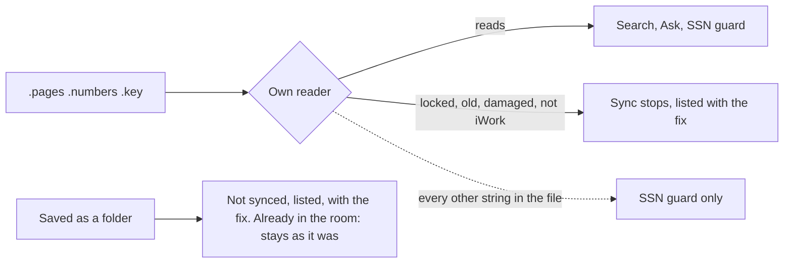

# Reading Pages, Numbers and Keynote

Tested 2026-11-01, invented files only, Pages, Numbers and Keynote 15.4. Issue #66.

## Routes

✅ yes, ⚠️ partly, ❌ no, – can't read that format

| | **Own reader (chosen)** | Quick Look | Spotlight | LibreOffice | numbers-parser | SheetJS |
|---|---|---|---|---|---|---|
| Pages markers found | ✅ 43/43 | ✅ 43/43 | ✅ 43/43 | ⚠️ 41/43 | – | – |
| True page numbers in Pages | ❌ none | ✅ exact | ❌ | ⚠️ differ | – | – |
| Tracked deletion left out | ✅ | ✅ | ❌ | ❌ | – | – |
| Comment left out | ✅ | ✅ | ❌ | ✅ | – | – |
| Header, footer or body no page prints left out | ✅ #228, against Pages 15.4's PDF | not tested | not tested | not tested | – | – |
| Numbers: text | ✅ | ✅ | ✅ | ❌ none | ✅ | ✅ |
| Numbers: amounts | ✅ | ✅ | ❌ none | ❌ none | ⚠️ raw | ⚠️ raw |
| Numbers: 1,200 rows | ✅ | ✅ | ⚠️ labels only | ❌ none | ✅ | ✅ |
| Keynote: slides in order | ✅ | ✅ | ❌ | ✅ | – | – |
| Keynote: speaker notes | ✅ | ❌ | ✅ | ❌ | – | – |
| Says a file is locked | ✅ | ✅ | ❌ silent | ✅ | ✅ | ✅ |
| Adds nothing to install | ✅ | ✅ | ✅ | ❌ large | ❌ Python | ❌ npm, from 2022 |
| Runs on Windows | ✅ tested | ❌ | ❌ | ✅ not tested | ✅ not tested | ✅ not tested |
| Bad file | ✅ short code, in a child process with a heap limit and a deadline | ⛔ crash dialog | not tested | not tested | not tested | not tested |

Hosted macOS 15, 26 and 27 with no iWork app, hosted Linux, hosted Windows, this Mac. LibreOffice 24.2, as Ubuntu ships it: a newer one may do better. Reader: 140 to 190 ms per document, process start included.

## Why not Quick Look

⛔ `qlmanage` aborted on a Pages file with parts missing, and macOS showed "quit unexpectedly". A damaged or half-synced file could do that on a founder's Mac. It can't be sandboxed, and a dialog can't be ruled out, so true Pages page numbers wait. Its numbers were exact: 2,200 markers over 163 pages, none off.

## What a cite says

A cite never prints a page nobody knows.

| | Mac and Windows |
|---|---|
| Pages | The document, no page |
| Numbers | Sheet |
| Keynote | Visible slide |
| Word and other office files | "p. 1" today, wrong: #142 |

## When a file can't be read

| Code | Means | The founder is told |
|---|---|---|
| `password` | Locked | Remove the password, or export a PDF |
| `old-format` | iWork '09, very old Numbers | Open it and save it again |
| `not-iwork` | A `.pages` or `.numbers` file, or a ZIP named `.key`, that isn't one | Rename it, or take it out of the folder |
| `too-large`, `timeout` | Past a limit | Export a PDF |
| `unreadable` | Damaged, or still downloading | Open it in the app, or sync again |
| Saved as a folder | Package form | File > Advanced > Change File Type > Single File |

A `.key` that isn't a ZIP isn't Keynote's, so it isn't a failure. It isn't indexed, and the guard reads its bytes. A private key is flagged: take it out of the folder.

## Limits

| | Instead |
|---|---|
| ❌ Pasted scans and photos | Save a scan as a PDF, which gets OCR |
| ❌ Chart titles and labels | Data in tables is read |
| ❌ Automatic list numbers ("1.", "2.") | The clause text is read |
| ❌ Folder-form file not synced | Listed until re-saved as a single file. One already in the room stays at its last version |
| ❌ Windows founder can't open the original | Search and Ask work. The room says "Opens in Pages on a Mac, or at iCloud.com" |
| ⚠️ Hidden rows and columns | Read, as Excel's are |
| ⚠️ A CSV-imported table keeps that file's path inside the document | Never indexed, but it stays in the file |

Text the reader can't place goes under `Other text:`, so it is never lost. Across 22 saved files, none needed it.

## Apple's licence terms

Read 6 Nov 2026: the Pages, Numbers and Keynote Software License Agreements at `apple.com/legal/sla/docs/{Pages,Numbers,Keynote}.pdf`. All three say the same in each clause below.

| Clause | Says | For the reader and fixtures |
|---|---|---|
| 2.I No Reverse Engineering | No decompiling or reverse engineering of "the Apple Software" | ✅ The reader is written from saved files and public notes. No Apple code is read, called or bundled |
| 2.F Content and Digital Materials | Photos, images, clipart and artwork in templates may not be distributed "on a standalone basis" | ✅ No fixture holds an image (checked: 0 image entries in each ZIP). Files made from Apple templates are for local checks only, never committed |
| 2.A(ii) | A commercial enterprise may run one copy per person | ✅ Fixtures are saved by the apps, run under this grant, from invented text |
| 2.H | No renting, selling or redistributing the Apple Software | ✅ Nothing of Apple's ships |
| Neither | Who owns a user's documents, or reading them with other software | No limit stated. The files are the customer's own |

Not legal advice: no lawyer reviewed this, same as [`dependency-review.md`](../licences/dependency-review.md).

## Not established

| | |
|---|---|
| A real folder-form file from iCloud Drive | None available |
| Much older Numbers cell layouts | None available. Fails visibly |
| A document under a folder name inside the file | None in 77 saved files. Fails visibly, as `not-iwork` |
| Legal review | None. Not legal advice, same as [`dependency-review.md`](../licences/dependency-review.md). `ip-legal:oss-review`'s method applied by hand, because its profile isn't set up here |

## Dependencies

✅ **None added**: `node:zlib` and `node:fs` only.

| Rejected | Licence | Why not |
|---|---|---|
| LibreOffice, libetonyek | MPL 2.0 | Read no current Numbers file |
| numbers-parser | MIT | Python, Numbers only, reverse-engineered schemas |
| keynote-parser | MIT (metadata only) | Python, no text output, schemas extracted from a copy of Keynote |
| SheetJS `xlsx` | Apache-2.0 | Numbers only, npm release from 2022 |

The reader copies no third party's code or schema. It holds only the field numbers it reads, recognised from public notes and checked byte by byte against the invented files. The apps' binaries were searched once for a preference name, with no result, and nothing from that is in the reader.

Sources: [Snappy format](https://github.com/google/snappy/blob/main/format_description.txt), [iWorkFileFormat](https://github.com/obriensp/iWorkFileFormat/blob/master/Docs/index.md), [numbers-parser notes](https://masaccio.github.io/numbers-parser/api/file-format.html), [keynote-parser](https://github.com/psobot/keynote-parser), [libetonyek copyright](https://metadata.ftp-master.debian.org/changelogs/main/libe/libetonyek/stable_copyright).
