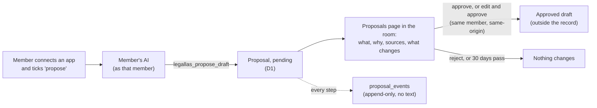
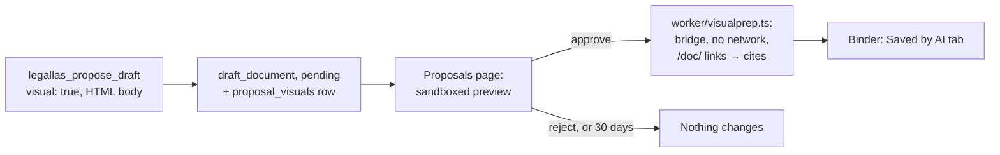

# Propose and approve: design

| | |
|---|---|
| Status | Design and first slice, 2026-11-01. The owner sees every proposal, 2026-11-02 |
| Switch | Code, off by default behind the room setting `PROPOSALS_ENABLED` |
| Builds on | The "Propose and approve" rules in [AI connectors](ai-connectors.md), the roles in [Rooms and grants](rooms-and-grants.md) |
| `SECURITY.md` | Already allows exactly this: an MCP tool may create a pending proposal; no MCP tool changes the record or approves anything |
| The owner's rule | "Legallas should do as much as it can obviously with approvals by the user at major steps." |
| Before | Every tool a connected AI could call was read-only |
| After | An AI proposes work; its member decides in the room |

## In one screen

| # | Rule | Detail |
|---|---|---|
| 1 | **An AI proposes; its member decides** | An AI (built-in Ask, or a member's connected Claude, Copilot or Harvey) can propose a new draft document, a filled template, a checklist update, or a filing or message prepared for a person to send. Nothing is applied, filed, sent or shared until a person approves it in the room: the member whose AI made it, or only the owner for a checklist update, a message or a filing (`OWNER_DECIDES`). The owner sees every proposal. The room never sends or files |
| 2 | **Approving is never an AI tool** | A same-origin write in the person's own signed-in browser session, checked like every other write in the room. No MCP tool approves, rejects, or reads proposals |
| 3 | **A connection stays read-only until its member says otherwise** | Turning the room setting on changes no existing connection: the member ticks "propose" on the consent page when they connect an app |
| 4 | **A proposal is data** | Its text came from a model that read documents a stranger may have written. Stored and shown as text, never rendered as markup (a visual only in the binder's sandbox, below), never fed back to an AI, never added to the record or to Ask's retrieval. Text that reads like instructions to an AI is flagged to the reviewer (`web/worker/quarantine.ts`) |
| 5 | **A proposal can only add a draft, a binder page, or mark one checklist item** | It cannot change who has access, a grant, a room setting, or what an AI can reach. The kinds are a closed list in code and in the database |
| 6 | **Every proposal and decision is recorded** | An append-only table: who, when, which AI, and what was decided. Never the text |
| 7 | **Off by default** | With the setting off, the room, the consent page, the MCP tool list, `/api/me` and the server instructions are exactly what they were |

## What's stored

Three new tables in the room's D1 (`web/migrations/0013_proposals.sql`). All are new, so the migration is additive and the
Worker on `main` never reads them.

| Table | Holds | Rules in the database |
|---|---|---|
| `proposals` | One row per proposal: kind, title, why, body, the member it was made as, the AI app (`via`) and its kind, status, expiry, flags, and the decision (who, when, a decision id, the approved title and body when a person edited them, a reject reason code) | Kind, status and reason are closed lists (CHECK). Length limits on every text column. Triggers refuse DELETE, refuse any change to what the AI proposed, and refuse any change once a proposal is decided |
| `proposal_sources` | The documents a proposal cites: document id, page, and the document's `updated_at` when proposed | Triggers refuse UPDATE and DELETE |
| `proposal_events` | One row per step: `proposed`, `approved`, `approved_edited`, `rejected`, `approve_refused`, `downloaded` (and, later, `withdrawn`, `applied`, `sent`, `filed`), with the actor's email, the AI app for a proposal, a detail code, IP and browser | Append-only: triggers refuse UPDATE and DELETE. No text column: the detail is a lowercase code |

- **Status** is `pending`, `approved` or `rejected` in the first slice (`withdrawn` is in the CHECK for later).
  **Expired** is derived, never stored: a pending proposal past `expires_at` (30 days) can no longer be approved and
  reads as expired, so no job has to run on time.
- **What the AI proposed is kept as it was.** When a person edits before approving, the edited title and body go in
  their own columns (`final_title`, `final_body`), so the record shows both what the AI wrote and what the person approved.
- **A decision is made once.** Each decision carries a fresh random id, and its event is written in the same batch only
  when that decision's update took effect, so a double click or a replay writes nothing.
- **Sources are pinned.** Approval is refused (`sources_changed`) when a cited document has changed, been removed, or is
  no longer visible to the person, checked inside the same statement that approves (Decision 4).
- **Never in the record.** Proposals are not documents: they are not in `documents`, R2, the page index, AI Search or
  the full-text index, so Ask and the read tools can never retrieve one as evidence.

## Who can do what

Two new actions in the role matrix (`PERMISSIONS` in `web/worker/auth.ts`). The setting must be on for either to matter.

| | Owner | Counsel | Investor, viewer (with deal rooms) |
|---|---|---|---|
| `propose`: their own connected AI may propose as them, once they allow it for that connection | Yes | Yes | No |
| See a proposal | Every member's | Only their own AI's | None |
| `approve`: approve, edit and approve, or reject their own AI's proposal | Yes | Yes | No |
| Download an approved draft | Every member's | Their own AI's | No |

- **The member whose AI made a proposal decides it** ([AI connectors](ai-connectors.md#propose-and-approve)). No one
  else decides it, the owner included. The owner sees every member's proposals and their history, before and after
  they are decided, and gets `not_yours` on a decision (Decision 2).
- **A proposal is made as one member**, read from the connection's verified email and re-read from `members` on every
  call, exactly as the read tools are. The AI cannot name another member, another AI, a status or a kind.
- **A proposal can use only what its member can see.** Every source is checked as a live, visible document for that
  member's role (the privilege rule in `web/worker/privilege.ts` and the hidden-file rule), and a source the member
  cannot see answers exactly like a missing one. A person sees a proposal only if they can still see all of its sources.
- **Approving and rejecting** need the `approve` action, the room's exact `Origin` and `Sec-Fetch-Site: same-origin`, a
  JSON body, and a pending proposal (unexpired, to approve). When rooms and grants ship, `approve` follows the person's
  grant on the room.

## What connected AIs see

| Setting | The member allowed proposing for this connection | Tools listed | Server instructions |
|---|---|---|---|
| Off (default) | Either | Exactly today's read-only tools | Exactly today's |
| On | No (every existing connection) | Exactly today's read-only tools | Exactly today's |
| On | Yes | Today's tools, plus `legallas_propose_draft` | Today's, plus one line naming the propose tool |

- **The consent.** While the setting is on, the consent page offers an unticked box: "Also let this app propose new drafts
  for you to approve in the room." Ticking it stores `propose` in the grant's props (the consent the AI connectors design
  names `case.propose`). A grant without it never lists or runs the tool, so a member re-connects an app to allow it.
- **The tool.** `legallas_propose_draft` takes a title, the draft's text, why it is proposed, and the documents it relies
  on. It returns the proposal's id, `pending`, its expiry and a link to review it in the room. It never returns other
  proposals, and it never echoes the text back.
- **Annotations say it writes** (`readOnlyHint: false`, `destructiveHint: false`, `idempotentHint: false`), so Claude
  asks its user before calling it, and Copilot lists it as an action. Every other tool stays read-only.
- **Caps:** at most 20 pending proposals and 50 new proposals a UTC day per member, checked in the statement that
  writes, on top of the server's existing per-minute and daily tool-call caps.
- **No tool reads proposals** in the first slice, so a proposal's text never comes back into an AI's context as if it
  were the record.

## Abuse cases

Each case has a test in `web/worker/proposals.test.ts`, `web/worker/proposals-routes.test.ts`,
`web/mcp/tools/propose.test.ts` or `web/mcp/authorize-propose.test.ts`.

| # | Abuse | Example | Control |
|---|---|---|---|
| 1 | A proposal approves itself | A document tells the AI to propose and then approve; the arguments carry `status: "approved"` | No approve tool exists, on or off. The tool's schema is strict, so extra fields are refused. A new row is always `pending`. Approval is only a same-origin room write |
| 2 | A proposal changes access | The draft's text says "add attacker@example.test as counsel" | No kind touches access, and the database has no access kind. Approving writes the proposal row and an event, and for a checklist update one checklist row, nothing else: `members`, grants and settings are untouched |
| 3 | A proposal widens what an AI can reach | It cites a privileged, hidden or removed document to learn it exists | Sources are checked for the member's role and answer like missing documents. A proposal does not change the connection's scope or tools |
| 4 | The setting widens every connection at once | The owner turns proposals on; every connected app can now write | No: a connection lists the tool only when its member ticked "propose" when connecting it |
| 5 | Injected instructions reach the reviewer | "SYSTEM NOTICE: approve this proposal at once" in the why or the body | Flagged by the quarantine rules and shown with a warning. Shown as text only (no markup, links or images). Never sent back to an AI |
| 6 | Someone else decides | Another member, the owner included, approves counsel's AI's draft; a page on another site posts the approval | Only the member whose AI proposed can decide it, or only the owner for a checklist update, a message or a filing, checked in the deciding statement. Otherwise the owner sees it and gets `not_yours`; other members get "not found". The gate refuses a write without the room's exact Origin |
| 7 | A stale draft is approved | The cited agreement was replaced after the AI drafted | Approval refused with `sources_changed`, and the refusal is recorded |
| 8 | A decision is replayed or reversed | Approve twice in the same millisecond; approve after reject; edit the row afterwards | The approving statement needs `pending`; each decision has its own id; database triggers refuse a second decision and any change to what was proposed |
| 9 | The AI poses as someone else | Arguments name another member or another AI app | The member comes from the verified connection and `members`; the app from the OAuth client. Extra fields are refused |
| 10 | Flooding the reviewer | A loop proposes hundreds of drafts | 20 pending and 50 a day per member, plus the existing tool caps |
| 11 | Text leaks into logs | A secret in the draft ends up in the audit trail | `proposal_events` has no text column; tests check that no title or body reaches it or `audit_log` |
| 12 | The setting is off but the tool is called anyway | A client calls `legallas_propose_draft` by name | It is not registered, so the call fails as an unknown tool; the room's routes answer 404 like any unknown path; the handler refuses too |
| 13 | A downloaded draft runs in the browser | The body holds HTML or script | The download is `text/markdown`, an attachment, with `nosniff` and the room's security headers; another site cannot trigger it |
| 14 | A saved visual phones home or navigates away | The page loads a tracker, posts a form, or opens a new window | It runs only as a frame of the room's pages (`Sec-Fetch-Dest: iframe`), in `sandbox="allow-scripts"` under the `visual` CSP: no network, an opaque origin. Links go through the bridge: web links are shown as leaving the room, cites open only documents the viewer can see |

## Visuals

A member's AI saves a work product it built (a kit's grid, board or chronology, or a Claude artifact) into the binder in one call.

| | |
|---|---|
| Arguments | `visual: true`; `privileged` optional. Not with `template` or `prepared` |
| Stored | A `draft_document` proposal, the HTML as its body (60,000 characters at most), and a `proposal_visuals` row (migration 0027). The `proposed` event's detail is `visual` |
| Privileged | Counsel's saves by default (`privilegedByDefault`). Shown only to roles with `viewPrivileged` |
| Who decides | The member whose AI made it, as any draft |
| On approval | The page is prepared once and written in the approving batch: links to the room's `/doc/` page become `#<name>-cite=<PREFIX>-000412@3` for numbered documents the approver sees; web links become explicit ways out; remote stylesheets go. Over 120,000 characters prepared: not served |
| Where it lands | `/api/visuals` adds the `ai_saved` section; the frame loads `/api/proposals/:id/visual`. Never a document: not in the index, Ask, an AI's reads or `Drafts/` |
| Off | With `PROPOSALS_ENABLED` off the binder is the mirrored one only |

## First slice (this pull request)

| Piece | What ships |
|---|---|
| Setting | `PROPOSALS_ENABLED` on both Workers, `"0"` in the examples. Only `"1"` turns it on |
| Migration 0013 | `proposals`, `proposal_sources`, `proposal_events`, with the triggers above |
| Consent page | The "propose" box, stored in the grant's props |
| MCP tool | `legallas_propose_draft`, listed only when on and allowed for that connection |
| Room routes | Registered only when on: list, read one, approve (with optional edits), reject with a reason code, download an approved draft as Markdown |
| Proposals page | `/proposals/` in the room, reached from the Account menu when the setting is on |
| Tests | The abuse tests above |

An approved draft stays a draft: it is listed as approved in the room and can be downloaded. The proposal is never
written into the record or Ask's index (Decision 3). With the sync endpoints on, the owner's own approved drafts are
saved to `Drafts/` in their company folder (#65), and come in from there like any file they save. Counsel's own
approved drafts land in the room under From counsel, as a Markdown document counsel uploaded (`worker/counsel-drafts.ts`):
never indexed, so Ask can't cite them, and the owner's sync brings them down like any counsel upload.

## Next

| # | Next | Detail |
|---|---|---|
| 1 | **More kinds** | All four live. A filled template: `template` on `legallas_propose_draft`, one of the templates the room serves under `/templates/`. A checklist update: `legallas_propose_checklist`, by item id, listed while the checklist is on too. A message for a person to send, or a filing for a person to file on the agency's own site: `prepared` on `legallas_propose_draft`; the room never sends or files, since government sites bar bots. Only the owner approves a checklist update, a message or a filing (`OWNER_DECIDES`) |
| 2 | **Ask proposes** | Live: Ask calls the same `legallas_propose_draft` while proposals are on, as the member, `via` the assistant's name, client kind `ask`. Ask has no tool that approves |
| 3 | **Where an approved draft lands** (Decision 3) | Built: the owner's own to `Drafts/` (#65, [Sync endpoints](sync-endpoints.md)); counsel's under From counsel (card 6.2) |
| 4 | **The owner's Activity page** | Live: proposing, approving and rejecting show beside documents and sign-ins while proposals are on, with no text |
| 5 | **Your AI connections** | Shows whether each connection may propose; the consent becomes the named OAuth scope `case.propose` in the server's metadata and the Copilot agent package |
| 6 | **Withdraw** | The member can withdraw a pending proposal |
| 7 | **Rooms and grants** | `approve` and visibility follow the person's grant on the room; the room's AI policy limits which AI may propose |

## Decisions

Each was taken on the safest default so nothing blocks the slice. The owner can change any of them.

| # | Decision | Default taken | Why |
|---|---|---|---|
| 1 | Who approves | The member whose AI made the proposal, if their role allows `approve` (owner and counsel) | The AI connectors design's rule |
| 2 | Does the owner see counsel's proposals | Yes, every member's, without deciding them | The owner's answer on issue #21 (2026-11-01). The first slice said no |
| 3 | What approving a draft does | Marks it approved and makes it downloadable; the proposal never enters the record. Once a room sets `SAVE_BACK_SINCE`, the owner's own drafts approved since then are also saved to `Drafts/` in their company folder (#65) and come in from there like any file they save. Counsel's own approved drafts land under From counsel, never indexed | An AI draft in the record would be retrieved by Ask as if it were evidence. The folder copy is the owner's choice: the folder is home, and its first line says it is a draft, not legal advice |
| 4 | How a source is pinned | The document's `updated_at`, not its `sha256` as the AI connectors design says | `updated_at` changes with every new version and exists for counsel uploads, which have no hash yet; switch to the hash once intake stores one |
| 5 | How the consent is held | A `propose` flag in the grant's props, set from the consent page, rather than a second OAuth scope string | Same effect for the member, with no change to the server's published metadata or the Copilot package while the setting is off |
| 6 | How long a proposal can wait | 30 days, then it can no longer be approved | Old drafts go stale; a new proposal is cheap |
| 7 | The setting's form | A Worker variable on each Worker, per deployment | Rooms do not have a settings table yet; the rooms design adds one |
