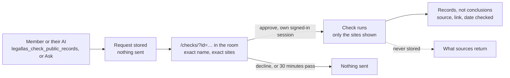

# Check who you're dealing with: public records sources

| | |
|---|---|
| What | Before a deal or a signature, a member looks a person or a company up in public records |
| Code | `web/worker/public-records-catalog.ts`, `web/worker/public-records-sources.ts`, the tool `legallas_check_public_records`, and Ask |
| This page | For each source: what its terms and robots rules allow, and what Legallas does with it |
| Checked | 2026-11-01. This session's network reached none of these sites, so no robots.txt or terms page was read directly |
| Evidence | Web search results that quote the sites' own pages. Where nothing could be confirmed, the table says so, and the source is not automated |
| Before a release | Each row needs a live check ("What needs a live test") |

## Sources

| Source | What the terms and robots rules say | Confirmed how | What Legallas does |
| --- | --- | --- | --- |
| SEC EDGAR full-text search (`efts.sec.gov`), including Form D and company filings | The SEC lets automated tools in if they declare a User-Agent with a company name and contact email and stay at or under 10 requests a second. Undeclared bots are not allowed to crawl. `www.sec.gov/robots.txt` disallows `/cgi-bin` (the old company browse pages). The full-text search API is the one the SEC's own search page calls; it is not in the SEC's list of documented APIs. | Search results quoting sec.gov's "Accessing EDGAR Data" and developer pages, and a cached copy of sec.gov's robots.txt. `efts.sec.gov/robots.txt` was not seen. | **Automated**, one request per check, only when the room sets `PUBLIC_RECORDS_CONTACT` (sent in the User-Agent). Never touches `/cgi-bin`: the company filing list is given as a link for the member to open. |
| SEC Investment Adviser Public Disclosure (`adviserinfo.sec.gov`) | Its terms of use were not found. Its search runs on the same system as BrokerCheck, whose terms bar robots. | Not confirmed. | **Link only**, with what to look for. |
| FINRA BrokerCheck (`brokercheck.finra.org`) | Terms of use, section 6(g), bar bulk monitoring or copying and any data mining, scraping or robots. Use is limited to the user's own personal or professional use. | Search results quoting brokercheck.finra.org/terms. | **Link only**, with what to look for. |
| Colorado Secretary of State business search (`coloradosos.gov`) | Its terms and robots rules were not found. The search page links to "Terms & conditions". | Not confirmed. | **Link only**, with what to look for. |
| Colorado Information Marketplace, "Business Entities in Colorado" (`data.colorado.gov`, dataset `4ykn-tg5h`) | The state's open data portal publishes the Secretary of State's entity register through a Socrata API made for programs. A third-party directory lists the licence as public domain. Column names `entityid`, `entityname` and `entitystatus` were confirmed; the rest were not. | Search results (third-party pages describing the dataset). The portal's own terms and robots.txt were not seen. | **Automated** for a company, one request per check. A column that is missing is left out, never guessed. Not used for a person: it is searched by entity name. |
| Delaware Division of Corporations entity search (`icis.corp.delaware.gov`) | The Division prohibits data mining of its name and entity search, warns that automated tools can get access suspended, and puts the search behind a challenge. The free result is limited; status and tax standing cost a fee. | Search results quoting the Division's pages. | **Link only**, with what to look for. Not applicable to a person. |
| CourtListener dockets (`www.courtlistener.com`) | Free Law Project offers a REST API for programs. Since API v4.3 (and v4.8 for the rest), v4 endpoints answer anonymous requests with 401, so a token is needed. Default limits for a new account: 5 a minute, 50 an hour, 125 a day. | Search results quoting CourtListener's API documentation and change log. Its terms and robots.txt were not seen. | **Automated**, one request per check, only when the room sets the secret `COURTLISTENER_TOKEN` (the room owner's own token; Legallas creates no account). Searches dockets (`type=d`). |

Coverage is said plainly in every result, so an empty result is never read as a clean record. For example, CourtListener
holds the federal dockets someone has bought from PACER and shared, and almost no state court cases.

## How a check behaves

| Rule | Detail |
|---|---|
| **Approval first** | The first call sends nothing. It records a request and returns a link to `/checks/?id=…` in the room, where the member who asked sees the exact name and the exact sites, and approves or declines. Only then does a call run the check, and only against the sites shown |
| Limits | At most 10 requests waiting per member. A pending request lapses after 30 minutes, an approval after an hour |
| Nothing kept | Expired rows are deleted whenever a member uses the approval page and by the MCP Worker's daily cron, so the room keeps no lasting list of who was checked. What the sources return is never stored |
| **A pending proposal, as `SECURITY.md` allows** | The tool's one write is the request, which changes nothing until the member approves it in the room in their own signed-in session; no tool approves |
| What leaves the room | It is the only tool that sends anything out of the room: the name, after approval. The name sent is always the one the member approved, as the page showed it |
| Annotations | The propose tool's (`readOnlyHint: false`), plus `openWorldHint: true`, so a client that asks before running such a tool asks the member too |
| Roles | Asking takes the `propose` role action and approving the `approve` one, as for [proposals](propose-and-approve.md) |
| Consent | Like `legallas_propose_draft`, listed only on a connection whose member ticked "propose" on the consent page; while the check is on, that box names public-records checks. A connection kept read-only cannot make the room store a name; the tool's handler checks the consent too. A connection made before the box named the check must be connected again to get it |
| Own table | Not the proposals' append-only log, because that log would keep the names that were checked |
| **Off unless set** | `PUBLIC_RECORDS` is `"0"` in the examples, so a room turns the check on by choice (`"1"`). Off, the tool is not listed and Ask is not offered it |
| **Records, not conclusions** | Each finding has its source, a link and the date checked. Each source is listed as searched, could not check (with the reason), search by hand (with the link and what to look for), or not applicable. A failure is never shown as "nothing found". The result never labels anyone |
| **In Ask** | Shown as its own card beside the answer. It never enters the answer's evidence, so the answer never cites a public record as part of the case record |

## Fair Credit Reporting Act wording

Every result and the approval page say:

> Not a consumer report. This check is not a consumer report as the Fair Credit Reporting Act defines one (15 U.S.C.
> § 1681a(d)), and Legallas does not act as a consumer reporting agency. Do not use it, in whole or in part, to decide whether
> a person is eligible for credit, insurance, employment or housing, or for any other purpose the Act covers (15 U.S.C.
> § 1681b). Use it only to research a party before a business deal or a signature.

Every result also says it is not a lawyer and not legal advice, and to have the user's own lawyer review anything a decision
depends on.

| Why this wording | |
|---|---|
| Consumer report | A communication from a consumer reporting agency about a person's credit, character, general reputation, personal characteristics or mode of living, used or expected to be used for credit, insurance, employment or another purpose listed in § 1681b (15 U.S.C. § 1681a(d)) |
| Consumer reporting agency | Regularly assembles or evaluates such information to furnish reports to third parties for a fee (§ 1681a(f)) |
| Legallas | Furnishes nothing to anyone. Each room runs in its owner's own account, and the member runs the search for their own use. That is why the notice can say Legallas does not act as a consumer reporting agency |
| A disclaimer alone does not decide it | In 2023 the FTC said TruthFinder and Instant Checkmate acted as consumer reporting agencies despite disclaimers on their sites, because they assembled background reports and marketed them for employment and tenant screening; they paid $5.8 million ([FTC, 2023](https://www.ftc.gov/news-events/news/press-releases/2023/09/ftc-says-truthfinder-instant-checkmate-deceived-users-about-background-report-accuracy-violated-fcra)). So the check must never be marketed or offered for screening, and the notice names the uses to avoid |
| "Housing" | Named because tenant screening is a common use the Act covers, though § 1681b reaches it through "legitimate business need" rather than by that word |

A lawyer should review this wording, and whether a particular customer's use (for example, checking a person who will
personally guarantee a deal) could still fall under the Act, before customers rely on it.

## What needs a live test

None of this was run against the real sites. Before a release, from a room's Worker:

| # | Source | Confirm |
|---|---|---|
| 1 | **EDGAR**: one search with a contact address set | The response shape (`hits.total.value`, `hits.hits[]._source.ciks`, `display_names`, `form`, `file_date`, `adsh`); the filing index links open; the SEC accepts requests from Cloudflare Workers' addresses; read `efts.sec.gov/robots.txt` and the SEC's current fair-access page |
| 2 | **Colorado open data**: one company search | The dataset id `4ykn-tg5h`; the column names (`entityformdate`, `entitytype`, `principalcity`, `principalstate`, and whether it is `jurisdictonofformation` or `jurisdictionofformation`); the `upper(entityname) like` query works and is quick enough; the limit without an app token; the portal's terms and licence |
| 3 | **CourtListener**: one search with a token | `type=d` returns `caseName`, `docketNumber`, `court`, `dateFiled`, `dateTerminated`, `suitNature`, `docket_id` and `docket_absolute_url`; the docket links open; the site's terms |
| 4 | **The linked pages** | Open each link (EDGAR search, adviser search, BrokerCheck, the Colorado Secretary of State's search at `coloradosos.gov/ucc/pages/biz/bizSearch.xhtml`, Delaware's name search) and read each site's current terms and robots rules. Automate one only if its terms allow it |
| 5 | **The approval round trip** | In a real room, from Claude and from Ask |
