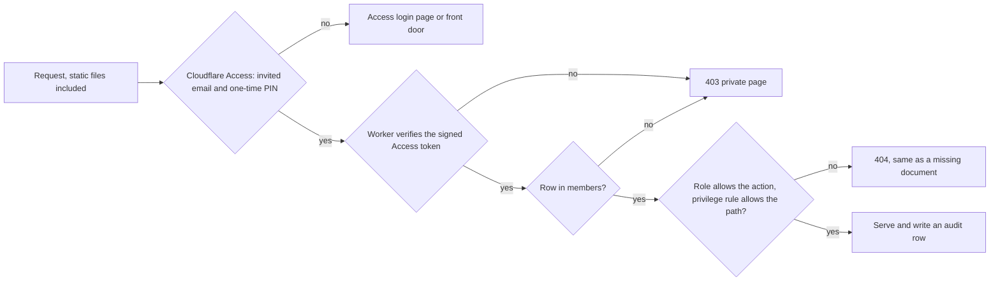
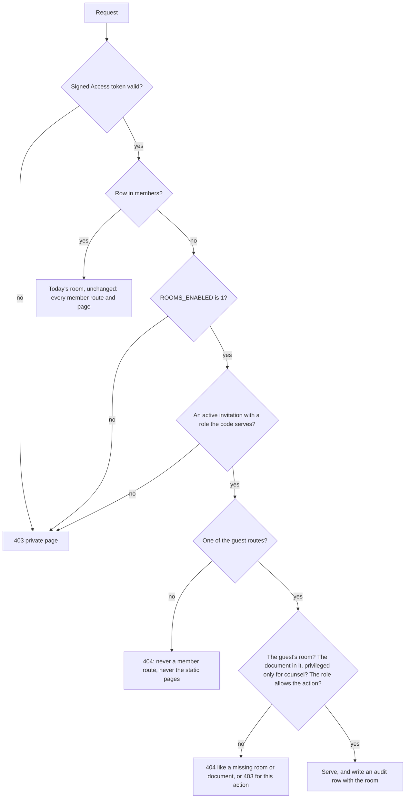
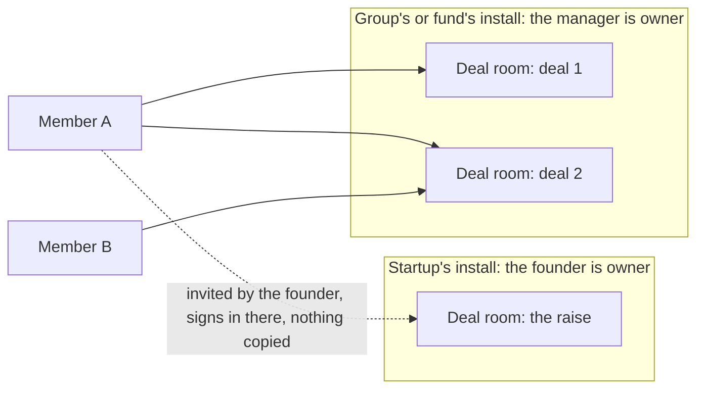
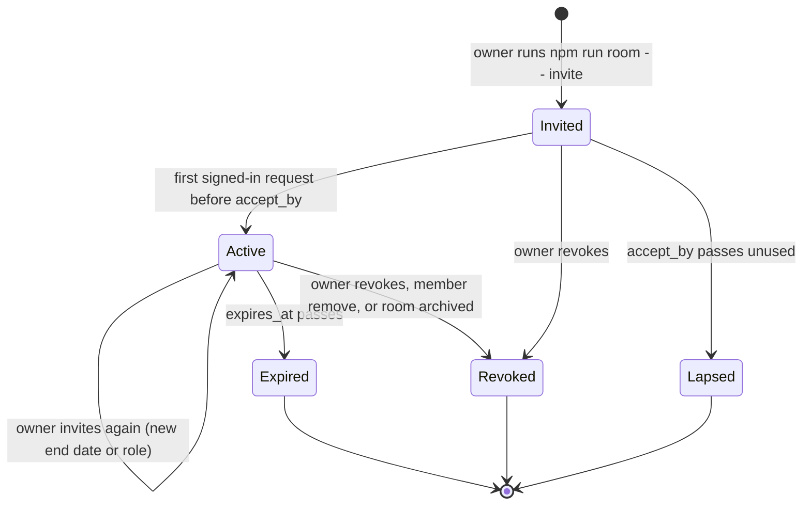

# Rooms and grants: design

Status: design 2026-10-31, updated 2026-11-01 to the owner's terms for groups and funds and to what the code does. The first
slice is built: deal rooms, the investor role and invitations, behind `ROOMS_ENABLED`, which is off by default (migration
`0012_deal_rooms.sql`, `web/worker/rooms.ts`, `web/worker/routes/rooms.ts`, `web/scripts/room.ts`). Matter rooms with
counsel as guests followed on 2026-11-02, behind the same setting and with no new migration. Investors' own AI apps followed on
2026-11-06 (the owner: investor AI on by default, never privileged), and so did privileged documents for matter-room counsel
(the owner, 2026-11-05: founder and counsel see everything). Cloudflare facts and prices
were checked against official pages on 2026-10-31 and 2026-11-01 (see "Sources").

## In one screen

1. **One install, many rooms.** One install per company, group or fund, run by its owner (the founder, or the group's or
   fund's manager). Each deal is its own room with its own documents and its own people. A room is a view over the record:
   it shows the documents under its folders and never copies them.
2. **People are invited to the rooms they need, with a role.** The install's own owner and counsel keep seeing the whole
   record, as today. Everyone else is a guest of the rooms they are invited to. The first guest role is **investor**: read
   what the room shows, comment, and nothing else.
3. **Reviewing a startup happens in the startup's room.** An investor, group or fund joins the founder's room as a guest of
   that room, signing in with their own email. Installs never talk to each other, and nothing is copied across installs.
4. **Removal is immediate.** The room and the remote MCP server re-read access on every request and every tool call, so a
   revoke, an expiry or an archived room ends access at the next one, for the person and for their connected AI.
   **Investors connect their own AI** (Claude, Copilot, Harvey, OpenCode): it reads what their rooms show, nothing more.
5. **Privileged material never reaches an investor.** The path rule (`privileged` anywhere in a path) hides it, a document
   the matter manifest marks privileged is hidden too, and a manifest that cannot be read shows the investor nothing at all.
   One guest role lifts both: counsel in a matter room (`viewPrivileged`).
6. **No Cloudflare API token in the room.** Sign-in stays Cloudflare Access with a one-time PIN per invited email. The owner
   keeps the Access policy in step by hand, as today. The token the earlier design proposed is not built; see "Needs a
   decision".
7. **A single-room install is unchanged.** Migration 0012 is purely additive, and with `ROOMS_ENABLED` unset the Worker reads
   none of it: a guest is refused exactly like a stranger, and members, pages and MCP tool listings stay byte for byte the same.

## The owner's terms (2026-11-01)

- **Price and seats:** $99 for the install and setup, in the customer's own Cloudflare account. Whoever bought it can invite
  people into their data room for free. Anyone who wants their own install buys one.
- **Groups and funds:** one install per group or fund, run by its manager. Each deal is its own room. Members are invited to
  what they need.
- **Reviewing a startup:** they join the startup's room, with nothing copied.

## Today: how a room gives counsel access



| Piece | Today | Where in `web/` |
|---|---|---|
| Lock 1 | One Access app over the whole Worker (`run_worker_first`). Counsel sign in with a one-time PIN and the owner with the Cloudflare login. A reusable policy holds one email rule per person, never a domain rule | `wrangler.example.jsonc` (`run_worker_first`), Access settings |
| Lock 2 | The Worker verifies `Cf-Access-Jwt-Assertion` itself (issuer, audience, RS256), then requires a `members` row. It fails closed | `worker/auth.ts`, `worker/room.ts` |
| People | `members(email, role, name, added_at)`. Roles are `owner` and `counsel`. A third, read-only role was retired by triggers in migration 0010 | `migrations/0001`, `0006`, `0010` |
| Permissions | One matrix of 14 actions (`view`, `viewPrivileged`, `download`, `readComments`, `comment`, `resolve`, `upload`, `ask`, `flag`, `connect`, `viewActivity`, `propose`, `approve`, `setCompany`). Counsel can do everything the owner can except `viewActivity` and `setCompany` | `PERMISSIONS` in `worker/auth.ts` |
| Scope | One room. Every member sees every document | |
| Privilege | If any path segment contains "privileged", the document reaches only roles with `viewPrivileged`. A refused document answers like a missing one. The matter manifest can also mark a document privileged; today that mark is only shown, because every role that exists sees privileged documents | `worker/privilege.ts`, `worker/doc-facts.ts` |
| Static pages | The Astro build reads the room's own settings file at build time (banner, control prefix, regulator name), so the room's pages carry them | `src/scripts/room-config.ts` |
| Adding a person | `npm run member add` on the owner's Mac writes production D1. The Access policy is edited by hand, and the invite email is sent by hand | `scripts/member.ts` |
| Removing a person | `npm run member remove` cuts them off at the Worker at once. With the owner's `LEGALLAS_ACCESS_API_TOKEN`, it also removes them from the Access policies and ends their sessions; without it, both are done by hand | `scripts/member.ts`, `scripts/access-offboard.ts` |
| AI connector | `legallas-mcp` runs its own OAuth, with the Access code at `/authorize`. Refresh tokens die 30 days after sign-in. Every tool call re-reads `members` (and `room_members` for an investor), and a daily sweep revokes the connections of anyone who is neither | `mcp/authorize.ts`, `mcp/server.ts`, `mcp/sweep.ts` |
| Audit | `audit_log` holds document actions, with `via` naming the AI app. `sign_ins` holds one row per Access session and alerts the owner. Neither ever stores text | `worker/audit.ts`, `worker/signins.ts` |
| Sessions | 6 hours from sign-in | Access settings |
| Writes | Need the exact `Origin` and `Sec-Fetch-Site: same-origin` | `worker/room.ts`, `worker/http.ts` |

Two findings shaped the first slice. The static pages carry the room's settings, so a guest must never be served them. And
the manifest's privilege mark matters for the first time, because investors are the first role that must not see privileged
documents.

## The first slice: what is built



| Piece | What it does | Where |
|---|---|---|
| Setting | `ROOMS_ENABLED`: "1" on, anything else or unset off. Not in `wrangler.example.jsonc`, so a room turns it on deliberately, after migration 0012 is applied | `worker/env.ts`, `worker/rooms.ts` |
| Data | `rooms`, `room_folders`, `room_members`, `access_events`, and a nullable `room_id` on `comments` and `audit_log` | `migrations/0012_deal_rooms.sql` |
| Gate | A verified email with no `members` row, while the setting is on, is looked up in `room_members`. With an active invitation it reaches the guest routes and nothing else | `worker/room.ts` |
| Guest routes | `GET /` (the guest's page), `GET /api/rooms`, `GET /api/rooms/:room/documents`, `GET /api/rooms/:room/files/:id` (inline to a viewer; a download only where the role allows it), `GET` and `POST /api/rooms/:room/documents/:id/comments` | `worker/routes/rooms.ts` |
| Guest roles | Their own types and matrix by room kind (`GuestRole`, `canGuest`), never `Role` or `PERMISSIONS`, so no member route can be handed a guest. Deal room investor: `view`, `readComments`, `comment`. Matter room counsel: the same plus `viewPrivileged` and `download`. A role in the other kind of room, and everything else, is refused | `worker/rooms.ts` |
| Owner's tools | `npm run room` creates rooms, adds and removes folders, invites, revokes and archives, from the owner's machine only, as `npm run member` does; `npm run room -- matter create` and `matter invite` do the same for matter rooms. `npm run member remove` also ends the person's invitations | `scripts/room.ts`, `scripts/member.ts` |
| AI connector | An investor connects their own AI app. It reads as `ROOM_READER` (auth.ts): view only, and `privilegeFilter` cuts every tool's document query to the investor's rooms, less manifest marks. Read tools only (`GUEST_TOOLS`). Needs `ROOMS_ENABLED` on `legallas-mcp` too | `mcp/authorize.ts`, `mcp/server.ts`, `mcp/sweep.ts`, `worker/privilege.ts` |

Not built yet: the investor's pages (a document viewer), the owner's Share page in the room, AI connections for matter-room
counsel, the viewer guest role, organizations, folder and document scope inside a room, and Access kept in step automatically.
See "What's next".

## Rooms

| Kind | What it is for | What it shows | Who | Privileged documents | Downloads | AI connector | Status |
|---|---|---|---|---|---|---|---|
| The install's record | Everything the owner syncs: the company record, or the group's or fund's own papers | Every synced folder | Owner and counsel (`members`) | To owner and counsel | Owner and counsel | Owner and counsel | Today |
| Deal room | A founder's data room for a raise or a sale, or one deal in a group's or fund's install | Only the documents under its folders | Guests invited to it | Never | Never in this slice | Investors, on by default: read tools, their rooms only | Built, behind the setting |
| Matter room | One matter with outside counsel: a case, a financing, an engagement | The folders the owner adds | Counsel as guests | To counsel, inside its folders | Counsel | Not yet | Built, behind the setting |

- **A room is a view.** `room_folders` lists folder paths. A folder covers every document whose path starts with it and a
  slash, compared exactly, so files added later are included and a sibling folder with the same prefix is not. Documents stay
  where the sync put them, so a document in three rooms is stored once.
- **A folder is checked twice.** The database refuses, and `npm run room` explains: the whole record (the root), a privileged
  path, counsel's upload folder, and any path with an empty, `.` or `..` part or a backslash.
- **Room ids are random** and appear only in URLs inside the room. Room names never leave the room: not in emails, the Access
  application name or the Access login page.
- **Archiving a room** ends every invitation to it and keeps its comments and events. Nothing offers to delete a room.
- **The install's record has a shape, from its data** (`web/worker/room-shape.ts`, never stored; the setting goes on both Workers):

  ```mermaid
  flowchart LR
    A{COMPANY_ROOM_ENABLED is 1?} -- no --> C[Pages as built]
    A -- yes --> B{Matter published?}
    B -- yes --> C
    B -- no --> D[Company room: no case pages or case room words]
  ```

- **The install's record stays as it is.** It is not a row in `rooms` yet, and `members` stays the list of its people. The
  later migration that makes it a room is in "Migration from today's access model".

## Who runs which rooms



| Customer | Install ($99 flat) | Rooms | Who is invited (free) |
|---|---|---|---|
| Founder | Their own | The record, a deal room for a raise, case rooms if needed | Their lawyers as members; investors to the deal room only |
| Angel on their own | Their own, for their own compliance and records | The record, matter rooms | Their lawyer |
| Angel group | One, run by the manager | The record for the group's own papers, one deal room per deal | Members as investors, to the deals they need; the group's lawyer as counsel |
| VC fund | One, run by the manager | The record for the fund's own papers, one deal room per deal | Partners and LPs as the manager chooses; the fund's lawyer as counsel |
| Anyone reviewing a startup | None needed | The startup's deal room | Invited by the founder |

- **Installs never talk to each other.** An investor with an install of their own still signs in to the startup's room as one
  invited email, like anyone else. No sync, export or import moves documents between installs, and downloads and connected AI
  stay off for investors.
- **One room kind, two uses.** In a startup's install, a deal room is the founder's curated set. In a group's or fund's
  install, it holds what the group gathers for one deal: screening notes, its term sheet, SPV papers. The startup's own files
  stay in the startup's room.
- **Seats.** Invited people pay nothing. Each person who signs in uses one of the host's 50 free Zero Trust seats; above that
  the host pays Cloudflare $7 per user per month. See "Needs a decision".

## Roles

| Action (code name) | Owner | Counsel (member) | Investor (deal room guest) | Counsel (matter room guest) | Viewer (guest) |
|---|---|---|---|---|---|
| See documents (`view`) | Everything | Everything, as today | What the room shows | What the room shows | Planned |
| See privileged documents (`viewPrivileged`) | Yes | Yes | Never | Yes, inside the room's folders | Never |
| Download (`download`) | Yes | Yes | No: inline to a viewer only | Yes, audited with the room | No |
| Read comments (`readComments`) | Every thread | Every thread | Their own threads in that room | Their own threads in that room | No |
| Write comments (`comment`) | Yes | Yes | Yes, in that room | Yes, in that room | No |
| Resolve threads (`resolve`) | Yes | Yes | No | No | No |
| Upload (`upload`), mark Key (`flag`) | Yes | Yes | No | No | No |
| Built-in Ask (`ask`) | Yes | Yes | No | No | No |
| Connect their own AI (`connect`) | Yes | Yes | Yes, on by default: search, list, open and read what their rooms show; never the case overview, comments, files or proposals | Not yet | No |
| See who else is in the room | Yes | Yes | No | No | No |
| Invite, extend, revoke, archive | Yes, with `npm run room` | No | No | No | No |
| Activity log (`viewActivity`) | Everything, guests' rows included | No | No | No | No |
| Set the company's entity type, formation date, report month (`setCompany`) | Yes, on `/checklist/` | No: reads them | No | No | No |

- **Owner is instance-wide** and counsel in `members` sees the whole record, deal-room folders included, exactly as today.
  An invitation to a member is refused: it would add nothing.
- **Guest roles are not member roles.** `room_members.role` lists `investor`, `counsel` and `viewer` so the CHECK never needs
  a rebuild. The code serves `investor` in deal rooms and `counsel` in matter rooms. Any other role, or a role in the other
  kind of room, reads as no access.
- **The member matrix never learns a guest role.** `canPerform('investor', ...)` is false for every action, and a test pins it.
  A guest's AI reads as `ROOM_READER`, which `canPerform` allows `view` and nothing else, and which is never a `members` role.

## What a guest sees: one rule

`VISIBLE_SQL` in `worker/rooms.ts`, applied by every guest route, then checked again in code. A role with `viewPrivileged`
(counsel in a matter room) skips steps 3 and 5 (`VISIBLE_PRIVILEGED_SQL`), and its routes never read the marks. The owner's
preview and as-of read show each room as the role its kind serves. An as-of instant before a room's database took the
counsel rule (`rule_changes`, migration 0029) shows a matter room as an investor saw it then (#884):

1. The document is live (`removed_at IS NULL`) and mirrored by the sync (`source = 'mirror'`): never counsel's uploads.
2. It is not a room data file (`NOT_HIDDEN_SQL`, the catalog's own pattern for the stored name's data files), or a folder guide
   (`NOT_AGENT_FILE_SQL`: each AI's instruction file, `web/worker/agent-files.ts`), which instructs counsel and their AI.
3. No "privileged" anywhere in its path, in any ASCII case (privilege.ts's rule), and in code `isPrivilegedPath` once more.
4. Its path starts with one of the room's live folders and a slash, on a room that is not archived.
5. In code: the matter manifest does not mark it privileged. A manifest that exists but cannot be read stops every investor
   document route with 503 and shows the investor's page without documents.

A document that fails any step answers exactly like a missing one (404), so a guest cannot even learn that it exists.

**The same rule for a guest's AI.** `guestVisibleSql` (privilege.ts) is this rule for any set of rooms. Each guest tool call
reads with a role of its own (`room_reader#<n>`, `withGuestScope`), and `privilegeFilter` adds the rule over the guest's rooms,
less the manifest's marks, to every query that role makes. It binds nothing: room ids (the CHECK's `[0-9a-f-]`) and marked ids
(validated, at most 1,000) are inlined. A bare `room_reader`, a role whose call has ended, or a scope it cannot inline sees
nothing.

## Comments in a deal room

- A guest's comment carries its room (`comments.room_id`). A guest reads only threads they started in that room, and the
  replies written in that room under them.
- A guest never reads a member's comment (counsel's comments can be privileged advice), another guest's (investors in one
  deal room stay unknown to each other), or a comment written in another room on the same document.
- A guest replies only under their own thread in that room. What a guest is served names no author: only whether a comment is
  their own, and whether the thread is resolved.
- The owner and counsel see investors' comments in their usual threads and feed. A reply they write there is not shown to
  the investor in this slice; answering an investor in the room comes with the owner's room view.
- Investor text reaching counsel's AI through `legallas_get_comments` is wrapped as case data like any comment, so it is
  evidence, never instructions.

## Lifecycle: invite, first use, expire, revoke, archive



| Step | D1 | Cloudflare Access | Event |
|---|---|---|---|
| Invite | A `room_members` row: role, end date (120 days by default, 730 at most), accept window of 14 days. Again for a live invitation: new terms on the same row, and without `--days` the end date resets to 120 days from now | The owner adds the email to the Access policy by hand; the command prints where | `invite_created`, or `grant_changed` |
| First use | `joined_at` is set by the first signed-in request, or by connecting an AI app at `/authorize`, so the accept window stops mattering | The person signs in with a one-time PIN sent to the invited address | `invite_accepted` |
| Expire | Nothing to write: every request compares `expires_at`. From 14 days before, `npm run room -- list` and `invite` warn the owner and print the command that extends it. The daily sweep revokes the investor's AI grant | The owner removes the email by hand | none yet (`grant_expired` is planned for the daily job) |
| Revoke | `revoked_at` is set; the cut is at the next request | The owner removes the email and ends sessions by hand; the command prints where | `grant_revoked`, one per invitation actually revoked |
| Archive | `rooms.archived_at` is set and every invitation to it is revoked | As revoke | `room_archived` |
| Member removed | `npm run member remove` deletes the `members` row, then ends every invitation of that email | As today | `grant_revoked` |

Access is derived from dates on every request and never stored as a status, so no job has to run on time for access to end.
Nothing caches an invitation. Why the invitation carries no secret link: Access already proves the email with a code, and
email scanners can use up single-use links.

## Sign-in, and keeping Access in step without a token

Every option keeps the room's two locks: something proves the email, and D1 decides what that email may see.

| Option | How it works | Who builds and runs it | Works on `workers.dev` alone | Needs a sender domain | Resists phishing | Cost on the customer's plan |
|---|---|---|---|---|---|---|
| **Access with a one-time PIN** (today) | Access emails a code to an address its policy lists. The Worker verifies the signed token | Cloudflare. The room verifies tokens | Yes | No: codes come from `noreply@notify.cloudflare.com` | Medium: a code can be phished, and a taken-over mailbox can sign in | Zero Trust Free: $0 for up to 50 users. Above 50: Pay-as-you-go, $7 per user per month. A seat is used by each person who signs in |
| **Access with the Cloudflare login** | The owner signs in with their own Cloudflare account and its MFA | Cloudflare | Yes | No | High with a security key | Same seat as above |
| **Access independent MFA** (on top of either) | After the code or login, Access asks for a security key or biometrics. `REQUIRE_MFA` counts only these, never an app code | Cloudflare | Yes | No | High for security keys and biometrics | Same seat |
| **Passkeys built into the room** | WebAuthn in the Worker, credentials in D1 | Legallas code. We own its security | Yes, but bound to the hostname | Yes, for enrolment and recovery | High | Workers Paid usage |
| **Magic links built into the room** | The Worker emails a signed single-use link | Legallas code | No | Yes | Low: links get forwarded and scanners use them up | Email Service on Workers Paid |

**Recommendation, unchanged:** a one-time PIN for counsel and guests, the Cloudflare login plus independent MFA for the owner,
and no passkeys or magic links built into the room in 1.0.

**Keeping the Access policy in step.** The earlier design had the room hold a customer-made Cloudflare API token
("Access: Policies Edit" and "Access: Organizations Revoke") to add and remove emails itself. That token could edit every
Access policy in the customer's account, so this slice does not build it. Three ways that need no such token:

| Way | How | What it needs | Trade-off |
|---|---|---|---|
| **By hand** (built) | The owner adds and removes emails in the Access policy, as for members today. `npm run room` prints where | Nothing new | A manual step per invite. The Worker refuses a revoked guest at once whatever Access says, so a late Access edit only delays freeing the seat and ending the session (at most 6 hours) |
| **Access External Evaluation** (recommended to try next) | The Access policy's include rule calls an endpoint the room serves at sign-in; the room answers from D1 whether the email has a `members` row or an active invitation, signed with a key the room holds | A key pair: the private key as a Worker secret, the public key at the Keys URL. No Cloudflare API token | Checked at sign-in only, which is enough because the Worker re-checks every request. A spike must confirm who Access sends a code to, and whether a refused sign-in uses a seat |
| **The token** (not built) | As the earlier design | A customer-made API token as a Worker secret | Automates sessions and seats too, but a leaked token edits every Access policy in the account |

## Ways in, and the test for each

How someone could reach a room they were not invited to, see what the room does not show, or keep access after removal.
Every row is tested end to end through the gate on real SQLite: `web/worker/rooms-access.test.ts` (every row but R13) and
`web/mcp/rooms-ai.test.ts` (R13 through a guest's AI, with R3, R4, R9, R10 and R12 again there). Each rule was also broken on purpose (LIKE instead of an exact folder match, the
privilege rule removed, any room id accepted, threads not limited to their author, expiry ignored, downloads allowed) to check
that a test fails.

| # | Way in | What stops it |
|---|---|---|
| R1 | An Access session with no invitation (a typo in the policy, a forwarded code) | No `members` row and no active invitation: the private page on every path, and the room's assets are never served |
| R2 | A guest of room A asks for room B, or reuses a room B link | The room must be one of the guest's own; any other answers exactly like a missing room on every guest route |
| R3 | A document outside the room's folders: another folder, a sibling folder with the same prefix, a folder name with a LIKE wildcard (`Doe_Labs`), another case, a file named like the folder, counsel's uploads, the record | The exact prefix rule and `source = 'mirror'`: never listed, and 404 by file and by comments |
| R4 | Privileged material inside the room's folder: by path in any case, marked in the manifest, or a manifest that cannot be read | The path rule, which only matter-room counsel's `viewPrivileged` lifts, the manifest's marks applied in code, and 503 with nothing shown when the marks are unknown |
| R5 | Removed documents and room data files | Live documents only, and the catalog's own hidden-file pattern |
| R6 | Member routes and pages: `/files/:id` and `/api/doc/:id` links, the comments feed, activity, exports, `/api/me/ai`, and pro's Ask, search, research chat and matter routes; the static pages | A guest only ever reaches the guest routes; everything else is 404, and the static build (which carries the room's settings) is never served |
| R7 | Getting bytes out: `?download`, a top-level open, a frame or embed, an HTML visual, a cross-site or same-site read | Inline only, by `deliveryFor`'s rule for viewer reads (a browser read must be same-origin; a script with a valid sign-in gets the same inline bytes, as a member's does); every read is audited with its room, deduplicated across ranges |
| R8 | Comments: counsel's comments, another investor's, another room's on the same document; replying under someone else's thread; commenting outside the room; a write from another origin; resolving, uploading, flagging, asking | Threads filtered by room and author; replies only under the guest's own thread; the exact-origin check; no guest route for anything else |
| R9 | Keeping access after a revoke | Invitations are re-read on every request; a guest with another room keeps only that one; events are append-only |
| R10 | An expired invitation, one never used within its accept window, an archived room, a folder removed from the room | All derived from dates on every request; nothing cached |
| R11 | A role the code does not serve (`counsel`, `viewer` rows), and a member who is also invited | Unknown guest roles are no access; the `members` row decides first, and members never use the guest routes |
| R12 | The setting off | A guest is refused exactly like a stranger; owner and counsel get byte-identical responses on the routes and pages tested, on or off; MCP tool listings and instructions are identical on, off or unset |
| R13 | Through a guest's AI: reading beyond their rooms or a privileged document, a tool beyond reading, connecting without a live invitation, keeping a grant after it ends | `/authorize` needs a member or an invitation that may `connect` (refused on GET and POST before any OAuth step); every tool call re-reads both, scopes every query to the guest's rooms, refuses non-read tools before the cap counts, and calls at once never share a scope; the daily sweep revokes the grant once the invitation ends or rooms are off |
| R14 | Removed from the install but still invited to a room | `npm run member remove` ends every invitation of that email after deleting the row |
| R15 | The Access email's case and spacing | Normalized before any lookup; `room_members` refuses an email that is not lowercase |
| R16 | Markup in a room or document name on the guest's page | Every name is escaped; the page runs no script and uses only the front door's public stylesheet |
| R17 | A folder guide under a room's folder | Reads like a missing document: not listed, not named on the guest's page, not served |
| R18 | One document read in two rooms inside the audit window | One audit row per room, so each room's reads show |
| R19 | Matter rooms: counsel invited to a deal room, an investor to a matter room, a matter-room download, counsel reaching privileged or member pages | Each role is served in one kind of room only; counsel get the same rule as investors (R3 to R10) plus privileged documents in the room's folders and downloads, each audited with its room; an investor over the same folder still gets 404 on every guest route (`web/worker/rooms-matter.test.ts`) |

## Threat model

| # | Threat | Example | Controls | What remains |
|---|---|---|---|---|
| 1 | A stranger reaches the room or a file | Guessed address, a deep file link | Access in front of every path. The Worker verifies the signed token itself. A `members` row or an active invitation is required. A refused document answers like a missing one | Trust in Cloudflare itself |
| 2 | An invite reaches the wrong inbox | A typo in the email | The invitation carries no secret. The code goes only to the invited address. An unused invitation lapses after 14 days. `npm run room -- list` shows who is invited | A typo address that exists could request a code while it is on the Access policy |
| 3 | A guest's or lawyer's mailbox is taken over | A phished email account | Sign-in alert to the owner on every new session, guests included. 6-hour sessions. End dates. Instant revoke | The main residual risk of email codes. Independent MFA closes it where it is turned on |
| 4 | The owner's account is taken over | Stolen laptop | Cloudflare login with MFA. Every invite and revoke is an event | If the customer's Cloudflare account falls, everything in it falls |
| 5 | Privileged material reaches investors | A privileged folder inside a deal folder | Path rule and manifest marks, which only matter-room counsel's role lifts; a privileged folder cannot be a room's; fail closed on an unreadable manifest | Whether sharing a document waives privilege is for the customer's counsel (not legal advice) |
| 6 | A room is broader than meant | The parent folder added instead of the deal folder | The root can never be a room's folder. `npm run room -- list` shows every folder | Owner error remains possible; the Share page's preview with counts is next |
| 7 | Access lingers after the work ends | A deal closes | Required end dates (730 days at most), archive ends every invitation, member removal ends invitations | Copies an investor saved from the browser's viewer |
| 8 | A revoke misses a path | An open tab, a live AI connection | Invitations re-read on every request and every tool call; the sweep revokes ended grants daily | The Access session lasts until it ends or the owner revokes it, but the Worker already refuses |
| 9 | The AI connector reads beyond the person's rooms | An investor's assistant | Every tool query goes through `privilegeFilter`, which scopes `ROOM_READER` to the guest's rooms and nothing outside a call; read tools only | A tool that skips `privilegeFilter` would not be scoped: every document query already uses it, and each tool has a privilege test. Investor text in comments reaches counsel's AI as wrapped case data |
| 10 | Data leaves through downloads | An investor saves the deal room | No download route for guests; every view is audited with its room | A browser can still save what it displays; watermarks later |
| 11 | The audit log is altered | An insider hides a read | `access_events` is append-only by trigger | Anyone with the customer's Cloudflare account can change D1 |
| 12 | A Cloudflare API token is misused | A leaked secret | Not built: the room holds no token | None from this slice |
| 13 | Seats are used up or billed | Many investors across deals | The policy lists invited emails only | 50 free seats limit large deal rooms |
| 14 | Room names leak outside the room | A room name in an invite | Ids are random; names appear only inside the room | Whatever the owner writes in their own invite |
| 15 | Cross-site writes | A page posts a comment as the investor | The exact `Origin` and same-origin checks on every guest write | None known |
| 16 | The vendor sees customer data | Support or telemetry | No vendor backend. Rooms, invitations and events stay in the customer's D1 | None |
| 17 | The room's settings leak to a guest | The static pages carry the banner and control prefix | A guest is never served the static build; the guest's page is built in the Worker from the guest's own rooms | None known |

## D1 schema

Built in migration 0012 (every value a later release may need is in the CHECKs now, because SQLite cannot widen a CHECK
without rebuilding the table):

| Table | Columns that matter | Rules |
|---|---|---|
| `rooms` | `id` (random), `kind` (`deal`, `matter`, `company`; code serves `deal`), `name`, `created_by`, `archived_at` | Names stay inside the room |
| `room_folders` | `room_id`, `folder`, `added_at`, `removed_at` | One live row per room and folder. The folder CHECK refuses the root, privileged paths, counsel's upload folder and malformed paths |
| `room_members` | `room_id`, `email` (lowercase, no `:` or space), `role` (`investor`, `counsel`, `viewer`; code serves `investor`), `invited_at`, `accept_by`, `joined_at`, `expires_at` (required), `revoked_at` | One live invitation per room and email. Times must be 24-character ISO instants so they compare as text. `accept_by` and `expires_at` after `invited_at` |
| `access_events` | `ts`, `actor`, `action` (the whole planned list), `room_id`, `grant_id`, `subject_email`, `detail_code` | Append-only by trigger. Never text |
| `comments.room_id` | Nullable; NULL is the install's record | Index on live room comments |
| `audit_log.room_id` | Nullable; set on a guest's rows | |

Planned, from the earlier sketch: `people` and `organizations` (a firm or fund holding grants), grant scopes inside a room
(folder, document, checklist item), document entries in a room, room settings (`downloads`, `ai_connect`,
`members_visible`), `folder_marks` (owner marks that only add to the privilege rule), and an `access_sync` outbox if Access is
ever kept in step automatically.

## Migration from today's access model

| Step | Change | Why it is safe |
|---|---|---|
| 0 | Time Travel bookmark of the room's D1 | Rollback point |
| 1 (built) | Migration 0012: new tables, and nullable `room_id` on `comments` and `audit_log` | Additive. The Worker on `main` never reads them; its inserts leave `room_id` NULL; its queries name their columns, so its responses do not change. Tested |
| 2 (built) | Release the Worker with the guest gate and `npm run room`, setting unset | With the setting off the Worker reads none of the new tables. Tested byte for byte |
| 3 | The owner turns on `ROOMS_ENABLED`, creates a deal room and invites investors | Members keep exactly what they have; guests reach only their rooms |
| 4 (later) | The install's record becomes a room, and `members` rows become people with grants on it; the connector's per-call check reads grants | Every member gets an equivalent grant, so nobody gains or loses access; `members` stays intact for rollback |
| 5 (later) | The Share page replaces `npm run room` and `npm run member` | One way to add people at a time |

**What counsel notice:** nothing. The address, the sign-in, the connector and its tools, the documents and privileged access
all stay the same.

## Interfaces with other designs

| Design | What this design needs from it | What it gets from this design |
|---|---|---|
| AI connectors, propose and approve | Later: a per-room connector setting, if an owner wants AI off in one room | `RoomRole`, `canInRoom` and `GUEST_ACTIONS` in `web/worker/rooms.ts`: the place guest roles and actions are defined; `ROOM_READER` and `GUEST_TOOLS` for a guest's AI. A proposal path for guests adds its action there; members keep `auth.ts` |
| Company checklist | Stable checklist item IDs, in `docs/checklist/baseline.toml`, and `checklist_matches` (migration 0016), the people's own matches of documents to items | A future `checklist_item` scope |
| Setup and install (not in this repository) | The Access application and policy; later, the External Evaluation rule and its key pair | The setting and the Access steps above |
| Helper record backup | Include rooms, invitations and events in the export | |

## Decisions

Taken on my recommendation in this slice; each can change before the next one.

| # | Decision | Taken | Why |
|---|---|---|---|
| 1 | Sign-in | Access with a one-time PIN per invited email, as today | Proven, free up to 50 users, no credential store of our own |
| 2 | Cloudflare API token in the room | Not built; Access kept in step by hand | The token could edit every Access policy in the account. See "Needs a decision" |
| 3 | Who manages rooms | The owner, with `npm run room` on their own machine | The same stance as `npm run member`: access is never granted over the web until the Share page is decided |
| 4 | Guests are separate from members | `room_members` and `RoomRole`, never `members` or `Role`. The one way a tool reaches a guest: `GUEST_TOOLS` (mcp/server.ts), read through `ROOM_READER` | No member route or MCP tool can reach a guest by mistake, and a single-room install's tables are untouched |
| 5 | What a room is | Folders of the record, compared exactly | Nothing copied; files added later appear; one rule |
| 6 | Investor permissions | View inline, read and write their own comments, nothing else | The owner's terms: "read what it's granted, comment, and nothing else" |
| 7 | Investor comments | Private to the investor, the owner and counsel | Investors in one deal stay unknown to each other; counsel's comments never reach them |
| 8 | End dates | Required. 120 days by default, 730 at most; the owner is warned 14 days before one ends. Unused invitations lapse after 14 days | Stale access is the common failure, and a round takes 83 days to close on average, 106 at late-stage firms (Gompers et al., in `quality-speed/pages/data-room/research/investors.md`), so 90 could end before the round did (#202) |
| 9 | Privilege for guests | Path rule and manifest marks; only matter-room counsel see past them; unreadable manifest shows an investor nothing | Fails closed |
| 10 | Static pages for guests | Never served; the guest's page is built in the Worker | The build carries the room's settings |
| 11 | Member removal | Also ends the person's invitations | Removal from the install must leave nothing open |
| 12 | How groups and funds use it | The owner's terms: one install each, each deal its own room, members invited as needed, startups reviewed in the startup's room | "Who runs which rooms" |
| 13 | Counsel in a matter room | View, privileged documents in its folders included, download, their own comments; no AI app yet | A lawyer can work one matter without the whole record; the owner, 2026-11-05: founder and counsel see everything |
| 14 | Investor AI | On by default (the owner, 2026-11-06): read tools over their rooms, never privileged, never the case overview, comments, files or proposals. No notice tick, as in the room | The product is AI-first; the owner: investors see everything except privileged documents |

## Needs a decision

Each has a safe default in place, so none blocks the slice.

1. **Keeping Access in step (security).** Default: by hand, no token. Recommended next: a spike on Access External Evaluation,
   which needs no Cloudflare API token. The token stays unbuilt unless the owner wants it.
2. **The Share page (security).** Granting access over the web, from an owner-only page with the exact-origin check and a
   typed confirmation, instead of `npm run room` on the owner's machine. Default: the command line only.
3. **Investors seeing each other (privacy).** Default: investors in one deal room never see each other or each other's
   comments. A room setting could let a group's members discuss a deal together.
4. **More than 50 people (billing).** A group or fund with many members across deals can pass 50 Zero Trust seats; above that
   the host pays Cloudflare $7 per user per month. Options: accept it and warn on the Share page, or revisit room-built
   passkeys for guests. Built meanwhile: `npm run room -- invite` warns from 45 people who can sign in (members and live
   invitations), and says when that passes 50.
5. **Privileged documents for matter-room counsel (privacy).** Decided by the owner, 2026-11-05: counsel see them, with no
   per-room setting. A privileged folder still cannot be a room's own folder (migration 0012's CHECK).

## What's next

1. **The investor's pages:** a viewer for PDFs, images and text, built separately from the room's static pages so they carry
   none of the room's settings, using the guest routes as they are.
2. **The owner's room view:** see a room as its investors see it, read and answer investors' questions in the room.
3. **The Access External Evaluation spike** (with "Needs a decision" 1).
4. **The daily job:** `grant_expired` and `invite_lapsed` events. The warning before an end date is built from the dates
   (`npm run room`); the owner's room view should show it too.
5. **Counsel as a guest role** for matter rooms (built, privileged documents included), then AI connections, if the owner
   allows them per room.
6. **The install's record as a room**, people and organizations, and the Share page (with "Needs a decision" 2).

## Sources

Read on 2026-10-31 and 2026-11-01.

- The room's code: `web/worker/auth.ts`, `web/worker/room.ts`, `web/worker/privilege.ts`, `web/worker/doc-facts.ts`,
  `web/worker/files-http.ts`, `web/worker/comments.ts`, `web/worker/audit.ts`, `web/worker/signins.ts`,
  `web/src/scripts/room-config.ts`, `web/migrations/0001` to `0011`, `web/scripts/member.ts`, `web/mcp/authorize.ts`,
  `web/mcp/server.ts`, `web/mcp/sweep.ts`, `web/README.md`.
- Cloudflare Zero Trust plans: <https://www.cloudflare.com/plans/sase-zero-trust.md>
- Seat management: <https://developers.cloudflare.com/cloudflare-one/team-and-resources/users/seat-management/>
- One-time PIN login: <https://developers.cloudflare.com/cloudflare-one/integrations/identity-providers/one-time-pin/>
- External Evaluation rules: <https://developers.cloudflare.com/cloudflare-one/access-controls/policies/external-evaluation/>
- Independent MFA: <https://developers.cloudflare.com/cloudflare-one/access-controls/access-settings/independent-mfa/>
- Session management and revoking sessions:
  <https://developers.cloudflare.com/cloudflare-one/access-controls/access-settings/session-management/>
- Access policies and common misconfigurations: <https://developers.cloudflare.com/cloudflare-one/access-controls/policies/>
- API token permissions: <https://developers.cloudflare.com/fundamentals/api/reference/permissions/>
- Access for Workers and `workers.dev`: <https://developers.cloudflare.com/workers/configuration/cloudflare-access/>
- Email Service pricing: <https://developers.cloudflare.com/email-service/platform/pricing/>
- Workers and D1 pricing: <https://developers.cloudflare.com/workers/platform/pricing/> and
  <https://developers.cloudflare.com/d1/platform/pricing/>
