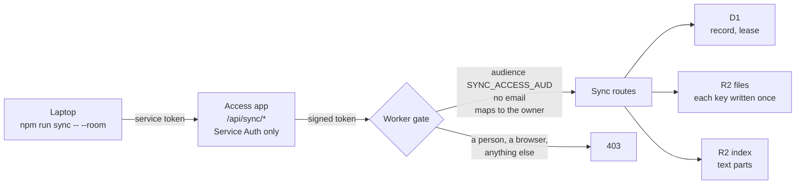
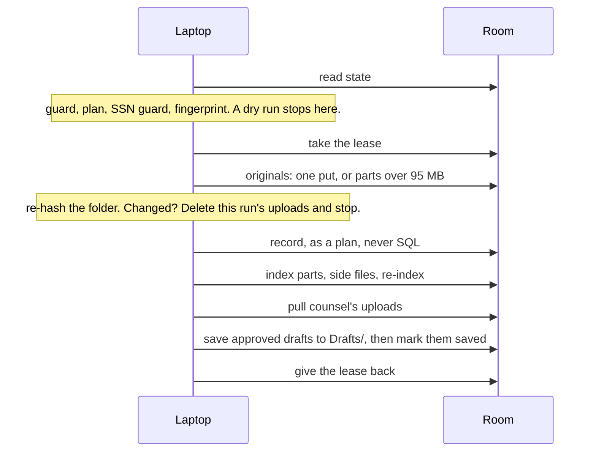

# Sync endpoints

## A run

## What a lost laptop can do

| | |
|---|---|
| ✅ | Add to the room, change what it mirrors |
| ✅ | Read counsel's uploads until each has come down |
| ✅ | Read the owner's approved drafts until each is saved, once `SAVE_BACK_SINCE` is set |
| ❌ | Run SQL, deploy code, touch another bucket |
| ❌ | Delete or overwrite a stored original: replaced ones are kept 30 days |
| ❌ | Move a document out of a privileged folder |
| ⚠️ | With a guest's login too: move any other document into a folder that guest sees, and read it |
| ❌ | Blank a document's search text for good: the room's record notices, and the next sync writes it again |
| ⚠️ | Fill the month's search allowance: new text stays out of search until the 1st, and a later sync catches up |
| ❌ | Race two large uploads on one key: a key takes one (`sync_uploads`) |
| ⚠️ | Add up to 250 GB a month that nothing sweeps: about $3.75 a month to keep for each full month, and that adds up. `SYNC_MONTHLY_GB` can lower the cap, not raise it |

## Turn it on

| Step | Value |
|---|---|
| Migrations | `0015_sync_endpoints.sql`, `0016_sync_upload_bytes.sql`, `0021_sync_counted.sql` (what each upload counted, so a delete refunds only that, once) |
| Access app | `<room host>/api/sync/*`, Service Auth, one service token |
| `SYNC_ACCESS_AUD` | That app's AUD |
| `SYNC_ENDPOINTS` | `"1"`. Anything else: the room is as it was |
| `SAVE_BACK_SINCE` | Optional, with proposals on: an ISO time. Approved drafts since then are saved back; unset, none are |
| `sync_tokens` | `INSERT INTO sync_tokens (client_id, owner_email) VALUES (?, ?)` |
| `SYNC_MONTHLY_GB` | Optional, 250 if unset. Above 0, up to 250. Anything else: every sync request gets 500 `bad_setting` |
| Laptop | `ROOM_SYNC_CLIENT_ID`, `ROOM_SYNC_CLIENT_SECRET`, optional `ROOM_SYNC_ORIGIN` |

Revoke: set `revoked_at` on the row, delete the token in Access.

## Routes

Under `/api/sync/`. All but `state` and `POST lease` need `X-Sync-Lease`.

| Route | Body | Answer |
|---|---|---|
| `GET state` | | `{ rows, pending }`, plus `drafts` once save-back is on. No R2 keys |
| `POST lease` | `{ device, takeover? }` | 201 `{ lease, expires_at }`, 409 `lease_held` |
| `PUT` `DELETE lease` | | renew, give back |
| `PUT files/:key` | raw, up to 95 MB, `Content-Type`, `X-Sync-Sha256` | 201, 200 same bytes, 409 `key_taken`, 429 `upload_budget` |
| `DELETE files/:key` | | a stopped run's own upload only |
| `POST files/:key/uploads` | `{ contentType }` | 201 `{ upload, part_bytes }` |
| `PUT files/:key/uploads/:upload/parts/:n` | raw | `{ partNumber, etag }`, 429 `upload_budget` |
| `POST files/:key/uploads/:upload/complete` | `{ size, parts }` | `{ key, size }` |
| `DELETE files/:key/uploads/:upload` | | give up |
| `POST record` | `{ run, removals, renames, changes, adds, pages }`, 100 entries at most | 409 `key_taken`, `object_mismatch` (missing object, other size, or a sha256 its bytes don't have: R2's for a single put, the room's own hash for a multipart one), `privileged_move` |
| `PUT` `DELETE index/:id/:part` | raw, up to 4 MB, `X-Index-Sha256`, `X-Index-Stamp` | 429 `ingest_budget`: the month is full. The room records each document's text (`index_text`); `GET state` returns it as `index` |
| `PUT` `DELETE side/:name` | raw | 429 `upload_budget` |
| `POST reindex` | | 502 is not fatal |
| `GET pulls/:id` | | a counsel upload not pulled yet |
| `POST pulls` | `{ run, ids }` | |
| `GET drafts/:id` | | one of the owner's approved drafts not saved yet, as Markdown. Save-back on only |
| `POST drafts` | `{ ids }` | one `applied` event each, by `sync@local`. Save-back on only |

## Saving back (#65)

| In the folder | |
|---|---|
| ✅ | One new file in `Drafts/` per approved draft (`scripts/saveback.ts`) |
| ✅ | A taken name gets a new name: `Name (2).md`. A name iCloud holds in the cloud (`.Name.md.icloud`) counts as taken |
| ✅ | Written whole to a hidden file, then placed in one step |
| ✅ | A title the guard would refuse or skip (`_private`, `~$`) gets a plain name |
| ❌ | Overwrite, rename, move or delete anything but its own hidden temporary files |
| ❌ | Write a draft twice: bytes already there are marked, not written |

Last in a run, so the file comes in on the next run as one add. `worker/sync-saveback.test.ts` checks every other file byte for
byte, with its times.
