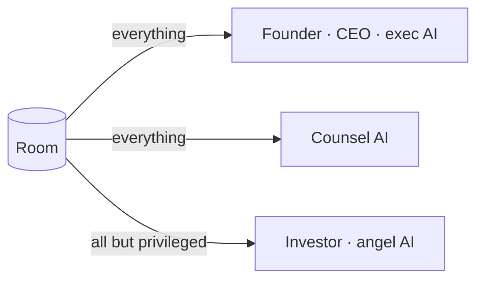

# Legallas: the product

What Legallas is, who it's for and how it behaves. These are the owner's product decisions, moved here on 2026-11-01. Install,
setup, licensing, signing and sales are not in this repository.

| Doc | What it holds |
|---|---|
| This page | What the product does and why |
| [`design/document-set-and-law.md`](design/document-set-and-law.md) | The five paths: which documents, which law, what an app can file |
| [`design/law-pack-plan.toml`](design/law-pack-plan.toml) | The first law pack, machine-readable |
| [`design/rooms-and-grants.md`](design/rooms-and-grants.md) | Rooms, roles, grants, invites, deal rooms |
| [`design/ai-connectors.md`](design/ai-connectors.md) | How a customer's AI connects, and how it proposes work for approval |
| [`design/propose-and-approve.md`](design/propose-and-approve.md) | Propose and approve: what is stored, who decides, the abuse cases, and the first slice |
| [`checklist/`](checklist/README.md) | The baseline company checklist |
| [`licences/`](licences/dependency-review.md) | Dependency licence review and notice outline |
| [`legal/product-notices.md`](legal/product-notices.md) | What the product says to users: not a lawyer, AI can be wrong, have your own lawyer review |

Legallas is an AI agent for legal work, not a lawyer or law firm, for founders, angels, angel groups and VC funds: formation, agreements,
data rooms, raises, securities compliance and disputes, under Colorado, Delaware and federal law. It keeps every document in the
customer's own accounts, knows which documents and agreements a company should have, helps put them in order, and gives the
people the customer chooses access to them.

The aim, in the owner's words: help founders "be more legally compliant, be more compliant with security laws, pay less money to
legal and lawyers ... And then if they ever need to be helped in litigation, they have a tool."

## Who it's for

Documents and law follow five paths. Each has two layers: the agreements and the securities law that goes with them.

| Build order | Path | Customer | Install and rooms |
|---|---|---|---|
| 1 | Startup forms | A founder forming a company | The founder's own install |
| 2 | Startup raises | A founder raising money | The founder's install, with investors invited to a deal room |
| 3 | Angels invest | One person investing, directly or through an SPV | Their own install. To review a startup, they join its room |
| 4 | Angels create a group | A group's manager and members | One install, run by the manager. Each deal is its own room, and members are invited only to the rooms they need |
| 5 | VCs invest | A fund's manager | One install, run by the manager. Each deal is its own room |
| When needed | Founder conflict, and investor-founder conflict | Founders and investors in a dispute | A case room, with counsel invited |

To review a startup, an investor, group or fund joins the startup's own data room, and nothing is copied to their account.

## Your AI first (owner, 2026-11-06)

"The whole point of the product is to let the user, whoever they might be, connect their own AI." "Very few people are actually
going to go in here and look around."



| Role | Sees | AI |
|---|---|---|
| Founder, CEO, exec | Everything (admin) | Claude, Copilot, Harvey or an open-weight model, connected first |
| Counsel (company or litigation) | Everything | Same |
| Investor, angel | Most; never privileged | Same |

Views follow best practice for each room: formation, fundraising (data room), litigation. Anthropic's legal artifacts (Matter
board, Tabular review, Cite check, Jurisdiction survey matrix, Playbook deviation board) are copied as views and kits every AI
gets.

**The founder's path:** formation documents and starting agreements, understood and finalized quickly; a data room for future
investors; the raise documents, understood and finalized; securities law compliance for the raise; running the company legally
and effectively with less spent on lawyers; and if litigation comes, a place for the documents that the founder's lawyers can
access.

**Price:** $99 flat, for anyone: "the install and setup is the product at $99 and anyone can buy it for that." Whoever bought it can
invite people into their data room, and invited people join free. "Anyone else who wants their own install and setup, wether it's
a VC/Angel/Startup buys it and downloads it." Not on sale yet. Customers also pay Cloudflare directly, about $5 a month.

## How it behaves

| Rule | What it means |
|---|---|
| **Research, then options** | "Always research, analyze the users asks, then give options with a recommendation." For everyone: with no lawyer connected, on investor questions and in a dispute, with no referral to a lawyer first. Never on hiring, firing, pay, credit or housing for a named person, and never finding investors. Every recommendation shows its sources, says what it couldn't verify, and says Legallas isn't a lawyer. Ask and the connector do this while the room's `RECOMMEND` is "1" ([notices](legal/product-notices.md#a4-on-each-recommendation)) |
| **As much as it can, with approvals** | "Legallas should do as much as it can obviously with approvals by the user at major steps": preparing documents and filings, sending them for signature through a service the customer already uses, and filing where the government site allows it. Nothing is signed or filed without the user's approval |
| **No lawyer signs off on the product** | Claude does its best attempt with every legal skill, plugin, connector and tool available or findable, and says what it couldn't verify. The product says it's an AI agent for legal work, not a lawyer or law firm, and that each customer "should have their own lawyer sign off" |
| **Wording** | Copy never calls the product a lawyer, "general counsel" or "superintelligent" (`web/scripts/copy-voice.test.ts`), and shows the short line, "not a lawyer or law firm", wherever the agent speaks ([notices](legal/product-notices.md)) |
| **Templates** | Well-known public forms whose licences allow bundling, checked form by form, each showing its source and date. Where no form can be bundled, Legallas ships original drafts. The customer's AI fills them in and the customer approves |
| **Checking who you're dealing with** | Helps a founder, angel or fund look up an investor, group or fund in public records (SEC filings and registrations, state records), shows what it found with its sources, and says what it couldn't find |
| **Fetched pages are data** | A page, form or filing the agent reads is never an instruction to it |

## The law it covers

- **Focus:** "law for startups, law for venture capital, law for angel investing, at a Colorado, Delaware, and federal level." Colorado
  comes first, and Delaware is there because many startups incorporate in it. "we don't have to have the other 48 states really as a
  focus." It covers securities law and operating agreement law, and "everything related to a startup, to an angel investor, to a VC
  fund, and to an angel group."
- **First law pack:** whole acts and rule sets on their merits (LLC acts, corporation law, securities acts and rules, for all three
  levels), not sections picked for any one customer.
- **Entity choice:** Colorado LLCs, Colorado C corporations and Delaware C corporations side by side, compared fairly and with
  sources. A Colorado C corporation is a full option, not an afterthought to the standard advice to go Delaware.
- **Disputes:** the main litigation uses are founder conflict and investor-founder conflict: a founder ousted, a founder's bad
  behaviour that investors need to act on, investors trying to take over. The map covers which documents decide them. The product's
  sample case is one of these fights, invented from scratch.

## How people use it

"you connect your AI (Claude, Copilot, Harvey, and Open Weight Models through Open Router or other) which then gives that AI access
to a shared data room and a structure it can easily use to review documentation."

| AI | Role |
|---|---|
| The member's own AI account: Claude, Microsoft 365 Copilot, Harvey, or an open-weight model on a host they choose | "the heavy question and driving comes from the users OWN account." Connects through the room's remote MCP server |
| gpt-oss-120b on Workers AI in the customer's own Cloudflare (GLM-5.3 Flash until 2026-11-05) | "a simple assister": built-in Ask works out of the box, with cites mapped to documents and checked against the prompt |

Closed models are limited to Claude, Microsoft 365 Copilot and Harvey; any open-weight model is fine. The default model list never
uses a hosted provider run by a Chinese company or hosted in China.

## Where documents live

The customer's own folder is home. Legallas never asks them to move it.

| | Mac | Windows |
|---|---|---|
| **Documents** | iWork: Pages, Numbers, Keynote | Microsoft 365: Word, Excel, PowerPoint |
| **Folder** | iCloud Drive | OneDrive |
| **Business account** | Apple Business | Microsoft 365 |

Apple Business is free since 2026-04-14, and it replaced Apple Business Manager, Essentials and Connect. Google and Google Workspace are
skipped for now.

**Sync, the owner's decision on 2026-11-01:** the folder is home. Changes flow into the room, a new agreement the customer approves in
Legallas is saved back to that folder, and nothing else in the folder is ever changed.

To keep that rule, the helper's own files, such as the record backup and the install record, sit beside the folder.

Both computers work the same way: the helper works on the local folder, and iCloud Drive or OneDrive carries the files from there. No
server reads the customer's cloud account. Apple's pages show no public server API for reading someone's iCloud Drive, and reading
OneDrive from a server with no signed-in user needs an administrator's grant, tenant-wide or item by item.

What's left of saving back and reading iWork files is on the [Legallas board](https://github.com/orgs/Colorado-Startups/projects/1).

## How it's built

```
 Customer's laptop                     Customer's Cloudflare account (always on)
 +----------------------------+        +---------------------------------------------+
 | Legallas helper (Mac/Win)  |  sync  | Worker: rooms, viewer, comments, checklist  |
 |  - Setup (first run)       | -----> | Access: sign-in for lawyers and investors   |
 |  - folder sync + PII guard |        | D1: the record (control numbers, grants,    |
 |  - OCR, PDF renditions     | <----- |     comments, checklist, activity)          |
 |  - record backup beside it | intake | R2: document copies, renditions, text       |
 +----------------------------+        | AI Search + Workers AI: search and Ask      |
        |                              | Remote MCP: customer's and firm's own AI    |
 iCloud Drive / OneDrive               +---------------------------------------------+
 (originals stay here)                  Claude, Microsoft 365 Copilot, Harvey (their accounts)
```

- **The room** is an Astro site plus a Cloudflare Worker that reaches every service through bindings, so a new instance is a new set of
  resources in the customer's account running the same code.
- **The helper** is one TypeScript app (Tauri 2) that runs Setup once, then keeps the instance in step with the company folder. It runs
  OCR (Vision on Mac, the Windows OCR API on Windows), PDF renditions and the PII guard on the laptop before upload. The app and
  Setup are not in this repository; the sync engine is here (`web/scripts/`).
- **Customer costs:** the room needs Workers Paid (USD 5 a month, paid by the customer to Cloudflare), because Workers Free allows only
  10 ms of CPU per request. Access is free for up to 50 users. A built-in spend guard keeps Workers AI and AI Search inside what the plan
  includes, and it is the stop, because Cloudflare has no hard cap of its own.
- **Colorado Startups hosts no customer's room** and never sees customer data: no vendor backend and no telemetry. Each instance, its
  documents and its AI are the customer's own. A fictional sample room on Colorado Startups' own account, used to measure the product,
  holds invented data only.
- **Open question: the room's address.** Options are `*.workers.dev` behind Access, or a domain on Cloudflare. Email sending needs a
  sender domain.

**Why not install into iCloud or OneDrive:** they keep, sync and share files but run no programs. There is nowhere in them for the
lawyers' sign-in page, the connector their AI talks to, or Ask, and SharePoint and OneDrive download `.html` files instead of serving
them. They are the home of the originals and the simplest way to share a folder. A version hosted in a customer's own Microsoft cloud is
possible later, as a second product.

### The company checklist

The checklist lists the documents a startup should have, grouped by relationship: the company and the state; founders and the company;
the company and its investors; the company and its people; customers, vendors and partners; IP and assets; disputes and regulators.
Each says "You aren't receiving legal advice from a licensed lawyer" (`web/worker/checklist-baseline.ts`). Legallas uses it to:

- match each document to checklist items (the customer's own AI proposes and the founder approves);
- pull out key facts (parties, dates, amounts, signed or not);
- show gaps and dates;
- prepare "questions for counsel" packs with cites.

Angel groups and VC funds get their own checklists and templates, built after the founder's path.

### Rooms and access

| | |
|---|---|
| **Rooms** | The company room (founder and team); case rooms (one matter each, with the litigation pack); deal rooms (a founder's room for investors, or one per deal in a group's or fund's install) |
| **Company room** | No published matter: opens on the company. A matter turns the same room into a case room, nothing lost |
| **Roles** | Owner and counsel first; investor and viewer with deal rooms, on the raise path; team later |
| **Grants** | Per room and per folder, with an end date |
| **Privilege guard** | Privileged folders are visible only to the owner and counsel, never in a deal room, with a warning before any share outside counsel |
| **Sign-in** | A Cloudflare Access one-time PIN per invited email. MCP connector grants cover only the rooms a member can see |

## What's open and what's closed

Anyone may build the open code and run it themselves. The $99 pays for a signed install and a guided setup.

| Open: this repository (Apache-2.0, DCO) | Closed, kept private |
|---|---|
| Room engine, rooms and grants, viewer, comments, intake, search, security headers | The installer and Setup |
| Built-in Ask with verified cites and its evals | Licensing and the signing key |
| Sync with dry run, fingerprint and PII guard | Signed, notarized builds and their update feed |
| Remote MCP connector, `/connect` guides, the Copilot agent package source | Sales |
| Spend guard | |
| Checklist format, baseline lists, matching, gap and date reports, packs for counsel | |
| Law library builder (a customer's own selection of law stays with that customer) | |
| Mac case tracker (SwiftUI), case rooms (the litigation features) | |
| Fictional fixtures, design system with a neutral mark | |

Each customer names its own instance and assistant. This repository is open to community contributions under the DCO:
[`CONTRIBUTING.md`](../CONTRIBUTING.md).
