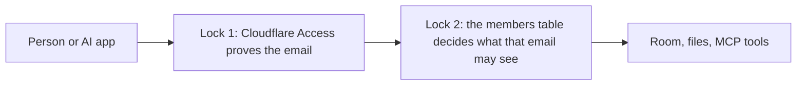

# Access management

Part of the [security policies](README.md). Version 1.1, 2026-11-17.

## Purpose

Only people the room owner invited, one by one, reach a room. Each sees only what their role allows. Removing a person
ends every way they had in.

## Two locks on every request

| Rule | Kind | Evidence |
|---|---|---|
| The Worker verifies the signed Access token on every request, static files included: issuer, audience, RS256, expiry, email | Built in | `web/worker/auth.ts` |
| No Access team or audience configured: every request is refused | Built in | `web/worker/auth.ts` |
| No members row: no entry | Built in | `web/worker/auth.ts` |
| The development identity works only on localhost, and a test bans it from production config | Built in | `web/worker/auth.ts`, `web/worker/config.test.ts` |
| Writes check the exact Origin and `Sec-Fetch-Site` | Built in | `web/worker/http.ts` |
| No `workers.dev` or preview URL: the custom domain behind Access is the only way in | Built in | `web/wrangler.example.jsonc` |

## Sign-in

| Rule | Kind | Evidence |
|---|---|---|
| Access lists each person's email. Never a whole domain | Room owner | `web/connect/security-brief.md` |
| Members sign in with a one-time email code. The room owner uses the Cloudflare login with its own multi-factor sign-in | Room owner | `docs/design/rooms-and-grants.md`, "Sign-in, and keeping Access in step without a token" |
| `REQUIRE_MFA` = `"1"`: the room and the AI sign-in refuse any Access session whose token (`amr`) shows no security key or biometric. An emailed code, `otp` or `mfa` alone never counts; a missing claim fails closed | Built in; the room owner turns it on | `web/worker/mfa.ts`, `web/worker/room.ts`, `web/mcp/authorize.ts` |
| Access prompts for that key or biometric (independent MFA) on top of the code, at no cost on Zero Trust Free | Room owner, recommended | `docs/design/rooms-and-grants.md` |
| Sign-ins limited to the room owner's chosen countries | Room owner | An Access policy rule |
| Session length is set on the Access application. The Worker enforces the token's expiry | Room owner | `docs/design/rooms-and-grants.md` |
| The room owner gets an email on every new session by another member | Built in | `web/worker/signins.ts` |

## Roles

| Role | Sees | Can do |
|---|---|---|
| Owner | Everything, privileged included | Everything counsel can, plus the activity log and admin pages |
| Counsel | Everything, privileged included | View, download, upload, comment, Ask, connect their own AI, approve their own AI's drafts |
| Guest (deal and matter rooms, off unless `ROOMS_ENABLED`) | That room's folders. Investors never see privileged; matter-room counsel do | Only that room's guest routes. Never a member route or the MCP server |

Evidence: `web/worker/auth.ts`, `web/worker/rooms.ts`, `web/worker/privilege.ts`. A path with "privileged" in any segment
is hidden from a role without access, and answers like a missing document.

## AI connections (MCP)

| Rule | Kind | Evidence |
|---|---|---|
| OAuth 2.1 with PKCE, one scope, `case.read`. Tokens bound to this server | Built in | `web/mcp/contract.ts`, `web/mcp/oauth.ts` |
| Access tokens last 1 hour. Refresh tokens rotate and end 30 days after sign-in | Built in | `web/mcp/contract.ts` |
| A consent page names the app before access is granted | Built in | `web/mcp/authorize.ts` |
| Every tool call re-reads the member's row and role | Built in | `web/mcp/server.ts` |
| Self-registration accepts only allowlisted callbacks, caps metadata at 4 KB, and expires unused registrations after 30 days | Built in | `web/mcp/oauth.ts`, `web/mcp/contract.ts` |
| Members see and revoke their own connections; the room owner can revoke anyone's | Built in | `web/mcp/connections.ts` |
| A daily sweep revokes grants whose member is gone | Built in | `web/mcp/sweep.ts` |

## Joining and leaving

| Step | Kind | Evidence |
|---|---|---|
| Add a member: the room owner's command line, then the Access policy | Room owner | `web/scripts/member.ts` |
| Every add, role change and removal writes an `access_events` row: who ran it, the action, the email. Append-only by trigger | Built in | `web/scripts/member.ts`, `web/migrations/0012_deal_rooms.sql` |
| Remove a member: deletes the row and revokes their room invitations. Their next MCP call fails | Built in | `web/scripts/member.ts`, `web/mcp/server.ts` |
| With the room owner's Access API token (`LEGALLAS_ACCESS_API_TOKEN`), removal also takes the email out of the room's Access policies, reads each back, and ends their Access sessions. Each step writes an `access_events` row | Built in; the token is the room owner's | `web/scripts/access-offboard.ts`, `web/scripts/member.ts` |
| Without that token, the command prints the two dashboard steps | Room owner | `web/scripts/member.ts` |
| Quarterly access review: every member, AI connection and guest invitation, with last use; flags anything unused in 90 days | Room owner runs `npm run access-review` | `web/scripts/access-review.ts`, `web/README.md` |
| Guest invitations expire: 120 days by default, 730 at most | Built in | `web/scripts/room.ts` |
| Admin pages (`/admin/clients`) are owner-only | Built in | `web/mcp/admin-clients.ts` |

## Who administers the room

| Rule | Kind |
|---|---|
| The room owner's Cloudflare account has multi-factor sign-in on every member | Room owner |
| Cloudflare's account-wide "enforce two-factor" setting is on when the account has more than one member | Room owner |
| Worker secrets and the deploy token live in Cloudflare and the room's GitHub environment, never in a repository | Room owner |
| Colorado Startups holds no access to any room or room account | Built in by design ([`SECURITY.md`](../../SECURITY.md)) |

## Gaps

| Gap | What it would take |
|---|---|
| Members sign in with an emailed code alone until the room owner sets `REQUIRE_MFA` | One setting; each person enrolls a key or biometric once |
| Automatic Access removal needs the room owner's own API token | The room owner creates it, with the two permissions `web/README.md` names |

## Review

Every 12 months, and when a role, a sign-in method or an MCP tool changes.
