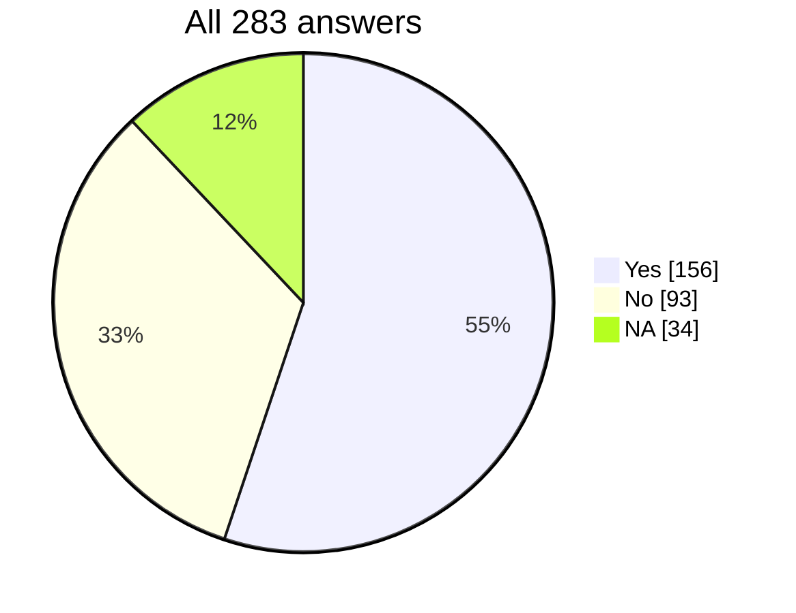

# CAIQ v4.1 answers

Part of the [security policies](README.md). Version 1.1, 2026-11-17.

| | |
|---|---|
| Answers | [`caiq.csv`](caiq.csv): id, domain, answer, how, evidence |
| Questionnaire | CSA CAIQ v4.1.0 (CCM v4.1.1): 283 questions, 17 domains |
| Source | [CSA, CCM and CAIQ v4.1](https://cloudsecurityalliance.org/artifacts/cloud-controls-matrix-v4-1), released 2026-01-27; workbook generated 2026-10-02 |
| Read | 2026-11-06 |
| Basis | Policies 1.0 (#657), `SECURITY.md`, `main` at `52c50fe8`; IAM, STA-09, DSP-16 and TVM-03 rows updated at `00d3a3fc` |
| Licence | CSA: personal, non-commercial use; no changes; no redistribution. So IDs and our answers only. Questions: CSA's workbook |
| Claims | No certification, audit or penetration test ([Attestations](README.md#attestations)) |
| Review | With the policies, every 12 months. An answer changes in its control's PR |

## Reading `how`

| Marker | Means | CAIQ SSRM ownership |
|---|---|---|
| None | Built in, every room | CSP-owned |
| `Room owner:` | Set in the owner's Cloudflare account. Add their setting before sending | CSC-owned, or shared |
| `Cloudflare:` | Hosting platform | Third-party outsourced |
| Answer NA | Nothing to apply to: no premises, hardware, own key system or held room data | Blank |

## Counts

| Domain | Name | Yes | No | NA | Questions |
|---|---|---|---|---|---|
| A&A | Audit and assurance | 0 | 8 | 0 | 8 |
| AIS | Application and interface security | 13 | 0 | 0 | 13 |
| BCR | Business continuity and resilience | 15 | 3 | 1 | 19 |
| CCC | Change control and configuration | 8 | 4 | 0 | 12 |
| CEK | Cryptography and key management | 9 | 8 | 6 | 23 |
| DCS | Datacenter security | 2 | 3 | 23 | 28 |
| DSP | Data security and privacy | 18 | 4 | 2 | 24 |
| GRC | Governance, risk and compliance | 4 | 6 | 0 | 10 |
| HRS | Human resources | 1 | 19 | 0 | 20 |
| IAM | Identity and access management | 16 | 3 | 0 | 19 |
| IPY | Interoperability and portability | 3 | 5 | 0 | 8 |
| I&S | Infrastructure security | 14 | 0 | 1 | 15 |
| LOG | Logging and monitoring | 14 | 4 | 1 | 19 |
| SEF | Incidents, e-discovery and forensics | 11 | 5 | 0 | 16 |
| STA | Supply chain and shared responsibility | 15 | 4 | 0 | 19 |
| TVM | Threat and vulnerability management | 12 | 3 | 0 | 15 |
| UEM | Endpoint management | 1 | 14 | 0 | 15 |
| | **All** | **156** | **93** | **34** | **283** |

| Domain | Name | Asks about (our words) |
|---|---|---|
| A&A | Audit and assurance | Independent audits and how their findings get fixed |
| AIS | Application and interface security | Secure build, test and release, and API protection |
| BCR | Business continuity and resilience | Continuity plans, backups, recovery and exercises |
| CCC | Change control and configuration | Approving, baselining and rolling back changes |
| CEK | Cryptography and key management | Algorithms, who holds keys, and the key life cycle |
| DCS | Datacenter security | Physical sites, equipment and media |
| DSP | Data security and privacy | Classes, inventory, flows, privacy rights, retention, location |
| GRC | Governance, risk and compliance | The policy program, risk management and legal requirements |
| HRS | Human resources | Screening, agreements and training for staff |
| IAM | Identity and access management | Identities, least privilege, MFA, joining, leaving and reviews |
| IPY | Interoperability and portability | APIs, getting data out, and exit terms |
| I&S | Infrastructure security | Capacity, network rules, segmentation and hardening |
| LOG | Logging and monitoring | Audit records, alerts and protecting the records |
| SEF | Incidents, e-discovery and forensics | Response plan, triage, notice and incident records |
| STA | Supply chain and shared responsibility | Who owns which control, suppliers and bills of materials |
| TVM | Threat and vulnerability management | Scanning, malware, penetration tests and fix deadlines |
| UEM | Endpoint management | Laptops and phones that touch the data |

## What would change each No

| Change | Nos | Cost or state | Questions |
|---|---|---|---|
| An independent audit: SOC 2 Type I or II, or ISO/IEC 27001 | 10 | Paid, the owner's call. Waits until a firm says one is required | A&A-01.1, A&A-01.2, A&A-02.1, A&A-03.1, A&A-04.1, A&A-05.1, A&A-06.1, A&A-06.2, CEK-09.1, CEK-09.2 |
| A third-party penetration test | 1 | Paid, the owner's call. The monthly automated dynamic scan (#684) is not one | TVM-07.1 |
| A restore drill result in each live room | 3 | Built (#687); each room sets it up; no drill result yet | BCR-06.1, BCR-08.3, BCR-10.1 |
| A second maintainer who approves changes, and time-limited owner access | 3 | Needs a second person | IAM-04.1, IAM-10.1, IAM-10.2 |
| An audit row when the owner views the activity log | 1 | Free. One code change | LOG-04.1 |
| Alerts on unusual access, and a page when a scan or drill fails | 2 | Free | LOG-05.1, LOG-14.2 |
| A check of each live room's Cloudflare settings against the baseline | 1 | Free | CCC-07.1 |
| Written crypto risk and key life cycle steps, with a key event log | 5 | Free | CEK-06.1, CEK-07.1, CEK-14.1, CEK-21.1, LOG-12.1 |
| Cloudflare's own statement on certified cryptography, read and cited | 1 | Free | CEK-03.1 |
| Customer-held keys for D1 and R2 | 1 | Not offered by Cloudflare today | CEK-08.1 |
| Governance papers: risk management, a policy exception process, a register of laws and contracts | 8 | Free | GRC-02.1, GRC-04.1, GRC-05.1, GRC-07.1, GRC-07.2, GRC-08.1, CCC-08.1, CCC-08.2 |
| Privacy papers: an impact assessment, a data subject request process, a privacy notice, a legal check of defaults | 4 | Free to draft. A lawyer's review is paid | DSP-08.2, DSP-09.1, DSP-11.1, DSP-12.1 |
| An interoperability and portability policy | 4 | Free | IPY-01.2, IPY-01.3, IPY-01.4, IPY-01.5 |
| A customer agreement with service, change and exit terms | 3 | Lives with licensing and sales, outside this repository | CCC-05.1, IPY-04.1, STA-11.1 |
| A yearly review of Cloudflare's reports and terms, and written supplier requirements | 3 | Free | STA-12.1, STA-14.1, STA-15.1 |
| A private incident record store, incident metrics and authority contacts | 5 | Free | SEF-05.1, SEF-09.1, SEF-09.2, SEF-10.1, SEF-10.2 |
| A threat model | 2 | Free | TVM-04.1, TVM-04.2 |
| A staff programme: screening, agreements, training, acceptable use, remote work, equipment disposal | 22 | Free to write. Applies once there is staff | HRS-01.1, HRS-01.2, HRS-01.3, HRS-02.1, HRS-02.2, HRS-03.1, HRS-03.2, HRS-04.1, HRS-04.2, HRS-05.1, HRS-06.1, HRS-07.1, HRS-08.1, HRS-10.1, HRS-11.1, HRS-11.2, HRS-12.1, HRS-12.2, HRS-13.1, DCS-02.1, DCS-02.2, DCS-02.3 |
| An endpoint policy and device management | 14 | Policy free. Managing devices needs a tool | UEM-01.1, UEM-01.2, UEM-03.1, UEM-04.1, UEM-05.1, UEM-06.1, UEM-07.1, UEM-08.1, UEM-09.1, UEM-10.1, UEM-11.1, UEM-12.1, UEM-13.1, UEM-14.1 |
