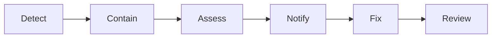

# Incident response

Part of the [security policies](README.md). Version 1.0, 2026-11-05.

## Purpose

At the first sign that case content, an account or a key is exposed, contain it. Then tell the people it affects, quickly
and plainly.

## Who does what

| Role | Who | Does |
|---|---|---|
| Incident lead for a room | The room owner | Contains, decides, notifies the room's members |
| Product maintainer | Colorado Startups | Fixes product flaws, tells every room owner of a flaw that affects them |
| Members (counsel) | Each member and their firm | Report anything odd; handle what their own AI vendor kept |

Report a product flaw privately to the [repository's administrators](../../SECURITY.md), never in an issue, pull request or
commit. Each room owner publishes their own contact, for example in their domain's `/.well-known/security.txt`.

## Detection

| Signal | Kind | Evidence |
|---|---|---|
| Email to the room owner on every new session by another member | Built in | `web/worker/signins.ts` |
| Email on every new AI connection, and on a refused callback | Built in | `web/connect/security-brief.md` |
| The audit log of every read and file sent | Built in | `web/worker/audit.ts`, `web/mcp/audit.ts` |
| Secret scan on every change; dependency and code scans nightly | Built in | [Vulnerability management](vulnerability-management.md) |

## Severity

| Level | Example | Contain within | Tell members within |
|---|---|---|---|
| 1, critical | Case content reached someone not allowed to see it; a live key or token exposed | 1 hour | 24 hours |
| 2, high | An account taken over but no case content read; a flaw that could expose content | 24 hours | 72 hours |
| 3, low | A flaw with no exposure path; a failed attack | 14 days | In the next routine note |

These are goals set by this policy. Contracts or law may set shorter ones, and those win.

## Steps

| Step | What |
|---|---|
| Contain | Rotate the exposed key first. Remove the member (`web/scripts/member.ts`) and revoke their sessions and AI connections. Roll back a bad release |
| Assess | Read the audit log: who opened what, when, through which AI app. It holds no document text, so it can be shared with the people affected |
| Notify | Room members, in writing, with what happened, what was exposed, and what was done. The room owner decides on any other notice the law requires |
| Fix | A pull request that closes the cause, and a test that would have caught it |
| Review | A short private note: timeline, cause, fix, what changes. Never repeat a secret or case content in it |

A credential or case content that reached this repository follows [`SECURITY.md`](../../SECURITY.md), "If something leaks":
rotate, remove, and recreate the repository when it was case content.

## Gaps

| Gap | What it would take |
|---|---|
| Only a desk exercise has run ([November 2026](tabletop-2026-11.md)); no live drill | One a year, using the fictional fixture room |
| No status page for an outage | The room owner's email to members is the channel today |

## Review

Every 12 months, and after every level 1 or 2 incident.
