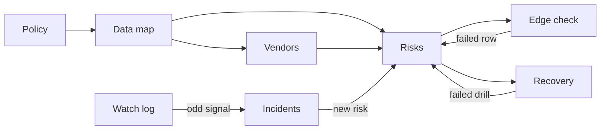

# Operator security records

Templates for the person or firm that runs a room: the operator, called the room owner in the
[security policies](../README.md). The policies say what the product does and what the operator must set. These records
show that the operator did it.

| | |
|---|---|
| Use | Copy this folder into the operator's own private store. Fill the `<placeholders>`. Never commit a filled record here |
| Example values | Only the fictional fixture: Doe v. Harbor Labs, control prefix `DOE`, `room.example.com` |
| Case content | Never in a record. Name documents by id, never by title or text |

## The records

| Record | For | Filled by | Review |
|---|---|---|---|
| [Policy](policy.md) | The operator's own rules: owner, access, MFA, devices | Room owner | Every 12 months |
| [Data map](data-map.md) | What data the room holds, where, how long, who reads it | Room owner | Every 12 months, and when a store or feature is turned on |
| [Vendors](vendors.md) | Every supplier, its retention and zero data retention (ZDR) state | Room owner | Every 12 months, and before adding a supplier |
| [Risks](risks.md) | The room's risks, rated and treated | Room owner | Every quarter |
| [Incidents](incidents.md) | Contacts, steps, and every incident | Incident lead | After each incident; contacts every quarter |
| [Recovery](recovery.md) | Recovery plan and restore drills | Room owner | A drill every quarter |
| [Edge check](edge-check.md) | Cloudflare edge settings, checked | Room owner | Every month, and after any zone change |
| [Watch log](watch-log.md) | Sign-in alerts, member changes, backups | Room owner or a delegate | Every week |

## Rules for every record

| Rule | |
|---|---|
| Dates | `YYYY-MM-DD` |
| People | A role and a name, for example `Room owner: <Name>` |
| A missed review | A row in [Risks](risks.md) until done |
| Changes | Keep old rows. Add a dated row, never overwrite one |
