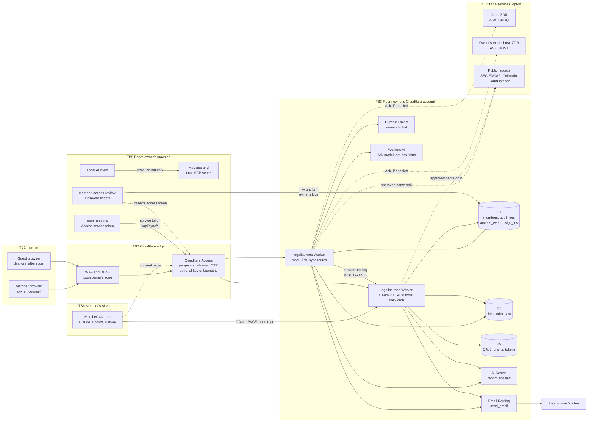

# Threat model

Part of the [security policies](README.md). Version 1.0, 2026-11-17.

| | |
|---|---|
| Method | STRIDE per trust boundary, on the data flow below |
| Scope | One room: both Workers, their stores, every service they call, the member's AI, the Mac app, sync |
| Basis | `main` at `00d3a3fc`. Each control names its file; the file wins |
| Not in scope | The room owner's own laptop and Cloudflare account security ([Access](access.md), "Who administers the room"), a member's own AI vendor's retention ([AI governance](ai-governance.md)) |
| Example data | Only the fictional room: Doe v. Harbor Labs, prefix `DOE` |

## Data flow

Each box is a trust boundary (TB). Dotted arrows are off until the room owner turns them on.

| TB | Boundary | Who is on the far side | Main asset at risk |
|---|---|---|---|
| TB1 | Internet to edge | Anyone | Every case document |
| TB2 | Edge to Workers | A person Access let in | Role limits, privileged files |
| TB3 | Workers to stores and Cloudflare services | Cloudflare | Integrity of the record, audit log |
| TB4 | Workers to outside services | A processor or public site | Case text leaving the account |
| TB5 | Owner's machine to the room | The owner's own tools | Account-wide write access |
| TB6 | Member's AI app to the MCP server | An AI vendor acting for a member | Bulk reads, prompt injection |

## STRIDE per boundary

S spoofing, T tampering, R repudiation, I information disclosure, D denial of service, E elevation of privilege.
Residual risk: low, medium, high, after the controls.

### TB1 and TB2: browser to room

| | Threat | Control | Evidence | Residual |
|---|---|---|---|---|
| S | A stranger signs in | Access lists each email; the Worker checks the signed Access token (RS256, issuer, audience, expiry) on every request; no members row, no entry | `web/worker/auth.ts` | Low |
| S | A mailbox takeover passes the emailed code | `REQUIRE_MFA` refuses any session without a security key or biometric; the owner gets an email on every new session | `web/worker/mfa.ts`, `web/worker/signins.ts` | Medium until the owner turns it on, then low |
| T | A forged cross-site write | Exact Origin and `Sec-Fetch-Site` on every write; no CORS | `web/worker/http.ts`, `web/worker/headers.ts` | Low |
| R | A member denies reading a file | Audit row for every read, search and file sent; append-only by trigger; hash-chained export | `web/worker/audit.ts`, `web/worker/audit-chain.ts`, `web/migrations/0019_audit_append_only.sql` | Low |
| I | Counsel or a guest sees privileged files | Any path segment "privileged" is hidden from a role without access and answers as missing | `web/worker/privilege.ts`, `web/worker/rooms.ts` | Low |
| I | A page leaks to another site | Strict CSP per response type, `frame-ancestors 'none'`, no referrer, no-store, HSTS with subdomains | `web/worker/headers.ts` | Low |
| D | A flood of requests | Cloudflare DDoS on every plan; Ask 6 a minute per member; daily caps | `web/wrangler.example.jsonc`, `web/worker/burst.ts` | Low |
| E | A guest reaches member routes | Guests reach only their room's guest routes, never a member route or the MCP server | `web/worker/rooms.ts` | Low |
| E | The development identity works in production | Localhost only; a test bans it from production config | `web/worker/auth.ts`, `web/worker/config.test.ts` | Low |

### TB6: member's AI app to the MCP server

| | Threat | Control | Evidence | Residual |
|---|---|---|---|---|
| S | A rogue app registers and phishes a member | Callbacks only from an allowlist (Claude, Microsoft, Harvey by default); consent page names the app; Access in front of `/authorize` | `web/mcp/redirects.ts`, `web/mcp/authorize.ts` | Low |
| S | A stolen token is replayed | Tokens bound to this server, 1 hour; refresh tokens rotate and end 30 days after sign-in | `web/mcp/contract.ts`, `web/mcp/oauth.ts` | Low |
| T | The AI writes to the record | One scope, `case.read`; drafts need the member's approval in the room | `web/mcp/contract.ts`, `web/worker/proposals.ts` | Low |
| R | Which app read what is unknown | Every tool call writes an audit row naming the AI app; no row, no data | `web/mcp/audit.ts` | Low |
| I | A removed member's AI keeps reading | Every tool call re-reads the member's row and role; the daily sweep revokes orphan grants | `web/mcp/server.ts`, `web/mcp/sweep.ts` | Low |
| I | A document's text steers the AI (prompt injection) | Passages wrapped as data with a per-request boundary; untrusted passages quarantined; no tool acts outside the room | `web/worker/prompt.ts`, `web/worker/quarantine.ts` | Medium |
| I | The AI vendor keeps what it read | Outside the product: the member's or firm's agreement; the audit log shows what was read | [AI governance](ai-governance.md) | Medium |
| D | Registration or token floods | 10 and 120 a minute per IP; limiter down: 503, fail closed | `web/mcp/gates.ts` | Low |
| D | Bulk tool calls | 60 a minute per member, daily cap; limiter down passes, daily cap holds | `web/wrangler.mcp.example.jsonc`, `web/worker/burst.ts` | Low |
| E | A browser page calls the MCP endpoint | Origin logged; refused once `MCP_ORIGIN_ENFORCE` is on | `web/mcp/contract.ts` | Medium |

### TB3: Workers to Cloudflare stores and services

| | Threat | Control | Evidence | Residual |
|---|---|---|---|---|
| S | Another Worker calls a binding | Bindings exist only in the room owner's account; the room calls the MCP Worker by service binding, not over the internet | `web/wrangler.example.jsonc` | Low |
| T | A bug or insider edits the audit log | Triggers refuse update and delete; purges only under the retention batch, with a hash-chained copy first | `web/migrations/0019_audit_append_only.sql`, `web/worker/data-retention.ts` | Low |
| T | SQL injection | Every D1 query is a prepared statement with bound values | `web/worker/*.ts` (`.prepare(...).bind(...)`) | Low |
| R | A purge erases evidence under a hold | A legal hold refuses every purge, in code and in SQL | `web/worker/hold.ts`, `web/migrations/0022_retention.sql` | Low |
| I | Data at rest is read off disk | AES-256-GCM at rest in D1 and R2, Cloudflare-managed keys | [Encryption](encryption.md) | Low |
| I | Workers AI or AI Search keeps case text | Workers AI keeps no inputs or outputs and doesn't train; AI Search with AI Gateway logs off | [AI risk assessment](ai-risk-assessment.md) | Low |
| D | AI spend runs past the free allowance | Daily and monthly ceilings in the metered binding | `web/worker/budget.ts` | Low |
| E | A Worker secret leaks through config | Secrets set with `wrangler secret put`, never in config or the repository | [Encryption](encryption.md) | Low |

### TB4: Workers to outside services

| | Threat | Control | Evidence | Residual |
|---|---|---|---|---|
| S | A model host is swapped for a hostile one | `ASK_HOST` takes an https URL with no credentials, query or fragment; the room owner sets it | `web/worker/ask-host.ts` | Low |
| T | A host returns crafted text | Answers keep only citations to retrieved, live pages; output escaped by the CSP and page | `web/worker/ask.ts`, `web/worker/headers.ts` | Low |
| R | Case text left with no record | Off by default; turning either on is a config change the owner makes | `web/wrangler.example.jsonc` | Low |
| I | Case text reaches a processor that keeps it | Groq and the owner's host need `zdr_confirmed` and a passing eval run before `enabled` | `web/worker/ask-provider.ts`, `web/worker/ask-host.ts` | Low |
| I | A public-records lookup leaks who the case is about | Off by default; only a name the member approves on `/checks/` leaves; fixed source URLs | `web/worker/public-records.ts`, `web/worker/public-records-sources.ts` | Medium: the name reaches the source |
| D | An outside service is down | Workers AI answers first; Groq only after the day's Workers AI budget is spent; a failed lookup fails alone | `web/worker/ask-provider.ts` | Low |
| E | Server-side request forgery through a lookup | Source hosts are constants (SEC, Colorado open data, CourtListener); the member supplies only the query | `web/worker/public-records-sources.ts` | Low |

### TB5: the room owner's machine to the room

| | Threat | Control | Evidence | Residual |
|---|---|---|---|---|
| S | A stolen sync credential writes the record | Sync uses an Access service token scoped to `/api/sync/*`; a person or browser there gets 403 | `docs/design/sync-endpoints.md`, `web/scripts/sync.ts` | Low |
| T | A sync swaps documents unseen | Dry run prints a plan and fingerprint; `--apply --expect` applies only that plan; each file key is written once; replaced originals kept 30 days | `web/scripts/sync.ts`, `web/worker/sync-rules.ts` | Low |
| T | A synced file carries active content or an SSN | Sync refuses PDF scripts, Office macros, programs in a zip, and flagged SSNs, each overridable per file hash only | `web/worker/active-content.ts`, `web/scripts/sync.ts` | Low |
| R | A member change is denied later | Each add, role change, removal and Access step writes an append-only `access_events` row naming who ran it | `web/scripts/member.ts`, `web/scripts/access-offboard.ts` | Low |
| I | Owner scripts print member data into CI logs | `access-review` refuses to run in CI; CI never prints case content | `web/scripts/access-review.ts`, [Data and network](data-and-network.md) | Low |
| I | The Mac app leaks the case | No network calls in its Swift sources; its MCP server talks over stdio to a local AI client only | `LegallasApp/`, `Sources/LegallasMCP/` | Low |
| E | The owner's account-wide Cloudflare login is stolen | Owner MFA; enforce two-factor on the account; out of the product's reach | [Access](access.md) | Medium |

## OWASP Top 10 (2021)

| ID | Risk | Controls | Evidence |
|---|---|---|---|
| A01 | Broken access control | Access token on every request; members row; roles; privileged paths hidden; guest routes apart; per-call role re-read on MCP | `web/worker/auth.ts`, `web/worker/privilege.ts`, `web/worker/rooms.ts`, `web/mcp/server.ts` |
| A02 | Cryptographic failures | TLS 1.2+ and HSTS; RS256 Access tokens; AES-256-GCM at rest; hashed OAuth tokens | `web/worker/headers.ts`, `web/worker/auth.ts`, `web/mcp/oauth.ts`, [Encryption](encryption.md) |
| A03 | Injection | Bound D1 parameters; CSP per response type; case text marked as data for the model | `web/worker/headers.ts`, `web/worker/prompt.ts`, `web/worker/quarantine.ts` |
| A04 | Insecure design | This threat model; read-only AI scope; drafts need approval; outside AI off without ZDR and an eval | `web/mcp/contract.ts`, `web/worker/proposals.ts`, `web/worker/ask-provider.ts` |
| A05 | Security misconfiguration | Config tests refuse the dev identity and invalid settings in production; `REQUIRE_MFA` typos fail safe and log; no `workers.dev` route | `web/worker/config.test.ts`, `web/mcp/config.test.ts`, `web/worker/mfa.ts`, `web/wrangler.example.jsonc` |
| A06 | Vulnerable and outdated components | Dependabot weekly; osv-scanner nightly; pinned lockfiles and action SHAs; SBOM per release | `.github/dependabot.yml`, `quality-speed/pages/security/scan.sh`, `.github/workflows/sbom.yml` |
| A07 | Identification and authentication failures | Per-person Access; optional key or biometric enforced by the room; OAuth 2.1 with PKCE; rotating refresh tokens; fail-closed sign-in limits | `web/worker/mfa.ts`, `web/mcp/oauth.ts`, `web/mcp/gates.ts` |
| A08 | Software and data integrity failures | Signed commits, DCO, required CI, merge queue; `--ignore-scripts` installs; sync plan fingerprint; hash-chained audit export | `.github/workflows/ci.yml`, `.github/workflows/dco.yml`, `web/scripts/sync.ts`, `web/worker/audit-chain.ts` |
| A09 | Security logging and monitoring failures | Audit row per read; `access_events` per member change; sign-in records; owner emails on new sessions and AI connections | `web/worker/audit.ts`, `web/mcp/audit.ts`, `web/scripts/member.ts`, `web/worker/signins.ts` |
| A10 | Server-side request forgery | Public-records hosts are constants; `ASK_HOST` https only, set by the owner; no fetch of a user-given URL | `web/worker/public-records-sources.ts`, `web/worker/ask-host.ts` |

## Open threats

| Threat | Residual | What would lower it |
|---|---|---|
| Email-only sign-in until `REQUIRE_MFA` is on | Medium | The room owner sets it; each member enrolls once |
| Prompt injection through a document | Medium | More eval cases for planted instructions |
| A browser calling the MCP endpoint | Medium | `MCP_ORIGIN_ENFORCE` on, once each AI vendor's Origin is confirmed |
| A public-records lookup reveals a name to the source | Medium | Accepted: the member approves each name |
| No outside test of these controls | Medium | A third-party penetration test ([Vulnerability management](vulnerability-management.md)) |

## Review

Every 12 months, and when a boundary, a store, an outside service or an MCP tool is added.
