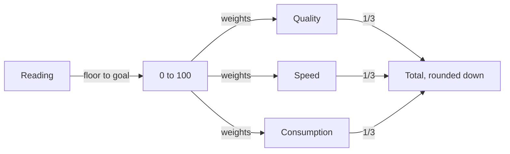

# Quality and Speed: the brief

> **The simpler and less code, the better, in all situations. No over-engineering. No test that isn't needed. No tool a metric doesn't need.**
>
> **All documentation is as visual as possible, with little to no text.**

## A metric stays only if

| | |
|---|---|
| 1 | It can be measured |
| 2 | It matters to the quality, speed or consumption of this specific thing |
| 3 | It has a goal to work toward: the goal and the metric are what add up to the score |
| 4 | It moves the page toward its stated ideal (`ideal.json`) |
| 5 | Its goal has a source (`goal_source`) |
| 6 | A session can act on it: Claude acts on these |

| | |
|---|---|
| Per thing scored | About 3 to 10: an expectation, never a limit |
| A page with `signoff_comment` | One metric in each lens |
| Total | (Q+S+C)/3, a third each: the owner's decision (2026-11-04), Git Crafter's rule |
| Start from | Git Crafter's templates: [ideals](https://github.com/SoulCraft-Org/git-crafter/tree/main/quality/ideals), the [model](https://github.com/SoulCraft-Org/git-crafter/blob/main/quality/README.md) |

## Scoring

| Reading | Scores |
|---|---|
| At goal | 100 |
| Missing, stale, too few samples, an error | 0, as an empty red tile |
| `no_events` with its drill at goal | 100 |
| A lens with no metric | 0 |

Format: [contract/README.md](contract/README.md).

## Your folder

| `quality-speed/pages/<slug>/` | |
|---|---|
| `PLAN.md` | Sources, ideal state, metrics, chart per metric, baseline, fixes, final |
| `manifest.json` | The list. `signoff_comment`, a pull request comment id, starts it scoring; from then on goals only tighten |
| `lanes.json` | Where and how often the collector runs, and what it can use: [contract/README.md](contract/README.md) |
| `page.ts` | The page, built with `core/charts/`, its numbers from `render()`. The build runs it fenced: no files outside `quality-speed/`, no processes, no environment |
| Collector, tests | Only what a metric needs |

## Limits

| | |
|---|---|
| Words | 80 visible per page, table data and the home page's ring names aside, counted by the publish guard. A page's body gets 80 minus `frameWords(slug)` (`core/build.ts`): the title, ring and ideal header's share |
| First view | 100 KB |
| Charts | Inline SVG, painted before any script |
| Screens | Light and dark, phone and desktop |
| Local check | One page, port 3200 to 3249, strict port |
| Packages | None for the site |
| Output | Only html and json from a page, named with lowercase letters, digits and hyphens |

## Never

| | |
|---|---|
| ✗ | Case data or customer names, anywhere |
| ✗ | A case room's connector tools |
| ✗ | Output of `web/scripts/coverage.ts` or `web/mcp/audit.ts`, `proposal_events`, the replica eval |
| ✗ | Counting this site's own folder, workflow or pull requests in Code, Testing, Actions, Pull requests, Issues, Agents or Insights |
| ✗ | Em dashes |
| ✗ | The Colorado regulatory department's acronym: write its full name |
| ✗ | Loosening more than one page in one pull request (any number of pages and `core/` otherwise) |

## Where CI runs

| Work | Where |
|---|---|
| Heavy, one-off | A cloud VM first |
| No secret, no write token | Blacksmith, with its guard counting the minutes |
| A secret or write token | GitHub-hosted |

## One GitHub login, 5,000 REST calls an hour, shared by every session

| | |
|---|---|
| ✗ | `gh run watch`, or polling at short intervals |
| ✓ | Check a run once, when you expect it's done |
| ✓ | A 403 from `gh` may be this limit: read the reset time before calling it a failure |

Pull requests: the `pull-request` skill.
