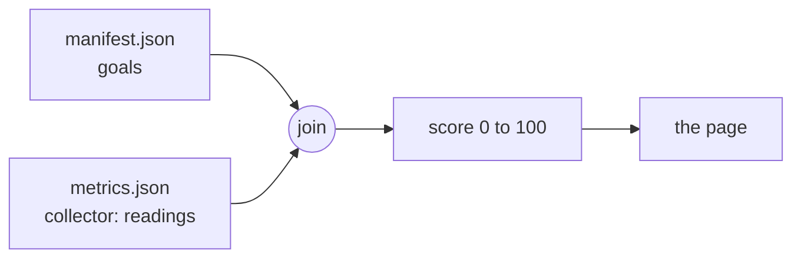

# The metric format



```bash
node quality-speed/contract/check-pages.ts
```

| | |
|---|---|
| An unknown field | Fails: no text can reach the site |
| `example/` | A sample |
| `vectors.json` | Worked scores |

## `manifest.json`

| Field | Rule |
|---|---|
| `page` | The folder's slug (`pages.ts`) |
| `signoff_comment` | Optional: a pull request comment id that starts the list. Without it the list takes no readings, scores 0, needs no minimum, and can change freely |
| `groups` | Optional: `{ id, weight }`, adding up to 100, each with a metric in each lens |
| `metrics` | With `signoff_comment`, at least one in each lens |
| `changes` | The change log, `[]` to start |

| Each metric | Rule |
|---|---|
| `id` | `lower_snake_case`, dots between parts, at most 120 characters, unique |
| `lens` | `quality`, `speed`, `consumption` (a resource used: tokens, minutes, dollars, CPU, bytes) |
| `unit` | `percent` (0 to 100), `pass` (0 or 1), `count`, `ratio`, `score`, `ms`, `seconds`, `minutes`, `hours`, `days`, `bytes`, `usd`, `per_week`, `tokens` |
| `direction` | `higher`, `lower` |
| `floor`, `goal` | 0 at `floor`, 100 at `goal`, a straight line between |
| `weight` | A whole number from 1 to 100, within its lens |
| `max_age_hours` | Older scores 0, at most 2,160 (90 days). Use 48 unless the run is slower than daily |
| `min_samples` | Fewer scores 0 |
| `coverage_metric` | Optional: the drill that lets this metric read `no_events`. The drill's `max_age_hours` is at most 744 |
| `group` | Required when the page has `groups` |
| `goal_source` | Required with `signoff_comment`: the public `https` page the goal comes from, as in Git Crafter's targets |

**With `signoff_comment`, goals only tighten.** A loosening needs a `changes` entry: `date`, `metric`, `field`, exact `from` and `to`, `reason`, `issue`. Its `signoff_comment` is optional.
An added metric is logged the same way: `field: "added"`, `from: null`, `to` its own id, `reason: "added_toward_ideal"`.

## `ideal.json`: what the page is working toward

Required with `signoff_comment`. The same shape as Git Crafter's [`quality/ideals/<tab>.json`](https://github.com/SoulCraft-Org/git-crafter/tree/main/quality/ideals), so a page starts from its template.

| Field | Rule |
|---|---|
| `ideal` | The end state every metric moves toward. Plain words, at most 25 words and 300 characters |
| `sources` | 1 to 5 `{ title, url, date }`, newest documents first: a public `https` link to the document itself (not a home page), a plain title of at most 120 characters, and the document's date (`YYYY-MM-DD`), never after today. The page's Sources table links each `url`; the publish guard lets a page link outside this repository only to these, exactly as written |
| `quality`, `speed`, `consumption` | Optional: what ideal looks like in that category. Plain words, at most 25 words and 160 characters |

| Term | Rule |
|---|---|
| Plain words | Letters, digits, spaces and `,.;:'()%/+?!-`, at least one letter, no leading or trailing space: no markup, entities, quotes or em dashes |
| Words | Counted as the publish guard counts them (letter runs, 20 letters to a word). 25 is its run limit, so a line that passes here passes there |
| Links | `https` to a plain host name (no punycode, port or credentials), only URL-safe characters after it |
| A Git Crafter template's ideal | May need shortening: Git Crafter allows a longer one |

## `metrics.json`

A list. All eight fields, always.

| Field | `ok` | `stale` | `no_events` | `missing` |
|---|---|---|---|---|
| `id`, `page` | ✓ | ✓ | ✓ | ✓ |
| `status` | `ok` | `stale` | `no_events` | `missing` |
| `value` | number | number or null | null | null |
| `stage` (`lab`, `live`) | ✓ | ✓ | ✓ | ✓ |
| `measured_at` (UTC) | ✓ | ✓ | ✓ | or null |
| `source_url` | run link | any link or null | run link | any link or null |
| `sample_size` | ✓ | or null | 0 | or null |

| | |
|---|---|
| Can't measure | Write `missing`, never a good number |
| Run link | The run on the commit being scored. A collector reading another run's result checks its `head_sha` |
| Any link | This repo's issue, pull request, run, commit, or `settings`, optionally `/actions`, `/branches`, `/pages`, `/rules` or `/security_analysis`, with no query |
| No record, or a bad one | Reads `missing`: an empty red tile |

## `lanes.json`: when a page is measured

A list, one entry per lane. Each lane runs in its own job: a page never edits the workflow. Anything needing a secret isn't a lane: it goes in the owner-merged jobs.

```json
[{ "id": "daily", "runner": "linux", "cadence": "daily", "collector": "collect.ts" }]
```

| Field | Rule |
|---|---|
| `id` | Lowercase letters, digits and hyphens |
| `runner` | `linux` (Blacksmith first, 10 minutes at most, narrower reads), `linux-hosted` (GitHub's, 45 minutes, for anything longer or needing the wider reads), `macos` (`macos-26`, weekly, 20 minutes), `windows` (`windows-2025`, weekly) |
| `cadence` | `daily` (the schedule, and merges touching this page, on Linux), `nightly` (the schedule only), `weekly` (Sundays). A manual run takes all of them |
| `collector` | A `.ts` file in the page's folder, or `../../core/<kit>/<file>.ts` |
| `args` | Optional. Plain words passed before `--out`, such as a kit's page name |
| `install` | Optional. `true` runs `npm ci --ignore-scripts` in `web/` first |
| `admin` | Optional. Only `launch-readiness`, `projects`, `security` and `settings`, and needs `linux-hosted` |

| `../../core/<kit>/collect.ts`, `args: ["<slug>"]` | Writes |
|---|---|
| [`law`](../core/law/README.md) | The law metrics |
| `lane` | `lane_minutes` |

| The collector | |
|---|---|
| Runs | `node <collector> <args> --out <file>`, from the repository root, on Node 24 |
| Writes | A list of records to `<file>` |
| A failed, late or missing lane | Reads as missing that day; its job shows red |
| Always has | Full git history, outbound HTTPS, `$GITHUB_RUN_ID`, `$LEGALLAS_LAW_CONTACT`, and `$GH_TOKEN`, the job's read-only token: contents, issues, pull requests, Actions, checks, statuses |
| Lanes not on `linux` | Can also read deployments, Pages, security events, Dependabot alerts |

| It writes into `$DETAIL_DIR` | What happens |
|---|---|
| `page/<name>.json` | Copied beside `page.ts` before the build, where page code reads it. Plain name, valid JSON, 1 MB at most. It can't replace a file already there |
| `facts/` | Back in `$PREV_DIR/facts/` next run: the place for `--prev` facts and caches. Never published, 2 MB at most. Other lanes can read it, so no secrets |
| `detail.json` | `context.detail`: `{ "checks": { "<id>": 0 or 1 }, "readings": { "<id>": { "value", "limit", "n" } } }`, ids of 32 characters at most |

