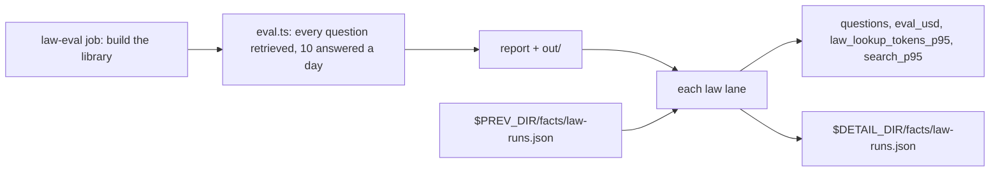

# Law kit

One collector for the law and regulator pages, every `PAGE_GROUPS.law` page but `templates` in [`contract/pages.ts`](../../contract/pages.ts). A page is a reviewed list, `needs.json`, plus a few lines of code. The metrics are
in [`PLAN.md`](PLAN.md). Lane: daily, repository files only, no secret, and one read of the run's own jobs for `lane_minutes`.

```bash
node quality-speed/core/law/collect.ts <slug> [--eval <law-eval report>]   # writes pages/<slug>/metrics.json and law.json
node quality-speed/core/law/collect.ts --questions                         # every page's questions, as eval.ts reads them
```

A page's `lanes.json` runs it daily. The daily run passes `--out` and `$DETAIL_DIR`, so `law.json` reaches the build beside `page.ts`.
Without `--eval`, the lane reads the newest report the `law-eval` job in `quality-speed.yml` left in
`$KEY_JOB_OUTPUT_DIR/law-eval/eval/`, beside the library in `out/`.



| Metric | Read from |
|---|---|
| `law_lookup_tokens_p95`, `search_p95` | Today's report: every question is retrieved, and timed, every day |
| `questions`, `eval_usd` | Each question's newest answered turn, today's or carried for up to 60 days (`CARRY_DAYS`) |
Never commit `law.json` or `metrics.json`: the build won't replace a file already there. Outside CI every record reads missing,
because an `ok` reading needs the run's link.

```json
[{ "id": "law", "runner": "linux", "cadence": "daily", "collector": "../../core/law/collect.ts", "args": ["<slug>"] }]
```

## `needs.json`: the reviewed list

What founders and investors need from one body, by customer path. Each line is a need, not a document: say what they need, then where
the product holds it.

```json
{
  "needs": [
    {
      "id": "form-d",
      "path": "startup-raises",
      "need": "Form D: what to file and when",
      "source": "https://www.sec.gov/resources-small-businesses/exempt-offerings/filing-form-d-notice",
      "checked": "2026-11-02",
      "covered_by": ["unit:us-sec-part-230", "item:financing.form-d-and-state-notices"],
      "flags": [{ "kind": "deadline", "text": "within 15 days after the first sale" }]
    }
  ],
  "questions": [
    { "id": "sec-form-d-deadline", "question": "When is Form D due after a Rule 506(b) sale?", "expect": ["17 CFR 230.503"] }
  ]
}
```

| Field | Rule |
|---|---|
| `id` | Lowercase letters, digits and hyphens, unique in the list |
| `path` | A path from the plan's vocabulary: `startup-forms`, `startup-raises`, `angels-invest`, `angels-create-groups`, `vcs-invest`, `fights` |
| `need` | What they need, in plain words, at most 60 characters: it labels a row on a phone |
| `source` | The body's own page for it: `https`, on a `.gov` host or a host the law pack plan lists |
| `checked` | The day you opened `source`, or `null`: unverified. The need counts as held only within 365 days of it |
| `covered_by` | Where the product holds it. Empty means it doesn't yet. `unit:<id>` a unit in `docs/design/law-pack-plan.toml`, `template:<path>` a file under `templates/` without `.md`, `item:<id>` an item in `docs/checklist/baseline.toml` |
| `flags` | Optional. Each deadline or fee the need carries: `kind` is `deadline` or `fee`, `text` the exact words, from `source`, at least three, that a template or checklist item it relies on must contain. A unit's plan note never counts |
| `questions` | Test questions in the law eval's format (`web/scripts/law/eval-score.ts`). Each `id` starts with the page's slug and a hyphen |

A reference resolves when that unit, file or item exists, and a unit only when a room built with the defaults builds it: one with
`flag = "next"` doesn't. One that doesn't resolve leaves its need uncovered, and the collector names it. A
malformed list fails the kit's test. `--eval` takes the report `eval.ts` writes to its law folder's `eval/`, outside the repository.
A row `eval.ts` marks `answered: false` was retrieved only, and a row whose call errored with no answer says nothing of the question: neither is a turn for `questions` or `eval_usd`, so the question keeps its last turn.
`law_lookup_tokens_p95` rebuilds the law tool's answer to each run from that folder's `out/`, the library it searched, with `web/mcp/law-answer.ts`, the file the tool itself builds it with: one shape, so the metric is what a member's AI gets.

## Page code

The build runs `page.ts` fenced inside `quality-speed/`, so a page never imports `law.ts`: it reads the `law.json` the collector writes
beside `metrics.json`. Before the collector has run there, the needs grid is a red tile.

```ts
import type { PageContext, PageOutput } from '../../core/build.ts';
import { roadTo100 } from '../../core/charts/index.ts';
import { lawCharts, readView, roadFixes } from '../../core/law/page.ts';

export function render(context: PageContext): PageOutput {
  const view = readView(new URL('./law.json', import.meta.url)); // needs, sources, fixes, values
  const now = { q: context.score.exact_quality, s: context.score.exact_speed, total: context.score.total };
  const fixes = roadFixes(context);
  return { body: lawCharts(view) + roadTo100({ baseline: BASELINE, now, fixes }) };
}
```
