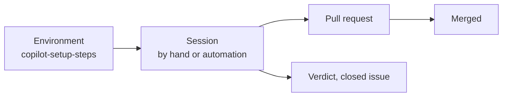

# Agents: plan

Slug `agents`, group Claude. GitHub's Agents tab, every vendor, section by section. Rescoped by the owner, 9 Nov: "mirrors GitHub's Agents tab, every vendor". Claude Code sessions stay on the Claude Code page (#670).

Copilot's cloud agent isn't set up for Colorado Startups yet, so the tab is quiet. Each metric then reads `no_events`, which scores only while `session_drill` proves the measures read planted facts exactly.

## Ideal state

`ideal.json`: every GitHub agent session, any vendor, by hand or automation, ends in a merged change, fast, on few tokens and minutes, after two-minute setup.

## Sections

| Section | Metrics | Read with the job's read token |
|---|---|---|
| Sessions | `sessions_merged`, `session_drill`, `session_to_pr_p50`, `minutes_per_merged_change`; a row per vendor | Completed Actions runs on `dynamic/copilot-swe-agent/<agent>`: `<agent>` is the vendor (`copilot`, verified on `github/docs`' runs). Their pull requests by branch |
| Automations | `automation_runs_useful`, `automation_credit_limit_set` | `GET /agents/repos/{repo}/automations` and each one's `/tasks` (needs "Agent tasks" read) |
| Environment | `env_setup_success`, `env_setup_seconds_p50` | Runs of `.github/workflows/copilot-setup-steps.yml`; none in the repository reads `no_events` |
| Configure | Link to the Settings page, Copilot section | Settings owns each value |

## Metrics

**Window:** the last 30 days. Every metric but the drill and the lane names `session_drill` as its `coverage_metric`.

| Id | Lens | Measured | Floor | Goal | Weight | `goal_source` |
|---|---|---|---|---|---|---|
| `sessions_merged` | Q | % of ended sessions merged into `main` | 50 % | 90 % | 3 | Best practices |
| `session_drill` | Q | 1 when every measure reads the planted facts exactly and the runs and pull requests reads worked | 0 | 1 | 1 | Testing for reliability |
| `automation_runs_useful` | Q | % of ended automation runs that merged a pull request into `main`, or completed with none (a verdict) | 50 % | 90 % | 2 | Creating automations |
| `automation_credit_limit_set` | Q | % of automations with an AI credit limit | 0 % | 100 % | 1 | Creating automations |
| `env_setup_success` | Q | % of finished setup runs that succeeded | 50 % | 100 % | 1 | Customizing the environment |
| `session_to_pr_p50` | S | p50 minutes from a session's start to its end | 60 | 15 | 1 | Troubleshooting: the one-hour timeout |
| `env_setup_seconds_p50` | S | p50 seconds of a setup run | 600 | 120 | 1 | Customizing the environment; the owner's two minutes |
| `minutes_per_merged_change` | C | Sessions' billed minutes over merged pull requests | 60 | 20 | 2 | Actions billing |
| `lane_minutes` | C | `core/lane` | 30 | 5 | 1 | Continuous Integration |

| Known gap | Reads |
|---|---|
| The automations API shows no credit limit field (read 2026-11-09) | `automation_credit_limit_set` is `missing` once an automation exists |
| The job token may lack "Agent tasks" read | Both automation metrics `missing`; the sessions and the drill are unaffected |

| Retired, 2026-11-06, superseded by the Claude Code page (#670) |
|---|
| `fence_proven`, `rule_clean`, `instruction_broken`, `first_commit_to_merge_p90` |

## Charts

| What | Chart |
|---|---|
| Each section, and the lane | `bullets`, one per metric |
| Vendors | `dataTable`, "off" with no session |
| Road to 100 | `roadTo100` |
| Every reading | `dataTable` with its link |

**Lane:** `linux` (Blacksmith first), `daily`. A few REST calls when quiet.

## Baseline

The 5 Nov run scored on the first list: only `lane_minutes` read, 7 minutes. Quality 0, Speed 0, Consumption 30.7.

## Fixes

| # | Fix | Metric |
|---|---|---|
| 1 | The drill passes on the daily run | Sessions, Environment |
| 2 | The automations read works with the job token | Automations |
| 3 | The lane on `linux`, in under 5 minutes | `lane_minutes` |

## Final

Not yet.
