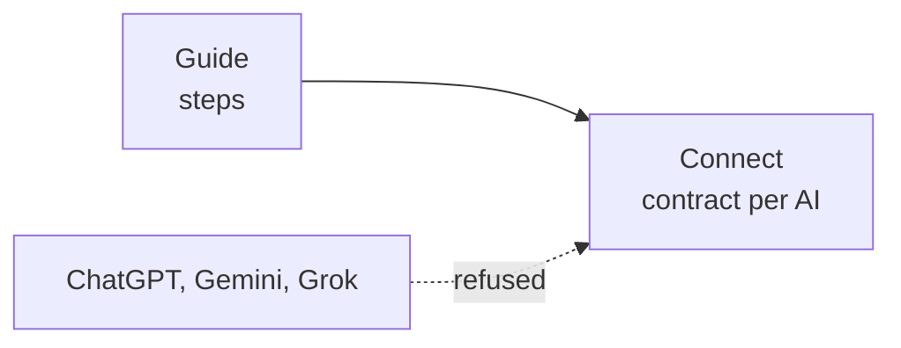

# AI connectors: plan

## Sources

| What | Where |
|---|---|
| The product's rule on which AI may connect | [`docs/product.md`](../../../docs/product.md), "How people use it"; [`docs/design/ai-connectors.md`](../../../docs/design/ai-connectors.md), "Which AI may connect" |
| The connector and its allowlist | [`web/mcp/contract.ts`](../../../web/mcp/contract.ts) (`DEFAULT_REDIRECT_ALLOW`, `TOOL_NAMES`, caps), [`web/mcp/redirects.ts`](../../../web/mcp/redirects.ts) |
| The setup guides | [`web/connect/`](../../../web/connect/): `claude-ai.md`, `copilot.md`, `harvey.md`, `README.md` |
| The connector contract, per AI | [`web/scripts/mcp-smoke.ts`](../../../web/scripts/mcp-smoke.ts) with [`connect-e2e-kinds.ts`](../../../web/scripts/connect-e2e-kinds.ts) (Claude, Teams, Copilot Studio, Harvey) and [`web/connect/copilot/validate.ts`](../../../web/connect/copilot/validate.ts) (the Copilot package) |
| ChatGPT's callbacks and client document | [OpenAI: authentication for apps](https://developers.openai.com/plugins/build/auth), read 2026-11-02: `https://chatgpt.com/connector_platform_oauth_redirect`, `https://chatgpt.com/connector/oauth/{callback_id}`, `https://chatgpt.com/oauth/client.json` |
| Gemini Enterprise's callback | `https://vertexaisearch.cloud.google.com/oauth-redirect`, from vendor setup guides read 2026-11-02 (Google's own page returned 404); the default allowlist allowed it from 2026-10-20 to 2026-10-31 |
| Grok's connectors | [xAI: Grok connectors](https://docs.x.ai/grok/connectors), read 2026-11-02: custom connectors exist, with no published callback, so the check tries Grok's hosts |
| API-only clients | [OpenAI API: remote MCP](https://developers.openai.com/api/docs/guides/tools-connectors-mcp), read 2026-11-02: a bearer token in `authorization`, no callback. Only a grant from an allowed app yields one |
| The MCP authorization flow | [MCP specification 2025-11-25: Authorization](https://modelcontextprotocol.io/specification/2025-11-25/basic/authorization), version 2025-11-25, read in full 2026-11-04 from its source in `modelcontextprotocol/modelcontextprotocol`: "Authorization servers MUST validate exact redirect URIs against pre-registered values" |
| Steps in a procedure | [Microsoft Writing Style Guide: writing step-by-step instructions](https://learn.microsoft.com/en-us/style-guide/procedures-instructions/writing-step-by-step-instructions), dated 2018-01-19, read in full 2026-11-04 from its source in `MicrosoftDocs/microsoft-style-guide`: "Limit a procedure to seven steps, and preferably fewer" |
| Tokens per tool response | [Anthropic: Writing effective tools for agents](https://www.anthropic.com/engineering/writing-tools-for-agents), published 2025-09-11, read in full 2026-11-04: "For Claude Code, we restrict tool responses to 25,000 tokens by default" |
| Tokens for the tool list | [Claude API docs: Tool search tool](https://platform.claude.com/docs/en/agents-and-tools/tool-use/tool-search-tool), read 2026-11-05, "When to use tool search": "Your tool definitions consume more than 10k tokens." Copilot and Harvey load every definition into each conversation |
| Answer time, for its board card | [web.dev: RAIL model](https://web.dev/articles/rail), updated 2023-01-06, read in full 2026-11-04 from `GoogleChrome/web.dev`: "Beyond 10000 milliseconds (10 seconds), users are frustrated and are likely to abandon tasks" |

## Ideal state

[`ideal.json`](ideal.json), drawn by core atop the page.

## Metrics

Lab: a local connector on a CI runner, invented data only. Needs sign-off on its new pull request.

| Id | Lens | Unit | Dir | Floor | Goal | Weight | Age h | Min n | Goal from | Reads |
|---|---|---|---|---|---|---|---|---|---|---|
| `unsupported_ai_refused` | quality | pass | higher | 0 | 1 | 3 | 48 | 9 | MCP spec: exact redirect match | 1 only when all 9 probes are refused and loopback is off by default; any admitted, 0; one unproven, `missing` |
| `supported_ais_connecting` | quality | percent | higher | 50 | 100 | 3 | 48 | 4 | MCP spec: the flow each client follows | Share of the 4 AIs passing every smoke stage |
| `setup_steps_worst_ai` | speed | count | lower | 20 | 7 | 2 | 48 | 4 | Microsoft: at most 7 steps | Most steps across the 4 guides' main paths |
| `tool_list_tokens` | consumption | tokens | lower | 20000 | 10000 | 3 | 48 | 1 | Anthropic: tool search past 10k tokens of definitions | The room's tools/list result (`web/connect/copilot/appPackage/mcp-tools.json`, which `mcp-tools.test.ts` holds equal to the server), compact JSON, characters over four (the data room's rule). Floor: twice the goal. 2,572 over 9 tools on 2026-11-05 |

| Steps rule | Reads |
|---|---|
| Guide file missing | 20, the floor (open-weight until #158) |
| Section missing, or 0 counted steps | `missing` |

**Board cards to file.** The answer metrics wait on the board card "AI connectors page: answer tests through the sample
room's connector". #863 removed the two answer jobs, whose scripts were never written, so nothing reads answers today.

| Metric | Returns when |
|---|---|
| `claude_answer_p95` | The answer card lands; goal 10 s from web.dev RAIL |
| `guide_checks_passing` | A public page sets its goal |
| `claude_right_document` | The answer card lands and a public page sets an answer accuracy goal |
| `open_weight_right_document` | Same |
| `tool_result_tokens_per_answer` (consumption) | The answer card lands; goal 25,000, Anthropic tools article |

**The unsupported AI probes.** Each runs with the callback listed in `MCP_REDIRECT_ALLOW`, plainly and as an owner entry (`=uri`), so it
proves that neither config nor the owner's one-click allow lets it in. Refused means the allowlist's own answer, 400 with
`invalid_redirect_uri`; any other answer proves nothing. In the same run Claude's callback must register (201), or a server refusing
everyone would pass, so every refusal then reads unproven.

| AI | Probe | Refused means |
|---|---|---|
| ChatGPT | Register with `https://chatgpt.com/connector_platform_oauth_redirect`, and with `https://chatgpt.com/connector/oauth/{id}`, a fresh random id each run | 400, `invalid_redirect_uri` |
| ChatGPT | `/authorize` with `client_id=https://chatgpt.com/oauth/client.json` | "App not allowed" |
| Gemini Enterprise | Register with `https://vertexaisearch.cloud.google.com/oauth-redirect` | 400, `invalid_redirect_uri` |
| Every denied host | Register with a callback on a fresh random subdomain of `openai.com`, `google.com`, `grok.com`, `x.ai` and `x.com` each run (Grok publishes no callback), so a deny of exact addresses can't pass | 400, `invalid_redirect_uri` |

Baseline: 0. Today an owner entry or a config line admits any of them. The fix is a hard deny of `openai.com`, `chatgpt.com`,
`google.com`, `x.ai`, `grok.com` and `x.com`, with subdomains, ahead of the allowlist and before `/authorize` fetches a client document.

**The connector contract, per AI.** From the MCP smoke (`npm run mcp:smoke`) on the full product. An AI connects only when every stage
passed: discovery from the shared rows, registration, sign-in, tools and revocation from its own, so a kind with one row can't count.

| AI | Client, as the smoke plays it | Profile | Also |
|---|---|---|---|
| Claude | Client document or public client, `https://claude.ai/api/mcp/auth_callback` | standard, images | |
| Copilot | Teams Developer Portal, confidential, `client_secret_basic`; and Copilot Studio, public | compact | The agent package validates (`validate.ts`); every result within 9,000 characters; at most 10 tools |
| Harvey | Confidential, `client_secret_post`, on `harvey.ai` | standard | |
| Open-weight | OpenCode: public client by registration, `http://127.0.0.1:19876/mcp/oauth/callback` | compact | The lab turns loopback on, as the owner does for desktop apps; the gate still checks it is off by default |

**Main-path sections for steps.** Claude: `claude-ai.md` "What you do". Copilot: `copilot.md` "What you do" and "The Legallas agent for
Microsoft 365". Harvey: `harvey.md` "What you do" and "What your Harvey admin does once". Open-weight: `open-weight.md` "What you do"
and "What the room's owner does once" (#158).

**Left off, and why**

| Candidate | Why not |
|---|---|
| Copilot answer accuracy | Needs a Microsoft 365 test account with Copilot. The master plan keeps it off the site until the owner buys one (step 7); nothing waits on it. Added then |
| Harvey answer accuracy | Harvey can't be bought for testing, and the first firm's room holds customer data, which is never measured. Never measurable here |
| The "not a lawyer" notice in the connector's first reply | A legal-review condition, scored on Launch readiness |
| Retrieval through the connector on a seeded room | The Data room's "Find it fast", from the sample room lab |
| Desktop clients on loopback (OpenCode, and also Gemini CLI or Codex) | Once the owner turns loopback on, the server can't tell which model a desktop client runs. Loopback stays off by default (checked in the gate); the generated config names an allowed model |
| Per-person or vendor-UI timings | Need a person at a screen; not measurable in CI |
| Open-weight answer time | Cut on review: on OpenRouter's free tier it mostly measures the free queue, and its fix is a billing choice, not this product |
| Tool round trip | Held out on the merge queue's review: the lab room is empty, so half the timed calls answer not-found. Returns on the sample room lab's seeded room |

## Chart per metric

| Metric | Chart (kit) |
|---|---|
| `unsupported_ai_refused`, `supported_ais_connecting`, `tool_list_tokens` | `metricTile` row |
| `setup_steps_worst_ai` | `metricBullet`, under Speed |
| Drill-down | `dotMatrix` per AI by stage and per probe, unproven cells red; `dataTable` of steps by AI |
| Infographic | Guide to Connect, each full, part or empty; ChatGPT, Gemini and Grok at the gate, a red line while it lets them in |
| Road to 100 | `roadTo100` from Fixes, scored with `core/score.ts` |
| Every metric | `dataTable` with each run's link |

## How it's collected

| Lane (`lanes.json`) | Runs | Needs | Writes |
|---|---|---|---|
| `lab`, daily, `linux`, about 3 min | `collect.ts`: `legallas-mcp` on the full product, empty room whose owner has ticked the full notice; MCP smoke, its table in the job log; registration window; 9 probes plus Claude's callback as control; guides | `install: true`, no secret; child processes get `PATH`, `HOME`, `TMPDIR`, `LANG`, `CI` only | 4 records (`tool_list_tokens` reads the pinned list, no server); `page/connectors.json` drill-down |

## Baseline

Lab on `main` at `35c58d4` (2026-11-02), rescored 2026-11-04 with `core/score.ts`.

| Metric | Value | Score | Why |
|---|---|---|---|
| `unsupported_ai_refused` | 0 | 0 | Every listed probe admitted |
| `supported_ais_connecting` | 100% | 100 | All 4 pass since #157 (in #316) |
| `setup_steps_worst_ai` | 20 | 0 | Claude 7, Copilot 13, Harvey 10, open-weight no guide (20) |
| Total | 33 | | Quality 50, Speed 0 |

## Fixes

| Fix | Where | Gain |
|---|---|---|
| Hard deny of `openai.com`, `chatgpt.com`, `google.com`, `x.ai`, `grok.com`, `x.com` and subdomains, before the allowlist and before `/authorize` reads a client document | #156 | +33.3 |
| Open-weight guide (OpenCode) | #158 | +17.7 |
| Every main path to 7 steps: Copilot from 13, Harvey from 10 | `web/connect/` | +15.7 |
| Lean tool list, on any day it passes 10,000 tokens: shorter descriptions and schemas | `web/mcp/`, then `node connect/copilot/mcp-tools.ts` | up to +25 (Consumption at weight 3 of 4) |
| The lab's owner ticks the full notice. Since #725 (2026-11-06) sign-in stops at "Read the notice first" without it: from its merge to 8 November `supported_ais_connecting` read 0 and `unsupported_ai_refused` read `missing` | `collect.ts` `seedSql` | Quality 0 to 100 (the 6 Nov reading) |

## Final

To be filled.
