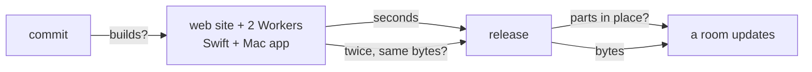

# Build

## Sources

Read on 2026-11-02 at `6cba301`.

| Source | What it gives this page |
|---|---|
| `web/package.json` | `build` is `astro build`. `check` (type check) belongs to Code |
| `web/astro.config.mjs`, `web/integrations/dist-audit.mjs` | The site build; `dist-audit` runs at its end and fails it on a CSP break or a page over 60 KB of eager script |
| `web/scripts/dist-audit.ts`, `bundle-budget.ts` | Eager script per page, gzipped. Largest today: 49.7 KB of 60 KB |
| `.github/workflows/ci.yml`, job `checks` | Steps `Web install`, `Web build`, `Worker dry runs` (both Workers, as a release would bundle them) |
| `.github/workflows/ci.yml`, job `swift` | Steps `Build (Debug)`, `Build (Release)`, `App bundle`, `LegallasCore for iOS`. Runs only when Swift paths change |
| GitHub REST: workflow runs and their jobs | Each step's result and start and end times. The only CI source this page reads |
| Issue #31, `docs/licences/NOTICE-draft.md` | Before the first release: no GPL fonts in `dist/pdfjs/`, a generated `THIRD-PARTY-NOTICES` shown in the room |
| [Cloudflare Workers limits](https://developers.cloudflare.com/workers/platform/limits/) | Worker 64 MiB uncompressed, no compressed limit, 1 s startup; static assets 25 MiB a file, 20,000 files on Free, 100,000 on Paid |
| [Fowler, Continuous Integration](https://martinfowler.com/articles/continuousIntegration.html) | The ten-minute commit build |
| [reproducible-builds.org](https://reproducible-builds.org/docs/definition/) | Same source, environment and instructions give bit-for-bit identical artifacts |

Not here: install and setup (not in this repository), type-check time (Code), test time and coverage (Testing), spend and queue time (Actions).

## Ideal state

`ideal.json`, from Git Crafter's `quality/ideals/deploy.json`, cut to 25 words. Colorado Startups hosts no room, so the template's
"reaches production" becomes "a release a room can update to": every main commit builds, fast and the same bytes every time, into a
small, complete release.

**The release** is what a room deploys: `site/` (the Astro build), `worker-web/` and `worker-mcp/` (each Worker and its source map,
`upload_source_maps` is on), `migrations/`, `LICENSE`, `NOTICE`, and `THIRD-PARTY-NOTICES` inside `site/` so the About screen can show it.
A room's brand pack and settings are written in when its site is built (`vite.define`, `@brand`), so this page measures the reference
build: the neutral pack and the example settings, the only ones in this repository. Since #284 the example settings run the full product
(`worker/entry-pro.ts`, `mcp/entry-pro.ts`), so the room Worker carries Ask and the research chat's SDKs. A real room's bundle differs by
its own pack and entry; the Rive saving below, for one, applies only to a pack with no rig.

## Metrics

| Id | Lens | Why | Source | Floor | Goal | Weight |
|---|---|---|---|---|---|---|
| `main_commits_building` | Quality | "Any commit builds": share of the last 30 `main` runs that built, of those whose result is known | Job records, `main` pushes, the seven build steps above. A failed build step fails the run. A job whose build steps all passed passes it. A job where some build steps ran and the rest were skipped (an earlier check failed) makes the run unknown, left out, never a pass; so do cancelled runs and runs that built nothing | 0 % | 100 % | 1 |
| `release_reproducible` | Quality | "The same way every time": two builds of one commit give identical bytes | The lane builds the release twice, the second in a fresh `git worktree` with a clean install, in another time zone and locale, and compares every file's SHA-256 | 0 | 1 | 2 |
| `release_gaps` | Quality | "Complete", and "a room can update to": the 5 release checks below, counted where missing | The lane's release folder, and `git log` for the migrations | 5 | 0 | 3 |
| `web_build_seconds_p50` | Speed | "Fast", web: install, site and both Workers | Job records, `checks`, sum of the three steps, median of the last 10 runs where all three passed | 600 s | 60 s | 1 |
| `mac_build_seconds_p50` | Speed | "Fast", Mac: Debug, Release, app bundle, iOS | Job records, `swift`, sum of the four steps, median of the last 5 runs where all four passed (3 on record today) | 600 s | 60 s | 1 |
| `release_gzip_bytes` | Consumption | "Small": bytes shipped, what a room downloads and uploads on each update | The lane's release folder, each file gzipped at level 9, summed; the parts go to `detail.json` | 9.6 MB | 4.8 MB | 3 |
| `lane_minutes` | Consumption | This page's own daily lane | `core/lane` | 10 min | 5 min | 1 |

Each metric's `goal_source`: Fowler's Continuous Integration (every commit builds, the ten-minute build), reproducible-builds.org's
definition, and for `release_gaps` this plan's [Goals](#goals), since 0 is by definition. `release_gzip_bytes` is back on the list since 2026-11-05 (#645),
at weight 3, as the page's real cost: `lane_minutes` times only the lane. Its goal comes from the release itself, not a public page, so its `goal_source` is
this plan's Goals. It keeps the signed-off 4.8 MB and 9.6 MB, though the goal's basis changed with the full product (below): re-deriving it is a loosening, for the orchestrator.

All: `max_age_hours` 48 (daily lane). `min_samples`: 10 for
`main_commits_building`, today's count (the 10 `main` runs with a known result among a cold read's newest 300, on 2026-11-04), 5 for
`web_build_seconds_p50`, 3 for `mac_build_seconds_p50` (the Mac job runs only on Swift changes), 1 for the rest.

**The release checks**, each one a change can break (a failed build writes missing for all three release metrics, so the site, the
Workers, `LICENSE` and `NOTICE`, which can't be absent while it's measured, aren't checks):

| Check | Fails when | Basis |
|---|---|---|
| Migrations in order | `migrations/` isn't numbered from 0001 with no gap | D1 applies migrations by name, in order, once (#362 found two 0016s) |
| Migrations unchanged | A migration differs from the version in the commit that added it. D1 applies a migration by name once, so an edit never reaches a room that already ran it; a revert clears the check. The lane needs the full history and writes missing on a shallow clone | D1's apply-once rule |
| Third-party notices | `site/THIRD-PARTY-NOTICES` is missing or empty (#31). Once #31's generator lands, this becomes "the generator passed" | #31 |
| No GPL fonts | Any `LiberationSans-*.ttf` is in the site (#31) | #31 |
| Cloudflare limits | Either Worker is missing or over 64 MiB, an asset is over 25 MiB, or there are more than 20,000 assets (the Free plan's count, so the release deploys on either plan) | [Workers limits](https://developers.cloudflare.com/workers/platform/limits/) |

### Goals

| Metric | Reason |
|---|---|
| `main_commits_building` | The ideal says any commit; a straight line from none to all, so each broken run costs its share. Weight 1: the merge rule (0 behind `main`, CI green) means a `main` commit is a tree CI already built, so it fails mostly when a runner or the registry changes |
| `release_reproducible` | Pass or fail, because one changed byte breaks the check a room or an auditor would run (reproducible-builds.org). Met today in the lab, so the definition is the cited source |
| `release_gaps` | Goal 0 by definition: all 5 checks pass, each on the basis in the release checks table. Floor at all 5 missing, so each check is worth the same |
| `web_build_seconds_p50` | Floor: Fowler's ten-minute commit build, all of it. Goal: a tenth of it, because checks, tests and the type check share those ten minutes. Met today (9 s), so Fowler is the cited source |
| `mac_build_seconds_p50` | The web's rule, unchanged: floor at the ten minutes, goal at a tenth. Not met (118 s), so it needs no other source. Mac minutes cost about 10x Linux minutes (`CLAUDE.md`), so this is the costliest build to leave slow. Moving a compile out of these four steps into `Test` (for one, letting `swift test` do the Debug build) raises the score without making CI faster, so it is not a fix |
| `release_gzip_bytes` | Goal: today's release less what a room without a Rive rig never fetches (Rive runtime, 0.99 MB) and the Liberation fonts #31 removes (0.36 MB), plus room for `THIRD-PARTY-NOTICES`. Floor: twice the goal |

**Seeds cut:**

| Seed | Why it's off |
|---|---|
| Worker size against Cloudflare's limit | The limit is 64 MiB uncompressed and the larger Worker is 3.9 MB since #284, so no goal below the limit has a basis. Kept as one release check, so crossing it still shows |
| Eager script per page (`dist-audit`) | The build already fails over 60 KB, so while builds pass it can never read short of goal. What a member feels is the Data room's load timing |
| Worker startup time | `wrangler check startup` needs `workerd` and varies by machine; the 1 s limit is 30x away from a 1.8 MB bundle |
| Type-check time | Code's |

## Chart per metric

`core/build.ts` passes `render()` the scored metrics and the lane's `detail.json`, and copies its `page/runs.json` beside `page.ts`.

| Metric | Chart |
|---|---|
| All five | `bullets` against goal, with the baseline marked |
| `main_commits_building` | `dotMatrix`: the seven build steps by the newest 5 `main` runs whose result is known, pass, fail or not run (`runs.json`); five fit a phone |
| `release_gaps` | `dotMatrix`: the 5 release checks, pass or fail (`detail.json`) |
| `web_build_seconds_p50`, `mac_build_seconds_p50`, `release_reproducible` | `metricTile`s, the build times with a sparkline of their sampled runs; a reading that scores 0 is the empty red tile |
| `release_gzip_bytes` | **The infographic**, drawn while the metric is on the list: the release as one bar, part by part, kept parts solid, the parts a fix removes outlined, the goal marked (`detail.json`; before the lane's first run, `baseline/release.json`, dated) |
| Page | The build's `ring`; `markKey`; `roadTo100`, one row per metric short of goal, ranked by what reaching it adds, adding up to exactly 100 |

**The lane** (`lanes.json`, read by `core/lanes.ts`): `release`, on `linux` (Blacksmith first, 10 minutes), daily, `install: true`, the
collector `collect.ts`. It gets the full history, `GH_TOKEN` and `GITHUB_RUN_ID` from `.github/workflows/quality-speed.yml`; it writes
its records to `--out`, and to `$DETAIL_DIR` its `detail.json`, `page/runs.json` and `facts/runs.json`, the CI runs it read, which come
back in `$PREV_DIR` so the next run reads only newer ones.

Run end to end through `core/collect.ts` in a cloud VM at `7e60380`, cold (no `$PREV_DIR`): 242 s, all six records of the earlier list valid, `detail.json`
passing `core/detail.ts`, `facts/runs.json` 6 KB. A cold run reads the newest 300 CI runs, which on this repository now span about
three hours, and found two Mac builds. So the first CI run reads `mac_build_seconds_p50` as too few samples (0) until a third Swift
build lands; the lane's memory keeps them from then on.

63 visible words and a 26 KB page, counted by `core/guard.ts` on a build from the lane's own outputs; the guard passes that build and
the synthetic one, with no sideways scroll at 390 px.

## Baseline

Taken before any fix, 2026-11-02, after the review: CI records up to `main` at `6cba301`, and the release built at `26c741d`, whose `web/` is `main`'s.

| Metric | Value | Score | How |
|---|---|---|---|
| `main_commits_building` | 100 % | 100 | Job records: the 15 `main` runs of the last 300 whose result is known all built |
| `release_reproducible` | 1 (lab) | 100 | This VM: two checkouts, the second in `Pacific/Kiritimati` and `de_DE.UTF-8`; 420 files identical |
| `release_gaps` | 2 of 5 | 60 | No `THIRD-PARTY-NOTICES`; four `LiberationSans-*.ttf` in `site/pdfjs/standard_fonts/`. Migrations: 15, in order, none edited after landing |
| `web_build_seconds_p50` | 8 s | 100 | Job records, last 10 runs. This VM: install 20.7 s, build 3.6 to 4.0 s, dry runs 2.4 s each |
| `mac_build_seconds_p50` | 118 s | 89.3 | Job records: the 3 passing `swift` jobs in the last 300 runs (120, 118, 114 s); 9 across the whole history read 114 to 134 s |
| `release_gzip_bytes` | 6.04 MB | 74.1 | Site 1.91, pdf.js 1.34, source maps 1.01, Rive 0.99, MCP Worker 0.37, Liberation 0.36, room Worker 0.05, other 0.02 MB (`release.json`) |

Baseline, scored by `core/score.ts`: Quality 80, Speed 87.8; on the five-metric list, without release size, Speed 94.6; Consumption 0, before the lane's first reading. These lab readings are in `baseline/`, for the page's
baseline marks. A reading the site scores needs the run that measured it, so the lane writes `metrics.json` in CI, every record linking
its own run; run anywhere else, the collector writes missing.

**Found while measuring:** a Worker's source map names its sources relative to `--outdir`. CI's dry runs write to `$RUNNER_TEMP`, so
their maps carry the runner's folder; `wrangler deploy` bundles inside the project (`.wrangler/tmp`), so real releases don't. The lane
bundles inside the checkout, as a deploy does.

## Fixes

Ranked by points on the total. Each is its own small pull request outside this folder.

| Fix | Metric | Gain | Where | State |
|---|---|---|---|---|
| Ship only the two standard fonts pdf.js fetches in a browser (Symbol, ZapfDingbats): no Liberation, rendering unchanged | `release_gaps`, `release_gzip_bytes` | +9.2 | #166 | Merged in #284 |
| Ship the Rive runtime only when the brand pack has a rig | `release_gzip_bytes` | +6.1 | #162 | Merged in #284 |
| `.gitignore`: the Xcode rule `build/` hid this folder | none | | #149 | Merged in #284 |
| Generate `THIRD-PARTY-NOTICES` into the site | `release_gaps` | +3.3 | #31 | Open |
| Two migrations share the number 0016: move the later one to 0017, idempotent, and refuse a repeat | `release_gaps` | +3.3 | #362 | Open, found by this page |
| Release size: re-derive the goal for the full product, or slim it | `release_gzip_bytes` | +14.5 at weight 3, from 41.9 | below | Open |
| Mac build from 119 s to 60 s | `mac_build_seconds_p50` | +1.2 | `ci.yml`, which needs Mac runs this page never starts | Open |

**After #284, measured in the lab at `06c198c`:**

| Metric | Value | Score |
|---|---|---|
| `main_commits_building` | 100 % of 20 | 100 |
| `release_reproducible` | 1, 408 files | 100 |
| `release_gaps` | 1 (no `THIRD-PARTY-NOTICES`) | 80 |
| `web_build_seconds_p50` | 7.5 s | 100 |
| `mac_build_seconds_p50` | 119 s | 89.1 |
| `release_gzip_bytes` | 7.59 MB | 41.9 |

Lab total: 55 (Quality 90, Speed 77, Consumption 0, a third each). The two fixes worked: Rive and Liberation are gone (0 bytes each), and the GPL font check
passes. The release still grew, from 6.04 to 7.59 MB, because #284 made the full product the examples' default entry (its #30). The
room Worker went from 47 KB to 822 KB gzipped (3.9 MB raw), and source maps from 1.01 to 3.23 MB. By source, the room Worker is
mostly the Agents SDK (1.5 MB), the AI SDK (1.3 MB), zod (0.8 MB) and the MCP client (1.0 MB), for the research chat and Ask.

**The size goal's basis changed.** The 4.8 MB goal was today's core release less two dead parts. With the full product as the
reference, the release could only reach it by dropping source maps (3.23 MB). `worker/config.test.ts` requires them ("stack traces map to
the source"), and removing that test is blocking under `REVIEW.md`. Re-deriving the goal for the full product is a loosening of a
signed-off goal, so it needs a `changes` entry (`wrong_basis`) and an independent sign-off. It's left to the orchestrator (#247), not
done here. Ways to slim the full product instead: the research chat's SDKs in a Worker of their own, on a service binding, so a room
with the chat off (`RESEARCH_ENABLED` "0", the default) uploads the room without them. That is the split Cloudflare's limits page
suggests.

| `ideal.json` | |
|---|---|
| `consumption` | No number until that follow-up: "a room downloads only the parts it runs" |
| `sources` | Each document's own date. reproducible-builds.org's carried the day it was read, so it stays a `goal_source` only |

## Sign-off

An independent reviewer read this list on 2026-11-02 and asked for four changes, all made: a run whose build steps were skipped after an
earlier failure no longer counts as building; the five release checks that can't fail while measured are gone and "migrations unchanged"
is in; the Mac goal follows the web's rule; the reference build is named. Three suggestions were taken too: weight 1 for
`main_commits_building`, another time zone and locale for the second build, and the corrected breakdown. The re-review signed the list off
the same day; its three optional notes are in as well: a reverted migration clears its check, the Mac numbers agree, and moving a compile
into `Test` is not a fix. Comment 6570774383 on #247 signed off the earlier six-metric list only; this five-metric list needs a new sign-off on its own pull request.

## Final

Not yet.
