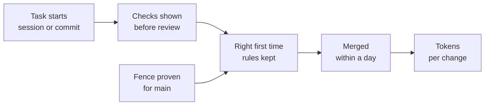

# Claude Code: plan

Slug `claude-code`. How well, how fast and how cheaply Claude Code sessions build Legallas. Split from Agents on 2026-11-05: the owner, "For Claude building, it might need its own Claude build or Claude code page". Agents now covers GitHub's Agents tab. The collector started as Agents' (from Git Crafter's `claude`, `instructions` and `tokens` templates) and keeps its fence, rules and instruction checks.

## Ideal state

`ideal.json`, from the Sources below (2026-11-06): every change Claude merges (product, pages, process maps) shows its checks, keeps the written rules, ships no bug and lands within a day on few tokens. The fence is one Quality metric, not a gate: a miss is CI upkeep, not harm to a customer or money (#645; the owner, 6 Nov).

| Best practices' four failures | Metric here |
|---|---|
| Built something different | `shipped_bugs_open` |
| No check to run, so "done" wasn't | `shipped_bugs_open` |
| A must-rule broken or skipped | `rule_clean`, `instruction_broken`, `fence_proven` |
| Right, but too many tokens or too slow | `tokens_per_merged_change`, `task_to_merge_p50`, `task_to_merge_p90` |

| [Code review post](https://claude.dev/blog/solving-code-review-at-anthropic/) layer | Here | Measured by |
|---|---|---|
| Verify before review: show a check's output, never claim it | Template's Verified row, filled | `rule_clean` (`verified`); delivery map `ci` step |
| Blocking checks | `ci-ok`, `dco` required | `rule_clean` (`ci-ok`); `pushes_per_merge` |
| AI review of every pull request | Orchestrator reviews the head with the `merging` skill | Delivery map `review` step: `reviews_per_merge` |
| Converge: 3 rounds at most | `merging` skill's round cap | `reviews_per_merge` |
| Approval pinned to one commit | `Review: MERGE at <sha>`, `--match-head-commit` | Delivery map `review` step rule |
| Merge queue | Queue, squash | `rule_clean` (`squash`) |
| Detect and roll back fast; reverts fall | Bugs filed with a Landed line | `shipped_bugs_open` |

| Post's figure, after | Goal here | Stricter? |
|---|---|---|
| 1.32 reviews to pass | `reviews_per_merge` 1.2 | ✓ |
| 78 % pass in one round | `pushes_per_merge` 2 | Different unit: pushes, not rounds |
| Reverts down over 40 % | `shipped_bugs_open` 0 | ✓ |
| At most one human per merge | None: Claude reviews and merges (`merging` skill) | ✓ |

## Sources

| Source | Read | What it says |
|---|---|---|
| [Code review post](https://claude.dev/blog/solving-code-review-at-anthropic/) | 2026-11-06 | Anthropic, 2026-10-15. Seven layers (table above); verification makes review 2 to 3 times better; a reviewer change stays only if its eval score rises |
| [Docs index](https://code.claude.com/docs/llms.txt) | 2026-11-06 | The page list this one was picked from |
| [Best practices](https://code.claude.com/docs/en/best-practices) | 2026-11-06 | Sessions fail four ways (table above). Give Claude a pass or fail check; put must-rules in hooks or deny rules, not CLAUDE.md |
| [Manage costs](https://code.claude.com/docs/en/costs) | 2026-11-06 | "around $13 per developer per active day", under $30 for 90 %; `/clear` between tasks; `/usage` shows the cache share |
| [Prompt caching](https://code.claude.com/docs/en/prompt-caching) | 2026-11-06 | Switching model or effort mid-session rereads the whole history uncached |
| [Monitoring](https://code.claude.com/docs/en/monitoring-usage) | 2026-11-06 | OpenTelemetry counters: tokens by type, pull requests, commits, active time; needs a collector backend |
| [Analytics](https://code.claude.com/docs/en/analytics) | 2026-11-06 | Team and Enterprise dashboards: merged pull requests with Claude Code, read beside State of DevOps measures |
| [Memory](https://code.claude.com/docs/en/memory) | 2026-11-06 | CLAUDE.md under 200 lines; contradicting lines get picked arbitrarily; review them periodically |
| [Hooks guide](https://code.claude.com/docs/en/hooks-guide) | 2026-11-06 | Hooks make a step always happen, without relying on the model |
| [Desktop](https://code.claude.com/docs/en/desktop) | 2026-11-06 | Parallel sessions, each with its own Git isolation |
| [Claude API pricing](https://platform.claude.com/docs/en/about-claude/pricing) | 2026-11-05 | Opus 5.5: $4 input, $8 1-hour cache write, $0.20 cache hit, $20 output, per million tokens |
| [Environment variables](https://code.claude.com/docs/en/env-vars) | 2026-11-05 | `CLAUDE_CODE_SESSION_ID` is set in the Bash tool: a session finds its own transcript |
| [Sandboxing](https://code.claude.com/docs/en/sandboxing) | 2026-11-04 | `sandbox.failIfUnavailable` |
| [State of DevOps 2024](https://cloud.google.com/devops/state-of-devops) | 2024-10-22 | Elite lead time under a day; rework |

| Inferred, not read | |
|---|---|
| Task start | The earliest of a merge's session lines and commits: this page's choice |
| p90 goal 24 h | State of DevOps states a typical lead time; holding the 90th percentile to it is this page's choice |
| Token goal | Dollars turned into tokens at this repository's own measured rate (below) |

## Token source

| Candidate | CI can read it | Verdict |
|---|---|---|
| OpenTelemetry export | Only through a collector backend: a sign-up, a key, and a credential cloud sessions can't hold in environment variables | ✗ |
| Enterprise Analytics API | Enterprise plan only, per user and day, not per change | ✗ |
| Claude Code Analytics API | Console API usage only; sessions here use the subscription | ✗ |
| **A token line per session, in the pull request** | ✓ GitHub's API, with the job's read token | ✓ |

`session-line.ts` reads the session's own transcript (`$CLAUDE_CODE_SESSION_ID`, subagents included), counts each API message's tokens once, and writes one line into the pull request. The `pull-request` skill runs it after opening and after each push. Works on this Mac and in cloud sessions. No key, sign-in, purchase or scheduled job. Only numbers leave the transcript.

## Metrics

**Window** (#828): the newest 30 merges into `main` by people or agents (not bots) in 30 days: product, pages and process maps alike. On 6 Nov, 60 merges (#728 to #821) landed in 8 hours, so 30 is about half a day.

| Id | Lens | 6 Nov | How it is measured | Floor | Goal | Weight | `goal_source` |
|---|---|---|---|---|---|---|---|
| `fence_proven` | Q | No longer a gate | A passing confinement run on main's exact fence. The pin now comes from `claude.yml` only: `claude-review.yml`, retired in #555, made the read 404 | 0 | 1 | 3 | Sandboxing |
| `shipped_bugs_open` | Q | New | Open bugs a merge shipped: issues with a Severity line whose Landed line names a pull request or commit. A state, so a fix moves it the same day (#846) | 15 | 0 | 2 | State of DevOps: change fail rate |
| `first_pass` | Q | Retired | Newest 30 merges: a fix waited out the window. The owner, 6 Nov: no week, month or 30-merge windows (#846) | | | | |
| `rule_clean` | Q | Kept, wider window | % of merges and direct pushes that keep the written rules: branch, squash, sign-off, signature, no em dash, Verified row filled, `ci-ok`, no rerun after a block | 80 % | 100 % | 2 | Best practices |
| `instruction_broken` | Q | Kept | Paths and commands in instruction files that don't resolve | 5 | 0 | 1 | Memory |
| `task_to_merge_p50` | S | Changed | p50 hours from a task's start (its earliest session line or commit) to its merge: every merge counts | 168 | 24 | 1 | State of DevOps 2024 |
| `task_to_merge_p90` | S | Changed | The same, p90: 30 samples, not under 10 | 168 | 24 | 1 | State of DevOps 2024 |
| `first_commit_to_merge_p90` | S | Retired | Folded into the task metrics: a task's start is never after its first commit | | | | |
| `tokens_per_merged_change` | C | Kept, wider window | Mean tokens over merges carrying a line. A session's highest count splits evenly over its merged pull requests, as Git Crafter's `claude.tokens_per_merged_pr` | 80 M | 35 M | 3 | Costs, below |
| `lane_minutes` | C | Kept | `core/lane` | 30 | 5 | 1 | Continuous Integration |

| Considered, not added | Why |
|---|---|
| Area tags (product, site, process) | No metric needs them: one window counts all three |
| Claude's share of `ci_green_first_time` | Every pull request here is Claude's: Pull requests owns it, and two pages would count one fix twice |
| Claude's share of Insights' `rework_rate` | Windowed; Insights keeps it. This page counts open bugs, which a fix clears at once |
| Technical questions to the owner | Only numbers leave a transcript, and a number can't tell a technical question from a product one |
| Cache hit share | Already 98 %; the costs page sets no goal |
| A verification metric of its own | 11 of the last 60 merges (18 %) left Verified empty. A windowed share breaks the owner's 6 Nov rule; open pull requests rarely show one. A `rule_clean` rule instead |
| Review rounds per merge | `reviews_per_merge` on CI overview; 57 of the last 60 merged on one verdict |
| Substantive review comments | Read from words; no check tells substantive from not |
| A `REVIEW.md`, an Undo row, risk tiers for human approval | No human approves here; the `merging` skill holds review rules: Git Crafter |
| The reviewer's eval set | A Git Crafter change to the `merging` skill, not this repo |

| Token goal | |
|---|---|
| Rate | $0.354 per million tokens: 1,541 M tokens cost $546 at Opus 5.5 prices, two days of this repo's sessions on this Mac (2026-11-05), 98.3 % of them cache reads |
| Goal 35 M | One merged change costs no more than the costs page's average active day, $13 (36.7 M), rounded down |
| Floor 80 M | Its 90th percentile, $30 (84.7 M), rounded down |
| All four types | Cache reads are 55 % of the price and grow with context and turns, the levers the costs page names |

| Known limits | |
|---|---|
| A session that skips the line | Its merge still counts for task time, from its first commit; it drops out of tokens |
| A forked or continued session | Its transcript also holds its parent's entries, under the parent's id: left out, so nothing counts twice |
| A long session | Its start is its first entry, so a later pull request it opens starts there too, as Git Crafter's `claude.hours_session_to_pr` |
| Review tokens | Count only when the reviewing session writes a line |
| Rework | Read from words, as on Insights. A bug fix that names nothing reads as first pass |

## Chart per metric

| Metric | Chart |
|---|---|
| Tokens, open bugs, task p50 | `metricTile` row, one per lens |
| Every other, the fence included | `bullets` by lens, with the baseline |
| Road to 100 | `roadTo100` |
| Every reading | `dataTable` with its link |

**Lane:** one, `linux-hosted`, `daily`, `collect.ts`: 4 minutes on 6 Nov. The window no longer reads each merge's files, 30 fewer calls.

## Baseline

The 5 Nov run (42067834620) on Agents, scored on this list: fence missing, rules 36.7 %, broken paths 2, first commit to merge p90 34.8 h, lane 7 min. The new metrics had no reading. Quality 7.5, Speed 30.8, Consumption 23.

| Readings, run 42245983359, 6 Nov | Q 49, S 66, C 25, total 47: before #828 |
|---|---|

## Fixes

| # | Fix | Metric | Where |
|---|---|---|---|
| 1 | Read main's fence from `claude.yml` only | `fence_proven` | #828 |
| 2 | One task per session: `/clear` or a fresh session between tasks (costs page) | `tokens_per_merged_change` | Each session |
| 3 | Keep instruction paths resolving | `instruction_broken` | #286 |
| 4 | Fix each open bug a merge shipped | `shipped_bugs_open` | #846 |
| 5 | Lane in 5 minutes | `lane_minutes` | `core/lane` |
| 6 | Fill the Verified row: commands run and their output | `rule_clean` | `pull-request` skill |

## Levers

For `tokens_per_merged_change`. Measured on this Mac's Legallas transcripts, 3 days to 2026-11-06: 56 sessions over 5 M tokens, 8,495 main-thread calls, 3,118 M context tokens read. Numbers only.

| Finding | Reading |
|---|---|
| Context at a session's first call | 132 K to 153 K tokens |
| Context per call, each session's p50 | 242 K to 645 K |
| Calls past 200 K, per session | 77 % to 98 % |
| Calls that only read (`grep`, `cat`, `sed -n`) | 51 % of tokens read; 93 % make one tool call, 74 % follow another read |
| CI polling calls | 8 % of tokens read |
| Subagent first call | p50 114 K |

| Lever | Change | Source | Expected effect | Reverse |
|---|---|---|---|---|
| Compact at 300 K | `.claude/settings.json` `env`: `CLAUDE_CODE_AUTO_COMPACT_WINDOW` `300000`. Default on a 1M window: "about 967K tokens" | [Env vars](https://code.claude.com/docs/en/env-vars), [defaults](https://code.claude.com/docs/en/model-config#default-auto-compact-thresholds), [subagents take it too](https://code.claude.com/docs/en/sub-agents#subagent-auto-compact-window) | Replay of the 56 sessions: 37 % fewer main-thread tokens, 1.7 compactions a session | Delete the line, or raise it toward `1000000` |
| Read in batches | One line in `CLAUDE.md`, Start here | [Costs](https://code.claude.com/docs/en/costs#why-usage-climbs-in-a-long-session): each tool use "sends another request" | Goal, not measured: half the back-to-back reads, about 20 % fewer calls | Delete the line |
| Next | 250 K while open bugs stay at 0 | Same replay | 42 % fewer, 3.1 compactions a session | |

| Considered, not taken | Why |
|---|---|
| `disableClaudeAiConnectors`: 712 of 869 deferred tool names are connectors | Acts only on connectors Claude Code fetches; the desktop app delivers them in-process ([MCP](https://code.claude.com/docs/en/mcp#how-connectors-reach-claude-code)). Account plugins and connectors, about 30 K of the base by estimate, are the owner's account: Git Crafter |
| `CLAUDE_CODE_SUBAGENT_MODEL` | Fewer dollars, not fewer tokens |
| `BASH_MAX_OUTPUT_LENGTH` under 30,000 | 4 % of Bash output characters sit past 15,000 |
| `SLASH_COMMAND_TOOL_CHAR_BUDGET` | Skill names alone are 22.9 K of the listing's 32.5 K characters |
| `CLAUDE_AUTOCOMPACT_PCT_OVERRIDE` | A percentage of the same window; a token count reads plainer |

## Final

Not yet.
