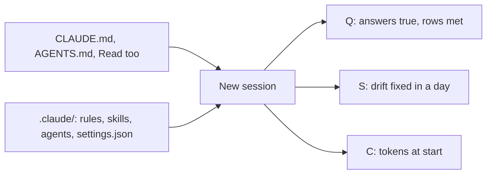

# Claude documentation: plan

What Claude and other coding AIs read at start, scored on Q, S and C. The owner, 9 Nov: "as visual, graphical, informative, little to no words or text as possible".

## Sources

| Source | Gives | Read |
|---|---|---|
| [How Claude remembers your project](https://code.claude.com/docs/en/memory) | What loads at launch: CLAUDE.md, imports, .claude/CLAUDE.md, rules with no `paths` | 2026-11-05 |
| [Extend Claude with skills](https://code.claude.com/docs/en/skills) | Skill descriptions always in context; the body loads when invoked | 2026-11-05 |
| [Configure permissions](https://code.claude.com/docs/en/permissions) | Deny, then ask, then allow; MCP rule forms | 2026-11-06 |
| [Settings files and precedence](https://code.claude.com/docs/en/settings) | A project file can't set Auto | 2026-11-04 |

## Goals

Each metric moved here with its goal, floor, weight and samples unchanged.

| Metric | Lens | Goal | Floor | Weight | `min_samples` | From | Reads |
|---|---|---|---|---|---|---|---|
| `questions_true` | Q | 100% | 50% | 4 | 25 | Documentation | `questions.json`: stated in its doc, true in the code, no doc or config comment against it |
| `settings_match` | Q | 100% | 0% | 2 | 6 | Claude settings | Repo rows of `expected.json` met by `.claude/settings.json` |
| `deny_rules_kept` | Q | 1 | 0 | 1 | 60 | Claude settings | Every pinned deny rule kept (`REVIEW.md`, Blocking 7) |
| `drift_open_hours` | S | 24 h | 168 h | 1 | 1 | Claude settings | Hours a row has been short. Daily lane: one day to fix |
| `start_tokens` | C | 3,000 | 10,000 | 3 | 1 | Documentation | Root CLAUDE.md, its `@` imports (4 hops), its Read too files. Characters / 4 |
| `startup_tokens` | C | 2,000 | 8,000 | 3 | 1 | Claude settings | `.claude/CLAUDE.md`, rules with no `paths`, each skill's and agent's listing. UTF-8 bytes / 4. An `@` import reads missing |

| Pinned | Where |
|---|---|
| `questions.json` | `inputs.lock.json` |
| `expected.json` | Deny rules only grow |

## Charts

| What | Chart |
|---|---|
| Each metric | Stat tile |
| Lens by place (CLAUDE.md, `.claude/`) | Heatmap |
| Each question: stated, true, clean | Dot matrix (`answers.json`) |
| Each settings row met | Dot matrix (`rows.json`) |
| Each file loaded at start | Table (`load.json`) |
| Fixes left | Road to 100 |

## Baseline

| Head | `questions_true` | `settings_match` | `deny_rules_kept` | `drift_open_hours` | `start_tokens` | `startup_tokens` | Q | S | C | Total |
|---|---|---|---|---|---|---|---|---|---|---|
| `main` at 16be9e09, local run, list signed | 84% (21 of 25) | 100% | 1 | 0 h | 2,261 | 59 | 81.7 | 100 | 100 | 93 |

| Fix | Metric |
|---|---|
| Keep each new skill's or agent's description short; give a one-area rule `paths` | `startup_tokens` |

## Not yet scored

| Card item | Why |
|---|---|
| Speed: time for a new session to start real work | No reading without running a session; a later lane |
| Briefs: `quality-speed/BRIEF.md`, each `PLAN.md` | No metric reads them yet |
