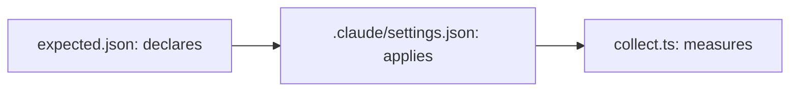

# Claude settings: plan

## Sources

| Source | Gives | Read |
|---|---|---|
| [Configure permissions](https://code.claude.com/docs/en/permissions) | Deny, then ask, then allow; MCP rule forms | 2026-11-04 |
| [Settings files and precedence](https://code.claude.com/docs/en/settings) | A project file can't set Auto | 2026-11-04 |
| [MCP: organization controls on connector tools](https://code.claude.com/docs/en/mcp) | A connector tool set to ask prompts past allow rules | 2026-11-04 |
| `REVIEW.md`, Blocking 7 | The deny rules only grow | 2026-11-04 |
| [How Claude remembers your project](https://code.claude.com/docs/en/memory) | What loads at launch: CLAUDE.md, .claude/CLAUDE.md, rules with no `paths`, their imports; "target under 200 lines per CLAUDE.md file" | 2026-11-05 |
| [Extend Claude with skills](https://code.claude.com/docs/en/skills) | Skill descriptions are always in context; the body loads when invoked | 2026-11-05 |

## Goals

| Metric | Goal | Floor | `min_samples` | Why |
|---|---|---|---|---|
| `settings_match` | 100% | 0% | 6 | 6 repo rows; fewer means a row was dropped |
| `deny_rules_kept` | 1 (gate) | 0 | 60 | 60 pinned deny rules; fewer means one was dropped |
| `drift_open_hours` | 24 h | 168 h | 1 | Daily lane: one day to fix. A week short is 0 |
| `startup_tokens` (Consumption, weight 3; added 2026-11-05, #645) | 2,000 | 8,000 | 1 | What the checkout's `.claude/` adds to every session: .claude/CLAUDE.md, rules with no `paths`, and the name, description and when_to_use of each skill and agent. The root CLAUDE.md counts on the Documentation page (`start_tokens`), so no file counts twice. UTF-8 bytes / 4, Git Crafter's estimate. Goal: half of Git Crafter's 4,000-token budget for all always-loaded files, leaving half for the root CLAUDE.md and the managed and user files each contributor brings. Floor: four times that. An `@` import makes it missing, since the count doesn't follow one |

## Charts

| Metric | Chart |
|---|---|
| Each, `startup_tokens` too | Stat tile |
| Rows | Declared table: row, read, expected |

## Baseline

| Head | `settings_match` | `deny_rules_kept` | `drift_open_hours` | `startup_tokens` |
|---|---|---|---|---|
| `main` at 462b9df | 16.67% | 1 | missing | |
| This page | 100% | 1 | 0 h | |
| `main` at 76335b4, 2026-11-05 | | | | 59 (1 file: the pull-request skill's listing). The root CLAUDE.md, 1,943, counts on the Documentation page |

| Fix | Metric |
|---|---|
| Keep each new skill's or agent's description short, and give a rule for one area `paths` | `startup_tokens` |
