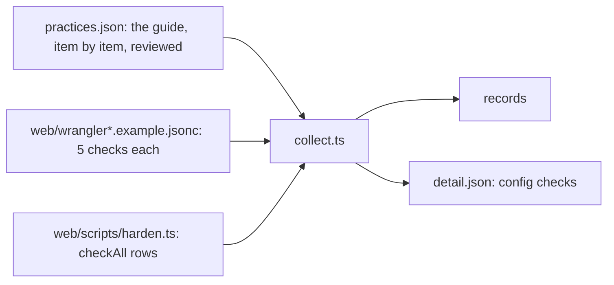

# Cloudflare security: plan

The product's own Workers, as this repository ships them: never a room's account, host or spend.

## Sources

| Source | Gives | Read |
|---|---|---|
| [Cloudflare: Workers Best Practices](https://developers.cloudflare.com/workers/best-practices/workers-best-practices/) | 21 items in 7 sections | 2026-11-18 |
| #70, #71 | The review against the guide: 5 gaps fixed, 3 items not adopted (`web/README.md`) | 2026-11-18 |
| `web/README.md`, "Edge rules" | 12 edge and account rows | 2026-11-18 |
| [Martin Fowler: Continuous Integration](https://martinfowler.com/articles/continuousIntegration.html) | Keep the build fast | 2024-01-18 |

## Goals

| Metric | Lens | Goal | Floor | Weight | `min_samples` | Why |
|---|---|---|---|---|---|---|
| `workers_practices_met` | quality | 100% | 50% | 2 | 1 | Met over applicable items. An accepted item leaves both, unless its config check fails or it lacks its own `accepted` date and `reason` |
| `edge_rows_checked` | quality | 12 | 6 | 1 | 1 | Rows in `harden.ts`'s `checkAll`, against the README's 12 |
| `compat_date_age_days` | speed | 60 | 180 | 2 | 3 | Oldest of the three examples' `compatibility_date` |
| `sources_read_hours` | speed | 26 | 168 | 1 | 1 | Hours since the last complete read before this run (`facts/reads.json`): a daily lane keeps it near 24 |
| `lane_minutes` | consumption | 5 | 10 | 1 | 1 | This lane's own job minutes |

| Config check, each of the three examples | Item |
|---|---|
| Date: `compatibility_date` within 60 days | 1 |
| Node: `nodejs_compat` in `compatibility_flags`, or a date from 2026-08-04 without `no_nodejs_compat` | 2 |
| Maps: `upload_source_maps` true | 3 |
| URLs: `workers_dev` and `preview_urls` false | 7 |
| Logs: `observability` and its `logs` on | 16 (traces: accepted) |

## Not measured

| | Why |
|---|---|
| A room's zone, WAF or Access state | `npm run harden` reads them with the owner's token. A public lane holds no secret and shows no account |
| The 16 code items | Reviewed by hand in #70 and #71; `practices.json` records each. A new review is a pull request |

## Charts

| Metric | Chart |
|---|---|
| Each | Stat tile |
| Config checks | Dot matrix: config by check |
| Fixes | Road to 100 |
| The guide | Table: item, state, PR |

## Sign-off

Signed off on #76 ([comment 6996196000](https://github.com/Colorado-Startups/legallas/pull/76#issuecomment-6996196000)): `manifest.json` carries `signoff_comment`, so goals only tighten from here.

## Baseline

| Head | `workers_practices_met` | `edge_rows_checked` | `compat_date_age_days` | `sources_read_hours` | `lane_minutes` | Total |
|---|---|---|---|---|---|---|
| This branch, read locally | 100 (18 of 18) | 12 | 2 | missing: no earlier read | missing: no CI job | scores from the first readings after merge |

## Fixes

| Fix | Metric | Action |
|---|---|---|
| Guide met | `workers_practices_met` | At goal |
| Every edge row | `edge_rows_checked` | At goal |
| Date current | `compat_date_age_days` | Move the date in all three examples before 60 days |
| Daily read | `sources_read_hours` | The second daily run |
| Lane in 5 min | `lane_minutes` | Already short: four file reads |
