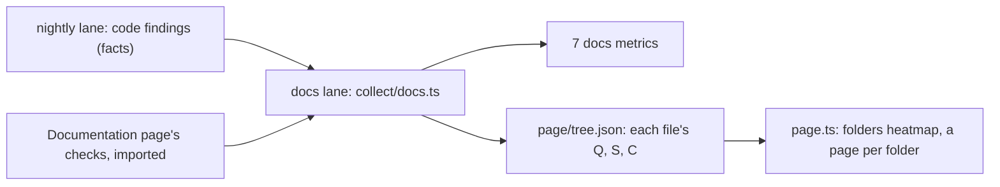

# Code: plan

Slug `code`. Owned by the `qs-code` session. Files: this folder only; fixes elsewhere go in their own small pull
requests. Since 2026-11-09 (the owner's card): every folder and file in the repository, its docs included (every `.md`
file and code comment). This site's own folder (`quality-speed/`), its workflow and its pull requests stay outside
every measurement (`BRIEF.md`, Never): `collect/tree.ts` `outsideCode`, and the docs corpus's `corpus_excluded`.

## Every folder and file (2026-11-09)

| Lens | Each file, 100 at goal, 0 at floor (`collect/tree.ts` `LINES`) | Goal | Floor |
|---|---|---|---|
| Q | Findings: long function or file, type escape, dead code, broken link, dead name, sentence over 25 words, undocumented public symbol | 0 | 5 |
| S | Minutes to read, 238 words a minute | 1 | 10 |
| C | Tokens, four characters each | 2,000 | 10,000 |

| | |
|---|---|
| A folder | Mean of every file under it, rounded down |
| Code findings | The nightly lane's last facts, a day old at most. None yet: no tree, a missing tile |
| Moved here from Documentation | `public_symbols_documented`, `long_sentence_share`, `broken_internal_links`, `dead_names`, `doc_lag_hours_p90`, `reading_minutes_p90`, and `lag_drill`, doc lag's coverage drill. Same lines and goal sources |
| Their checks | `pages/repo-documentation/collect/*.ts`, imported, never copied. Goal sources link the Documentation plan at its last commit before the rename |
| Doc lag cache | `facts/lag-cache.json`, seeded from the Documentation lane's on the first run |
| History | `history.jsonl` holds page score lines only, no metric rows: nothing to carry |

## Sources

Read on 2026-11-02 unless marked.

| # | Source | What it gives this page |
|---|---|---|
| S4 | SonarQube, [quality gates](https://docs.sonarsource.com/sonarqube-server/2025.4/quality-standards-administration/managing-quality-gates/introduction-to-quality-gates): the "Sonar way" gate | New code may add at most 3 % duplicated lines; a duplicated block is 10 lines; duplication is measured on main code, not tests |
| S5 | Kent Beck, *Extreme Programming Explained*, 2nd ed. (2004), practice "Ten-Minute Build" | A build and its tests past ten minutes stop being run often |
| S6 | Cox, Bouwers, van Eekelen, Visser, Measuring Dependency Freshness in Software Systems (ICSE 2015); [CHAOSS libyears](https://chaoss.community/kb/metric-libyears/) | Libyears: the release-date gap between the installed and the newest version |
| S7 | typescript-eslint rules `no-explicit-any`, `no-non-null-assertion`, `ban-ts-comment` | The type escapes the TypeScript community lints for |
| S8 | This repo: `.github/dependabot.yml` (weekly, 7-day cooldown, 30 for majors), `.github/workflows/ci.yml`, `CLAUDE.md` (Mac minutes count 10x) | The repo's own rules and update policy |

Considered and cut:
- TypeScript lint with typescript-eslint: a new dependency set; the escape count below covers its type-safety rules.
- SIG and TUViT star ratings: the thresholds are not public.
- Per-person numbers: one login does all the work.
- Complexity scores: function length covers the same risk.
- Worker bundle size and startup: they are runtime speed, which the Data room page measures as "Find it fast".
  No outside source sets a goal for bundle size below Cloudflare's 64 MiB uncompressed limit (since 2026-09-04). Locally, `wrangler check startup`
  reads about 88 ms for the MCP Worker.

## Ideal state

`ideal.json`, from Git Crafter's `quality/ideals/code.json` cut to 25 words: every file and folder as small and plain as the job
allows, green checks, short units, no escapes, no dead or copied code, true docs (widened 2026-11-09). Tests and their strength are the Testing page's, so coverage
and mutation left this list (below).

## One rule for what each file is

`collect/classify.ts` assigns every tracked `web/` file one class, and every metric says which classes it reads:

- **test**: a `*.test.ts` file.
- **production**: reachable through imports from an entry point.
- **helper**: not production, but reachable from a test (fixtures, fakes, mocks used only by tests).
- **orphan**: reachable from nothing. Counted as dead code.

Entry points come from configuration and are published in `details.json`, never from a hand-kept list:

- the Workers' `main` in the example wrangler configs, and the pro slot beside each;
- every `.ts` file a `package.json` script names, preloads included;
- every `node <file>` in the workflows and the docs;
- every file that runs as a command (`import.meta.main`);
- `astro.config.mjs` and every Astro page.

Imports count statically, dynamically, through Vite's `import.meta.glob`, from `.astro` files, and when a path is
held in a string. Type declarations (`.d.ts`) are left out everywhere. In Swift, `Sources/` and `LegallasApp/` are
production and `Tests/` is test.

Baseline classes: 528 production, 341 test, 24 helper and 1 orphan, from 56 entry points.

## Metrics

The reviewed list is `manifest.json` in the shared format (`quality-speed/contract`). `lanes.json` declares one lane
in the workflow's format (`core/lanes.ts`). The collector, `collect/main.ts`, writes each lane's readings where
`core/collect.ts` asks. The drill-down for people goes to `$DETAIL_DIR/facts/details.json`: lane memory, kept in the
state and never published. That sign-off (comment 6570952492 on #270) was for the earlier 13-metric list only; this nine-metric list needs a new one on its
own pull request.

Quality (2/3 of the total). Weights sum to 100.

| id | What | Files | Why | Source (command) | Floor | Goal | Weight |
|---|---|---|---|---|---|---|---|
| `checks_failing` | The sum of: failed web tests, crashes, skipped or todo tests beyond the 20 that skip on Linux by design (`EXPECTED_LINUX_SKIPS`; the Windows-only ones run on `windows-latest`), a failed `npm run check`, and a failed `swift` or `swift-ocr` job on today's Swift tree. A run with fewer than 3,028 tests, or no Mac result for today's Swift tree, is missing | all | Red checks make every other number moot | `npm test`'s globs with a JUnit report; `npm run check`; the Actions jobs of the newest CI run on the current Swift tree | 1 | 0 | 12 |
| `long_functions` | Functions over 60 code lines. Blank and comment-only lines do not count | all TS, JS and Swift, tests included | Long units are hard to change safely | `collect/shape-ts.ts` (TypeScript compiler), `collect/shape-swift.ts` | 46 | 0 | 22 |
| `long_files` | Files over 400 code lines | all, tests included | As above | Same scan | 10 | 0 | 11 |
| `type_escapes` | Type escapes in production code, counted: explicit `any`; `@ts-ignore`, `@ts-nocheck` and `@ts-expect-error`; double assertions (`as unknown as`, `as any as`); non-null assertions `x!`; and Swift force unwraps, `try!` and `as!` without `// safe:` | production TS and Swift (helpers excluded: faking platform bindings needs casts) | Each one is a place the compiler stops checking (S7) | Same scan | 1,150 | 0 | 22 |
| `dead_code` | Dead-code findings. Unused locals, imports, parameters and private members come from the compiler's noUnused checks, forced on for every `web/` tsconfig. Also counted: exports nothing references, and orphan files. Swift is not measured, because it needs the compiler's index, which only the Mac jobs build | all `web/` | Dead code costs every reader and every change | `collect/dead.ts` | 58 | 0 | 11 |
| `duplication` | Production code lines inside a duplicated block of 10 or more lines | production TS and Swift | S4 caps what new code adds at 3 %. The whole codebase sits at 1.17 %, so the goal is 1 %, just under it, and a quiet rise shows | `collect/dup.ts` | 3 | 1 | 11 |
| `dependencies_current` | Share of direct dependencies with no newer stable release older than the Dependabot window: 14 days within a major, 37 for a new major | `web/package.json` | Old dependencies turn small upgrades into risky big ones | `collect/deps.ts`, npm registry release dates | 75 | 100 | 11 |

Speed (1/3 of the total). Weights sum to 100.

| id | What | Why | Source | Floor | Goal | Weight |
|---|---|---|---|---|---|---|
| `web_loop_seconds` | The median, per CI run, of `Web check` + `Web test` + `Web build` + `Worker dry runs`. Only steps that succeeded count, matched by exact name. Samples come from one runner class, the newest sample's (Blacksmith 2 vCPU or GitHub-hosted): the newest 20 within 30 days, minimum 5 | The whole web loop, as the ideal states it | Actions job records | 600 (S5) | 60 (the ideal: a session can run it before every push) | 60 |
| `mac_loop_seconds` | The median, over the newest 5 runs within 90 days, of the wall time of whichever of `swift` and `swift-ocr` runs longer; minimum 3; the newest must be on the current Swift tree, so one lucky rerun cannot set the number | The same loop for the Mac app | Actions job records | 600 (S5) | 120 (the ideal. These minutes bill at 10x, so two minutes there costs what twenty cost on Linux) | 40 |

Cut on the Git Crafter conversion: `web_line_coverage`, `web_function_coverage`, `swift_line_coverage` and `mutation_score`, with
their collector parts (`lcov.ts`, `mutation.ts`, the Swift coverage reader) and the weekly lane. The template's ideal is small,
plain code; how well tests prove it is the Testing page's, which scores mutants on the risky code. The quality weights are the earlier
ones scaled to sum to 100 (5, 10, 5, 10, 5, 5, 5 to 12, 22, 11, 22, 11, 11, 11; checks take the rounding).

`checks_failing` stopped being a gate on 2026-11-05 (#645): red checks are CI upkeep, not harm to a customer or money. It still scores.

Each metric's `goal_source`: Fowler's Continuous Integration (green checks, the ten-minute loop), typescript-eslint's
`no-explicit-any` (type escapes), SonarQube's quality gate (copied lines), and this plan's [Goals](#goals) for the repo-made ones:
function and file length, dead code, current packages.

| Percent metric | `min_samples`: a validity floor, since the set can rightly shrink | Today, on `main` at `c71c733` |
|---|---|---|
| `duplication` | 1,000 production code lines | 72,146 |
| `dependencies_current` | 5 direct dependencies | 34 |

Consumption (a third of the total). Weights sum to 1.

| id | What | Floor | Goal | Weight |
|---|---|---|---|---|
| `lane_minutes` | This page's own nightly lane, in minutes (`core/lane`) | 10 | 5 | 1 |
| No real-cost metric yet (#645) | The ideal names two costs. Server CPU per request, against the Free plan's 10 ms: no lane can read it, since Cloudflare's analytics need a secret and a Node run counts its in-process D1 (`worker/sqlite-d1.ts`) as CPU. Page scripts within 307 KiB: a build check (`bundle-budget.ts`, 60 KB of gzipped eager script a page), and the bytes shipped are Build's `release_gzip_bytes`. Worker gzip bytes have no limit to work toward since Cloudflare dropped its compressed limit on 2026-09-04. CI minutes are Actions' `billed_minutes_per_merge` | | | |

### Goals

| Metric | Goal | Basis |
|---|---|---|
| `checks_failing` | 0 | `ci.yml`'s rule that every check passes (S8); Fowler's self-testing build |
| `long_functions`, `long_files` | 0 | Repo-made: 60 lines a function and 400 a file, so none over them |
| `type_escapes` | 0 | typescript-eslint's `no-explicit-any` (S7) |
| `dead_code` | 0 | Repo-made: the ideal's "no dead code" |
| `duplication` | 1 % | SonarQube's 3 % for new code (S4); the whole codebase sits at 1.17 %, so 1 %, just under it |
| `dependencies_current` | 100 % | Repo-made: Dependabot's own window (`.github/dependabot.yml`, S8), so every direct dependency inside it |
| `web_loop_seconds` | 60 s | A tenth of the ten-minute build (S5, and Fowler's Continuous Integration), so a session can run it before every push |
| `mac_loop_seconds` | 120 s | A fifth of it: these minutes bill at 10x, so two minutes there cost what twenty cost on Linux |

Floors, and why:

- **Counts:** the long-function and dead-code floors are about double today's count, so the scale shows both
  directions. The long-file floor is 10 (the reviewer's figure; the count was 7). The type-escape floor, 1,150,
  is about double the baseline count. It was a density per line at sign-off, but the format has no per-1,000-lines
  unit, and a ratio displays as 0.01, so it became a count.
- **Dependencies:** at the 75 % floor, a quarter of direct dependencies overdue reads 0.
- **Speed:** the floors are S5's ten minutes.
- **Baseline already at goal:** only the checks. Its goal is `ci.yml`'s own rule that every check passes (S8).

Age limits:

| Measurement | Limit |
|---|---|
| Daily lane | 48 hours |
| Web loop | 720 hours (quiet weeks add no samples) |
| The Mac loop | 2,160 hours (artifact retention), and only while the Swift tree matches the run's commit |

An API error, a failed run or too few samples makes a metric missing, and a missing metric scores 0.

Lanes (`lanes.json`):

| Lane | Runner | Measures | Time |
|---|---|---|---|
| `nightly` | `linux` (10 minutes, Blacksmith first) | every metric | about 4 to 5 minutes |

`nightly` rather than `daily`: a 5-minute lane on every merge would spend about 100 Blacksmith minutes a day. The
48-hour age limit absorbs a day without a run. The lane installs `web/` (`install: true`). The workflow gives it
the full git history (`git log` finds the last Swift change), `GH_TOKEN`, and `actions: read` and
`pull-requests: read`.

## Chart per metric

`page.ts` exports `render()`, which the site build (`core/build.ts`) calls with this page's scores and validated
readings. The build supplies the title and the score ring; the body adds the rest from the chart kit. The `dataviz`
skill was read first, and every color is one of the kit's validated tokens.

| Part | Chart |
|---|---|
| Score | The build's ring: Quality, Speed, total |
| Folders | A heatmap: the repo and its top folders on Q, S and C; each cell opens that folder's page of folders and files |
| Infographic | The ideal state as a pass grid: Green, Typed, Small, Clean, Current, Fast, Documented, No drift down the side, web and Mac across. A row passes only when every metric behind it is at goal; Mac has no packages, so its Current cell is hatched |
| Road to 100 | The kit's waterfall: each fix's bar is the weight its metrics still lack, ranked by what it adds |
| Every metric | A bullet against floor and goal, with the baseline, the date and a link to the run, Quality then Speed |

The page holds numbers only. The collectors' drill-down (offenders, survivors, untested files) stays in the lanes'
`facts/`, which is never published.

Checked on 2026-11-02, built with real lane readings by `core/build.ts --state` and served on port 3200 (also
`--synthetic`):

- Chromium at 1,280 and 375 px, light and dark.
- No console errors and no sideways scroll.
- 60 visible words.
- 30 KB, or 4 KB gzipped.

## Baseline

Taken by `collect/main.ts` in this session's cloud VM on 2026-11-02, before any fix. The commit was `main` at
`1f688d5` (mutation at `cf36015`), on Node 24.22 with 4 vCPUs. CI numbers come from Actions job records. The first CI run of the lanes
becomes the recorded baseline. The four cut metrics' rows stay as the record of the earlier list.

| Metric | Baseline | Score |
|---|---|---|
| `checks_failing` | 0: 3,028 tests, 0 failed, 18 skipped as expected; check passed; Mac jobs passed (run 41348340812) | 100 |
| `web_line_coverage` | 76.79 %: 58,496 of 76,177 lines in 496 files, 100 of them never loaded (mostly `src/scripts`) | 56.0 |
| `web_function_coverage` | 74.59 % | 48.6 |
| `swift_line_coverage` | 32.53 %: 4,528 of 13,921 lines, from the first CI run with coverage (Colorado-Startups/legallas#133). LegallasCore 89 %, LegallasMCP 81 %, LegallasExtraction 97 %, the app's views 8.5 % | 0 |
| `mutation_score` | 90.22 %: 913 of 1,012 mutants killed in 22 files, from 179 test files, in 18 minutes. 99 survivors, 8 of them reached by no test. Lowest: `mcp/consent-repeat.ts` 76 %, `worker/auth.ts` 84 % | 68.1 |
| `long_functions` | 23 | 50.0 |
| `long_files` | 7 | 30.0 |
| `type_escapes` | 572: 515 non-null, 43 double assertions, 13 `any`, 1 Swift force, in 66,847 production lines | 50.3 |
| `dead_code` | 29: 12 unused declarations, 16 unused exports, 1 orphan file | 50.0 |
| `duplication` | 1.17 % (756 of 64,365 lines) | 91.3 |
| `dependencies_current` | 96.97 % (32 of 33; TypeScript 7.0 is overdue) | 87.9 |
| `web_loop_seconds` | 104.5 s, the median of 20 samples on Blacksmith 2 vCPU | 91.8 |
| `mac_loop_seconds` | 162 s, the median of 5 samples (151 to 170 s) | 91.3 |

## Fixes

Ranked by points added to the total, from the scores of 2026-11-02 on the nine-metric list (total 72: Quality 62.6, Speed 91.6;
the earlier list read 64). Fixes for the cut metrics went with them. The Road to 100
on the page computes the same numbers live.

| # | Fix | Metrics | Adds | Where |
|---|---|---|---|---|
| 1 | Split the 23 long functions and 9 long files | `long_functions`, `long_files` | +12.4 | |
| 2 | Replace 515 non-null and 43 double assertions with checked helpers | `type_escapes` | +7.3 | |
| 3 | Remove dead code: 31 to 5 here, then code that uses the 4 protocol and format types | `dead_code` | +3.7 | Colorado-Startups/legallas#150, ready for slot |
| 4 | Speed up the web test step, slowest files first | `web_loop_seconds` | +1.6 | |
| 5 | Speed up the Mac jobs | `mac_loop_seconds` | +1.2 | |
| 6 | TypeScript 7, once `astro check` supports it | `dependencies_current` | +0.9 | |
| 7 | Merge the copied blocks in the Mac editors | `duplication` | +0.6 | |

## Final

Not yet.
