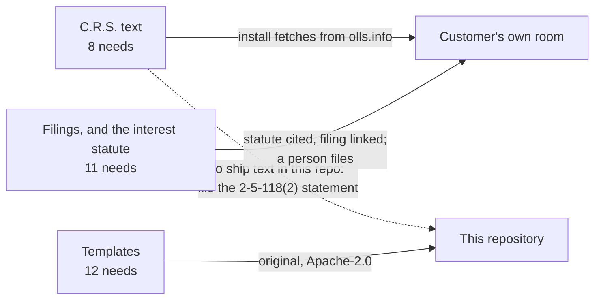

# Colorado business law

Page slug `colorado-business-law`. Public law only, no case data. Not legal advice; no lawyer has reviewed this page or its list.

| File | What it holds |
|---|---|
| [`needs.json`](needs.json) | The reviewed list, in the [law kit's format](../../core/law/README.md): 31 needs with source, path and where the product holds each, 1 deadline flag in the statute's exact words, 20 test questions |
| [`manifest.json`](manifest.json) | 6 metrics: the kit's five, and `change_lag` |
| [`page.ts`](page.ts) | The page: the law kit's needs charts from `law.json` (`core/law/page.ts`), bullets against goal, Road to 100 |
| [`lanes.json`](lanes.json) | Two lanes, daily on Linux: the shared law collector, and `collect.ts` |
| [`collect.ts`](collect.ts) | `change_lag`, with [`collect.test.ts`](collect.test.ts) |
| [`baseline/metrics.json`](baseline/metrics.json) | The kit's reading before any fix |

## Sources

| Source | Host | What was read, 2026-11-02 | Machines may fetch | Right to ship its text |
|---|---|---|---|---|
| [C.R.S. 2026, titles 2, 5, 7, 24](https://leg.colorado.gov/agencies/office-legislative-legal-services/2026-crs-titles-download) | `olls.info` | The sections below. Files dated 2026-10-02, "current with ... the Second Regular Session in 2026" | Yes: robots file disallows only `/crs-archive/`; no terms on the download page | After the publisher's statement, [C.R.S. 2-5-118(2)](https://olls.info/crs/crs2026-title-02.pdf) |
| [Secretary of State fee schedule](https://www.coloradosos.gov/pubs/info_center/fees/business.html); [periodic reports FAQ](https://www.coloradosos.gov/pubs/business/FAQs/reports.html) | `coloradosos.gov` | Cited only. Nothing on this page rests on a read of it: see below | **No**: [terms](https://www.coloradosos.gov/pubs/info_center/terms.html) say the site is for natural persons and prohibit robots and data mining | Needs a person's copy, as #33 does for the rules; written permission to reuse is the owner's call |

**Who read what.** Statute text came from the `olls.info` downloads. On 2026-11-02, before the decision below, this session made single automated requests to `coloradosos.gov`: a reachability check, the terms, the fee schedule and the periodic reports FAQ. **Decision, 2026-11-02** (comment (#119)): no automated read of that site, and nothing shipped or scored that depends on one. So no flag or score here uses those reads: the fee flags are gone, the filing needs cite the statutes, and the fee need waits on a person's copy (`checked: null`).

| Group | Needs | Read in the 2026 text |
|---|---|---|
| Entity law and founder fallout | 9 | 7-90-303, -501, -801, -802, -901, -903, -904; 7-80-203, -204; 7-102-102; 7-30-106, 7-133-101. Others at heading level, with the plan's own reading. Founder fallout rests on the plan's `fights` rows for the LLC and corporation acts and the investor fights template |
| Secretary of State filings | 10 | 7-90-201, -309, -501, -701, -801 to -805, -901 to -904; 7-80-203, -204; 7-102-102; 7-110-106. A delinquent entity can't sue to collect its debts until cured (7-90-903(1)). The fee need waits on a person's copy |
| Templates | 12 | Metadata, A2 notice and A5 footer of each; the one-member LLC agreement and LLC consent are missing |

**Scope.** What a founder needs from Colorado business law: the Corporations and Associations Act, the LLC Act, the Business Corporation Act, the partnership and nonprofit acts an angel group or fund uses, what those acts say when founders fall out, Secretary of State filings and periodic reports, and the Colorado formation templates.

**On other pages, so each need has one owner:**

| Need | Page |
|---|---|
| Employment law a first hire touches: wages, pay orders, equal pay, sick leave, FAMLI, workers' compensation, unemployment, new hire reports, noncompetes | [Employment law](../employment-law/) |
| Trade secrets, the invention assignment, and trade names | [Intellectual property law](../intellectual-property-law/) |
| The Securities Act and its rules, and civil rights law (both in the Colorado Department of Regulatory Agencies) | [Agencies](../colorado-regulatory-agencies/) |
| Income tax and the Advanced Industries credit | [Colorado tax law](../colorado-tax-law/) |
| Court rules and limitation periods | [Court rules](../court-rules/) |

Left out: judge-made law, and the Colorado Privacy Act, whose thresholds rarely reach an early startup.

**Watch.** From 2027-07-01 the periodic report carries EEO-1 data for employers of 100 or more (7-90-501(1)(f), (9)(b)).

## Ideal state

A founder or investor who needs a Colorado business law document or rule gets the right, current one, fast, with its official source and date, and nothing they need is missing.

## Right to ship, by route

| Route | What's needed | Who |
|---|---|---|
| Install fetches C.R.S. | Nothing today: no law text ships in this repository. Shipping text later needs the statement under C.R.S. 2-5-118(2), with annotations stripped | Colorado Startups, only if it ever ships text |
| Link | The statute cited and the official filing page linked. Filings, and any fee figure, stay with a person, because the site bars robots | A person |
| Bundle | Nothing: original drafting | n/a |

## Metrics

The kit computes the five quality metrics from repository files ([`core/law/`](../../core/law/)); `collect.ts` adds `change_lag`. Total = (Q + S + C) / 3.

| Metric | Lens | Floor | Goal | Weight | Basis |
|---|---|---|---|---|---|
| `coverage` | quality | 0 | 100 | 40 | Nothing they need is missing; the heart of the page, so the largest weight |
| `flags` | quality | 0 | 100 | 15 | A wrong deadline costs a founder money. Each flag is the exact words of its need's own source; fee flags return once a person's copy of the fee schedule exists |
| `verified` | quality | 0 | 100 | 10 | With its official source |
| `fresh` | quality | 0 | 100 | 5 | Current, with its date. Already met: checked 2026-11-01, C.R.S. 2026 |
| `rights` | quality | 0 | 100 | 5 | Each install may fetch or link it by itself. Already met: no unit here waits on permission |
| `change_lag` | speed, days | 30 | 0 | 1 | Days since the first `olls.info` change to a relied-on C.R.S. title (its `Last-Modified`) after the plan's `checked` date, or since the next edition was posted, whatever its date, while the units still name this one; 0 when none. Acts without a safety clause take effect 90 days after the session ends (Colo. Const. art. V, sec. 1(3)), before the new edition posts, so the product is already behind when it does: 0 is the goal, and 30 days, one month of a stale record, the floor. Already met: `Last-Modified` 2026-10-02, `checked` 2026-11-01 |
| `law_lookup_tokens_p95` | consumption, tokens | 10,000 | 2,250 | 3 | Tokens in the law tool's answers to this page's questions, p95, from the kit ([`core/law/PLAN.md`](../../core/law/PLAN.md)). Reads only from a law eval run's report, so it reads missing until one feeds the lane |

Floors of 0 follow the kit: a straight share from none. `min_samples` is today's count: coverage 31, flags 1, verified 8, fresh 26, rights 8, change_lag 3 (the C.R.S. titles it watches), law_lookup_tokens_p95 10 (runs that retrieve law: half its 20 questions, at most 10).

### Goals

| Id | `goal_source` | The number it states |
|---|---|---|
| `flags` | [C.R.S. title 7](https://olls.info/crs/crs2026-title-07.pdf) | The periodic report deadline, 7-90-501(4)(c)(I): exact, so 100 |
| `rights` | [C.R.S. title 2](https://olls.info/crs/crs2026-title-02.pdf) | 2-5-118: the statute may be fetched and linked; shipping needs its statement. 100 |
| `change_lag` | This section: Colo. Const. art. V, sec. 1(3), whose official URL no record here holds | 90 days from session end to effect, so floor 30, goal 0 (Basis above) |
| `coverage`, `verified`, `fresh` | This section: repo-made goals, from the ideal state | All needs, every unit opened on its host, each checked within 365 days |
| `law_lookup_tokens_p95` | [`web/mcp/contract.ts`](https://github.com/Colorado-Startups/legallas/blob/main/web/mcp/contract.ts) | `COMPACT_LIMITS`: 9,000 characters, 2,250 tokens, the room's own budget for one answer. Floor 10,000: Claude Code warns above it ([MCP docs](https://code.claude.com/docs/en/mcp)) |

Cut after review (#444): `questions`, `search_p95`, `answer_p95`. No lane collects them today.

**Sign-off:** an independent reviewer's comment (#119) on the list. Its two changes are applied: trade names went to the intellectual property page, and founder fallout was added. Since then, the decision on `coloradosos.gov` removed six fee flags and made the fee need a gap, which can only lower the score. `change_lag` was added later with its own sign-off (#119), now `signoff_comment`; both its changes are applied.

**Lanes** ([`lanes.json`](lanes.json)), daily on Linux, no secret: `law`, the shared collector (`../../core/law/collect.ts colorado-business-law`), repository files only, writing the records to `--out` and `law.json` for the page; and `lag`, this folder's `collect.ts`, one HEAD request per relied-on title and edition to `olls.info`, whose robots file disallows only `/crs-archive/`. A failed request, a redirect, or a run with no run link writes `change_lag` as missing, never 0. 

## Chart per metric

| Metric | Chart |
|---|---|
| `coverage` and every check | **The infographic,** from the law kit: needs held on each customer path as pictograms, then every need against held, verified, fresh, rights and flags. Before the collector has run, a red tile |
| All six | Bullets against goal, with the baseline marked, in Quality and Speed |
| `lane_minutes`, `law_lookup_tokens_p95` | Bullets against goal, in Consumption |
| The fixes | Road to 100: one bar per metric short of its goal, sized by the points it adds |

Checked on a synthetic build with the collector's real `law.json`: the publish guard passes, and light and dark, phone and desktop render with no console errors. At phone width the needs grid scrolls inside its own box, but the chart kit lets its hidden labels widen the page by 165 px; #301 (open) fixes that in `core/charts/charts.css`.

## Baseline

The kit's run on `main` at `6cba301`, before any fix, 2026-11-02: [`baseline/metrics.json`](baseline/metrics.json). `change_lag` from `collect.ts` on the same day: 0, since no relied-on title changed after the plan's check. The same list reads the same on `main` at `35c58d4`: nothing merged since touches it.

| Metric | Value | Score |
|---|---|---|
| `coverage` | 87.09 (27 of 31) | 87.09 |
| `flags` | 0 (0 of 1) | 0 |
| `verified` | 87.5 (7 of 8) | 87.5 |
| `fresh` | 100 | 100 |
| `rights` | 100 | 100 |
| `change_lag` | 0 days | 100 |
| **Quality 71.45, Speed 100, Consumption 0 (no consumption metric yet), Total 57**, retaken with the six metrics on `main` at `23a5a4c`, 2026-11-04: the same values | | |

| Group | Held |
|---|---|
| Entity law and founder fallout | 9 of 9 |
| Secretary of State filings | 8 of 10 |
| Templates | 10 of 12 |

The one flag isn't found: the checklist words the periodic report deadline its own way. The fee need is a gap until a person's copy of the fee schedule exists.

**Real run** on this cloud VM, through the lane runner (`node quality-speed/core/collect.ts --page colorado-business-law --lane law`) at `0253d20`, 2026-11-02: coverage 87.09, flags 0, verified 87.5, fresh 100, rights 100, and `collect.ts` reads `change_lag` 0, the same as the baseline. The format check set the records aside only because a local run has no CI run link to prove it, as it should; the daily run on `main` gives the page its first recorded score.

## Fixes

Ranked by total points. Law and templates follow the backlog, each in its own small pull request outside this folder.

| # | Fix | Points | Size | State |
|---|---|---|---|---|
| 1 | The statute's words for the periodic report deadline in the checklist: "the last day of the second calendar month following" (7-90-501(4)(c)(I)) | +13.3 | Small | After the checklist rewrite (#170) merges |
| 2 | A person's copy of the fee schedule, then the fees and the statement curing delinquency in the checklist | +1.1 | Small, plus a person's read | The owner's call on asking the Secretary of State |
| 3 | Templates: one-member Colorado LLC agreement; Colorado LLC initial consent | +2.3 | Large: drafting and an independent read | Filed on Project 1 |
| 4 | Read the nonprofit acts (7-30, 7-121 to 7-137) in full and mark them VERIFIED | +1.1 | Small to medium: about 170 sections | Filed on Project 1 |

2026-11-07: `sos-cure-delinquency` and `sos-periodic-report-fee` now point at the periodic report item, which quotes the fee schedule. The fee need still waits on a person's dated read (`checked: null`), fix 2.

Merged, on needs that moved to other pages: the first-hire units and the trade secrets read (#185), and the full read of four first-hire acts (#316).

## Final

Not reached yet.
