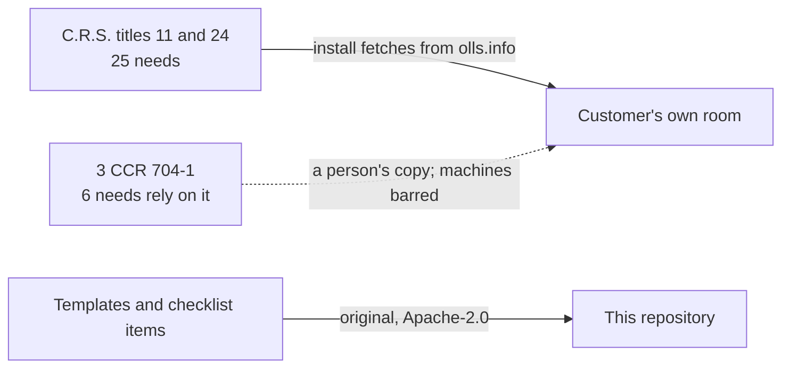

# Colorado regulatory agencies

Page slug `colorado-regulatory-agencies`: what founders, angels, groups and funds need from the Colorado Department of Regulatory
Agencies. Public law only, no case data. Not legal advice; no lawyer has reviewed this page or its list.

| File | What it holds |
|---|---|
| [`needs.json`](needs.json) | The reviewed list, in the [law kit's format](../../core/law/README.md): 26 needs, 13 deadline and fee flags in the statutes' exact words, 16 test questions |
| [`manifest.json`](manifest.json) | 8 metrics: the kit's five, `change_lag`, `lane_minutes` and `law_lookup_tokens_p95` |
| [`page.ts`](page.ts) | Needs held by division (the infographic), bullets against goal, Road to 100, and the kit's needs charts on a drill-down; [`page.test.ts`](page.test.ts) |
| [`lanes.json`](lanes.json) | Two daily Linux lanes: the shared law collector, and `collect.ts` |
| [`collect.ts`](collect.ts) | `change_lag`, with [`collect.test.ts`](collect.test.ts) |

## Sources

| Source | Host | Read 2026-11-05 | Machines may fetch | Right to ship its text |
|---|---|---|---|---|
| [C.R.S. 2026, title 11](https://olls.info/crs/crs2026-title-11.htm) | `olls.info` | Article 51: 11-51-201(14), (17), -307(1)(i), -308(1)(i) to (k) and (p), -308.5, -401, -402(2), (5), -403(3), -501, -601 to -606 by heading, -604, -701, -705, -803. Article 110, 11-110-101 and -201, for scope. File dated 2026-10-02 | Yes: the robots file disallows only `/crs-archive/` | After the publisher's statement, [C.R.S. 2-5-118](https://olls.info/crs/crs2026-title-02.htm) |
| [C.R.S. 2026, title 24](https://olls.info/crs/crs2026-title-24.htm) | `olls.info` | 24-1-122(2); article 34: 24-34-300.5, -304, -306(11), (14), -401, -402, -403, -407, -408. File dated 2026-10-02 | Yes | Same |
| [C.R.S. 2026, title 2](https://olls.info/crs/crs2026-title-02.htm) | `olls.info` | 2-5-118, for `rights` | Yes | Same |
| [Rules under the Colorado Securities Act, 3 CCR 704-1](https://www.coloradosos.gov/CCR/DisplayRule.do?action=ruleinfo&ruleId=2207) | `coloradosos.gov` | **Not opened.** The decision of 2026-11-02 (#119) bars automated reads of that site. The plan's unit rests on a person's copy | No: the site's terms bar robots | After written permission |

Not reached: the `leg.colorado.gov` download page redirects to `content.leg.colorado.gov`, which this session's network refused
(403). The files it links are the `olls.info` ones above. The Division of Securities' own site answers machines with 403 (the plan's
`colorado-securities` host), so nothing here rests on it.

**Scope, by division** ([C.R.S. 24-1-122(2)](https://olls.info/crs/crs2026-title-24.htm)):

| Division | Needs | Why |
|---|---|---|
| Division of Securities, (2)(e) | 21 | Every raise, angel, group and fund: the Colorado Securities Act and its rules |
| Colorado Civil Rights Division and Commission, (2)(h) | 5 | Every employer from the first hire: "every other person employing persons within the state" (24-34-401(3)) |
| Professions and Occupations (g), Insurance (b), Banking (d), Financial Services (c), Real Estate (k), the Public Utilities Commission (a), Conservation (l) | 0 | Each reaches only a startup in that trade, such as a money transmitter (C.R.S. article 11-110, the Division of Banking). No checklist item tracks a trade licence |

**On other pages, so each need has one owner:**

| Need | Page |
|---|---|
| Secretary of State filings: the periodic report, the registered agent, delinquency | [Colorado business law](../colorado-business-law/) |
| Form D, Rule 506 and the federal adviser exemptions | [SEC](../sec/) |
| Wages, leave, noncompetes, new hire reports | [Employment law](../employment-law/) |
| Court rules and arbitration | [Court rules](../court-rules/) |

**Watch.**

| Date | What the text says |
|---|---|
| 2027-09-01 | Part 3 of article 34, the Civil Rights Division and Commission, "is repealed, effective September 1, 2027", after review under 24-34-104 (24-34-304(2)) |
| 2037-09-01 | Article 51 "is repealed, effective September 1, 2037" (11-51-803) |
| Since 2026-08-12 | HB 26-1188 amended adviser licensing, 11-51-401(1.5), (1.6), (2.5). The plan found no conforming rule |

## Ideal state

A founder, angel, group or fund manager who needs a rule from the Colorado Department of Regulatory Agencies gets the right, current
one, fast, with its official source and date, and nothing they need is missing.

## Right to ship, by route

## Metrics

The kit computes the five quality metrics from repository files ([`core/law/`](../../core/law/)); `collect.ts` adds `change_lag`, and
the kit's lane adds `lane_minutes`. Total = (Q + S + C) / 3.

| Metric | Lens | Floor | Goal | Weight | Basis |
|---|---|---|---|---|---|
| `coverage` | quality | 0 | 100 | 3 | Nothing they need is missing: the heart of the page |
| `flags` | quality | 0 | 100 | 2 | A missed claim or notice deadline can't be undone. Each flag is the statute's exact words |
| `verified` | quality | 0 | 100 | 1 | With its official source |
| `fresh` | quality | 0 | 100 | 1 | Current, with its date |
| `rights` | quality | 0 | 100 | 1 | Each install may fetch or link it by itself |
| `change_lag` | speed, days | 30 | 0 | 1 | Days since the first `olls.info` change to a relied-on C.R.S. title after the plan's `checked` date, or since the next edition posted; 0 when none |
| `lane_minutes` | consumption, minutes | 10 | 5 | 1 | The kit's lane time, as on every law page |
| `law_lookup_tokens_p95` | consumption, tokens | 10,000 | 2,250 | 3 | Tokens in the law tool's answers to this page's questions, p95, from the kit ([`core/law/PLAN.md`](../../core/law/PLAN.md)). Reads only from a law eval run's report, so it reads missing until one feeds the lane |

`max_age_hours` 48 for all. `min_samples` is today's count: coverage 26, flags 13, verified 2, fresh 17, rights 2, change_lag 1 (title
11; title 24 joins once its unit exists), lane_minutes 1, law_lookup_tokens_p95 8 (runs that retrieve law: half its 16 questions, at most 10).

### Goals

| Id | `goal_source` | The words it rests on |
|---|---|---|
| `flags` | [C.R.S. title 11](https://olls.info/crs/crs2026-title-11.htm) | The claim limits in 11-51-604(8) and the notice dates in 11-51-308.5 and 11-51-403(3)(c): exact, so 100 |
| `rights` | [C.R.S. title 2](https://olls.info/crs/crs2026-title-02.htm) | 2-5-118: the statutes may be fetched and linked; shipping needs its statement. 100 |
| `change_lag` | This section: a repo-made goal | Goal 0: the record catches a new C.R.S. file the day it posts. Floor 30 days, one month of a stale record, as on the Colorado business law page |
| `lane_minutes` | [Continuous integration](https://martinfowler.com/articles/continuousIntegration.html) | Goal 5, floor 10: the same as every law page |
| `law_lookup_tokens_p95` | [`web/mcp/contract.ts`](https://github.com/Colorado-Startups/legallas/blob/main/web/mcp/contract.ts) | `COMPACT_LIMITS`: 9,000 characters, 2,250 tokens, the room's own budget for one answer. Floor 10,000: Claude Code warns above it ([MCP docs](https://code.claude.com/docs/en/mcp)) |
| `coverage`, `verified`, `fresh` | This section: repo-made goals, from the ideal state | All needs, every unit opened on its host, each checked within 365 days |

Not on the list: `questions`, `search_p95`, `answer_p95`. No lane collects them today, as on the other law pages.

**Lanes** ([`lanes.json`](lanes.json)), daily on Linux, no secret: `law`, the shared collector (`../../core/law/collect.ts
colorado-regulatory-agencies`), repository files only; and `lag`, this folder's `collect.ts`, two HEAD requests per relied-on title to
`olls.info`. A failed request, a redirect, a refusal such as 429, or a run with no run link writes `change_lag` as missing, never 0.
The rules sit on a host that bars robots, so a person checks their version each year.

**Questions:** 16 in `needs.json`, written from the official texts only, each citing the section that answers it. Two carry traps:
the old six-month charge deadline, and a 15-employee threshold Colorado doesn't have.

**History.** Draft #86 built this page on 2026-11-02, before the law pages cut `questions` and `search_p95` and added `lane_minutes` and goal
sources. Its sound needs are here, each re-read on `olls.info` on 2026-11-05. Left behind: its fee flags of one word each (the kit now
needs three) and its needs resting on the Division's pages, which a person read in a browser and this session could not open.

## Chart per metric

| Metric | Chart |
|---|---|
| `coverage` | **The infographic:** needs held for each division, as pictograms. On the drill-down, the kit's pictograms by path and the Held column of its needs grid |
| `verified`, `fresh`, `rights`, `flags` | On the drill-down, a column each of the kit's needs grid: a check, a cross, or hatched where it doesn't apply |
| All eight | Bullets against goal, by lens, with the baseline marked |
| The fixes | Road to 100: one bar per metric short of its goal |

Before the collector has run, the infographic and the grid are red tiles. Checked on a synthetic build with the collector's real
`law.json`, 2026-11-05: first view 26 KB and 43 visible words (the frame adds 7), the drill-down `needs.html` 39 KB, publish guard
passes; light and dark, 390 and 1280 wide. With the grid on the first view it was 103 KB, over the 100 KB limit, so it moved, as on
the SEC page. At phone width the grid scrolls inside its own box.

## Baseline

The kit's run on `main` at `9b9511c`, 2026-11-05, before any fix, and `collect.ts` against `olls.info` the same day.

| Metric | Value | Score |
|---|---|---|
| `coverage` | 20 of 26 | 76.92 |
| `flags` | 0 of 13 | 0 |
| `verified` | 2 of 2 units | 100 |
| `fresh` | 17 of 17 | 100 |
| `rights` | 1 of 2: 3 CCR 704-1 waits on permission | 50 |
| `change_lag` | 0 days: title 11 dated 2026-10-02, no 2027 file | 100 |
| `lane_minutes` | Missing outside CI | 0 |
| **Quality 60.1, Speed 100, Consumption 0, Total 53** | | |

| Division | Held | | Path | Held |
|---|---|---|---|---|
| Securities | 20 of 21 | | Forming | 6 of 9 |
| Civil rights | 0 of 5 | | Raising | 6 of 7 |
| | | | Angels, groups, VCs | 6 of 6 |
| | | | Fights | 2 of 4 |

No flag is found: the templates and checklist word each deadline their own way (for example "Notice 10 days before the offering"
for "not less than ten days before the commencement of an offering"), and no item yet holds the civil rights deadlines.

## Fixes

Ranked by total points, from the kit's fix list and the manifest's weights. Law and templates follow the backlog, each in its own small
pull request outside this folder.

| # | Fix | Moves | Total | Where |
|---|---|---|---|---|
| 1 | The statute's words for the 13 flags in the templates and checklist items each need relies on. Branch `claude/co-agencies-template-limits` drafts the 11-51-604(8) limits and the December 31 notice, in its own words: re-word them to the statute's | flags 0 to 100 | +8.3 | `templates/`, `docs/checklist/` |
| 2 | Unit `co-anti-discrimination`, the Colorado Anti-discrimination Act (draft #144 proposes it), and checklist item `people.personnel-records` | 5 needs | +2.4 | `web/scripts/law/`, the plan, `docs/checklist/` |
| 3 | 3 CCR 704-1's right to ship. Done 2026-11-07: the unit is `cite-only`, linked and never stored, and no permission is sought | rights 50 to 100 | +2.1 | Done |
| 4 | A person opens 3 CCR 704-1 on its official page and records the day | 1 need | +0.5 | A person |

Fix 2, 2026-11-07: the unit landed behind `LEGALLAS_LAW_NEXT` (#602), then joined the default pack, so it counts as held. No `people.personnel-records` item: `people.offer-letters`
now quotes 24-34-408's "for at least five years after the later of", and the records need relies on it too.

Fix 1, 2026-11-07: done. Every flag is quoted, with its section and the date read, in a checklist item or template its need relies on: flags 100.

`lane_minutes` reads from the first daily run on `main`; at 5 minutes or less it adds 33.3.

**Not flagged, because the deadline isn't in a text read here:** the Colorado notice date for a Rule 506 round and for a fund's
offering (3 CCR 704-1, Rule 51-3.7, as the templates cite it), and every fee amount. The statute gives only the duty to pay, so those
needs carry "pay an exemption fee" or "pay an opinion fee" until a person reads the rules and the fee schedule.

## Final

Not reached yet.
