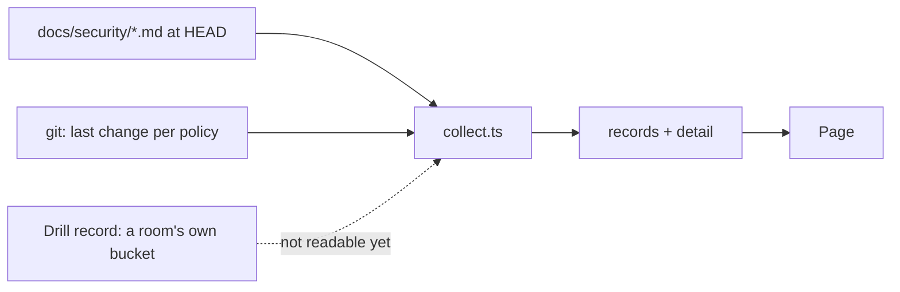

# Compliance: plan

How ready Legallas is for a law firm's vendor risk review: the written policies in `docs/security/`, true to the code and
current, and the restore drill a review asks for.

## What a firm's review asks for

| Ask | Answer today | On this page |
|---|---|---|
| SOC 2, ISO 27001, ISO 42001 | None held | Attestations row, unscored |
| Pen test and remediation status | No third-party test. Automated scans: the Security page | Attestations row, unscored |
| AI governance and guardrail policies | `ai-governance.md` | Areas, citations, review |
| BCP/DR, data and network security, encryption, access | One policy each | Areas, citations, review |
| Incident response, vulnerability management, asked as standard | One policy each | Areas, citations, review |
| Proof that recovery works | A drill runs in each room's own Cloudflare account (backup session's PR); its record stays there | Drill age, missing until readable |

## Sources

| Source | Gives | Read |
|---|---|---|
| [NIST CSWP 29, CSF 2.0](https://nvlpubs.nist.gov/nistpubs/CSWP/NIST.CSWP.29.pdf), GV.PO-01 | "Policy for managing cybersecurity risks is established": a policy per area | 2026-11-06, dated 2024-02-26 |
| The same, GV.PO-02 | Policy "reviewed, updated ... to reflect changes in ... technology": what it cites must still be in the code | 2026-11-06 |
| [NIST AI RMF 1.0](https://www.nist.gov/itl/ai-risk-management-framework), GOVERN 1 | AI risk policies "in place, transparent, and implemented": the AI area | 2026-11-06, dated 2023-01-26 |
| `docs/security/README.md` and each policy's Review section (#657) | "Every 12 months": the review goal | 2026-11-06 |
| `docs/security/bcp-dr.md`, Gaps (#657) | A restore drill "at least every quarter": the drill goal | 2026-11-06 |
| [Fowler, Continuous Integration](https://martinfowler.com/articles/continuousIntegration.html) | A fast build: the lane goal, as other pages | 2024-01-18 |

CIS Controls v8.1 sets the same cadences (annual review, quarterly recovery test), but its safeguard text is behind a
download form, so it can't be a `goal_source`.

## Ideal state

`ideal.json`: a firm's security team gets every document it asks for, current, true to the code, the same day.

## Metrics

| Id | Lens | Measures | Floor | Goal | Weight | Min samples |
|---|---|---|---|---|---|---|
| `policy_areas_covered` | Quality | Of 7 areas, % with a policy that is dated ("Version x, YYYY-MM-DD") and cites evidence in the tree | 0 | 100: GV.PO-01 | 3 | 7 |
| `evidence_refs_dead` | Quality | Citations in the 7 policies that don't resolve at HEAD: a ticked path not in the tree, or a ticked symbol not in its file | 10 | 0: GV.PO-02 | 2 | 7 |
| `policy_review_age_days` | Speed | Days since git last changed the oldest policy | 730 | 365: the policies' own cadence | 1 | 7 |
| `restore_drill_age_days` | Speed | Days since the last passing drill in the fictional sample room, from its drill record | 365 | 90: `bcp-dr.md` | 2 | 1 |
| `lane_minutes` | Consumption | This lane's job minutes (`core/lane`) | 10 | 5: Fowler | 1 | 1 |

| Rule | Why |
|---|---|
| A citation | A ticked token that is a repository path: folders with an optional file, or a file with a known extension. Not a command, URL, branch pattern, bare dotfile, `..` or `/` |
| A symbol | `` `file` (`symbol`) `` or `` `symbol` in `file` ``: must be a whole word in that file |
| Min samples 7 | One citation per area at least; an emptied policy set can't score |
| Floor 730 | Two missed reviews |
| Floor 10 | About 10% of the 111 citations on main after #657 |
| Floor 365 | A year without proof that recovery works |
| Weights | Coverage 3: the review's first ask. Drill 2: the one proof no page measures |

**Speed is a stand-in.** Nothing records when a questionnaire arrives or is answered: no issue, label or file. A same-day
answer needs every proof in it current. Speed measures the cadence of the two proofs a review checks: policy review and
restore drill.

## Seeds dropped

| Seed | Why |
|---|---|
| Third-party attestations held, scored | Each is bought from an outside auditor: the owner's spending decision, so no session can act (rule 6). Shown unscored from the README's table, never assumed held |
| Hours from questionnaire to answer | No record exists. A label on issues would read `no_events` for months |
| Policy lags code (as Documentation's doc lag) | The policies cite `web/worker` and `web/mcp`: 67 and 24 commits on main from 2026-11-01 to 11-05 (`git log --first-parent`). Every change would force a policy commit |
| Count of stated gaps, goal 0 | Deleting an honest Gap row would raise it. Shown unscored per area |
| Dynamic scan age | #684 builds the scanner in `quality-speed/pages/security/dast/`: the Security page's, beside its other scans |
| Drill age as the last green CI run of the drill's test on main | That step runs only when `web/` changes, so it would track how often `web/` changes, not drills. Tests are the Testing page's |

## Collector

| Lane | Runner | Reads | Missing when |
|---|---|---|---|
| `daily` | `linux` | The 7 policies and the README at HEAD; `git log -1 --format=%cI` per policy | Shallow checkout: all policy metrics. The drill: always, for now |

Detail: `area_<id>` and `attest_<id>` checks; `dead_<id>`, `gaps_<id>`, `age_<id>` readings. Counts only: no policy text reaches the site.

**The drill record.** The drill is a Cloudflare Workflow in a room's own account, so case data never leaves it. It writes
`drills/<UTC time>.json` (ok, counts, hashes, seconds) to that account's backup bucket. No lane token reads a bucket, so the
lane writes `missing`. The path to a real reading, never a customer's room:

| Step | Who |
|---|---|
| The drill runs on a schedule in the fictional sample room | The backup session's pull request |
| A GitHub-hosted job, merged by the owner, reads the newest `drills/*.json` there with a read-only token scoped to that bucket, and saves `ok` and the time as a read-out | A session writes it; the owner merges it and adds the token |
| `compliance` joins `ADMIN_PAGES` (`core/lanes.ts`), and `collect.ts` passes that time to `records()` | A `core/` pull request, then this page's |

## Chart per metric

| Metric | Chart |
|---|---|
| Each | Stat tile against floor and goal |
| Areas, citations, review | Dot matrix: 7 areas by written, true to code, reviewed |
| Attestations | Dot matrix: SOC 2, ISO 27001, ISO 42001, pen test, held or not, from the README |
| Fixes | Road to 100, core `fixGain` |
| Per area | Table: citations, dead, gaps stated, days since change |

## Baseline

Read 2026-11-06 by `collect.ts` on this Mac. The lane's entrypoint on `main` at `76335b4e` (06:33Z, before the policies)
and at `52c50fe8` (07:50Z, after #657); its reading functions on #657's head `5dd25bd2`. No CI run yet, so `lane_minutes`
reads missing.

| Metric | `main` before | #657 head | `main` after #657 | Score after |
|---|---|---|---|---|
| `policy_areas_covered` | 0 % | 100 % | 100 %, 7 of 7 | 100 |
| `evidence_refs_dead` | 0 of 0, too few | 1 of 106 | 0 of 111 | 100 |
| `policy_review_age_days` | missing | 0 | 0 | 100 |
| `restore_drill_age_days` | missing | missing | missing | 0 |
| `lane_minutes` | missing | missing | missing | 0 |
| **Total** | **0** | **43** | Q 100, S 33.3, C 0 | **44** |

Attestations on `main` after #657: 0 of 4 held, as its README says.

## Fixes

Ranked by total points, from `main` after #657.

| Fix | Metrics | Total | State |
|---|---|---|---|
| Merge the policies | Areas, citations, review | +44 from 0 | #657, merged |
| Full path for `quarantine.ts` | `evidence_refs_dead` | in the above | #657, merged |
| A lane run in CI | `lane_minutes`, at goal | +33.3 | The first daily run after this merges |
| A drill record the lane can read, from the fictional sample room | `restore_drill_age_days` | +22.2 | Collector, "The drill record" |

## What a good reading doesn't prove

| Reading | Doesn't prove |
|---|---|
| A citation resolves | That the rule beside it is true. Review does |
| Review age | A review: any edit resets it |
| Drill age | The recovery times in `bcp-dr.md`, or a drill in any customer's room. Only that one passed in the sample room |
| Attestations | Anything beyond the README's table |

## Sign-off

| Round | Date | Reviewer | Result |
|---|---|---|---|
| 1 | 2026-11-09 | A worker session, asked by the orchestrator, against `contract/validate.ts`, `core/goal-check.ts` and this plan's sources | **Signed off** (comment on #940), no changes. Lenses Q 2, S 2, C 1; each goal has a public source; `ideal.json` valid; `collect.test.ts` 11 of 11 |

Why the 8 Nov run read 0 on every lens: `validateRecords` (`contract/validate.ts`) keeps no record for a list with no
`signoff_comment`, so `records/compliance.json` was `[]`. Its detail read 7 of 7 areas and 0 dead citations.

| After sign-off | Expect |
|---|---|
| Quality | 100: areas 7 of 7, 0 dead |
| Speed | 33.3: review at goal (weight 1), drill missing (weight 2) until "The drill record" lands |
| Consumption | The lane's own minutes against 5 |

## Final

Not reached.
