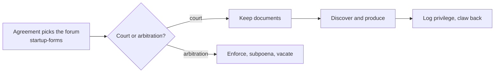

# Court rules for disputes, federal, Colorado and Delaware

Plan for builders. Not legal advice. No lawyer has reviewed it. Public rules only, never any real matter.

| File | Holds |
|---|---|
| [`needs.json`](needs.json) | **The reviewed list:** 18 needs a founder or investor dispute touches, each with its official source, the day it was opened and where the product holds it, and 10 test questions the law eval can read today. Format: `quality-speed/core/law/README.md` |
| [`questions-pending.json`](questions-pending.json) | 16 court rule questions, which move into `needs.json` once the citation reader reads court rules (fix 3) |
| [`manifest.json`](manifest.json) | 7 metrics, the law kit's shared ids, with this page's floors, goals and weights |

The 26 questions were written from the official texts by an agent that never read the retrieval code. Colorado's court rules have none
until they can be opened.

**CI lanes:** `lanes.json` runs two collectors daily on Linux. `law` is the shared law kit (`../../core/law/collect.ts court-rules`), repository
files only; it writes `law.json` beside `page.ts`. `lag` is `lag.ts`, one HEAD request per watched unit (11), for `change_lag`.

## Sources

Opened on 2026-11-02 on the official host, except Colorado's court rules; every source below but C.R.C.P. and 15 U.S.C. re-read 2026-11-13.
This is the record of each source's edition and right to ship.

| Need | Source | Edition read | Fetch | Ship | Why |
|---|---|---|---|---|---|
| Federal discovery, privilege, lost ESI | [Fed. R. Civ. P.](https://www.uscourts.gov/forms-rules/current-rules-practice-procedure/federal-rules-civil-procedure) 16(b)(3)(B), 26(b)(1), 26(b)(5), 26(f)(3), 34(b)(2)(E), 37(e), 45(e)(2) | 2025-12-01; read whole 2026-11-13 | yes | bundle | Federal work, 17 U.S.C. 105; robots allow it |
| Privilege waiver | [Fed. R. Evid. 502](https://www.uscourts.gov/forms-rules/current-rules-practice-procedure/federal-rules-evidence) | 2025-12-01; read whole 2026-11-13 | yes | bundle | Federal work |
| Arbitration | [9 U.S.C. 2, 3, 4, 7, 9, 10, 12, 402](https://uscode.house.gov/us/usc/t9/) | Through P.L. 119-138 | yes | bundle | Federal work; title 9 is positive law |
| Securities suit stay | [15 U.S.C. 78u-4(b)(3)](https://uscode.house.gov/us/usc/t15/s78u-4/) | Through P.L. 119-136 | yes | bundle | Federal work |
| Destroying records | [18 U.S.C. 1512(c), (f), 1519](https://uscode.house.gov/us/usc/t18/s1519/) | Through P.L. 119-138 | yes | bundle | Federal work |
| D. Colo. | [LCivR 26.1(a), 30.1, 30.2(a), 30.3(a), 37.1, 45.1](https://www.cod.uscourts.gov/CourtOperations/RulesProcedures/LocalRules.aspx) | 2025-12-01, rev. 2026-03-04 | yes | cite only | Federal court work; no robots file; terms page errored. Cited until a reader for the PDF is checked |
| D. Del. | [LR 26.1, 26.2, 30.1, 37.1](https://www.ded.uscourts.gov/local-rules); [Default Standard](https://www.ded.uscourts.gov/default-standard-discovery) 1(c), 1(d), 3(a) | LR 2026-09-01; the standard prints no date, server date 2019-05-22 | yes, 10-second delay | cite only | Federal court work; robots allow it. Cited until a reader is checked |
| Colorado court rules | C.R.C.P. 16, 16.1, 26, 34, 37, 45, 121 section 1-15 | **Not opened** | not settled | not settled | coloradojudicial.gov banned this address until 2026-11-03 02:31 UTC; not worked around |
| Colorado arbitration | [C.R.S. 13-22-201 to 13-22-230](https://olls.info/crs/crs2026-title-13.pdf) | C.R.S. 2026 | yes-with-rules | after-statement | As the plan records for olls |
| Chancery | [Rules](https://courts.delaware.gov/forms/download.aspx?id=160908) 34(b), 34(d), 37(e), 45(c)(2)(B), 45(d)(2); [Preservation](https://courts.delaware.gov/forms/download.aspx?id=50988) and [Litigating](https://courts.delaware.gov/forms/download.aspx?id=99468) Guidelines | Full set 2026-06-01; guidelines 2024-11-15 | yes | cite only | Terms, re-read 2026-11-13, reserve all rights and route reproduction to the State Court Administrator. No court term allows storing, so the text is linked, never stored |
| Delaware arbitration | [10 Del. C. 5701, 5702(a), 5708, 5714](https://delcode.delaware.gov/title10/c057/index.html), [5803, 5808, 5809](https://delcode.delaware.gov/title10/c058/index.html) | Through 85 Del. Laws c. 550 | yes | after-counsel | As the plan records for delcode |
| Director service | [10 Del. C. 3114](https://delcode.delaware.gov/title10/c031/index.html) | As read | yes | after-counsel | As the plan records for delcode |

**What each rule says, in a line:**

| Topic | Federal | Colorado | Delaware |
|---|---|---|---|
| Lost ESI | Cure prejudice; presumption or dismissal only on intent to deprive (37(e)) | Not opened; the plan records it as judge-made | Presumption or dismissal on recklessness or intent (37(e)); duty from reasonable anticipation; written hold overseen by counsel |
| Production form | As kept, or ESI as ordinarily maintained or reasonably usable, one form (34(b)(2)(E)); D. Del.: single-page TIFF with load files, fixed metadata incl. control numbers | Not opened | Form requested, or as maintained or reasonably usable (34(b)) |
| Privilege log | Claim expressly and describe (26(b)(5)(A)); clawback (26(b)(5)(B)); timing and method set in the 26(f) plan since 2025 | Not opened | Senior Delaware counsel answer for the log; post-filing items usually unlogged (Guidelines) |
| Waiver | 502(b) inadvertent; 502(d) order binds every court | | |
| Arbitration award | Vacate notice within three months (12); confirm within one year (9) | Vacate within 91 days (13-22-223) | Vacate within 90 days (5714(b)); the Delaware act applies only if the agreement references it (5702). Rapid Arbitration Act: award within 120 days (5808(b)), challenge within 15 days (5809(b)) |

**Watch:** Fed. R. Civ. P. 26(a)(3) and 45(b), (c) are with the Supreme Court for 2027-12-01 (subpoena service, 14 days' notice, remote
testimony). Chancery's final rules tranche is due in 2026 (release of 2026-05-18); Rules 26 to 37 still carry 2019 history lines.

**The 13 needs coverage did not count on 2026-11-13 (card 690):**

| Need | Unit | State |
|---|---|---|
| `us-discovery`, `us-privilege-log` | `us-civil-rules` | Stored whole: 94 rules from the uscourts.gov print, read 2026-11-13 |
| `us-privilege-waiver` | `us-evidence-rules` | Stored whole: 69 rules, read 2026-11-13 |
| `us-lost-esi` | `us-civil-rules` | Its 37(e) row; was `us-preservation`, which now holds only the crimes |
| `arbitration-clause` | `us-arbitration-act`, `co-arbitration-act`, `de-arbitration-act`, `de-rapid-arbitration-act` | Stored whole: 9 U.S.C. ch. 1 and 4, C.R.S. 13-22 part 2, 10 Del. C. ch. 57 and 58 |
| `us-arbitration` | `us-arbitration-act` | Stored whole; deadlines in its own words (9, 12) |
| `co-arbitration` | `co-arbitration-act` | Stored whole; 91 days (13-22-223(2)) |
| `de-arbitration` | `de-arbitration-act`, `de-rapid-arbitration-act` | Stored whole; 90 days (5714(b)), 15 days (5809(b)) |
| `us-obstruction` | `us-preservation` | Now 18 U.S.C. 1512 and 1519, stored whole |
| `d-colo-local`, `d-del-local` | `d-colo-local-rules`, `d-del-local-rules` | Cited: federal works, until a reader for each PDF is checked on a real copy |
| `de-discovery`, `de-privilege-log` | `de-chancery-rules` | Cited: Rules 34, 37(e), 45 and both guidelines. The courts reserve all rights and name no term that allows storing |
| `co-discovery`, `co-lost-esi` | | Can't count: `checked` is null until C.R.C.P. is opened (fix 4). C.R.C.P.'s official volume is a LexisNexis publication that needs permission to reproduce, so it would be cited, not stored |

**Left out:** AAA and JAMS rules (private, copyrighted); Sedona Conference (commentary); Delaware Superior Court rules (Chancery hears
these disputes; note its 37(e) is motion practice, and its 2026-02-05 copy predates orders of 2026-03-13 and 2026-09-30); appellate, class
and jury rules; injunction and derivative rules (they come with the whole rule sets).

## Ideal state

A founder, investor or their lawyer in a dispute gets the right, current court or arbitration rule for their forum, fast, with its
official source and date, and nothing such a dispute touches is missing.

## Metrics

The law kit's ids (`quality-speed/core/law/PLAN.md`), which compute them. Floors, goals and weights are this page's.

| Id | Lens | Measures | Floor | Goal | Weight | Why this goal |
|---|---|---|---|---|---|---|
| `coverage` | Quality | Needs the product holds, every reference resolving | 0 | 100 | 3 | "Nothing missing" is the ideal state |
| `verified` | Quality | Relied-on units opened on the official host (`status` VERIFIED) | 0 | 100 | 2 | The product says "checked against [source] on [date]" (`docs/legal/product-notices.md` A1) |
| `rights` | Quality | Relied-on units each install may fetch or link by itself | 0 | 100 | 1 | Already met; the plan ships no text, so every install must get its own (`law-pack-plan.toml`, `ships`) |
| `flags` | Quality | Award deadlines whose exact words appear in a held template or checklist item, never only in a unit | 0 | 100 | 1 | A missed challenge window can't be undone |
| `change_lag` | Speed | Most days a relied-on unit trails an official change: `lag.ts` reads the change date of one official document per unit, listed in `watch.json` with the day a person last read it (Last-Modified, or the date in its file name), and counts the days since any change made after that day. Whoever reads a new edition updates the plan's unit and its day in `watch.json`. A unit with no watched document is left out and named in the lane log; a watched one with no readable date leaves it missing. Daily, so its age limit is 48 hours | 90 | 0 | 1 | Rules are announced before they take effect (Fed. R. Civ. P. by May 1 for December 1), so the pack can be current on the day |
| `law_lookup_tokens_p95` | Consumption | Tokens in the law tool's answers to this page's questions, p95, from the kit ([`core/law/PLAN.md`](../../core/law/PLAN.md)). Reads only from a law eval run's report, so it reads missing until one feeds the lane | 10,000 | 2,250 | 3 | Claude Code warns above 10,000 tokens of tool output; 2,250 is the room's own budget for one answer |

Left off: `fresh`, because its year rule can't pass a current source that is old or undated, such as D. Del.'s undated Default Standard, and `change_lag` checks currency against the source itself; notices (the kit cut it after review); `search_p95`, `open_p95` and `answer_p95`, because law search, opening and answering run on one engine, so every law page would show the same number: the AI connectors and Data room pages time them once.

`min_samples` is today's count, so removing a reference or a watch entry scores 0 instead of raising a share: coverage 18,
verified 13, rights 13, flags 4, change_lag 11 (the units with a watched document; `co-civil-rules` has none until C.R.C.P. can be
opened, and `de-civil-process` has none yet), law_lookup_tokens_p95 5 (runs that retrieve law: half its 10 questions). A change to a need's `covered_by`, or to `watch.json`, is a change to the reviewed list and needs the reviewer.

### Goals

| Id | `goal_source` | The number it states |
|---|---|---|
| `flags` | [9 U.S.C.](https://uscode.house.gov/us/usc/t9/) | Exact award deadlines, such as three months to move to vacate (section 12): 100 |
| `rights` | [17 U.S.C. 105](https://www.copyright.gov/title17/92chap1.html) | No copyright in a federal work, so federal units may ship: 100 |
| `change_lag` | [Fed. R. Civ. P.](https://www.uscourts.gov/forms-rules/current-rules-practice-procedure/federal-rules-civil-procedure) | Amendments sent by May 1 take effect December 1: the pack can be current on the day, goal 0. Floor 90 |
| `coverage`, `verified` | This section: repo-made goals, from the ideal state | All needs, every unit opened on its host |
| `law_lookup_tokens_p95` | [`web/mcp/contract.ts`](https://github.com/Colorado-Startups/legallas/blob/main/web/mcp/contract.ts) | `COMPACT_LIMITS`: 9,000 characters, 2,250 tokens, the room's own budget for one answer. Floor 10,000: Claude Code warns above it ([MCP docs](https://code.claude.com/docs/en/mcp)) |

Cut after review (#446): `questions`. No lane collects it today.

## Chart per metric

`page.ts`, drawn with the chart kit, whose palette already passes the dataviz validator in both themes. It reads the build's numbers
and the `law.json` the collector writes beside it, so it runs inside the build's fence.

| Metric | Chart |
|---|---|
| Every metric | `metricBullet`: Quality green and thick, Speed blue and thin; missing in red |
| `coverage` | **The infographic, Court map:** a `dotMatrix` of topic by forum (federal, Colorado, Delaware), each cell held, missing or not applicable, as the collector found it; a red tile before it has run |
| Road to 100 | `roadTo100`: one bar per metric short of its goal, worth its share of its lens |

Checked on 2026-11-02: the fenced synthetic build and publish guard pass; 25 visible words; light and dark, 390 and 1280 px wide, no
sideways scroll, no console errors.

## Baseline

Retaken on `main` at `23a5a4c`, 2026-11-04, with the law kit and the five metrics on the manifest. `change_lag` is `lag.ts`'s
reading of its three watched units on 2026-11-02 (all 0): this session's network can't reach the court hosts.

| Metric | Value | Score |
|---|---|---|
| `coverage` | 4 of 18 needs (22.22%) | 22.22 |
| `verified` | 3 of 4 units (75%): `co-civil-rules` is UNVERIFIED | 75 |
| `rights` | 4 of 4 | 100 |
| `flags` | 0 of 4: no held unit carries an award deadline | 0 |
| `change_lag` | 0 days over 3 watched units: rules PDF 2026-05-26, Exchange Act compilation 2026-09-04, Chancery set 2026-06-01, all before they were read on 2026-11-02 | 100 |
| **Total** | Quality 45.24, Speed 100, Consumption 0 (no consumption metric yet): (45.24 + 100 + 0) / 3, rounded down | **48** |

## Fixes

Ranked by score gained. Law fixes go under backlog #15, the default law pack, in small pull requests of their own.

| Rank | Fix | Gains | Where |
|---|---|---|---|
| 1 | Add the 13 missing needs as pack units with the award deadlines in their text, and widen `us-preservation` and `de-chancery-rules` | **Done on card 690** for 11 of 13: `coverage` 16 of 18 (88.88), `verified` 12 of 13, `change_lag` 0 over 11 units. `flags` stays 0 of 4: the kit finds a flag only in a template or checklist item, never in a unit, so it needs fix 6 | `law-pack-plan.toml`, `default-pack-units.ts`, `document-set-and-law.md` |
| 2 | Give `co-civil-rules` an official C.R.C.P. document with fix 4, and add it and `de-civil-process` to `watch.json` | `change_lag` covers all 13 units; `min_samples` rises to 13 | `law-pack-plan.toml`, `watch.json` |
| 3 | Teach the citation reader court rules (Fed. R. Civ. P., Fed. R. Evid., C.R.C.P., Ct. Ch. R., local rules) | Lets a future `questions` metric test court rules | `web/worker/law-cite.ts` |
| 4 | Open C.R.C.P. after the ban lifts, one request at a time | `verified` to 100: about +4.8 | `law-pack-plan.toml` |
| 5 | Court hosts' terms and the watch items: **merged in #185** for `delaware-courts`, `uscourts` and the Colorado ban; `cod-uscourts` and `ded-uscourts` **added on card 690**, read 2026-11-13; `colorado-judicial` terms with fix 4 | Keeps `rights` and `change_lag` honest | `law-pack-plan.toml` |
| 6 | Put each award deadline, in the act's own words, in an arbitration clause template or a dispute checklist item, where a founder sees it | `flags` to 100: about +4.8 | The Templates or checklist page, with its reviewer |

## Final

Not reached. Recorded here when every metric reads its goal.
