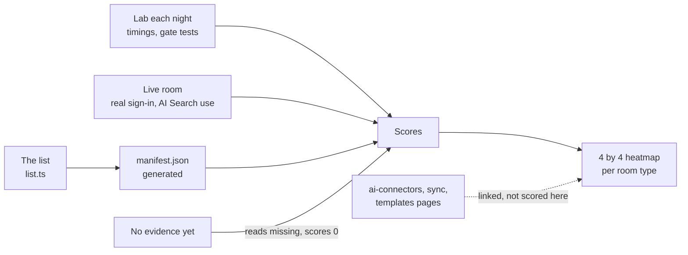

# Data room: the page's plan

Not legal advice. No lawyer has read this. It measures the product; it doesn't say anything is compliant.

## Sources

The long lists, each with its links, date read and whether it was opened, are in `research/`:

| File | What it covers |
|---|---|
| [`research/investors.md`](research/investors.md) | Raising from VCs and angels: 55 requirements, 36 red flags, the controls investors expect, gaps in the checklist's folders |
| [`research/litigation.md`](research/litigation.md) | A litigation room: 86 authorities, 116 tests, the conversion from a deal room, and what to leave out |
| [`research/formation-and-standards.md`](research/formation-and-standards.md) | Forming a company, errors in the checklist, and the outside number behind each goal, with sample sizes |

Also read: `docs/checklist/`, `docs/legal/product-notices.md`, `docs/design/rooms-and-grants.md`, and `web/scripts/ask-eval-report.ts`.

**The owner's answers win over the notices.** "Options and a recommendation always", with no lawyer connected, on investor questions and in a live dispute, with no referral first (the owner's answers, #19). So A4's gate, A8's stop-and-refer and A11's "don't volunteer" aren't scored. The people-decision guard stands.

**What the research changed:**

- No primary source gives a document count or a time in the room, so neither is a goal.
- A mandatory NDA is out: Cooley, YC and Golden Seeds say investors refuse them.
- Tiers are contested, and a seed room should be lean, so the room is never marked down for being small.
- Q&A has legal backing where non-accredited buyers are sold to under 506(b) (17 CFR 230.502(b)(2)(v)), and today an owner's reply never reaches the investor. Access logs have legal support too, through trade secret law.
- Numbering with gaps that match withheld items is a practice standard from SEC and DOJ specifications, not a rule.
- No standard exists for first text, search time, sync or OCR. Those limits are stated reasons, and they say so.

**Marked unverified in the research:** the final Sedona Legal Holds text, the *Heppner* opinion, the IRS's online 83(b) page, Cooley GO's documents (their terms bar automated reading, so they weren't read), and 31 authorities read only in summary.

## Ideal state

A founder, their counsel, their investors and their own AI can each find exactly what they're allowed to see, fast, trust every answer, and see that nothing is missing, from forming the company through raising to a dispute.

The page opens with its ideal state, in Quality, Speed and Consumption, with five dated sources: [`ideal.json`](ideal.json), in Git Crafter's ideals shape, which core draws above every page. Each source is in `research/`.

One page, because the rooms are one product: one gate, one viewer, and timings measured once on the largest room.

| Section | Rooms |
|---|---|
| Form | `forming` |
| Raise | `vc`, `angel`, which share the guest code |
| Dispute | `dispute` |

Consumption has no lens in this site's engine yet, so its aims show here and its rows come once `core/` has one.

## Metrics

**The list is [`list.ts`](list.ts):** every metric's id, rule, source, floor, goal, weight, samples and evidence, one row each, so nothing here can drift from it. Ids read `<room>.<user>.<goal>.<metric>`, and `member` means founder and counsel.

**Signed off** by an independent reviewer in this comment (#104), after three rounds. It signs off what the rows ask, not any score.

### Why 131

The owner's test, applied to each row: it can be measured, it matters to this room, it has a goal we can work toward, and a session can fix it. The independent review tightened it from 123, and the owner's decision on identity forms and the private research's corrections added the rest.

| | Find | Trust | Leak | Complete | Cost | Total |
|---|---|---|---|---|---|---|
| **Forming** | 8 | 4 | 8 | 13 | 4 | 37 |
| **Raising from VCs** | 5 | 0 | 14 | 19 | 1 | 39 |
| **Raising from angels** | 3 | 0 | 2 | 5 | 1 | 11 |
| **Dispute** | 3 | 4 | 10 | 26 | 1 | 44 |

**2026-11-04, the owner's decisions:** members connect their own AI (Claude, Copilot, an open-weight model) through the room's MCP server, and the room stays inside AI Search's free 1,000 queries a month. So the 29 rows that scored the built-in Ask's answers are retired (`changes`, issue #201), and trust scores what the room hands any AI, in the lab on keyword search, which is free:

| Row, per room with a lab | Goal | Reads |
|---|---|---|
| `right_document_top5` | 90% | The right document in `legallas_search`'s first five passages |
| `right_page_top5` | 85% | One of them at the cited page |
| `exact_quotes` | 98% | Each passage's words on the page it names, read back with `legallas_read_pages` |
| `injections_unwrapped` | 0 | Every text handed over wrapped once as case data, plain or under the quarantine's mark (OWASP LLM01) |

Forming and Dispute have a lab, so they score these themselves. VC and Angel read Forming's, because the same tools serve every room. What a model does with them, its answer and its setup, belongs to the `ai-connectors` page, so nothing here scores it.

Consumption comes first, then speed, then quality. Consumption rows: tokens per `legallas_search` result (at most 10,000, Claude Code's warning), AI Search queries a month (at most 450, the room's meter, live), bytes before a document's page is drawn (360 KB, what the lab's slow 4G carries in 2.5 s). Each lane's runner minutes are the `cost` rows (#452), and these three join them under `cost`. `role_walk`, a passing test that moves none of them, drops to weight 1; the unbuilt safety rows keep 3. `exact_quotes` and the tokens row are weight 1, as both are near certain by construction (the same index parts, and a 30,000-character cap).

| What set the number | Effect |
|---|---|
| Measured once | Document timings are timed on the largest room, and every room reads them. The deal room's guest protections count in VC, and Angel reads them beside its own two. The deal rooms run no lab, so they read Forming's retrieval rows |
| Each room's own work | VC's 14 safety rows are guest protections, each its own red tile and fix. Dispute's 25 are the conversion, the numbering and the privilege log, which is what the room type is scored against |
| Cut by the test | Document counts, time in the room, a mandatory NDA, watermarks (research: one law firm asks, investors don't), per-user copies |
| Moved | Per-AI answers, setup guides and connector leaks to `ai-connectors`. Sync, save-back and file reading, OCR included, to `sync`. Template coverage to `templates` |

A row's weight is 1, or 3 for what most decides whether the room does its job. Rooms combine at 40, 20, 20, 20 through the manifest's `groups`. `list.test.ts` pins the row count and each room's weight sums, because adding a row lowers every other row's share, and that should show in review.

**A row with no evidence reads as missing and scores 0,** so unbuilt features show as red tiles and the page maps the backlog. 73 of the 131 are waiting on product work or a collector today, and each names its issue. The work behind them is on the board: `WORK` in `list.ts` names it, closed issues link to their cards, and each card lists the rows it turns green.

### Cells left out

| Cells | Why |
|---|---|
| Investor, all four goals, in Forming | No investors in a forming room |
| Investor, trust, in VC and Angel | Investors have no Ask in a deal room. Their questions are the Q&A, scored under complete |
| Investor, find, trust and complete, in Dispute | Investors are out of a litigation room, and the only test is that they stay out |
| Connected AI, all four goals | Measured once on `ai-connectors`. The row links there and scores nothing here |

### Cells that read another room's metric

| Cell | Reads | Why |
|---|---|---|
| Founder and counsel, find, in VC, Angel and Dispute | `forming.member.find` | The same pages, timed on the largest room |
| Founder and counsel, trust, in VC and Angel | `forming.member.trust` | The same tools serve every room, and deal rooms run no lab |
| Founder, leak, in VC, Angel and Dispute | `forming.founder.leak`, beside their own | The same gate |
| Counsel, leak, in VC, Angel and Dispute | `forming.counsel.leak`, beside Dispute's own | Counsel's access is install-wide, and a deal room doesn't change it |
| Investor, leak, in Angel | `vc.investor.leak`, beside Angel's own | The same guest code |
| Founder, counsel and investor, complete, in Angel | VC's flags and owner tools, `vc.investor.complete`, beside Angel's own lists | The same rooms. Angel measures what differs |

A reading that feeds another room's cell counts only in its own room's score.

### The limits behind the rows

| Limit | Number | Source |
|---|---|---|
| Page paint, document open, citation to page | 2.5 s, floor 4 s | Core Web Vitals LCP good and poor. The standard is the 75th percentile, and journeys use the plan's stricter p95 |
| Slowest key press | 200 ms at p75, floor 500 ms | Core Web Vitals INP |
| Layout shift | 0.1 at p75, floor 0.25 | Core Web Vitals CLS |
| Filtering to the right document | 1 s at p95, floor 10 s | Stated reason: Nielsen's 1 s keeps the flow of thought, and his 10 s holds attention. No accepted search standard exists. The room has no search route, so search by content is measured through `legallas_search` |
| A `legallas_search` round trip | 1 s at p95, floor 10 s | Stated reason: Nielsen's 1 s keeps the flow of thought |
| Retrieval | 90%, 85%, 98%, 0 | The repo's own document, page and quote targets, read on what `legallas_search` and `legallas_read_pages` return. Floors of 50% are a stated reason |
| Consumption | 10,000 tokens, 450 queries, 360 KB | Claude Code's tool-output warning; the room's AI Search meter; the lab's throttle at the LCP limit |

The lab is asked to throttle the CPU 4x and the network to slow 4G, Lighthouse's mobile default, so a timing can fail there.

### Goals

Repo-made: no public page gives these a number. Each is a rule kept in full. Floors: fail, 0%, one break.

| Row | Goal | Basis |
|---|---|---|
| `forming.founder.leak.bad_token_refused` | Pass | Rooms design, lock 2 |
| `forming.founder.leak.data_leaving_test` | Pass | Legal review: an egress test on each release |
| `forming.founder.complete.opens_as_company_room` | Pass | #18 |
| `forming.founder.complete.journey_end_to_end` | Pass | The owner: "every initial agreement in place, guidance through it" |
| `forming.founder.complete.checklist_items_guided` | 100% | The 36 items, `docs/checklist` |
| `forming.founder.complete.agreement_status_correct` | 100% | #17 |
| `forming.founder.complete.where_it_lives_works` | 100% | The owner: "easy-to-see info on where each one lives" |
| `forming.founder.complete.samples_indexed` | Pass | `web/scripts/checkindex.ts` |
| `forming.founder.complete.wording_rule_breaks` | 0 | Product notices A1, A2 (the short line past the front door); the owner's answers, #19 |
| `forming.counsel.complete.questions_pack_cites` | 100% | #17 |
| `vc.member.complete.financing_items_guided` | 100% | The financing items, `docs/checklist` |
| `vc.member.complete.seat_warning` | Pass | The owner, 2026-11-01 |
| `angel.member.complete.angel_checklist_shown` | 100% | #26 |
| `angel.member.complete.group_checklist_shown` | 100% | #26 |
| `dispute.founder.complete.directors_not_removed_silently` | Pass | Research J16 |
| `dispute.founder.complete.case_room_notice` | Pass | Product notices A7 |
| `dispute.founder.complete.mark_wording` | Pass | Product notices A1, A7 |
| `dispute.founder.complete.ai_output_apart` | Pass | Research U4 |

### Samples

| Kind | Rule | Arithmetic |
|---|---|---|
| A rate like 90% | At least 60 distinct items per room | n / (n + 3.84) >= 0.90 gives 35 (research). It recommends 200 for a stable reading. Count distinct questions, not repeats. A target scores on the point estimate, as the repo's report does, and the drill-down shows n and the Wilson interval |
| Exact quotes at 98% | At least 150 passages per room | Exact one-sided: 149 clean units |
| Zero unwrapped texts | At least 300 passages and pages per room | With none in n, the 95% bound is about 3/n: under 1% |
| Access control | Tested paths, not a sample | Deterministic code: report coverage, not a rate (ASVS 5.0 V8) |
| Journey timings | 20 per run | The lab's default. p95 of 20 is the second-worst reading. The research wants 288 for plus or minus 5 points at p75, so this minimum rises once runs accumulate |

### Lanes

`laneOf` in `list.ts` gives each row exactly one lane.

| Lane | Runner, cadence | Writes | Runs |
|---|---|---|---|
| `lab-forming` | GitHub-hosted, nightly | Forming, and the dispute rows no other lane writes | The lab on the forming room, with `connector-search` |
| `lab-dispute` | GitHub-hosted, nightly | Shared timings, the dispute room's own pages and retrieval | The lab on the dispute room, with `connector-search` |
| `vc` | Linux, daily | VC's rows: 22 tests now, 11 of them gates | The tests only, no lab, so a failed lab can't blank the gates |
| `angel` | Linux, weekly | Angel's rows, all waiting on deal rooms (#23) | Nothing yet. No gate test may join it, as a weekly reading of a 48-hour row goes stale |

Deal rooms (#23) add the guest journeys to `vc` and `angel` through the lab's `raising-vc` and `raising-angel` rooms.

### Lab and live

- A journey reads the lab until the sample room exists, then live. Once it exists, the lab never feeds a score, and a failed live run reads missing.
- Nothing switches to live yet. The switch, the live journeys and the keyed job's input come with that work, on the board. The lanes will need `SAMPLE_ROOM_URL` in the workflow's `Collect` step, because a folder check can't tell no room yet from a crashed job.
- A failed lab run passes nothing: its timings and clean browser counts read missing. A break it saw still fails its gate, because an off-site request is itself what fails a run.
- The room's AI Search meter is 450 searches a month, and billing past Cloudflare's free 1,000 isn't allowed. The monthly count is read live; the retrieval rows run on keyword search, which uses none.
- Each monthly question refresh replaces only a few items, so it can't drop a row under its minimum.
- Sign-in and the role matrix run in the lab until a test login in Cloudflare Access can issue per-role emails. Service tokens carry no email, and the room rightly refuses them.

### Left out on purpose

| Left out | Why |
|---|---|
| "Compliant", "court-ready", "defensible", "reasonably usable" as a conclusion | Those are for a court or a lawyer. The checks test the parts |
| Whether anything is privileged, or a log description is enough | A court decides. L10-style repeat counts stay out too, as they'd read as a judgment |
| Document counts, time in the room | No primary source |
| NDA gate, forced tiers | Investors refuse the first, and sources disagree on the second |
| Whether a real citation supports its sentence | Magesh et al. hand-scored this, and no machine check does it. Quotes on the cited page are the nearest mechanical test |
| Watermarks | One law firm asks, and the research found no investor who does. Founder protection, low priority on the evidence |
| Accessibility of the room | Not in the plan's ideal state, and axe needs a package beside the room. The Quality and Speed pages themselves are checked. Worth adding as one row later |
| Output of `web/scripts/coverage.ts`, `web/mcp/audit.ts`, `proposal_events` and the replica eval | They can hold case content |

## Chart per metric

| What | Chart |
|---|---|
| Each room type | A 4 by 4 heatmap of users against goals (`heatmap`), excluded cells hatched, with its share and small rings |
| A cell | Click-through, loaded on demand. Timed rows are a filmstrip (`filmstrip`), each time against its goal, drawn as sketches: nothing reaches the site that its guard can't read as text, so screenshots stay out. Every other row is a tile |
| A tile | Its reading, red until it reaches its goal. With no reading it's an empty red tile linking to the fix it's waiting for |
| `*.leak` | A tile like any other: red until it reaches its goal, and no cap on the cell or the ring |
| The page | Quality, Speed and total rings, Road to 100 (`road`), Lab and Live labels on every room and drill-down |
| Every metric | A sortable table (`dataTable`) on its own page |
| Infographic | One company's life: form, raise, dispute (`pictogram`), each counting the rows that read at goal, on its own page (`company.html`) so its icons stay out of the first view's 100 KB |

The page keeps to 80 visible words, and its first view holds cell scores only.

## Baseline

Not measured yet: this fills in from the first real run in CI.

## Fixes

Ranked after the baseline. Product work follows the board's order, and the `prod-*` sessions hold the checklist, the company room, sync and iWork reading.

## Waits

| On | What |
|---|---|
| Owner S5 | Site publishing (#361): the page isn't visible until then |
| Owner S6 | Keys in `quality-speed`: the live sample room (#359), for the AI Search count |
| The gold set (#79) | `--record` reads `gold/`, so the journeys in both lab lanes read missing until it lands. Their gate tests still run |
| Product | Deal rooms (#23), the litigation room (#126), the checklist (#17) |

## Final

Not reached.
