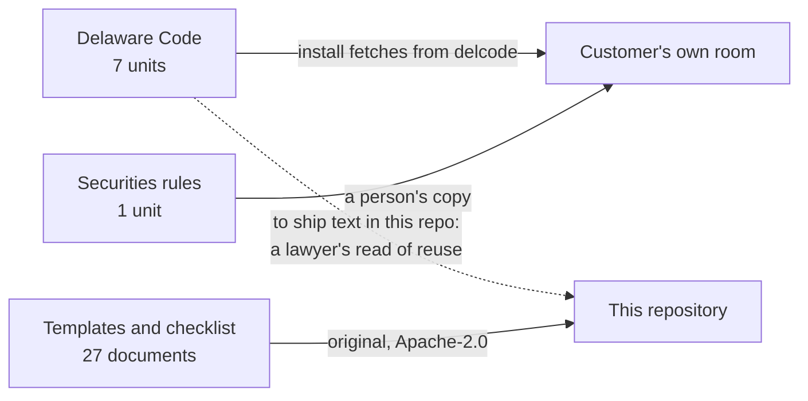

# Delaware business law

Page slug `delaware-business-law`. Public law only, no case data. Not legal advice; no lawyer has reviewed this page or its list.

| File | What it holds |
|---|---|
| [`needs.json`](needs.json) | The reviewed list, in the [law kit's format](../../core/law/README.md): 40 needs with source, path and where the product holds each, 12 deadline flags in the statute's exact words, 33 test questions |
| [`manifest.json`](manifest.json) | 8 metrics: the kit's five, `change_lag`, `lane_minutes` and `law_lookup_tokens_p95`, one lens each at least |
| [`ideal.json`](ideal.json) | The ideal state and its two sources, the signed Title 8 and Title 6 files |
| [`page.ts`](page.ts) | The page: bullets against goal by lens, Road to 100, and the law kit's needs charts from `law.json` (`core/law/page.ts`) on a page of their own |
| [`lanes.json`](lanes.json) | Two lanes, daily on Linux: the shared law collector, and `lag.ts` |
| [`lag.ts`](lag.ts) | `change_lag`, with [`lag.test.ts`](lag.test.ts) |

Earlier work: #113 (open) drafted this page on an older kit. Its list is reused here where its sources could be opened again. Its 33 questions on Titles 6 and 8 are kept, each checked against the 2026-11-05 text; its two Title 10 questions are left out, with Title 10.

## Sources

| Source | Host | What was read, 2026-11-05 | Machines may fetch | Right to ship its text |
|---|---|---|---|---|
| [8 Del. C. ch. 1](https://delcode.delaware.gov/title8/c001/index.html), General Corporation Law; [ch. 5](https://delcode.delaware.gov/title8/c005/index.html), section 502 | `delcode.delaware.gov` | Subchapters I to IX and XVIII, and ch. 5. The signed [title 8 file](https://delcode.delaware.gov/title8/title8.pdf): "includes all acts enacted as of October 01, 2026, up to and including 85 Del. Laws, c. 550", `Last-Modified` 2026-10-20 | Yes: no robots file (`/robots.txt` is 404) | The file calls itself "an official version" and disclaims warranty; the plan's host terms leave reuse to a lawyer. No text ships here |
| [6 Del. C. ch. 18](https://delcode.delaware.gov/title6/c018/index.html), LLC Act; [ch. 17](https://delcode.delaware.gov/title6/c017/index.html), LP Act; [ch. 73](https://delcode.delaware.gov/title6/c073/index.html), Securities Act; [ch. 27](https://delcode.delaware.gov/title6/c027/sc01/index.html), section 2708; [ch. 12A](https://delcode.delaware.gov/title6/c012a/index.html) | same | Ch. 18 subchapters I to IV, VIII, XI; ch. 17 subchapters I to III, XI; ch. 73 subchapters II, III. The signed [title 6 file](https://delcode.delaware.gov/title6/title6.pdf): "includes all acts enacted as of October 1, 2026, up to and including 85 Del. Laws, c. 550", `Last-Modified` 2026-10-20 | same | same |
| [Delaware Administrative Code, securities rules](https://regulations.delaware.gov/AdminCode/title6/Rules) | `regulations.delaware.gov` | Not opened: the proxy refused it (403) | The plan: browser only | Needs a person's copy |
| Division of Corporations (`corp.delaware.gov`, `corpfiles.delaware.gov`) | | Not opened: the proxy refused both (403) | | |

**Who read what.** This session fetched every `delcode.delaware.gov` page above with plain HTTPS requests on 2026-11-05. Every flag is the exact words of its need's own source, checked to occur there. Nothing rests on the Division's pages: its fees are totals the statutes split into parts (8 Del. C. 391, 6 Del. C. 18-1105), so no fee flag is kept, and no statute part is shown as a price. The securities rules need waits on a person's copy (`checked: null`).

| Group | Needs | Sections read |
|---|---|---|
| Corporations | 23 | 102, 109, 115, 122(17), (18), 131 to 133, 136, 141(f), (k), 145(f), 151(g), 152, 153, 204(g), 211, 218(c), 219, 220, 225, 226, 228, 242(b)(2), 391, 502 |
| LLCs | 9 | 18-102, 18-104, 18-215, 18-218, 18-302(d), 18-303, 18-305, 18-404(d), 18-802, 18-1101(c), 18-1105 |
| Partnerships | 4 | 17-201, 17-303(b), 17-305(f), 17-1101(d) |
| Contracts and securities | 4 | 2708; 73-207(b)(9), 73-301(c); ch. 12A at heading level. The rules: not opened |

**Scope.** What a founder, angel group or fund needs from Delaware entity law: the General Corporation Law, the LLC and LP Acts, the annual report's contents, the registered agent, consents, books and records, the Securities Act and its rules, and section 2708.

**On other pages, so each need has one owner:**

| Need | Page |
|---|---|
| The annual report's due date and fee, franchise tax and its methods, the late penalty, the LLC and LP annual tax, good standing and revival | [Delaware tax law](../delaware-tax-law/) |
| Chancery Rules and jurisdiction, service on directors (10 Del. C. 3114), limitation periods, arbitration | [Court rules](../court-rules/) |
| A Delaware noncompete for a Colorado worker | [Employment law](../employment-law/) |
| Registering a Delaware company in Colorado | [Colorado business law](../colorado-business-law/) |
| Trade secrets | [Intellectual property law](../intellectual-property-law/) |

Left out: judge-made duty law, mergers and sales of a company, close and public benefit corporations.

## Ideal state

A founder, angel group or fund gets the right, current Delaware corporation, LLC or partnership rule fast, with its official source and date, nothing missing.

## Right to ship, by route

| Route | What's needed | Who |
|---|---|---|
| Install fetches the Code | Nothing today: no law text ships in this repository | n/a |
| Securities rules | A person opens them in a browser; the plan marks the host browser only | A person |
| Bundle | Nothing: original drafting | n/a |

## Metrics

The kit computes the five quality metrics from repository files ([`core/law/`](../../core/law/)) and `lane_minutes` from its own job; `lag.ts` adds `change_lag`. Total = (Q + S + C) / 3.

| Metric | Lens | Floor | Goal | Weight | Basis |
|---|---|---|---|---|---|
| `coverage` | quality | 0 | 100 | 3 | Nothing they need is missing; the heart of the page |
| `flags` | quality | 0 | 100 | 2 | A missed deadline costs a founder: a lost charter, a court-ordered meeting, a barred claim. Each flag is the statute's exact words |
| `verified` | quality | 0 | 100 | 1 | With its official source |
| `fresh` | quality | 0 | 100 | 1 | Current, with its date. Already met: plan checked 2026-11-01, Code through 2026-10-01 |
| `rights` | quality | 0 | 100 | 1 | Each install may fetch or link it by itself |
| `change_lag` | speed, days | 30 | 0 | 1 | Days since the first change to a relied-on Code title (its signed file's `Last-Modified`) after the plan's `checked` date; 0 when none |
| `lane_minutes` | consumption, minutes | 10 | 5 | 1 | The law lane's job time, from the kit |
| `law_lookup_tokens_p95` | consumption, tokens | 10,000 | 2,250 | 3 | Tokens in the law tool's answers to this page's questions, p95, from the kit ([`core/law/PLAN.md`](../../core/law/PLAN.md)). Reads only from a law eval run's report, so it reads missing until one feeds the lane |

`min_samples` is today's count: coverage 40, flags 12, verified 8, fresh 35, rights 8, change_lag 2 (titles 8 and 6), lane_minutes 1, law_lookup_tokens_p95 10 (runs that retrieve law: half its 33 questions, at most 10).

### Goals

| Id | `goal_source` | The number it states |
|---|---|---|
| `flags` | [8 Del. C. ch. 1, subchapter VII](https://delcode.delaware.gov/title8/c001/sc07/index.html) | 228(c), 220(c), 219(a), 211(c): each deadline in exact words, so 100 |
| `rights` | [Title 8, signed file](https://delcode.delaware.gov/title8/title8.pdf) | "an official version", with no robots file on the host: every install fetches it, so 100 |
| `change_lag` | This section | The Code takes in acts as they pass, so 0 is the goal, and 30 days, one month of a stale record, the floor, as on the Colorado page |
| `lane_minutes` | [Continuous Integration](https://martinfowler.com/articles/continuousIntegration.html) | A ten-minute build as the floor, half of it as the goal, as on every law page |
| `law_lookup_tokens_p95` | [`web/mcp/contract.ts`](https://github.com/Colorado-Startups/legallas/blob/main/web/mcp/contract.ts) | `COMPACT_LIMITS`: 9,000 characters, 2,250 tokens, the room's own budget for one answer. Floor 10,000: Claude Code warns above it ([MCP docs](https://code.claude.com/docs/en/mcp)) |
| `coverage`, `verified`, `fresh` | This section: repo-made goals, from the ideal state | All needs, every unit opened on its host, each checked within 365 days |

Not measured yet, so not on the list: `questions`, `search_p95`, `answer_p95` (#361). No lane collects them today.

**Sign-off:** none yet. `signoff_comment` stays unset until an independent reviewer signs off this list.

**Lanes** ([`lanes.json`](lanes.json)), daily on Linux, no secret: `law`, the shared collector (`../../core/law/collect.ts delaware-business-law`), repository files only, writing the records to `--out` and `law.json` for the page; and `lag`, `lag.ts`, one HEAD request per relied-on title file to `delcode.delaware.gov`. A failed request, a redirect, or a run with no run link writes `change_lag` as missing, never 0.

## Chart per metric

| Metric | Chart |
|---|---|
| All eight | Bullets against goal, with the baseline marked, in Quality, Speed and Consumption |
| `coverage` and every check | **The infographic,** from the law kit, on `needs.html`: needs held on each customer path as pictograms, then every need against held, verified, fresh, rights and flags. Before the collector has run, a red tile. Its own page keeps the first view under 100 KB |
| The fixes | Road to 100: one bar per metric short of its goal, sized by the points it adds |

Checked on a synthetic build with the collector's real `law.json`: the publish guard passes; 45 visible words on the page, 12 on `needs.html`.

## Baseline

The kit's run on `main` at `d308522`, before any fix, 2026-11-05. `lag.ts` on the same day: 0 days, since both titles' files are dated 2026-10-20, before the plan's 2026-11-01 check. `lane_minutes` reads only in CI, so consumption starts at 0.

| Metric | Value | Score |
|---|---|---|
| `coverage` | 87.5 (35 of 40) | 87.5 |
| `flags` | 50 (6 of 12) | 50 |
| `verified` | 100 (8 of 8) | 100 |
| `fresh` | 100 (35 of 35) | 100 |
| `rights` | 87.5 (7 of 8) | 87.5 |
| `change_lag` | 0 days | 100 |
| `lane_minutes` | missing outside CI | 0 |
| **Quality 81.25, Speed 100, Consumption 0, Total 60** | | |

| Path | Held |
|---|---|
| Forming | 17 of 18 |
| Raising | 7 of 9 |
| Angels | 0 of 2 |
| Groups | 1 of 1 |
| VCs | 4 of 4 |
| Fights | 6 of 6 |

**Real run** on this cloud VM, through the lane runner (`node quality-speed/core/collect.ts --page delaware-business-law --lane law`, then `--lane lag`), 2026-11-05: both lanes collect, with the values above. The format check set the records aside only because a local run has no CI run link to prove it, as it should.

## Fixes

Ranked by total points. Law and templates follow the backlog, each in its own small pull request outside this folder.

| # | Fix | Points | Size |
|---|---|---|---|
| 1 | The law lane's first daily run after sign-off reads `lane_minutes` | +33.3 | None |
| 2 | Checklist, registered agent: "the period of 30 days after the filing" to name a new agent (8 Del. C. 136(b), 6 Del. C. 18-104(d)) | +1.4 | Small |
| 3 | A name reservation item with "for a period of 120 days" (102) | +1.0 | Small |
| 4 | Bylaws template: "13 months after the latest" (211(c)) | +0.7 | Small |
| 5 | Stock ledger item: "no later than the tenth day before each meeting" (219(a)) | +0.7 | Small |
| 6 | Grant consents item: "within 120 days from the later of" (204(g)) | +0.7 | Small |
| 7 | A person's copy of the securities rules, then a checked copy each install can build | +0.8 | Small, plus a person's read |
| 8 | Templates: an SPV LLC agreement; a certificate of designations; an LLC's dissolution and cancellation | +0.9 | Large: drafting and an independent read |

## Final

Not reached yet.
