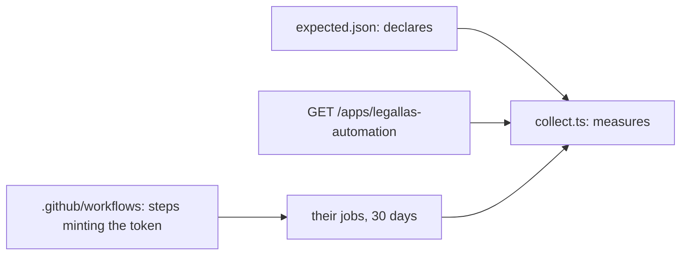

# GitHub App: plan

The org's GitHub App, Legallas Automation (`legallas-automation`): private, no webhook, its key in the `board-card` and
`settings` environments (main only), its client id in `vars.CS_APP_CLIENT_ID`. First used by `board-card.yml` (#393).

## Sources

| Source | Gives | Read |
|---|---|---|
| [Best practices for creating a GitHub App](https://docs.github.com/en/apps/creating-github-apps/about-creating-github-apps/best-practices-for-creating-a-github-app) | Select the minimum permissions; until the owner accepts new ones, the installation keeps the old | 2026-11-05 |
| [Choosing permissions for a GitHub App](https://docs.github.com/en/apps/creating-github-apps/registering-a-github-app/choosing-permissions-for-a-github-app) | None by default; select the minimum | 2026-11-05 |
| [Actions runner pricing](https://docs.github.com/en/billing/reference/actions-runner-pricing) | Each job bills rounded up to the whole minute | 2026-11-05 |
| [Martin Fowler: Continuous Integration](https://martinfowler.com/articles/continuousIntegration.html) | Keep the build fast | 2024-01-18 |
| `github/rest-api-description`, `GET /apps/{app_slug}`; `github/docs` token tables | The App's `permissions`; an installation token may call it, with no permission | 2026-11-05 |
| `actions/create-github-app-token` at `64ab729` (v3.3.0) | Outputs the token, installation id and slug only | 2026-11-05 |

GitHub Docs pages show no date, so each is dated the day read, from their source in `github/docs`.

## Goals

| Metric | Lens | Goal | Floor | Weight | `min_samples` | Why |
|---|---|---|---|---|---|---|
| `app_permissions_off` | quality | 0 | 5 | 1 | 5 | Each permission extra, missing or at another level than `expected.json`'s 10. An extra write widens what a leaked key can do, so a gate |
| `app_token_runs_passing` | quality | 100% | 50% | 1 | 1 | Jobs that ran a token step, every attempt, 30 days. A failed one is a card or setting not made. A census, so 1 |
| `app_token_job_seconds_p50` | speed | 60 s | 300 s | 1 | 1 | GitHub bills a job up to the whole minute; 300 s is `board-card.yml`'s timeout |
| `lane_minutes` | consumption | 5 | 10 | 1 | 1 | This lane's own job minutes |

All age limits are 48 hours: a daily lane. Answered means success, failure or timed out; a skipped or cancelled job answered nothing.

## Not measured

| | Why |
|---|---|
| API calls per App run | Neither the logs nor the token step report them: `gh api` calls aren't logged, and the action outputs no count |
| The installation's own permissions | `GET /app/installations/{id}` needs a JWT signed with the App's key. The App's listed permissions are next best: one not yet accepted is listed but fails the token mint, which `app_token_runs_passing` catches |
| Consumption beyond `lane_minutes` (#645, 2026-11-05) | The App's own cost is its API calls and its token jobs' minutes. The calls can't be read (first row; the App's rate limit needs its token, the owner-merged change below). The jobs' minutes already move with `app_token_job_seconds_p50`, and a second metric on the same jobs would count them twice. So `lane_minutes` stays alone |

## Charts

| Metric | Chart |
|---|---|
| Each | Stat tile |
| Fixes | Road to 100, core `fixGain` |
| Expected | Table: permission, level |

## The App token

The lane holds no secret. `GET /apps/{slug}` needs no permission, but a private App may be hidden from the lane's own token: then
`app_permissions_off` reads missing until an owner-merged change gives this collector `QS_APP_TOKEN`. Not in this pull request: a
page never edits the workflow (`contract/README.md`), and a workflow gaining a secret is Blocking (`REVIEW.md`, 6).

| That change | Rule |
|---|---|
| `environment: settings`, `if: github.ref == 'refs/heads/main'` | Only main reaches `CS_APP_PRIVATE_KEY` |
| `ubuntu-latest`, with the lane's read scopes and no more | A secret's job is GitHub-hosted (`CLAUDE.md`) |
| `actions/create-github-app-token@64ab729a6294000f5aa4a4bc0b73d1f32bc45510 # v3.3.0`, `client-id: ${{ vars.CS_APP_CLIENT_ID }}`, `permission-metadata: read` | Reads only; revoked when the job ends |
| Its `token` output as `QS_APP_TOKEN`, in the Collect step's `env` only | Never the key |

## Baseline

| Head | `app_permissions_off` | `app_token_runs_passing` | `app_token_job_seconds_p50` | `lane_minutes` | Total |
|---|---|---|---|---|---|
| `main` at a81e8d8 | missing | missing: no workflow mints the token yet | missing | missing | 0 |

## Fixes

| Fix | Metric | Action |
|---|---|---|
| Exact permissions | `app_permissions_off` | The owner change above, then match the App to `expected.json` |
| Every run passes | `app_token_runs_passing` | #393 merged, and a failed run's cause fixed |
| Job in a minute | `app_token_job_seconds_p50` | Fewer calls in the slow step |
| Lane in 5 min | `lane_minutes` | Already short: two reads plus one per run |
