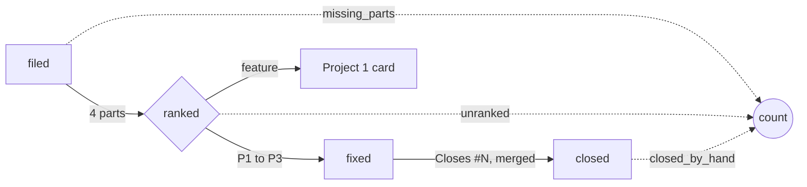
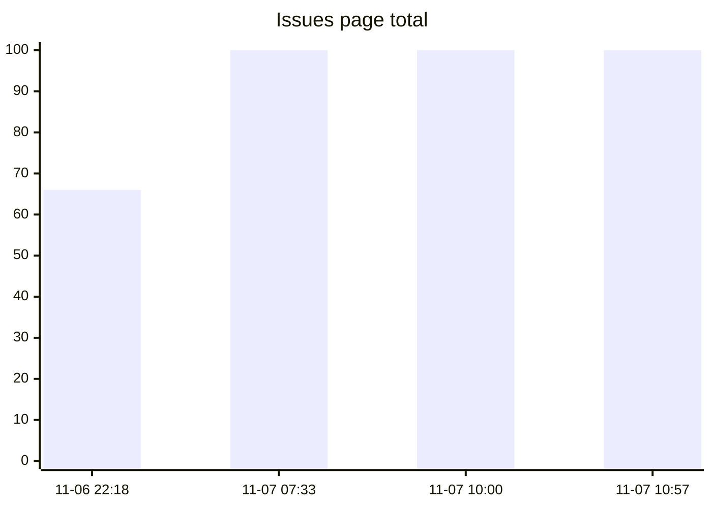

# Issues: plan

| | |
|---|---|
| Model | Git Crafter `quality/ideals/issues.json`, cut to 25 words in `ideal.json`. The board half is the Projects page's |
| Takes over | Draft #83: scope rules, template parser, REST collector, page |
| Lane | `lanes.json`: `linux`, daily, the job's read-only token: REST and GraphQL. Numbers only, never a title, body or label name |
| Rescoped | The owner, 2026-11-09: one page, four sections. Issues are "the quick fixes, errors, bugs" |

| Section | Quality | Speed | Consumption |
|---|---|---|---|
| Issues | `missing_parts`, `unranked`, `untyped`, `closed_by_hand`, `reopened` | `stale`, `overdue` | `lane_minutes` |
| Labels | `unused_labels` (one P: `unranked`; one type: `untyped`) | | |
| Milestones | One, "Public launch" | `launch_open` | |
| Views | Gap: no metric (below) | | |

| Gap | Why |
|---|---|
| Views: P1 bugs, Needs a P, Stale, shared and pinned | Repository saved views are a UI-only public preview ([changelog, 2026-06-25](https://github.blog/changelog/2026-06-25-saved-views-for-repository-issues-and-adjustable-row-heights-in-projects)): no API creates or reads them, so no reading (BRIEF rule 1). Made by hand with triage access |
| "Every bug found is filed" | A bug never filed leaves no record to count. `missing_parts` and `unranked` read the filed ones |
| Days left to launch | "Public launch" has no due date. Set one and `launch_open` can read against it |
| Scope | Issues, not pull requests. Left out, numbers listed in `rows.json`: label `area:quality-speed`, or every placed path in `quality-speed/` or `.github/workflows/quality-speed*.yml` |

## Sources

Read 2026-11-04 from `github/docs` (docs.github.com isn't reachable here). No date shown: dated the day read.

| Source | Gives |
|---|---|
| [Linking a pull request to an issue](https://docs.github.com/en/issues/tracking-your-work-with-issues/using-issues/linking-a-pull-request-to-an-issue) | "When you merge a linked pull request into the default branch of a repository, its linked issue is automatically closed" |
| [Syntax for issue forms](https://docs.github.com/en/communities/using-templates-to-encourage-useful-issues-and-pull-requests/syntax-for-issue-forms) | Required fields. This repo's forms require all four parts |
| [actions/stale](https://github.com/actions/stale) | `days-before-stale`: 60 |
| [Kubernetes issue triage](https://github.com/kubernetes/community/blob/master/contributors/guide/issue-triage.md) (read 2026-11-06, `gh api`) | "If an issue lacks a `priority` label, this means it has not been reviewed and prioritized yet" |
| [Rate limits for the REST API](https://docs.github.com/en/rest/using-the-rest-api/rate-limits-for-the-rest-api) | `GITHUB_TOKEN`: 1,000 an hour a repository (15,000 on Enterprise Cloud) |

## Metrics

| Id | Lens | Measured | Floor | Goal | Weight | n | `goal_source` |
|---|---|---|---|---|---|---|---|
| `missing_parts` | Q | Open issues without real text under Goal, Who it's for, Where to work, Done when (or the forms' headings) | 10 | 0 | 2 | 1 | Issue forms: the forms require all four |
| `closed_by_hand` | Q | Completed closes since `closes_since` (2026-11-07 UTC) whose last `closed` event names no commit. `main` takes no direct pushes | 5 | 0 | 3 | 1 | Linking a pull request |
| `unranked` | Q | Open issues without exactly one of `P1`, `P2`, `P3` | 10 | 0 | 1 | 1 | Kubernetes issue triage |
| `reopened` | Q | Open issues with a reopened event: a fix that didn't hold. Closed again by a merged PR, it drops | 5 | 0 | 1 | 1 | Linking a pull request |
| `untyped` | Q | Open issues with no issue type (Bug, Task, Feature) | 10 | 0 | 1 | 1 | [Managing issue types](https://docs.github.com/en/issues/tracking-your-work-with-issues/using-issues/managing-issue-types-in-an-organization) |
| `unused_labels` | Q | Labels on no issue or pull request, open or closed | 5 | 0 | 1 | 1 | [Managing labels](https://docs.github.com/en/issues/using-labels-and-milestones-to-track-work/managing-labels) |
| `stale` | S | Open issues idle 60 days | 5 | 0 | 1 | 1 | actions/stale |
| `overdue` | S | Open issues older than their rank's close target: P1 30 days, P2 60, P3 90; no rank, P1's | 5 | 0 | 1 | 1 | [GitLab Issue Triage](https://handbook.gitlab.com/handbook/product-development/how-we-work/issue-triage/), bug resolution SLOs for severity 1 to 3 (read 2026-11-09) |
| `launch_open` | S | Open issues in "Public launch". No such milestone: missing | 10 | 0 | 1 | 1 | [About milestones](https://docs.github.com/en/issues/using-labels-and-milestones-to-track-work/about-milestones) |
| `lane_minutes` | C | This lane's job minutes (`core/lane`), the only Consumption metric: see `api_calls` under Dropped | 10 | 5 | 1 | 1 | Fowler, Continuous Integration |

| Rule | |
|---|---|
| Counts, not windows | Each metric is a count a fix takes off at once (#846): rewrite the body, add a rank, reopen and close by a merged PR. n: every issue in scope |
| `closes_since` | A fixed start, the day the `pull-request` skill began writing `Closes #N`. Never a trailing window |
| Unread closer | Any close since then unread: `closed_by_hand` missing |
| A PR's close names the PR | GraphQL `ClosedEvent.closer`, 50 issues a call. REST `commit_id` is null after a merge-queue merge: issue 884, closer #886 (checked 2026-11-07) |
| Severity | The Reliability page's line; none counts as high |
| Errors, no run | Every record `missing`, no `detail.json` |
| Blind spot | A not-planned close never counts against `closed_by_hand` |

| Dropped | Why |
|---|---|
| `template_complete`, `closed_by_pr` (2026-11-06, #846) | 20-item windows: a fix moved them only as new items replaced old. Now `missing_parts`, `closed_by_hand` |
| `area_labelled` | No public source for 100 % |
| `close_hours_p50` | No public source for 24 h |
| `triaged`, `close_p50`, `flow_30d`, `age_p90` (#83) | In-repo rule; calendar windows |
| `api_calls` (2026-11-05, #645) | Nothing worth acting on. 26 calls on 2026-11-05 (run 42067834620, a 30 s job): 0.2 % of the job token's 15,000 an hour on an Enterprise Cloud organization (Rate limits). Issue events start the Claude workflow, which is off: of 200 `issues` and 1,368 `issue_comment` runs, none succeeded or failed (4 cancelled, the rest skipped). Runner time per fix is the Actions page's billed minutes per merge |

## Charts

| Metric | Chart |
|---|---|
| `missing_parts`, `unranked` | Pictogram of open issues and bullet |
| Open issues by rank and severity | Table from `detail.json` |
| `untyped`, `closed_by_hand`, `reopened` | Bullet |
| `stale`, `overdue`, `launch_open`, `unused_labels` | Stat tile |
| All | Road to 100; table with run link |
| The issue flow | Process page, `issue` map |

## Baseline

| Read | `template_complete` | `closed_by_pr` | `stale` | Q | S | C | Total |
|---|---|---|---|---|---|---|---|
| 2026-11-04 22:30, REST dump, no run (99 open in scope) | 4 of 20 (20 %) | | 0 | | | | |
| 2026-11-06 22:18, [run 42299384004](https://github.com/Colorado-Startups/legallas/actions/runs/42299384004) | 0 of 20 | 0 of 20 | 0 | 0 | 100 | 100 | 66 |

## Final

| Read | `missing_parts` | `closed_by_hand` | `unranked` | `stale` | `lane_minutes` | Q | S | C | Total |
|---|---|---|---|---|---|---|---|---|---|
| 2026-11-07 10:57, [run 42363807228](https://github.com/Colorado-Startups/legallas/actions/runs/42363807228) on `main` 5432bc20, 199 issues in scope | 0 | 0 | 0 | 0 | 1 | 100 | 100 | 100 | 100 |

| How it got there | |
|---|---|
| Q 0 to 100 | #846: window metrics out, counts in. Every open issue rewritten with four parts and one P label. Fixed issues closed by their PRs |
| Source | The run's `quality-speed-history` artifact: `history.jsonl` rows (each `at` is the `site` job's start), `records/issues.json` |
| 07:33, 10:00 | Read 100, not published: the site guard stopped them (#895, #897) |

## Rescope, 2026-11-09

| Repo change | Before | After | Reverse by |
|---|---|---|---|
| Milestone "Public launch" (#1), no due date | None | Open, 3 closed issues | Delete the milestone |
| #31, #32, #233 | Label `before launch` | Milestone "Public launch" | Recreate the label, add it back |
| 7 labels deleted, each on 0 issues and 0 PRs (GraphQL counts and `gh search issues --include-prs`) | `duplicate`, `good first issue`, `help wanted`, `invalid`, `question`, `wontfix`, `accessibility` | Gone | `gh label create <name>` |
| Label `before launch` deleted | 3 closed issues | Gone | As above |
| Issue types | #785, #935: none | #785 Bug, #935 Task | Clear the type |

| Read by hand, 2026-11-09, no run | `untyped` | `reopened` | `unused_labels` | `overdue` | `launch_open` |
|---|---|---|---|---|---|
| 2 open issues in scope | 0 | 0 | 0 | 0 | 0 |
