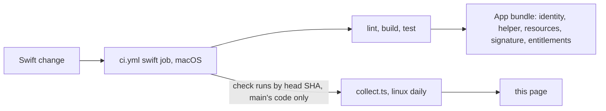

# Mac app: plan

Slug `mac-app`. Owned by `qsc-product`. Only this folder.

## Sources

Each read in full on 2026-11-04.

| Source | Where read | Date | What it settles |
|---|---|---|---|
| [DevOps Research and Assessment: Continuous integration](https://dora.dev/capabilities/continuous-integration/) | `dora-team/dora.dev`, `hugo/content/capabilities/continuous-integration/index.md` | 2023-03-27 | Measure "the percentage of automated builds and ... tests that are executed successfully"; tests take "an upper limit of about 10 minutes" |
| [Apple: App Sandbox](https://developer.apple.com/documentation/security/app-sandbox) | developer.apple.com doc JSON | undated, `goal_source` only | "To distribute a macOS app through the Mac App Store, you must enable the App Sandbox capability" |
| [GitHub Docs: GitHub Actions billing](https://docs.github.com/en/billing/concepts/product-billing/github-actions) | `github/docs`, `content/billing/concepts/product-billing/github-actions.md` | undated | macOS runners cost more per minute than Linux: the consumption plan |
| `.github/workflows/ci.yml`, `LegallasApp/Scripts/verify-app.sh` | this repo | | The `swift` job lints, builds, tests and bundles the app; its `App bundle` step checks identity, helper, resources, signature and entitlements |

## Ideal state

`ideal.json`: every Mac app change on main builds, passes its tests and makes a sandboxed app that passes its bundle check, within
ten minutes. The bundle is signed ad hoc in CI, so the check proves a signature that verifies, not a Developer ID.

## Metrics

| Rule | |
|---|---|
| Source | CI's `swift` job, read on Linux: 0 macOS minutes |
| Main's code | Walk 700 main commits newest first; per commit, its own SHA and the merged pull request head that became it |
| Lookup | `commits/{sha}/check-runs?check_name=swift`, then `actions/jobs/{id}`: kept only if `workflow_name` is `CI` and `head_sha` is that SHA |
| Time, link | The read, and this lane's run. A skipped job means main's Swift code is unchanged, so its last answer holds |
| Missing | No job found, a failed read, or no run link |

| Id | Lens | Measures | Unit | Floor, goal | Weight | Samples | `goal_source` |
|---|---|---|---|---|---|---|---|
| `swift_jobs_passing` | Q | Last 20 answered jobs (success, failure, timed out) that passed | percent | 50, 100 | 2 | 7 | Continuous integration |
| `app_bundle_verified` | Q | Newest job that ran `App bundle`: the app built and `verify-app.sh` passed | pass | 0, 1 | 1 | 1 | App Sandbox |
| `swift_job_minutes_p50` | S | Median minutes of the same jobs, pass or fail | minutes | 30, 10 | 1 | 7 | Continuous integration |

| Number | Derivation |
|---|---|
| Goal 100 | Repo-set from Continuous integration: "the team stops what they are doing to fix the problem immediately"; "the software is always in a working state" |
| Goal 10 | Stated: "an upper limit of about 10 minutes" |
| Goal 1 | App Sandbox: a Mac App Store app "must enable the App Sandbox capability"; `verify-app.sh` checks the signed entitlements |
| Floor 50, 30 | Repo-set: 30 is the job's `timeout-minutes`; 50 is one job in two failing |
| Samples 7 | Today's count (2026-11-04): 4 merged heads (#1, #47, #133, #284), 3 runs on main commits |

| Today, 2026-11-04 | Value | Samples |
|---|---|---|
| `swift_jobs_passing` | 100 | 7 |
| `app_bundle_verified` | 1 | 1 |
| `swift_job_minutes_p50` | 2.7 | 7 |

## Chart per metric

| Metric | Chart |
|---|---|
| `swift_jobs_passing`, `app_bundle_verified` | Tiles |
| `swift_job_minutes_p50` | Bullet against 10 |
| All | Road to 100: each fix's gain, no cap |

## Lanes

`daily`, `linux`: reads commits, pull requests, check runs and jobs with the job's read-only token. No `macos` lane: the swift job already runs there, and macOS minutes cost about ten times Linux minutes.

## Consumption

| Metric considered (#645, 2026-11-05) | Why `lane_minutes` stays alone |
|---|---|
| `swift_job_usd_p50`, the app bundle's bytes | A swift job's macOS minutes are this app's real cost, but per job `swift_job_usd_p50` is `swift_job_minutes_p50` times a fixed rate: the same minutes scored twice. How often the job runs needs every pull request commit's check runs, many reads a day. The bundle's bytes need the swift job to write its size, a workflow change no page makes (card below) |

## Baseline, fixes, final

To take once the list is signed off and the lane has run. Fixes in order: App bundle, Swift green, under 10 minutes.

## Board cards to file

- Launch time and memory at launch, from Apple's "Reducing your app's launch time", once a test measures them on macOS.
- The app bundle's bytes, once the swift job writes its size.
