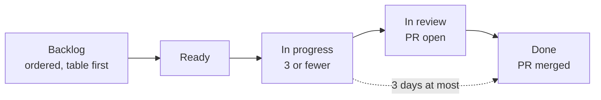

# Projects: plan

Rebuilt in Git Crafter's model (2026-11-04) from the board half of Git Crafter's `issues` ideal and its `projects.*` targets. It takes over draft pull request 97, whose session has stopped. That draft predates `core/` and the lane format: its own charts and scoring, a `lane.json` holding a stored secret, and a first metric on the pinned backlog issue, which closed on 2026-11-02. So this page starts again, small, on the chart kit and the admin lane. The draft's board model (Status column, linked pull requests, draft cards) carries over.

Reworked 2026-11-06 (#846) for the five-stage board: Backlog, Ready, In progress (limit 3), In review (pull request open), Done (pull request merged).

Rescoped 2026-11-09 by the owner to the whole Projects tab: the board plus its views, workflows, insights and status updates. Group: Claude.

| Section | Metrics | State |
|---|---|---|
| Board | `in_progress`, `cards_ready`, `done_with_pr`, `oldest_active_hours` | Kept |
| Views (Board, Backlog, Done) | `views_correct` | Added |
| Workflows (the 7 built-ins) | `status_matches_state` | Added |
| Insights | `charts_current` | Waiting: no API reads a saved chart |
| Status updates | `status_update_age_hours` | Waiting: nothing posts one yet |
| Labels, milestones | | The Issues page: repo-wide |

## Ideal state

`ideal.json`: one ordered board, every card ready, at most 3 in progress, none stale; views, workflows and charts keep it true with no hand edits.

## Sources

| Source | Read | What it gives this page |
|---|---|---|
| [GitHub Docs: Best practices for Projects](https://docs.github.com/en/issues/planning-and-tracking-with-projects/learning-about-projects/best-practices-for-projects) | 2026-11-06 | "Adding a column limit to a board column to maintain focus"; fields for order and grouping; break large issues into small ones |
| [GitHub Docs: Linking a pull request to an issue](https://docs.github.com/en/issues/tracking-your-work-with-issues/using-issues/linking-a-pull-request-to-an-issue) | 2026-11-06 | A merged linked pull request closes its issue |
| [GitHub Docs: Customizing a view](https://docs.github.com/en/issues/planning-and-tracking-with-projects/customizing-views-in-your-project/customizing-a-view) | 2026-11-09 | A view saves its layout, filter, sort, grouping and fields |
| [GitHub Docs: Using the built-in automations](https://docs.github.com/en/issues/planning-and-tracking-with-projects/automating-your-project/using-the-built-in-automations) | 2026-11-09 | Workflows set Status when an item is closed or a pull request merged |
| [The Kanban Guide (May 2025)](https://kanbanguides.org/the-kanban-guide/2025.5/) | dated 2025-05-01 | Work Item Age: time from a work item's start to now; "ensuring work items do not age unnecessarily" |

GitHub Docs show no date, so each is dated the day read.

## Metrics

| Id | Lens | Measured as | Floor | Goal | Weight | Min samples | `goal_source` |
|---|---|---|---|---|---|---|---|
| `in_progress` | Q | Cards in In progress or In review. Sample: every card with a Status | 15 | 3 | 1 | 1 | Best practices for Projects: a column limit |
| `done_with_pr` | Q | % of Done cards with a merged pull request: the card is one, one closes its issue, or its `PR` number field is set | 50 | 100 | 2 | 5 | Linking a pull request to an issue |
| `cards_ready` | Q | % of open cards (not Done) with Order set, Stage or Codebase set, a body opening with a table or mermaid block, and 30 words or fewer outside tables, code, `
` and comments | 50 | 100 | 1 | 5 | Best practices for Projects: fields, small issues |
| `oldest_active_hours` | S | Hours since the oldest In progress or In review card's Status last changed. None started: 0 | 336 | 72 | 1 | 1 | Kanban Guide: Work Item Age |
| `views_correct` | Q | % of the three views (`VIEW_SPECS`, `board.ts`) whose layout, filter, sort and grouping match and that show every spec field | 0 | 100 | 1 | 3 | Customizing a view |
| `status_matches_state` | Q | % of issue and pull request cards whose Status agrees with their state: Done when closed or merged, not Done while open. Drafts left out | 50 | 100 | 1 | 5 | Using the built-in automations |
| `lane_minutes` | C | This lane's job minutes (`core/lane`), the only Consumption metric | 30 | 5 | 1 | 1 | Fowler, Continuous Integration |

| Rule | How |
|---|---|
| The board comes from the admin job | The built-in token can't read an organization's project. The admin job saves `gh api graphql --paginate --include` with `BOARD_QUERY` (`board.ts`) as `admin-read/projects-board.txt`; this lane reads it and calls nothing |
| Card text stays on the runner | `board.ts` keeps only flags and word counts per card; no title or body reaches a record, detail file or page |
| Only a whole, fresh board counts | A refused answer, one over 30 hours old, a second page of cards, GraphQL errors or a malformed card: every metric missing |
| Renamed columns aren't an empty board | With no card in any of the five stages (matched case-insensitively), every metric is missing. A card with no Status is left out of the sample |
| A renamed field reads "not set" | A missing Order, Stage, Codebase or `PR` field lowers `cards_ready` or `done_with_pr`: never good news |
| Views come from the same read | `BOARD_QUERY` asks for the project's views after its items, with no `pageInfo`, so `gh --paginate` still follows the items. `views()` reads the first page, and only when that read proves the whole board; a `totalCount` above the nodes read is missing |
| A view's spec is the set-up of #846 | Board: board layout, columns by Status, sorted by Order. Backlog: table, `status:Backlog,Ready`, grouped by Status, sorted by Order. Done: table, `status:Done`. Each shows Title, Stage, Order, Codebase, PR (and Status in the tables). An extra field passes |
| Status needs a state | An issue or pull request card without `OPEN`, `CLOSED` or `MERGED` makes the whole board missing |
| The stage strip is counts only | `collect.ts` writes each stage's card count and how many pass each check to `detail.json` (`stageDetail`); the page draws it |
| Only a run proves a reading | Outside a workflow run, every record is missing |

| Goal | Stated reason |
|---|---|
| 72 h, oldest started | A card is a few small pull requests (Best practices: break issues down). Each merges within a day (the Pull requests page's goal is 1 hour median, 4 hours p90), so three days covers three in a row |
| 3, in progress | The board's own column limit. Little's law: cards in progress = cards done a day x days each takes; at about one a day and the 3-day age above, 3 holds |
| 15, in progress floor | Five times the goal |
| 30 words, cards ready | The repo's rule: tables, numbers and charts, not prose. A card's table carries goal, customer, files and done when |

| Dropped | When | Why |
|---|---|---|
| `cycle_hours_p90` | 2026-11-06, #846 | A 28-day window over Done cards: a fix moved it weeks later. `oldest_active_hours` moves the day a stuck card ships |
| `backlog_agreement` | draft 97 | The pinned backlog issue it compared against closed on 2026-11-02 |
| `fields_filled`, `targets_current`, `targets_met`, `throughput_per_week`, `wip_age_max_days`, `cycle_time_p85_days` | draft 97 | No public goal or stated reason |
| `charts_current` | 2026-11-09, not added | Insights charts have no API: GraphQL's `ProjectV2` exposes views, workflows and status updates, never a saved chart. A pass that can't be read would score 0, not measure. Add it when GitHub exposes charts |
| `status_update_age_hours` | 2026-11-09, not added | Readable (`ProjectV2.statusUpdates`), but none exists (0 on 2026-11-09) and the daily run can't post one: posting needs `organization-projects: write`, an owner-merged workflow change. Add it with that job, goal 26 hours |
| `api_calls` | 2026-11-05, #645 | This lane calls nothing; the admin job reads the board in one paginated query on the GitHub App's token |

## Lane

`lanes.json`: one lane, `board`, `linux-hosted`, daily, `admin: true` (`core/lanes.ts`, `ADMIN_PAGES`). No secret, no write.

## Chart per metric

| Metric | Chart |
|---|---|
| Stages | Dot matrix: a row per stage with its count, a column per check (order, stage or codebase, table first, 30 words, 3 days, merged PR) |
| `in_progress` | Meter against the floor, amber past the goal |
| `oldest_active_hours`, `cards_ready`, `done_with_pr` | Bullets |
| `views_correct`, `status_matches_state` | Bullets, "Upkeep" |
| All | Road to 100; a sortable table with the run link |

## Baseline

| Read | Q | S | C | Total |
|---|---|---|---|---|
| Last build before the rescope, 2026-11-08 | 100 | 100 | 100 | 100 |

Read by hand on 2026-11-09 with the new query's fields: 3 views, all match (`views_correct` 100); 25 issue cards, all agree (`status_matches_state` 100). The first admin read after this change sets the baseline.

## Final

Not reached.
