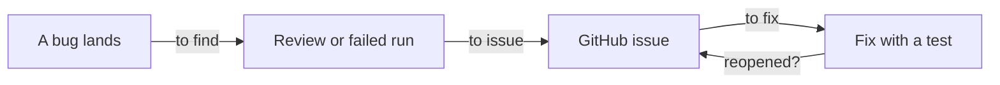

# Reliability: plan

**Ideal state:** customers never hit a bug, because reviews find bugs first, every bug and error goes into a GitHub issue, and each one gets fixed fast and stays fixed.

## Sources

Read 2026-11-02.

| Source | What it gives this page |
|---|---|
| [Testing for reliability, Google SRE book](https://sre.google/sre-book/testing-reliability/) | A regression test is a record of a past bug. Finding a bug before it reaches users raises the time between failures |
| [Postmortem culture, Google SRE book](https://sre.google/sre-book/postmortem-culture/) | Write each failure down with its follow-up actions, and track them to closed |
| [2024 Accelerate State of DevOps report, DevOps Research and Assessment](https://dora.dev/research/2024/dora-report/) | Time to recover: high, less than a day; low, 1 week to 1 month |
| [Quality processes, GitLab Environments group](https://handbook.gitlab.com/handbook/engineering/devops/runner/environments/) | A team reviews its triage report for bugs and regressions every week |
| [Continuous Integration, Fowler](https://martinfowler.com/articles/continuousIntegration.html) | A broken mainline is the top priority, ahead of any other task |
| [Linking a pull request to an issue, GitHub](https://docs.github.com/en/issues/tracking-your-work-with-issues/using-issues/linking-a-pull-request-to-an-issue) | A closing keyword links the fix to its bug, which is what a fix is read from here |
| [NIST SP 800-53 Rev. 5, SI-4(9)](https://csrc.nist.gov/pubs/sp/800/53/r5/upd1/final) | Test monitoring tools at a set frequency: the goal of `detection_drill` passing on every collection |

## Metrics

| Metric | Lens | Floor | Goal | Weight | Source | Chart |
|---|---|---|---|---:|---|---|
| `open_bugs_critical_high` | Quality | 10 | 0 | 5 | Bug issues, `Severity:` line. None counts as high. Closed with no merged pull request, closed as not planned, marked a duplicate of no other bug, or stripped of `bug`: still open for 90 days | Bullet |
| `bugs_found_first` | Quality | 0% | 100% | 3 | Real bugs filed in 90 days that link a failed run, or that a `reviews.json` row dated within a day names | Bullet |
| `reopened_bugs_90d` | Quality | 5 | 0 | 3 | Reopened events on bug issues | Bullet |
| `failed_main_runs_with_issue` | Quality | 0% | 100% | 3 | Failed, timed-out and never-started runs on `main`, 90 days, linked in a bug's body | Bullet |
| `risky_areas_reviewed_in_time` | Quality | 0% | 100% | 3 | `reviews.json` against the seven areas and 14-day limit in `measure.ts`. A row dated after now reads missing | Bullet, matrix |
| `fixes_with_test` | Quality | 0% | 100% | 2 | Bugs closed as done in 90 days whose merged closing pull request changed a test | Bullet |
| `detection_drill` | Quality | 0 | 1 | 1 | `measure` on invented events, the canary issue #28 read back whole while it carries `bug`, and the runs list answering | Bullet |
| `time_to_find_p90` | Speed | 90 d | 14 d | 1 | `Landed:` commit to issue. None, unknown or after filing: 90 days | Bullet |
| `time_to_fix_high_p90` | Speed | 168 h | 24 h | 3 | Critical and high, each open one at its age so far | Bullet |
| `time_to_fix_other_p90` | Speed | 30 d | 7 d | 1 | Medium and low, the same way | Bullet |
| `error_to_issue_p90` | Speed | 72 h | 24 h | 2 | Failed run to the first issue created after it that names it. Unnamed: its age so far | Bullet |
| `failed_main_run_minutes_90d` | Consumption | 100 min | 0 min | 1 | Runner minutes of the failed runs on `main` in 90 days: each job of every attempt, rounded up to a whole minute as GitHub bills it. Every runner's minute counts once, so a macOS minute isn't weighted 10x as its price is. None failed: no events, proved by the drill | Bullet |

| Why these goals | Source |
|---|---|
| 0 critical or high, 0 reopened, 100% filed, 100% tested | The owner: "it's the idea that there's no bugs", and the SRE book on regression tests and tracked follow-ups |
| 14 d to find, and to review an area | GitLab's group reviews bugs and regressions weekly. 14 days survives one missed week |
| 24 h for high | The 2024 State of DevOps clusters: high performers recover in less than a day |
| 7 d for other | The same clusters: a week is where the low group starts |
| 24 h to an issue | Fowler: a broken mainline comes before any other task, so a day to write it down is generous |
| 0 minutes lost to failures | Fowler: an effective team rarely sees a red mainline. The floor, 100 minutes, is ten ten-minute builds in 90 days |

`detection_drill` runs on every collection. A renamed label, a broken query or a renamed branch fails it, and then nothing can read "no events" at 100.

Cut: `confirmed_bugs_last_review`, as independent review found a shallow review scored highest. Bugs that escaped to customers (no customer is measured). Change failure rate (Insights). Coverage and mutation (Testing). Vulnerabilities (Security). CI health (Actions). How clear, labelled and stale issues are (Issues). The page links to those pages.

## How a bug is written

The bug form prefills the first two.

| Line in the issue body | Means |
|---|---|
| `Severity: critical`, `high`, `medium` or `low` | Which clock and count it joins |
| `Landed: <sha>` | When the bug arrived, for time to find |
| A link to `/actions/runs/<id>` | The failed run it answers |

Only these lines are read, and nothing from a body reaches the site. Only the canary is left out of the bugs, by number, so no label is a way out. This site's workflows and the replica eval are left out of failed runs.

## Recurring reviews

| | |
|---|---|
| What | One independent review of the seven risky areas, with the prompt below |
| When | Weekly |
| Where | A Claude Code cloud routine, on a cloud lane, never on the owner's Mac. It holds no Claude credential in a workflow, so `REVIEW.md` rule 8 stays untouched |
| Output | One issue per confirmed bug, and one pull request adding a row to `reviews.json` |
| Fails safe | A week with no review ages the areas, and past 14 days the score falls |

> Review `web/` for bugs in who can see what, citations, sync and save-back, migrations, the SSN guard, the spend guard and the connector contract. Use the fictional fixture only, and never read a customer's room, `web/mcp/audit.ts`, `web/scripts/coverage.ts`, `proposal_events` or the replica eval. Reproduce each finding. Check open and closed issues. A returning bug reopens its issue. Correct any severity set too low. File each new confirmed bug as one issue labelled `bug`, with `Severity:` and `Landed:` lines, steps to reproduce and when it's done. Then add this review to `quality-speed/pages/reliability/reviews.json` in a pull request.

## First review, 2026-11-02

| Area | Result |
|---|---|
| Who can see what | #175, #176 |
| SSN guard | #172, #173, #174, and #267, from the independent review of #182: the rule stops at sync |
| Sync | #177, #178. Save-back is still in draft (#112) |
| Citations | None. 21 cite forms tried on invented passages |
| Spend guard | None. Read the holds, settles and limits on both sides |
| Migrations | None. 0012 to 0015 are additive, and all apply on real SQLite |
| Connector contract | None by reading. Its tool tests need packages this lane lacks, so this repeats on a cloud lane |

Not features, so not issues. For the board:

| Improvement |
|---|
| A guest sees a member's reply to their thread |
| Sync lists each iWork bundle it cannot send, instead of stopping the run |

## Baseline

2026-11-02 07:17 UTC, one real collection over 92 bug issues, with #172 to #176 already fixed. The list was signed off after this.

| Quality | Speed | Consumption | Total |
|---:|---:|---:|---:|
| 46 | 57 | 0, no consumption metric yet | 34 |

| Metric | Reading | Score |
|---|---:|---:|
| `open_bugs_critical_high` | 7 | 30 |
| `bugs_found_first` | 8.7% | 9 |
| `reopened_bugs_90d` | 0 | 100 |
| `failed_main_runs_with_issue` | No events, no proof | 0 |
| `risky_areas_reviewed_in_time` | 100% | 100 |
| `fixes_with_test` | 80% | 80 |
| `detection_drill` | 0 | 0 |
| `time_to_find_p90` | 90 d | 0 |
| `time_to_fix_high_p90` | 1.1 h | 100 |
| `time_to_fix_other_p90` | 0.03 d | 100 |
| `error_to_issue_p90` | No events, no proof | 0 |

## Now

2026-11-17, run 44016097386 in the public repository: Q 35, S 76, C 97, total 69.

| Gap | Reading | Cause | Fix | Where |
|---|---:|---|---|---|
| `detection_drill` | 0 | Canary #273 was in the private repository | Canary #28 here, closed by this page's pull request | this PR |
| `open_bugs_critical_high` | 2 | #8 had no `Severity:` line; #10's line had text after `medium` | Severity lines fixed | #8, #10 |
| `failed_main_runs_with_issue`, `error_to_issue_p90` | 0%, 34 h | 2 failed runs on main named by no issue | Filed | #29, #30 |
| `bugs_found_first` | 0% | No bug filed from a review or failed run | #29, #30 link their runs | |
| `risky_areas_reviewed_in_time` | 0% | Last review 2026-11-02, limit 14 days | A review of the 7 areas | next review |
| `time_to_find_p90` | 90 d | No bug has a `Landed:` sha | Whoever files or fixes | each bug |
| `fixes_with_test` | no events | No bug fixed yet in this repository | Fixes with a test | each fix |
| `failed_main_run_minutes_90d` | 3 | Failed runs on main | Ages out | 90 days |
