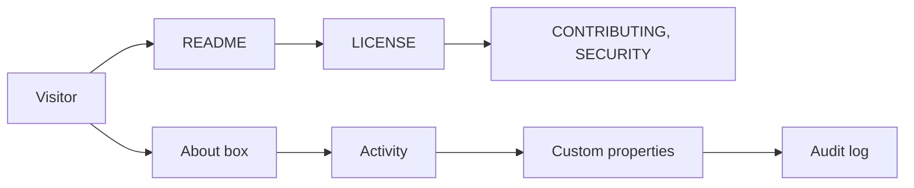

# Repo documentation: plan

Slug `repo-documentation`, formerly `documentation` (the owner, 9 Nov). Its history lines read under the new slug
(`contract/pages.ts` `RENAMED`). The list is `manifest.json`; `inputs.json` and `not-in-tree.json` are pinned in `inputs.lock.json`.

## Split, 9 Nov

| Metric | Went to |
|---|---|
| `public_symbols_documented`, `long_sentence_share`, `broken_internal_links`, `dead_names`, `doc_lag_hours_p90`, `lag_drill`, `reading_minutes_p90` | Code |
| `questions_true`, `start_tokens` | Claude documentation |
| `dead_external_links` | Stays, scoped to the front door's files |

The checks behind the moved metrics stay in `collect/` (`findings`, `symbols`, `readability`, `reach`, `lag`, `drill`, `questions`), with `questions.json` and their `inputs.json` fields: the Code page imports them.

## Sources

| Source | Gives |
|---|---|
| GitHub Docs: About READMEs, licensing a repository, community health files, topics, rulesets, custom properties | What GitHub shows a visitor, and each item's check |
| Google documentation guide, best practices | Short docs, kept current |
| Brysbaert (2019), Journal of Memory and Language | 238 words a minute |
| Berners-Lee (1998), Cool URIs don't change | Zero broken links |

## Metrics

| Item | Metric | Lens | Reads | Floor | Goal | Weight | Lane |
|---|---|---|---|---|---|---|---|
| README | `readme_visual_share` | Q | % of content lines in tables, fences or images, against paragraphs and list items | 30 % | 80 % | 2 | daily |
| README, CONTRIBUTING, SECURITY | `front_door_dead_names` | Q | Paths, scripts and names the files give that are not in the tree | 5 | 0 | 2 | daily |
| README, CONTRIBUTING, SECURITY | `front_door_broken_links` | Q | Relative links whose file or heading is gone | 5 | 0 | 2 | daily |
| README, CONTRIBUTING, SECURITY | `dead_external_links` | Q | Outside pages answering 404 or 410; this org's private pages left out | 3 | 0 | 1 | weekly |
| CONTRIBUTING, SECURITY | `community_files_ok` | Q | % present, at least 50 % visual, no dead name or link | 0 % | 100 % | 2 | daily |
| LICENSE | `license_detected` | Q | GitHub's licence API says Apache-2.0 | 0 | 1 | 1 | daily |
| About box | `about_box_set` | Q | % of description, topics, website set; the website must answer | 0 % | 100 % | 1 | daily |
| Activity | `main_via_pr` | Q | % of main's newest 100 commits tied to a pull request merged into main (one GraphQL call) | 90 % | 100 % | 2 | daily |
| Custom properties | `custom_properties_set` | Q | 1 when the repository carries a property value | 0 | 1 | 1 | daily |
| README | `readme_reading_minutes` | S | Words over 238 a minute | 10 | 2 | 1 | daily |
| README | `readme_tokens` | C | Characters over four | 4,000 | 1,000 | 2 | daily |
| Lane | `lane_minutes` | C | The daily lane's minutes | 10 | 5 | 1 | daily |

## Gaps

| Item | Why it has no metric |
|---|---|
| Audit log | The org audit log API needs an org owner's `read:audit_log` token. The lanes' `$GH_TOKEN` can't read it, and `admin` lanes are only for four pages. Shown as a missing cell, never a score |
| Custom properties, "match the Settings page" | The Settings page lists no properties yet, so only "set" is measured |
| About box, "true" | Only "set" and "the website answers" are measured |

### Goals

| Goal | Why |
|---|---|
| README 80 % visual | The owner, 9 Nov: "as visual as possible". Today's README reads 96 % |
| README in 2 minutes | `ideal.json`: a visitor finishes the front door in two minutes |
| README 1,000 tokens | An AI reader loads it whole; today 648 |
| Zero dead names, zero broken links | Each is a claim or link a visitor can't follow |
| 100 % through pull requests | `CLAUDE.md`: every change is a pull request; the ruleset requires one |

## Baseline, 9 Nov, local run on this branch

| | Q | S | C | Total |
|---|---|---|---|---|
| `documentation`, the old list (the card) | 43 | 49 | 48 | 46 |
| `repo-documentation`, projected | 80 | 100 | 100 | 93 |

| Short of 100 (2026-11-17) | Reading | Fix | State |
|---|---|---|---|
| `community_files_ok` | 50: SECURITY.md was prose | SECURITY.md in tables, 94.7 % visual | This pull request |
| `about_box_set` | 66.67: no website | Website set to the Pages site | Done in repo settings |
| `custom_properties_set` | 0 | An org property, `customer_data` = `none` | Needs a login with `admin:org` |
| `main_via_pr` | 80, 5 of 50 commits | More merges | History |
