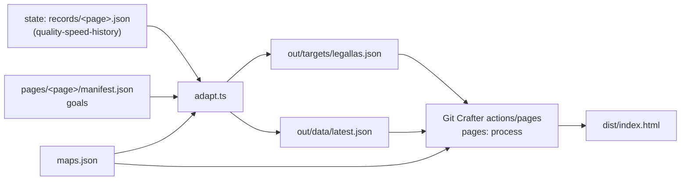

# Process page

Legallas's process maps, drawn by Git Crafter `actions/pages`, each step scored by a Legallas Quality and Speed metric.



| File | Is |
|---|---|
| `maps.json` | 16 maps (8 own, 8 from the Git Crafter library), 2 to 6 steps each, one metric a step |
| `adapt.ts` | Legallas records and goals to Git Crafter's run format |
| `quality.json` | The Quality config the action reads: `out/` |
| `config.json` | The Process page config |
| `process.json` | The Maps tab's ideal |

| Sources left out | Why |
|---|---|
| One host in Git Crafter's process sources | The clone's pre-push case-pattern scan matches its name; `process.json` lists the rest |
| `out/`, `dist/` | Generated, not committed |

| Map | Steps → metric (`legallas.<page>.<id>`, shown without the prefix) |
|---|---|
| `board` | card `projects.cards_ready` · start `projects.in_progress` · done `projects.done_with_pr` · watch `projects.oldest_active_hours` · split, finish dropped |
| `triage` | intake `issues.missing_parts` · issue `reliability.time_to_fix_high_p90` · card `projects.status_matches_state` · fix `reliability.fixes_with_test` · link `issues.closed_by_hand` |
| `contribute` | idea `issues.untyped` · approve `settings.settings_drift_count` · deploy `insights.change_failure_rate` · review, merge, rebuild dropped |
| `secure` | keys `security.secrets_in_history` · scan `security.scan_minutes` · dependency review `security.osv_vulnerabilities_open` · AI security audits `security.sast_findings_open` · model `reliability.risky_areas_reviewed_in_time` · alerts `security.time_to_fix_critical_high_hours` · report dropped (an own map: the library format adds no step, and a map holds 6) |
| `code` | measure `code.long_files` · simplify `code.long_functions` · delete `code.dead_code` · explain `code.public_symbols_documented` · check `code.web_loop_seconds` · hold `build.release_gzip_bytes` |
| `document` | write `repo-documentation.readme_visual_share` · lint `code.long_sentence_share` · map `code.doc_lag_hours_p90` · publish `code.broken_internal_links` · read `code.reading_minutes_p90` · load `repo-documentation.readme_tokens` |
| `measure` | collect `settings.read_gap_hours` · page `reliability.failed_main_runs_with_issue` · goal `issues.unranked` · fix `issues.closed_by_hand` · score `settings.planted_drift_detected` |
| `deploy` | build `build.web_build_seconds_p50` · ship `insights.lead_time_p50` · verify `insights.change_failure_rate` · restore `insights.recovery_time_p50` |
| `adopt` | require `settings.gates_intact` · current `code.dependencies_current` · copy, check, update dropped |
| `room` | search `data-room.forming.member.find.search_round_trip_p95` · open `…find.document_open_p95` · cite `…trust.exact_quotes` · gate `…founder.leak.stranger_refused` · complete `…founder.complete.journey_end_to_end` · cost `…member.cost.search_result_tokens_p95` |
| `law` | cover `sec.coverage` · verify `sec.verified` · rights `sec.rights` · refresh `sec.fresh` · lag `sec.change_lag` · look up `sec.law_lookup_tokens_p95` |
| `setup` | read `sync.mac_files_read` · index `sync.mac_change_to_index_text_max` · untouched `sync.mac_folder_unchanged` · guide `ai-connectors.setup_steps_worst_ai` · refuse `ai-connectors.unsupported_ai_refused` · tool list `ai-connectors.tool_list_tokens` |
| `template` | need `templates.coverage` · rights `templates.right_to_ship` · fields `templates.fields_work` · wording `templates.wording` · fill `templates.fill_ms_p95` · size `templates.template_part_tokens_max` |
| `test` | risk `testing.risks_proven` · mutate `testing.risk_mutation_score` · flaky `testing.flaky_tests` · fast `testing.web_test_step_p50` · CPU `testing.suite_cpu_minutes` |
| `release` | build `mac-app.swift_jobs_passing` · time `mac-app.swift_job_minutes_p50` · bundle `mac-app.app_bundle_verified` · repeat `build.release_reproducible` · conditions `launch-readiness.conditions_met` · minutes `launch-readiness.lane_minutes` |
| `assure` | cover `compliance.policy_areas_covered` · evidence `compliance.evidence_refs_dead` · review `compliance.policy_review_age_days` · restore `compliance.restore_drill_age_days` · least access `github-app.app_permissions_off` · minutes `compliance.lane_minutes` |

| Coverage | |
|---|---|
| Pages with a step on a map | 19 of the 28 public pages; no step names a private page |
| The other 9 public pages | Law pages. They run the `law` map's process; `sec` stands for all 10 |
| Steps dropped | 8: their only measurement is on a private page, or none exists (`adopt` update) |
| Maps with an ideal and a dated source | 16 of 16: 8 own in `maps.json`, 8 from the library |
| Page size | Each map adds about 17 KB; the guard's limit, 384,000 bytes, holds about 19. `sync` and `connect` share one map to stay under it |
| Library maps not used | 3: `decide`, `guard` (no blockers page), `delivery` (4 of its 5 steps measure private pages) |

| Legallas reading | On the Process page |
|---|---|
| `ok`, fresh, enough samples | Its value, rated by the manifest's `floor` and `goal` |
| `missing`, `stale`, `no_events`, past `max_age_hours`, under `min_samples` | Not measured, with the reason |

```bash
node quality-speed/process/adapt.ts --state <state dir>
```
