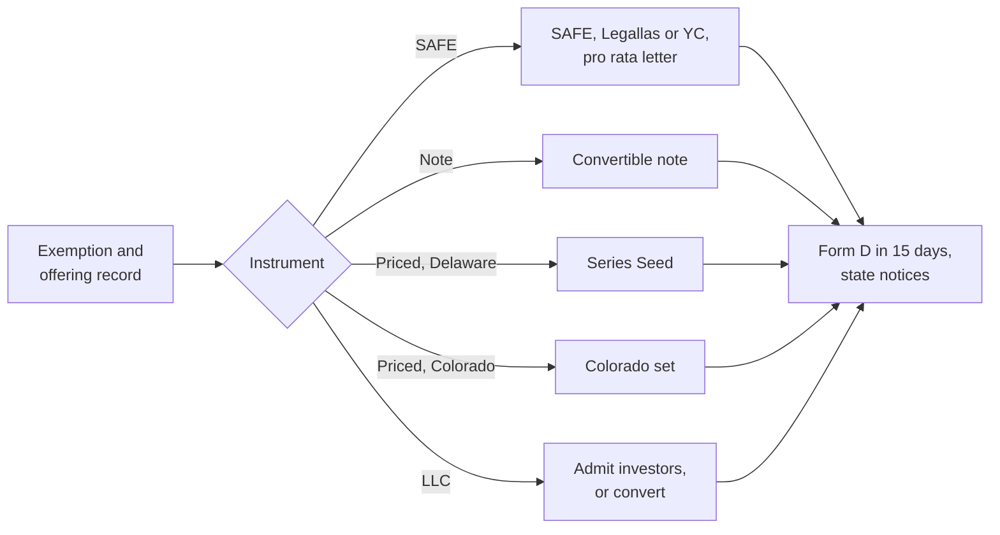

# Templates

> Legallas is an AI agent for legal work, not a lawyer or law firm. Using it creates no attorney-client relationship. AI can be wrong. Have your own lawyer review before you sign, file or rely on anything.
>
> No lawyer has reviewed these templates.

Agreements, filings and decision records a person or their AI can fill in. They follow the five paths in the
[document map](../docs/design/document-set-and-law.md): startups form,
startups raise, angels invest, angels create groups, VCs invest. Founders come first. Colorado comes first, then Delaware and federal
law.

The law behind them is the 2026 Colorado Revised Statutes, the Delaware Code and the federal code and rules, each read on the date the
document gives. Every template is original drafting from statutes and first principles. None adapts a form whose licence doesn't allow
it. Examples use invented facts.

**Licence.** Original templates (Legallas's own drafting) are under CC0 1.0, a public-domain dedication: use, change and pass them on without conditions. Code in this repository stays Apache-2.0. Bundled third-party forms keep their own licences, listed in [`bundled-forms.md`](bundled-forms.md). See [`LICENSE`](LICENSE).

**Held back.** The equity incentive plan and any option agreement are not offered in any list, checklist link or bundle. Rule 701, 26 U.S.C. 422 and 409A mistakes surface late and hurt employees, so a lawyer reviews them first. To release one, move it out of `held-back/` and into `founders/`.

How the product shows these to users comes later. The format stays plain so any AI or person can read it.

## Index

**Status** means: **Drafted** is written, citation-checked and read by an independent reader; **Bundled** is a public form pinned by address and SHA-256 in [`bundled-forms.md`](bundled-forms.md), shipped byte-identical, or with edits listed in a Legallas record where its licence allows; **Hand off** is an agency's own form or online flow, or a document only a professional can prepare, where Legallas prepares what it can and a person finishes it; **In the room** is something the Legallas room itself does; **Held back** is written but not offered: it sits in [`held-back/`](held-back/), outside every shipped list, until a lawyer reviews it or the owner rules otherwise; **Not started** isn't written yet, and issue #16 tracks it.

### Path 1: startups form

| Document | File | Level | Status |
|---|---|---|---|
| Colorado LLC, Colorado C corporation or Delaware C corporation | [`founders/entity-comparison.md`](founders/entity-comparison.md) | Colorado, Delaware, federal | Drafted |
| Delaware LLC or Colorado LLC | [`founders/delaware-llc-comparison.md`](founders/delaware-llc-comparison.md) | Colorado, Delaware, federal | Drafted |
| Colorado LLC operating agreement, two or more members | [`founders/colorado-llc-operating-agreement.md`](founders/colorado-llc-operating-agreement.md) | Colorado, federal | Drafted |
| Colorado LLC operating agreement, one member | [`founders/colorado-llc-single-member-operating-agreement.md`](founders/colorado-llc-single-member-operating-agreement.md) | Colorado, federal | Drafted |
| Delaware LLC agreement, one member | [`founders/delaware-llc-agreement.md`](founders/delaware-llc-agreement.md) | Delaware, federal | Drafted |
| Delaware LLC agreement, two or more members: the Delaware sections | [`founders/delaware-llc-operating-agreement.md`](founders/delaware-llc-operating-agreement.md) | Delaware, federal | Drafted |
| Colorado LLC articles of organization | [`founders/colorado-llc-articles.md`](founders/colorado-llc-articles.md) | Colorado | Drafted |
| Delaware LLC certificate of formation | [`founders/delaware-llc-certificate.md`](founders/delaware-llc-certificate.md) | Delaware, Colorado | Drafted |
| Colorado articles of incorporation | [`founders/colorado-corporation-articles.md`](founders/colorado-corporation-articles.md) | Colorado | Drafted |
| Colorado corporation bylaws | [`founders/colorado-corporation-bylaws.md`](founders/colorado-corporation-bylaws.md) | Colorado | Drafted |
| Delaware certificate of incorporation | [`founders/delaware-corporation-certificate.md`](founders/delaware-corporation-certificate.md) | Delaware | Drafted |
| Delaware corporation bylaws | [`founders/delaware-corporation-bylaws.md`](founders/delaware-corporation-bylaws.md) | Delaware | Drafted |
| Action of incorporator | [`founders/incorporator-action.md`](founders/incorporator-action.md) | Colorado, Delaware | Drafted |
| Initial board consent | [`founders/initial-board-consent.md`](founders/initial-board-consent.md) | Colorado, Delaware, federal | Drafted |
| Initial stockholder consent | [`founders/initial-stockholder-consent.md`](founders/initial-stockholder-consent.md) | Colorado, Delaware, federal | Drafted |
| Initial LLC member consent | [`founders/llc-initial-consent.md`](founders/llc-initial-consent.md) | Colorado, Delaware, federal | Drafted |
| Tax classification decision: Form 8832 or Form 2553 | [`founders/tax-classification-election.md`](founders/tax-classification-election.md) | Federal | Drafted |
| Colorado statement of foreign entity authority worksheet | [`founders/foreign-qualification.md`](founders/foreign-qualification.md) | Colorado, Delaware | Drafted |
| Founder stock purchase agreement, with vesting | [`founders/founder-stock-purchase.md`](founders/founder-stock-purchase.md) | Colorado, Delaware, federal | Drafted |
| Section 83(b) election, with company copy and filing record | [`founders/section-83b-election.md`](founders/section-83b-election.md) | Federal | Drafted |
| Capitalization table | [`founders/capitalization-table.md`](founders/capitalization-table.md) | Colorado, Delaware | Drafted |
| Stock ledger, with notice of uncertificated shares | [`founders/stock-ledger.md`](founders/stock-ledger.md) | Colorado, Delaware | Drafted |
| LLC member ledger | [`founders/member-ledger.md`](founders/member-ledger.md) | Colorado, Delaware | Drafted |
| Invention assignment | [`founders/invention-assignment.md`](founders/invention-assignment.md) | Colorado, Delaware, federal | Drafted |
| Short-form IP assignment for recording | [`founders/ip-recordation.md`](founders/ip-recordation.md) | Federal | Drafted |
| Invention record: inventors, first disclosure, provisional fee | [`founders/invention-record.md`](founders/invention-record.md) | Federal | Drafted |
| Trademark clearance search record | [`founders/trademark-clearance.md`](founders/trademark-clearance.md) | Federal | Drafted |
| Trademark application worksheet: company as applicant, basis, fees | [`founders/trademark-filing.md`](founders/trademark-filing.md) | Federal | Drafted |
| Colorado statement of trade name worksheet | [`founders/colorado-trade-name.md`](founders/colorado-trade-name.md) | Colorado | Drafted |
| Open-source inventory | [`founders/open-source-inventory.md`](founders/open-source-inventory.md) | Federal, plus licences | Drafted |
| Founders' agreement | [`founders/founders-agreement.md`](founders/founders-agreement.md) | Colorado, Delaware, federal | Drafted |
| Founder removal rule check | [`founders/removal-rule-check.md`](founders/removal-rule-check.md) | Colorado, Delaware | Drafted |
| Colorado periodic report record | [`founders/colorado-periodic-report.md`](founders/colorado-periodic-report.md) | Colorado | Drafted |
| Delaware franchise tax estimate, both methods | [`founders/delaware-franchise-tax.md`](founders/delaware-franchise-tax.md) | Delaware | Drafted |
| Delaware LLC annual tax hand-off record | [`founders/delaware-llc-annual-tax.md`](founders/delaware-llc-annual-tax.md) | Delaware | Drafted |
| Equity incentive plan, and any option agreement | [`held-back/equity-incentive-plan.md`](held-back/equity-incentive-plan.md) | Colorado, Delaware, federal | Held back: a lawyer reviews it first |
| Rule 701 grant record: 12-month totals, limit and disclosure | [`founders/rule-701-record.md`](founders/rule-701-record.md) | Federal | Drafted |
| Public forms that can ship | [`bundled-forms.md`](bundled-forms.md) | Federal, plus licences | Drafted |
| Advisor agreement | [`founders/advisor-agreement.md`](founders/advisor-agreement.md) | Colorado, Delaware, federal | Drafted |
| Mutual NDA | Common Paper, in [`bundled-forms.md`](bundled-forms.md#pinned-files) | Any state | Bundled |
| Mutual NDA fill-in record | [`founders/mutual-nda-record.md`](founders/mutual-nda-record.md) | Federal | Drafted |

### Path 2: startups raise



| Document | File | Level | Status |
|---|---|---|---|
| Exemption decision, solicitation log, demo days, anyone paid to help, holder count | [`raise/offering-record.md`](raise/offering-record.md) | Federal, Colorado, Delaware | Drafted |
| Investor questionnaire and Rule 506(c) verification | Forms 1 to 3 in [`investors/angels/accredited-investor.md`](investors/angels/accredited-investor.md) | Federal | Drafted |
| Bad actor questionnaire | [`raise/bad-actor-questionnaire.md`](raise/bad-actor-questionnaire.md) | Federal | Drafted |
| Disclosure to a buyer who isn't accredited (Rule 502(b)) | A lawyer and an accountant prepare it. Part 7 of the [offering record](raise/offering-record.md) lists what it must hold | Federal | Hand off |
| SAFE: valuation cap, discount or most favored nation | Y Combinator, in [`bundled-forms.md`](bundled-forms.md#pinned-files) | Corporations, any state | Bundled |
| Pro rata side letter | Y Combinator, in [`bundled-forms.md`](bundled-forms.md#pinned-files) | Corporations, any state | Bundled |
| SAFE, Legallas's own: cap, discount or both | [`raise/safe.md`](raise/safe.md) | Colorado, Delaware, federal | Drafted |
| Convertible note | [`raise/convertible-note.md`](raise/convertible-note.md) | Colorado, Delaware, federal | Drafted |
| Board and stockholder consents approving the financing | [`raise/financing-consents.md`](raise/financing-consents.md). A Colorado LLC uses its operating agreement's vote | Colorado, Delaware, federal | Drafted |
| Delaware priced round: term sheet, investment agreement with investor rights and voting terms, restated certificate | Series Seed 3.2, in [`bundled-forms.md`](bundled-forms.md#pinned-files). Written in 2014: have a lawyer check it against Delaware law today | Delaware | Bundled |
| Delaware priced round: the map of the files, approvals and filing | [`raise/series-seed-delaware.md`](raise/series-seed-delaware.md) | Delaware | Drafted |
| Colorado priced round: term sheet, investment agreement, restated articles | Series Seed 3.2, modified by the 15 edits marked so in [`raise/series-seed-colorado.md`](raise/series-seed-colorado.md) | Colorado | Bundled, with listed edits |
| Right of first refusal and co-sale | [`raise/rofr-co-sale-agreement.md`](raise/rofr-co-sale-agreement.md). Series Seed alone has a company right of first refusal (section 4.3) but no co-sale | Colorado, Delaware | Drafted |
| Management rights letter | [`raise/management-rights-letter.md`](raise/management-rights-letter.md) | Federal | Drafted |
| Director indemnification agreement | [`raise/director-indemnification.md`](raise/director-indemnification.md) | Colorado, Delaware | Drafted |
| Amended LLC agreement admitting investors | [`raise/llc-investor-admission.md`](raise/llc-investor-admission.md) | Colorado, federal | Drafted |
| Conversion to a Delaware corporation | [`raise/conversion-to-delaware.md`](raise/conversion-to-delaware.md) | Colorado, Delaware, federal | Drafted |
| Finder or placement agreement, with a licence check | Part 5 of the [offering record](raise/offering-record.md) checks registration and licensing. A registered broker-dealer brings its own engagement letter; Legallas drafts no agreement to pay an unregistered finder | Federal, Colorado | Hand off |
| Form ID and Form D | SEC, on EDGAR. Steps in [`investors/funds/form-d-and-colorado-notice.md`](investors/funds/form-d-and-colorado-notice.md) | Federal | Hand off |
| Colorado and Delaware Form D notices | NASAA EFD. Same steps | Colorado, Delaware | Hand off |
| Colorado notice, crowdfunding and interpretive opinion: deadlines and fees | [`raise/colorado-securities-filings.md`](raise/colorado-securities-filings.md) | Colorado | Drafted |
| Delaware Form LOE; Colorado or Delaware accredited investor notice | The state's own form, for a state route outside Rule 506 | Colorado, Delaware | Hand off |
| Testing the waters: legends, log, follow-up | [`raise/testing-the-waters-record.md`](raise/testing-the-waters-record.md) | Federal, Colorado | Drafted |
| Form C answers, financial statement tier, filing dates, Colorado notice | [`raise/regulation-cf-worksheet.md`](raise/regulation-cf-worksheet.md) | Federal, Colorado | Drafted |
| Form 1-A answers, tier, dates, Colorado notice | [`raise/regulation-a-worksheet.md`](raise/regulation-a-worksheet.md) | Federal, Colorado | Drafted |
| Filing Form C, Form 1-A, Colorado crowdfunding notice | A registered portal or a lawyer files, from the worksheets above | Federal, Colorado | Hand off |
| Good standing certificates | The Colorado Secretary of State or the Delaware Division of Corporations | Colorado, Delaware | Hand off |
| Closing checklist: certificates, any legal opinion, deliverables | [`raise/closing-checklist.md`](raise/closing-checklist.md) | Colorado, Delaware, federal | Drafted |
| Data room | The room's investor folders, built from the [company checklist](../docs/checklist/README.md); privileged folders never join it | All | In the room |

### Later paths

| Path | Status |
|---|---|
| Angels invest | Drafted, in [`investors/`](investors/README.md) |
| Angels create groups | Drafted, in [`investors/`](investors/README.md) |
| VCs invest | Drafted, in [`investors/`](investors/README.md) |

Path 2 uses this same format, and so do the investor documents in [`investors/`](investors/README.md).

## Format

Every document is one Markdown file, with these parts in this order. A comparison, record, explainer, checklist or outline skips the parts that do not apply.

**1. Metadata,** a YAML block at the top:

| Field | What it holds |
|---|---|
| `id` | Stable identifier: folder and name. Never reused |
| `title` | What the document is called |
| `kind` | `template`, `comparison`, `record`, `explainer`, `checklist` or `outline` |
| `path` | Which of the five paths it serves: `startup-forms`, `startup-raises`, `angels-invest`, `angels-create-groups`, `vcs-invest`; or `fights`, when founders and investors fight |
| `level` | `colorado`, `delaware`, `federal` |
| `entity` | Which entity types it fits: `colorado-llc`, `colorado-corporation`, `delaware-llc`, `delaware-corporation`; for investors, `natural-person`, `spv-llc`, `spv-lp`, `angel-group-network`, `angel-group-llc`, `delaware-series`, `fund-lp`, `fund-llc`, `general-partner`, `management-company` |
| `statutes` | Every statute and rule cited, each checked against the primary text |
| `source` | Where the text came from |
| `licence` | The licence of this file |
| `date_checked` | The day the citations were last checked against the primary text |
| `fields` | Every fill-in field the document uses: a list, or a map from each field to what it means |

**Source card.** The product shows the [product notices](../docs/legal/product-notices.md) A5 source card beside every template, built from this metadata. A third-party form carries nothing of Legallas's inside it, so its card's values sit in [`bundled-forms.md`](bundled-forms.md#source-cards).

| Card line | From |
|---|---|
| Document name | `title` |
| Source | `source`: who wrote it, and from what |
| Version | The footer's `version N` |
| Licence | `licence`, in A5's plain words |
| Law checked | `date_checked` |
| Written for | `entity` |
| Modified from the original | Series Seed for a Colorado corporation only: the edits marked **Modified** in [`raise/series-seed-colorado.md`](raise/series-seed-colorado.md#the-edits) |

**2. The notice:** the short line from [`docs/legal/product-notices.md`](../docs/legal/product-notices.md), section A2, and that no lawyer has reviewed the document.

**3. Before you use this:** when it applies, what else has to happen, and any deadline.

**4. The document:** the text a person would sign or file, between the markers `<!-- TEMPLATE START -->` and `<!-- TEMPLATE END -->`.
Fill-in fields look like `{{COMPANY_NAME}}`. Where a founder has to choose, the text has a labelled option block:

```text
[OPTION A: name of the option. Recommended.]
Text for option A.
[END OPTION A]
[OPTION B: name of the option.]
Text for option B.
[END OPTION B]
```

Keep one option and delete the rest, along with the markers. Each template ends with the removable footer from the product notices, section A5.

**5. Drafting notes:** a table with one row for each choice: the options, a recommendation and why, and where a lawyer should look.

**6. What couldn't be checked,** and **sources.**

The metadata, the notice and everything outside the markers is guidance. It doesn't belong in the signed copy.

**When the product shows a recommendation.** The `Recommended` labels and the recommendation column are stored here so the customer's lawyer can see the reasoning. The product notices, section A4, limit when the product may show them: only with the user's own lawyer connected, on an issuer-side or legal-form choice, all options first, and never once a dispute has started or is expected (section A8). A surface that shows a template without a connected lawyer strips them and keeps the options and the factors.

## Terms used in these templates

| Term | What it means here |
|---|---|
| **83(b) election** | A filing with the IRS, due within 30 days of a stock transfer, to be taxed now on stock that vests later, so growth in value isn't taxed as it vests |
| **409A** | The tax rule on deferred pay. For options, it means setting the price at a supportable fair market value |
| **Acceleration** | Vesting that speeds up on an event such as a sale or a removal |
| **Advancement** | The company pays a person's legal costs while a case is running, not only after it ends |
| **Cap table** | The list of who owns what share of the company |
| **Charter** | A corporation's articles of incorporation (Colorado) or certificate of incorporation (Delaware) |
| **Cumulative voting** | Each share gets one vote per open board seat, and a holder can stack them, which helps a smaller holder win a seat |
| **Drag-along** | A term that lets a stated vote force the other holders to join a sale |
| **Foreign authority** | The Colorado filing that registers an out-of-state company to do business here |
| **Incentive stock option** | An employee stock option with special tax treatment under 26 U.S.C. 422 |
| **Priced round** | A sale of stock, usually preferred, to investors at a set price |
| **Qualified small business stock** | Original-issue stock in a small C corporation whose holder may exclude some or all of the gain from federal tax if 26 U.S.C. 1202's tests are met |
| **SAFE** | A simple agreement for future equity: an investment that converts to stock at a later financing |
| **Safe harbour** | A process in a statute that, if followed, protects a transaction from a certain challenge |
| **Vesting** | Earning stock over time, so that unearned stock can be bought back if the person leaves |
| **Voting group** | Colorado's term for a class or series of shares that votes separately on a matter |

## How these were checked

- Each statute citation was looked up in the primary text on the date shown: Colorado's 2026 edition from the Office of Legislative
  Legal Services, Delaware Code Online, the U.S. Code from the Office of the Law Revision Counsel and the eCFR.
- An independent reader who hadn't drafted the document read it for errors against that text.
- Court decisions were read through passages and summaries from legal research tools. A lawyer should cite-check them.
- Each document lists what couldn't be checked.

This isn't a lawyer's review, and it doesn't replace one.
