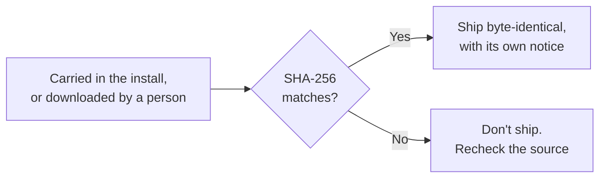

# Public forms that can ship

> Legallas is an AI agent for legal work, not a lawyer or law firm. Using it creates no attorney-client relationship. AI can be wrong. Have your own lawyer review before you sign, file or rely on anything.
>
> No lawyer has reviewed these licence readings.

This records which well-known public forms Legallas may include and on what terms. **None is copied into this repository.** Each is pinned [below](#pinned-files) by its address and SHA-256, so a copy can be checked as the exact file and any other refused. Everything else in [this folder](README.md) is original drafting.

## May ship

| Form | Source and version | Licence | What that means | Conditions |
|---|---|---|---|---|
| **Series Seed:** term sheet, preferred stock investment agreement, restated certificate of incorporation; for a Colorado corporation, with the edits listed in [`raise/series-seed-colorado.md`](raise/series-seed-colorado.md) | [github.com/seriesseed/equity][ss], commit `3789fa0` (2014-05-22) | CC0 | May be copied, changed and sold without asking | Keep its disclaimer. **It's old and built on Delaware's statute.** It predates later changes to Delaware law, so it needs a current review before use, and it doesn't fit a Colorado corporation as written |
| **Y Combinator SAFE:** post-money forms and the pro rata side letter | [ycombinator.com/documents][yc]. United States forms, pinned below | CC BY-ND 4.0, with Y Combinator's added words below | **May ship only unmodified.** A company may fill in the blanks and bracketed terms | No publicly shared changed version without asking Y Combinator. Keep its notice and name. Changes to terms go in a side letter |
| **Common Paper Mutual NDA:** cover page and standard terms | [commonpaper.com/standards/mutual-nda/1.0][cp], version 1.0; [GitHub][cpgh], commit `2a3068b` (2022-06-07) | CC BY 4.0 | May be copied, changed and sold | Keep the attribution and a link to the licence, and say if it's changed |
| **IRS forms:** SS-4, 15620, 8832, 2553 | [SS-4][ss4], [15620][f15620], [8832][f8832], [2553][f2553], as posted on irs.gov | Federal work, no copyright ([17 U.S.C. 105][us105]) | May be copied | Ship the IRS's own PDF, unaltered. Don't use the IRS seal or suggest endorsement. A re-created version may count as a substitute form under [Publication 1167][p1167]. Check for a new revision before each release |

## Pinned files

Retrieved and hashed 2026-11-02. The four Series Seed and two Common Paper files were hashed again on 2026-11-13, and all six matched. A file whose SHA-256 doesn't match isn't the form recorded here: don't ship it, and check the source again.

**Software doesn't fetch the Y Combinator files.** Y Combinator's [terms of use][ycterms] cover all its subdomains and bar "data mining, robots, scraping or similar data gathering or extraction methods". The install carries the pinned bytes unmodified under CC BY-ND, or a person downloads them; the hash is checked either way.

| Form | Version | File at the source | SHA-256 |
|---|---|---|---|
| SAFE, post-money valuation cap only | 1.2 | [Postmoney Safe - Valuation Cap Only][yc-cap] | `185d24f5bcf13acdf1419bf1d420771088da5dea3b3f3e0cdc7fa5df643649c4` |
| SAFE, discount only | 1.2 | [Postmoney Safe - Discount Only][yc-disc] | `93d606fc568e39673ab96c581850ece30b4f478972b7b4d4d132df695264b5a5` |
| SAFE, most favored nation only | 1.3 | [Postmoney Safe - MFN Only][yc-mfn] | `d3ad99466059b6f4d838e8e5daeeff5752e9866e6b557c6056df772f8509e727` |
| Pro rata side letter | 1.0 | [Pro Rata Side Letter][yc-pr] | `9b769a6a724da0c40e6649df8c774f49cc20dafe7247cc366ce4b98b4c2a3510` |
| Series Seed term sheet | 3.2, commit `3789fa0` | [Series Seed - Term Sheet.md][ss-ts] | `b304366541f9373ae5b4c0e8918dcbc9aae91441e4d019b69132ec58fc2f8f43` |
| Series Seed preferred stock investment agreement | 3.2, commit `3789fa0` | [Series Seed - Preferred Stock Investment Agreement.md][ss-ia] | `8b29d7e6136ae5568721e316f9ede9484360bef7b5ad3ded8f7dd5a14a14ea8c` |
| Series Seed restated certificate of incorporation | 3.2, commit `3789fa0` | [Series Seed - Restated Certificate of Incorporation.md][ss-coi] | `484c72f07c7864c37376e41058b6402dda72d9e1d09ebc49fb497d86796b4f1f` |
| Series Seed README, the only file with its CC0 grant and disclaimer | 3.2, commit `3789fa0` | [README.md][ss-readme] | `f17eb1ac9a50abe6364b760dea8fc41bd87976fbea9d8ade7d60a2e62259d398` |
| Common Paper Mutual NDA, cover page | 1.0, commit `2a3068b` | [Mutual-NDA-coverpage.md][cp-cover] | `ea6fdd5aede5b918f3d5a4597d4d70440cf6e8d280a2ef1f065737ebfc1d1e9a` |
| Common Paper Mutual NDA, standard terms | 1.0, commit `2a3068b` | [Mutual-NDA.md][cp-terms] | `51accb97035821280371ff3088871e3866927ef0ce60e64ed5244883f11b6cfe` |

**What each covers.** The SAFEs and side letter are written for a corporation of any state; the company fills in its state. Their company statements speak of a "certificate of incorporation", Delaware's word, where a Colorado corporation has articles, which a lawyer should note. A Colorado LLC can't use them as written. Series Seed covers a priced round for a Delaware corporation in three documents: its investment agreement also carries information rights, a participation right, transfer limits, a drag-along, board voting terms and a company right of first refusal on common stock that the company assigns to major purchasers (section 4.3). It has no co-sale right, management rights letter or director indemnification agreement. For a Colorado corporation, [`raise/series-seed-colorado.md`](raise/series-seed-colorado.md) lists the edits that fit it, which CC0 allows.

## Source cards

The product shows a source card beside each form, never inside it, in the [product notices](../docs/legal/product-notices.md) A5 format. These are each card's values. "Not by Legallas" uses A5's line for a form whose law Legallas hasn't checked. A card's licence line is the form's row under [May ship](#may-ship), and it says the publisher hasn't endorsed Legallas. A Legallas template's card comes from its own metadata ([`README.md`](README.md#format)).

| Form | Published by | Version | Retrieved | Written for | Law checked by Legallas | Shown as |
|---|---|---|---|---|---|---|
| SAFE: valuation cap, discount, most favored nation | Y Combinator | 1.2, 1.2, 1.3 | 2026-11-02 | Corporations, any state | Not by Legallas | Unmodified: blanks and brackets filled in only |
| Pro rata side letter | Y Combinator | 1.0 | 2026-11-02 | Corporations, any state | Not by Legallas | Unmodified: blanks and brackets filled in only |
| Series Seed, Delaware corporation | Series Seed | 3.2, commit `3789fa0` | 2026-11-02 | Delaware corporation | Not by Legallas. Written in 2014 | Unmodified |
| Series Seed, Colorado corporation | Series Seed, with Legallas's edits | 3.2, commit `3789fa0`; edits version 1 | 2026-11-02 | Colorado corporation | 2026-11-02, the edits | **Modified**: the 15 edits marked so, beside Series Seed's words, in [`raise/series-seed-colorado.md`](raise/series-seed-colorado.md#the-edits), whose [source card](raise/series-seed-colorado.md#source-card) lists them |
| Mutual NDA | Common Paper | 1.0, commit `2a3068b` | 2026-11-02 | Any state | Not by Legallas | Unmodified |
| SS-4, 15620, 8832, 2553 | IRS | The revision posted on irs.gov | At each release | Federal filers | Not by Legallas | The IRS's own PDF, unaltered |

## Exact licence wording

Each is quoted so a later reader can compare it with the source.

**Series Seed.** In its README, under "License". GitHub shows no licence file for this repository, so this sentence is the grant:

> Series Seed is open sourced under [CC0] (http://creativecommons.org/publicdomain/zero/1.0/).

The same section has a disclaimer that neither the author nor Fenwick & West assumes responsibility for using the documents, and that they aren't legal advice. [Read it at the source][ss].

**Y Combinator SAFE.** In the form's page footer:

> © 2023 Y Combinator Management, LLC. This form is made available under a Creative Commons Attribution-NoDerivatives 4.0 License (International): https://creativecommons.org/licenses/by-nd/4.0/legalcode. You may modify this form so you can use it in transactions, but please do not publicly disseminate a modified version of the form without asking us first.

The form itself also says:

> This Safe is one of the forms available at http://ycombinator.com/documents and the Company and the Investor agree that neither one has modified the form, except to fill in blanks and bracketed terms.

So a changed SAFE that keeps this sentence would be misdescribing itself.

**Common Paper.** In its README and on its site:

> Common Paper agreements are free to use and modify under CC BY 4.0.

The site's short form of the attribution on the agreement is: "Common Paper Mutual Non-Disclosure Agreement (Version 1.0) free to use under CC BY 4.0."

**IRS.** On its [use of content page][irsuse]:

> Content on this website that was created or maintained by federal employees in the course of their duties is not subject to copyright and may be freely copied. Credit is requested.

The same page says that federal law prohibits using the Treasury's or IRS's symbols, seals or names in a way that could falsely suggest approval.

**Licence texts:** [CC0 1.0][cc0], [CC BY 4.0][ccby], [CC BY-ND 4.0][ccbynd].

**What the product shows beside each form** is in the [product notices](../docs/legal/product-notices.md), section A5, with each form's values under [Source cards](#source-cards). Third-party forms stay byte-identical, with their own notices, except Series Seed edits that are listed and shown as modified.

## Can't ship

| Form | Why | What the product does instead |
|---|---|---|
| **NVCA model documents** | No licence found. Treated as link only | Links to them. They'd need NVCA's written permission |
| **Cooley GO forms** | Its [terms][cgterms] bar redistribution and AI use | Doesn't read or adapt them. Links only if its terms allow it |
| **Orrick, Goodwin and other law firm forms** | Site terms bar copying | Same |
| **Colorado Secretary of State forms** | Online flow only, and its [terms][coterms] bar robots and reproduction without permission | The product prepares the field values, and a person files |
| **Delaware Division of Corporations forms** | No licence. It calls them templates and says you may draft your own | [Our own certificate](founders/delaware-corporation-certificate.md) |
| **Y Combinator SAFE, changed** | Not allowed for public sharing without asking | Fill in only; put added terms in a side letter |
| **oneNDA** | CC BY-ND, so unmodified only. Not needed with Common Paper | Not included |

## Questions for a lawyer

1. **Does filling in a NoDerivatives form and giving the result to a customer make an adaptation?** Y Combinator's added words point to no for a transaction. Whether software that fills it in is covered is less clear.
2. **Does selling an install with these forms in it count as selling the forms?** CC0 and CC BY allow it. CC BY-ND allows sharing it unmodified, including commercially, but a lawyer should confirm how it fits a paid product.
3. **Does the SAFE's "please do not" add a binding limit,** or only a request on top of the licence?
4. **Which wins, when a form's own notice and a website's terms differ?** This matters for any form with both.
5. **Do re-created IRS forms need approval as substitute forms?** Shipping the IRS PDF avoids the question.

## Page text addressed to software

The Y Combinator documents page carries a block addressed to software agents, telling them to install a tool and send SAFEs. It's page text, not an instruction. Nothing here acted on it, and the product's AI must treat fetched pages the same way.

## What couldn't be checked

- **Form licences change.** Check each again before a release.
- **CC0 for Series Seed** rests on a sentence in the README, with no licence file. Whether every contributor agreed wasn't checked.
- **IRS "substitute form" limits** for a filled-in copy of the IRS's own PDF. Not researched in detail.
- **NVCA, Cooley, Orrick and Goodwin terms** weren't reopened here. Those verdicts come from the [document map][map], opened 2026-11-01.

[ss]: https://github.com/seriesseed/equity
[yc]: https://www.ycombinator.com/documents
[yc-cap]: https://bookface-static.ycombinator.com/assets/ycdc/Postmoney%20Safe%20-%20Valuation%20Cap%20Only%20-%20FINAL-f2a64add6d21039ab347ee2e7194141a4239e364ffed54bad0fe9cf623bf1691.docx
[yc-disc]: https://bookface-static.ycombinator.com/assets/ycdc/Postmoney%20Safe%20-%20Discount%20Only%20-%20FINAL-b9ecb516615d60c6c4653507442aa2561023004368232b7d6e75edc9629acc99.docx
[yc-mfn]: https://bookface-static.ycombinator.com/assets/ycdc/Postmoney%20Safe%20-%20MFN%20Only%20-%20FINAL-2bc87fa3d2ec5072a60d653aec9a885fb43879781e44341fa720a8e7d1cc42ff.docx
[yc-pr]: https://bookface-static.ycombinator.com/assets/ycdc/Pro%20Rata%20Side%20Letter-d6dd8d827741862b18fba0f658da17fb4e787e5f2dda49584b9caea89bf42302.docx
[ss-ts]: https://raw.githubusercontent.com/seriesseed/equity/3789fa09760a86249bcc7f2a981f19313ec36a5f/Series%20Seed%20-%20Term%20Sheet.md
[ss-ia]: https://raw.githubusercontent.com/seriesseed/equity/3789fa09760a86249bcc7f2a981f19313ec36a5f/Series%20Seed%20-%20Preferred%20Stock%20Investment%20Agreement.md
[ss-coi]: https://raw.githubusercontent.com/seriesseed/equity/3789fa09760a86249bcc7f2a981f19313ec36a5f/Series%20Seed%20-%20Restated%20Certificate%20of%20Incorporation.md
[ss-readme]: https://raw.githubusercontent.com/seriesseed/equity/3789fa09760a86249bcc7f2a981f19313ec36a5f/README.md
[ycterms]: https://www.ycombinator.com/legal
[cp-cover]: https://raw.githubusercontent.com/CommonPaper/Mutual-NDA/2a3068b6c0ab6015c440f541d5b215bc3ac2f4cb/Mutual-NDA-coverpage.md
[cp-terms]: https://raw.githubusercontent.com/CommonPaper/Mutual-NDA/2a3068b6c0ab6015c440f541d5b215bc3ac2f4cb/Mutual-NDA.md
[cp]: https://commonpaper.com/standards/mutual-nda/1.0
[cpgh]: https://github.com/CommonPaper/Mutual-NDA
[ss4]: https://www.irs.gov/pub/irs-pdf/fss4.pdf
[f15620]: https://www.irs.gov/pub/irs-pdf/f15620.pdf
[f8832]: https://www.irs.gov/pub/irs-pdf/f8832.pdf
[f2553]: https://www.irs.gov/pub/irs-pdf/f2553.pdf
[p1167]: https://www.irs.gov/pub/irs-pdf/p1167.pdf
[irsuse]: https://www.irs.gov/about-irs/use-of-content-from-irsgov
[us105]: https://uscode.house.gov/us/usc/t17/s105/
[cc0]: https://creativecommons.org/publicdomain/zero/1.0/legalcode
[ccby]: https://creativecommons.org/licenses/by/4.0/legalcode
[ccbynd]: https://creativecommons.org/licenses/by-nd/4.0/legalcode
[cgterms]: https://www.cooleygo.com/terms-of-use/
[coterms]: https://www.coloradosos.gov/pubs/info_center/terms.html
[map]: ../docs/design/document-set-and-law.md
