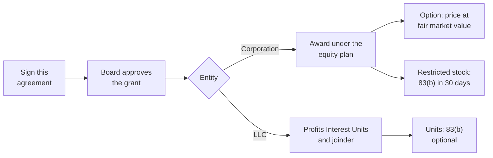

# Advisor Agreement

> Legallas is an AI agent for legal work, not a lawyer or law firm. Using it creates no attorney-client relationship. AI can be wrong. Have your own lawyer review before you sign, file or rely on anything.
>
> No lawyer has reviewed this template.

## Before you use this

| | |
|---|---|
| **When** | Before an advisor starts, and before any equity is promised in writing |
| **Who signs** | The company and the advisor, a natural person. Not the advisor's company: Rule 701 covers only natural persons ([230.701(c)(1)][e701]) |
| **Then** | The board approves the grant, and the grant is papered under the equity plan (corporations; the plan is held back until a lawyer reviews it, so the company has its lawyer paper the grant) or as Profits Interest Units under Section 13.9 of the [operating agreement](colorado-llc-operating-agreement.md) (an LLC; a Delaware LLC uses it with the [Delaware sections](delaware-llc-operating-agreement.md)). Nothing is granted until both happen |
| **Deadline** | Restricted stock: an 83(b) election, if made, within 30 days after issue ([26 U.S.C. 83(b)(2)][us83]). Profits Interest Units covered by [Rev. Proc. 2001-43][rp2001] need no election, though a holder may file a protective one |
| **Not for** | Anyone paid to bring in investors. That work falls outside Rule 701 ([230.701(c)(1)(iii)][e701]), and pay tied to a deal is one of the SEC staff's signs of broker activity ([SEC guide][secbd]; [15 U.S.C. 78o(a)][us78o]; [C.R.S. 11-51-401(2)][t11]) |

Check the advisor's own job first. An employer or university agreement may claim what the advisor creates, or forbid outside work.

## The document

<!-- TEMPLATE START -->

**ADVISOR AGREEMENT**

This Agreement is between {{COMPANY_NAME}}, a {{COMPANY_STATE_AND_TYPE}} (the "Company"), and {{ADVISOR_NAME}} ("you"). It takes effect on {{EFFECTIVE_DATE}}.

**1. What you'll do.** You'll advise the Company on {{ADVISORY_AREAS}}, as the Company reasonably asks, for about {{HOURS_PER_MONTH}} hours a month. This is your "**Service**". You decide how and when you do the work. You have no authority to sign for, bind or speak for the Company.

**2. What you won't do.** Your Service does not include finding, introducing, soliciting or negotiating with investors, or promoting the Company's securities. You won't receive any payment or equity tied to money the Company raises. If you choose to mention the Company to someone you know, you do it without pay and you'll tell the Company first.

**3. Equity.**

(a) **The grant.** The Company shall seek approval of this grant by its board, or for an LLC by the vote its operating agreement requires, within 60 days after the date above. Nothing is granted until then; if it isn't approved in that time, you may end this Agreement at once by notice. Once approved, the Company shall grant you, under its Equity Incentive Plan (the "**Plan**") if it is a corporation, or under its operating agreement if it is an LLC:

[OPTION A: An option, for a corporation. Recommended for most corporations.]
a nonstatutory option to buy {{NUMBER_OF_SHARES_OR_UNITS}} shares of common stock, at an exercise price per share of at least the fair market value on the grant date, as the Plan requires.
[END OPTION A]

[OPTION B: Restricted stock, for a corporation whose stock is still worth very little.]
{{NUMBER_OF_SHARES_OR_UNITS}} shares of common stock as a Restricted Stock Award, at a purchase price per share of at least the fair market value on the grant date. You may file an election under section 83(b) of the Internal Revenue Code within 30 days after the shares are issued, and you'll give the Company a copy.
[END OPTION B]

[OPTION C: Profits Interest Units, for an LLC.]
{{NUMBER_OF_SHARES_OR_UNITS}} Profits Interest Units under Section 13.9 of the Company's operating agreement, for your Service in anticipation of becoming a member, and not for money. Before they are issued you'll sign Exhibit 1 to that agreement, the agreement to be bound. You may also file a protective election under section 83(b) of the Internal Revenue Code within 30 days after the units are issued, and if you do, you'll give the Company a copy.
[END OPTION C]

(b) **Vesting.** The grant vests over {{VESTING_MONTHS}} months from {{EFFECTIVE_DATE}} while your Service continues. Nothing vests until {{CLIFF_MONTHS}} months have passed; then that many months' share vests at once, and an equal share each month after.

[OPTION A: All unvested equity vests on a sale of the Company. Recommended.]
(c) **Sale of the Company.** If a Change of Control, as the Plan or operating agreement defines it, closes while your Service continues, all of the grant that hasn't vested vests just before it closes. The grant documents shall say so, in a way that lets the newly vested part be exercised or paid at closing.
[END OPTION A]

[OPTION B: No speed-up on a sale.]
(c) **Sale of the Company.** A Change of Control doesn't change vesting, except as the Plan or operating agreement says.
[END OPTION B]

(d) **Which document controls.** The grant documents set the full terms. If they conflict with this section 3, the grant documents control, unless this section gives you more.

(e) **Investment.** You'll acquire any equity for your own account and not to resell it. It won't be registered, so you can't sell it unless an exemption allows. The Company shall give you a copy of the Plan, or of the operating agreement, before or when the grant is made.

**4. Cash and expenses.**

[OPTION A: No cash fee. Recommended to start.]
The Company pays no cash fee. It shall repay reasonable expenses that it approves in writing in advance, up to {{EXPENSE_LIMIT}} a year, within 30 days after you send receipts.
[END OPTION A]

[OPTION B: A cash fee as well.]
The Company shall pay you {{CASH_FEE}} for each month of Service, within 30 days after each invoice. It shall also repay reasonable expenses that it approves in writing in advance, up to {{EXPENSE_LIMIT}} a year, within 30 days after you send receipts.
[END OPTION B]

**5. Independent advisor.** Apart from any Units you hold as a member, you are not an employee, partner or agent of the Company. You get no employee benefits. You are responsible for your own taxes on what you receive, and the Company reports what tax law requires.

**6. What the Company owns.** You hereby assign to the Company all your right, title and interest throughout the world in everything you create, alone or with others, that results from your Service or uses the Company's Confidential Information ("**Company Work**"), including all copyrights, patent rights and trade secrets in it. You keep everything else, including your general know-how and anything you create for others without the Company's Confidential Information. You shall tell the Company about Company Work, and during and after your Service you shall sign documents and give reasonable help to protect it, at the Company's expense. If the Company can't get your signature after reasonable effort, you appoint it as your attorney-in-fact only to sign and file those documents. If you build anything you made before or outside your Service into Company Work, you grant the Company a non-exclusive, worldwide, perpetual, irrevocable, royalty-free licence, with the right to sublicense, to use, copy, change and distribute it as part of Company Work. You won't bring to the Company, or use for it, anything confidential that belongs to anyone else.

**7. Confidential information.**

(a) "**Confidential Information**" means non-public information of the Company, or held by it in confidence for others, that a reasonable person would understand to be confidential, including its trade secrets. It does not include information that arises from your general training, knowledge, skill or experience, whether gained with the Company or otherwise; information that is readily ascertainable to the public; or information you otherwise have a right to disclose as legally protected conduct.

(b) You shall use Confidential Information only for your Service, and shall not disclose it except as the Company allows. Trade secrets stay protected for as long as they remain trade secrets. For other Confidential Information, this duty ends {{CONFIDENTIALITY_YEARS}} years after your Service ends. When your Service ends, you shall return Confidential Information, and delete your copies once the Company confirms in writing. Don't delete anything while a dispute is reasonably foreseeable; tell the Company what you're keeping instead.

(c) Nothing in this Agreement stops you from reporting a possible violation of law to a government agency, giving truthful testimony, or talking to your own lawyer, in each case without telling the Company.

(d) **Notice under the Defend Trade Secrets Act.** An individual shall not be held criminally or civilly liable under any federal or state trade secret law for the disclosure of a trade secret that (A) is made (i) in confidence to a federal, state or local government official, either directly or indirectly, or to an attorney, and (ii) solely for the purpose of reporting or investigating a suspected violation of law; or (B) is made in a complaint or other document filed in a lawsuit or other proceeding, if such filing is made under seal. An individual who files a lawsuit for retaliation by an employer for reporting a suspected violation of law may disclose the trade secret to the attorney of the individual and use the trade secret information in the court proceeding, if the individual (A) files any document containing the trade secret under seal and (B) does not disclose the trade secret, except pursuant to court order.

**8. Other work.** You may work for or advise others, including in the Company's field. This Agreement has no non-compete and no non-solicit. You'll tell the Company if you take a role that could put you in a conflict, and you'll keep the Company's Confidential Information out of it. You confirm that, apart from what you've told the Company in writing, no agreement you've signed prevents this Service or claims Company Work.

**9. Your name.** The Company may list you as an advisor, with your name, photo and short biography, only in a form you approve in writing. You may withdraw that approval for future uses at any time. Within 30 days after your Service ends, the Company shall stop listing you as a current advisor.

**10. Term and ending.** Either side may end this Agreement at any time by written notice. Vesting stops when your Service ends, and the grant documents say what happens to the rest, including how long you have to exercise an option. Sections 3(d) and (e), 5, 6, 7, 11 and 12 survive, and so do amounts already owed under section 4 and section 3 for any part that vested before the end but wasn't yet granted.

**11. Notices.** Notices are in writing and go to the Company at {{COMPANY_ADDRESS}} and to you at {{ADVISOR_ADDRESS}}, or to a later address given by notice. Email counts if the recipient confirms it.

**12. General.** This Agreement is governed by the laws of {{GOVERNING_STATE}}, without its conflict of law rules. It and the grant documents are the whole agreement on this subject. Only a signed writing can amend it. You can't assign it; the Company may assign it to a successor to its business. If a court finds a term too broad, it may narrow that term only as far as needed, and the rest stands. It may be signed in counterparts and electronically.

Signed on {{SIGNING_DATE}}.

{{COMPANY_NAME}}

By: ______________________________

______________________________
{{ADVISOR_NAME}}

Legallas template founders/advisor-agreement version 1. Law checked 2026-11-02. Not reviewed by a lawyer. Have your own lawyer review. Delete this line before signing.

<!-- TEMPLATE END -->

## Drafting notes

| Choice | Options | Recommendation and why | Where a lawyer should look |
|---|---|---|---|
| Kind of equity (3(a)) | A, option; B, restricted stock; C, Profits Interest Units | **A for most corporations; B only while the stock is worth very little; C for an LLC.** An option costs nothing until exercise, and an exercise price at fair market value keeps it outside section 409A's penalties, which a plan should require. Only employees get incentive stock options, so an advisor's option is nonstatutory. Restricted stock is taxed at grant if the advisor files an 83(b) election, otherwise as it vests ([26 U.S.C. 83][us83]). A profits interest received for services in a partner capacity or in anticipation of being a partner isn't treated as taxable on receipt, under the conditions [Rev. Proc. 2001-43][rp2001] restates from Rev. Proc. 93-27, and holders it covers need not file an 83(b) election. It makes the advisor a member who gets a K-1, which is why section 5 carves out Units | Whether the grant is valued correctly; the advisor's own tax professional on any 83(b) election |
| Delaware LLC (3(a), Option C) | As drafted | **As drafted.** Delaware counts "services rendered" as a contribution ([18-101(3)][d6s1]). A person may be admitted as a member "without making a contribution or being obligated to make a contribution" ([18-301(d)][d6s3]). Section 13.9 works the same once the operating agreement is built with the [Delaware sections](delaware-llc-operating-agreement.md). Legallas holds back profits interest grants in a Delaware LLC with the equity plan, so the company's lawyer reviews the grant first | The grant, before it's made |
| Vesting (3(b)) | Months and cliff, filled in | **A judgment call. Fill in both** so the equity tracks the time the advisor will actually give. No primary source gives typical numbers, so the template sets none | Whether the size and schedule fit the advisor's role |
| Sale of the Company (3(c)) | A, full speed-up on a sale; B, none | **A.** An advisor's role usually ends when the company is sold, so there's nothing left to vest for. Without A, the plan's own change of control terms decide, and an unvested grant may simply end. Under the plan, only a part that vests under section 14(d) can be exercised at closing under 14(b)(iii), and the operating agreement's Section 6.3 has its own choices, so the grant documents must carry A. A buyer may ask about it, and with a large grant a lawyer should check [26 U.S.C. 280G][us280g] | Interaction with plan section 14 or the operating agreement's Section 6.3 |
| No fundraising (2) | Keep; drop | **Keep.** Rule 701 isn't available for services "in connection with the offer or sale of securities in a capital-raising transaction" ([230.701(c)(1)(iii)][e701]). An unregistered broker can't effect or induce securities sales ([15 U.S.C. 78o(a)][us78o]), and SEC staff list deal-based pay among the signs of broker activity ([SEC guide][secbd]). Colorado separately bars an issuer from engaging an unlicensed sales representative ([11-51-401(2)][t11]) | Any advisor who expects a finder's fee: use a registered broker-dealer instead |
| Cash fee (4) | A, none; B, a fee | **A to start.** Cash adds tax reporting and invoices for little gain at this stage. With B, collect the advisor's Form W-9 first | How a fee affects whether the advisor is really a contractor |
| What the Company owns (6) | As drafted, results of the Service and work using Confidential Information; everything related to the business | **As drafted.** An advisor usually has a day job and other clients. A clause that claims everything related to the Company's business could conflict with an employer's own invention agreement and drive good advisors away. "Hereby assign" is a present assignment, which is stronger than a promise to assign later ([17 U.S.C. 201, 204][us17]; [35 U.S.C. 261][us35]). For anyone building the product, use the [invention assignment](invention-assignment.md) | Advisors who will write code or file patents |
| Confidentiality exceptions (7(a)) | Keep; remove | **Keep.** Colorado protects only a reasonable confidentiality term that doesn't bar disclosure of general training, knowledge, skill or experience, readily ascertainable information, or legally protected conduct ([8-2-113(3)(b)][t8]). The text tracks those words | Whether a broader clause would be treated as a void covenant |
| Trade secret notice (7(d)) | Keep; cross-reference a policy | **Keep in full.** The federal notice duty reaches contractors and consultants ([18 U.S.C. 1833(b)(4)][us1833]). Without it, the Company can't get exemplary damages or fees against the advisor under that Act ([1833(b)(3)(C)][us1833]) | None |
| Non-compete and non-solicit (8) | None, as drafted; add | **None.** Colorado voids a covenant not to compete except narrow cases, such as highly compensated workers protecting trade secrets, with a separate signed notice ([8-2-113(2), (4)][t8]). An equity-only advisor rarely meets the cash pay threshold | Any advisor paid enough to meet the threshold |
| Term (10) | Open-ended, as drafted; ending when the grant has vested | **Open-ended, with a yearly check-in.** An option's exercise window starts when Service ends (set by the plan or grant, which the company's lawyer drafts), so an agreement that ends itself at full vesting would start that clock without anyone choosing to | None |
| Securities exemptions | Rule 701 and Colorado's exemptions | **Rule 701,** through the plan, which keeps the 12-month count against the greatest of $1 million, 15% of total assets or 15% of the class ([230.701(d)(2)][e701]). In Colorado, [11-51-307(1)(i)][t11] covers securities issued with "an employee's" benefit plan, so for an advisor the plan leans on [11-51-308(1)(i)][t11], transactions not involving a public offering | Whether 11-51-307(1)(i) reaches consultants; every other state where an advisor lives |

**Fights.** An advisor who leaves keeps what vested, on the grant documents' terms: an option must be exercised within the plan's window, and the plan and operating agreement have their own terms for misconduct and buyouts. What the Company owns is only Company Work under section 6, and the advisor stays free to advise others under section 8. Clear records of what the advisor actually did help if either point is ever disputed.

## What couldn't be checked

- **Typical advisor grant sizes and schedules.** No primary source gives them, and the best-known public guide wasn't read because its terms give no right to redistribute. The template gives no numbers.
- **Rev. Proc. 93-27.** No official copy was found online; it's read only as [Rev. Proc. 2001-43][rp2001] restates it.
- **Whether [11-51-307(1)(i)][t11] covers a consultant or advisor.** Its words say "an employee's" plan. No rule of the Securities Commissioner was read.
- **Whether a Colorado court treats an equity-only advisor as a "worker" under [8-2-113][t8].** The statute speaks of an individual's "compensation for performance of labor". The template is drafted to comply either way.
- **How a profits interest grant to an advisor affects the LLC's tax filings.** Left to the company's tax professional.

## Sources

[C.R.S. Title 8][t8] and [Title 11][t11], 2026 edition, read 2026-11-02. [15 U.S.C. 78o][us78o], [17 U.S.C. 201, 204][us17], [18 U.S.C. 1833][us1833], [26 U.S.C. 83][us83], [26 U.S.C. 280G][us280g], [35 U.S.C. 261][us35]. eCFR as of 2026-10-29: [17 CFR 230.701][e701]. [Rev. Proc. 2001-43][rp2001]. SEC staff, [Guide to Broker-Dealer Registration][secbd] (2008), as described in the document map. 6 Del. C. chapter 18, subchapters [I][d6s1] and [III][d6s3], read 2026-11-13.

[t8]: https://olls.info/crs/crs2026-title-08.pdf
[t11]: https://olls.info/crs/crs2026-title-11.pdf
[us78o]: https://uscode.house.gov/us/usc/t15/s78o/
[us17]: https://uscode.house.gov/us/usc/t17/s201/
[us1833]: https://uscode.house.gov/us/usc/t18/s1833/
[us83]: https://uscode.house.gov/us/usc/t26/s83/
[us280g]: https://uscode.house.gov/us/usc/t26/s280G/
[us35]: https://uscode.house.gov/us/usc/t35/s261/
[e701]: https://www.ecfr.gov/current/title-17/section-230.701
[rp2001]: https://www.irs.gov/pub/irs-drop/rp-01-43.pdf
[secbd]: https://www.sec.gov/about/divisions-offices/division-trading-markets/division-trading-markets-compliance-guides/guide-broker-dealer-registration
[d6s1]: https://delcode.delaware.gov/title6/c018/sc01/index.html
[d6s3]: https://delcode.delaware.gov/title6/c018/sc03/index.html
