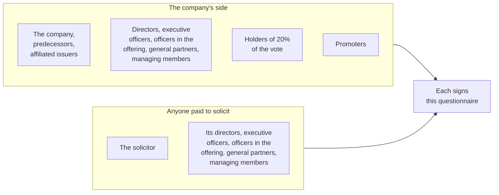

# Bad Actor Questionnaire

> Legallas is an AI agent for legal work, not a lawyer or law firm. Using it creates no attorney-client relationship. AI can be wrong. Have your own lawyer review before you sign, file or rely on anything.
>
> No lawyer has reviewed this template.

## Before you use this

If any covered person has a disqualifying event, Rule 506 isn't available for the sale at all ([230.506(d)(1)][e506]). The company keeps the exemption despite an event it missed only if it shows it didn't know and, with reasonable care, couldn't have known, and that takes a factual inquiry ([230.506(d)(2)(iv)][e506]). There's no single public registry to check, so this questionnaire is that inquiry.

| | |
|---|---|
| **Who signs** | Each covered person, below |
| **When** | Before the first sale, and again before each later closing |
| **Then** | Log each answer in Part 8 of the [offering record](offering-record.md). Any "yes" goes to a lawyer before any sale |

## The document

<!-- TEMPLATE START -->

**BAD ACTOR QUESTIONNAIRE**

To: {{COMPANY_NAME}} (the "Company"), for {{OFFERING_NAME}} (the "Offering").

I, {{PERSON_NAME}}, am answering as {{PERSON_ROLE}}. If I answer for a firm, "I" means the firm, and the firm's directors, executive officers, officers participating in the Offering, general partners and managing members each also answer.

The Company relies on these answers to decide whether it may use Rule 506 of Regulation D. For each question, check one box. If you check "Yes", describe the matter, its date and the court or agency on a separate page.

**1.** Within the last 10 years, have I been convicted of any felony or misdemeanor (a) in connection with the purchase or sale of any security, (b) involving a false filing with the Securities and Exchange Commission, or (c) arising out of the business of an underwriter, broker, dealer, municipal securities dealer, investment adviser or paid solicitor of purchasers of securities? ☐ Yes ☐ No

**2.** Am I subject to any court order, judgment or decree entered within the last 5 years that still restrains or enjoins me from any conduct or practice described in 1(a) to (c)? ☐ Yes ☐ No

**3.** Am I subject to a final order of a state securities commission, a state authority that supervises or examines banks, savings associations or credit unions, a state insurance commission, a federal banking agency, the Commodity Futures Trading Commission or the National Credit Union Administration that (a) now bars me from association with an entity it regulates, from the business of securities, insurance or banking, or from savings association or credit union activities, or (b) was entered within the last 10 years and is based on a violation of a law or rule that prohibits fraudulent, manipulative or deceptive conduct? ☐ Yes ☐ No

**4.** Am I subject to an order of the Securities and Exchange Commission under section 15(b) or 15B(c) of the Securities Exchange Act of 1934, or section 203(e) or (f) of the Investment Advisers Act of 1940, that now suspends or revokes a registration as a broker, dealer, municipal securities dealer or investment adviser, limits my activities, functions or operations, or bars me from association with any entity or from participating in a penny stock offering? ☐ Yes ☐ No

**5.** Am I subject to an order of the Securities and Exchange Commission entered within the last 5 years that still orders me to cease and desist from committing or causing a violation of any scienter-based anti-fraud provision of the federal securities laws, or of section 5 of the Securities Act of 1933? ☐ Yes ☐ No

**6.** Am I now suspended or expelled from membership in, or suspended or barred from association with a member of, a registered national securities exchange or a registered national or affiliated securities association, such as FINRA, for conduct inconsistent with just and equitable principles of trade? ☐ Yes ☐ No

**7.** Have I filed, as a registrant or issuer, or been named as an underwriter in, any registration statement or Regulation A offering statement that, within the last 5 years, was the subject of a refusal order, stop order or order suspending the Regulation A exemption, or that is now the subject of an investigation or proceeding to decide whether such an order should issue? ☐ Yes ☐ No

**8.** Am I subject to a United States Postal Service false representation order entered within the last 5 years, or now subject to a temporary restraining order or preliminary injunction about conduct the Postal Service alleges is a scheme to obtain money or property through the mail by false representations? ☐ Yes ☐ No

**9.** Did any matter you answered Yes to in 1 to 8 occur before September 23, 2013? ☐ Yes ☐ No. If yes, it doesn't disqualify, but the Company must describe it in writing to each buyer a reasonable time before sale.

**10.** Do I beneficially own, or will I after the Offering own, 20% or more of the Company's outstanding voting equity securities, counted by voting power? ☐ Yes ☐ No

**11.** Will I be paid, directly or indirectly, for soliciting buyers in the Offering? ☐ Yes ☐ No

I'll tell the Company promptly, in writing, if any answer changes before the Offering ends. My answers are true and complete to the best of my knowledge after reasonable inquiry.

Signed on {{SIGNING_DATE}}.

______________________________
{{PERSON_NAME}}

Legallas template raise/bad-actor-questionnaire version 1. Law checked 2026-11-02. Not reviewed by a lawyer. Have your own lawyer review. Delete this line before signing.

<!-- TEMPLATE END -->

## Drafting notes

| Choice | Options | Recommendation and why | Where a lawyer should look |
|---|---|---|---|
| Lookback in question 1 | 10 years for everyone, as drafted; 5 years for the company itself | **10 years for everyone.** The rule uses 5 years for the issuer, its predecessors and affiliated issuers and 10 for everyone else ([230.506(d)(1)(i)][e506]). Asking the longer period of everyone is simpler, and a "yes" between 5 and 10 years for the company itself just goes to a lawyer | None |
| Who signs | Every covered person; officers only | **Every covered person** in the rule's list, including 20% holders, promoters and anyone paid to solicit, with that firm's own officers ([230.506(d)(1)][e506]). A firm answering for its people collects their answers rather than guessing | Who counts as an "officer participating in the offering" or a promoter |
| When | Once; before each closing | **Before each closing.** The rule tests each sale ([230.506(d)(1)][e506]), so a change between closings matters | Long or rolling closings |
| Events before September 23, 2013 | Ask, as drafted; skip | **Ask.** They don't disqualify ([230.506(d)(2)(i)][e506]), but they must be described to buyers a reasonable time before sale ([230.506(e)][e506]) | The wording of that disclosure |
| Waivers | None in the form | **None.** The SEC can waive for good cause, and the order's own court or agency can say in writing that it shouldn't disqualify ([230.506(d)(2)(ii), (iii)][e506]). Both are a lawyer's work | Any "yes" |

**Fights.** A disqualified sale has no Rule 506 exemption. If no other exemption fits, a buyer can sue to get their money back ([15 U.S.C. 77l(a)(1)][us77l]). Signed answers, collected before each closing, are the company's evidence of reasonable care.

## What couldn't be checked

- **Colorado's crowdfunding exemption** also excludes bad actors, per the [document map](../../docs/design/document-set-and-law.md). It wasn't reread here, because this questionnaire is written for Rule 506.
- **Whether any other state adds a bad actor test** for its own exemptions. Not researched.

## Sources

[15 U.S.C. 77l][us77l]. eCFR as of 2026-10-29: [17 CFR 230.506][e506].

[us77l]: https://uscode.house.gov/us/usc/t15/s77l/
[e506]: https://www.ecfr.gov/current/title-17/section-230.506
