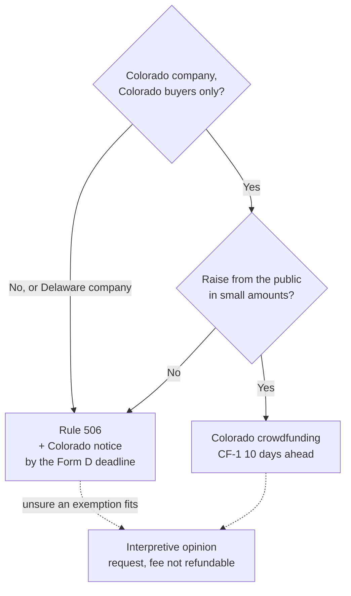

# Colorado securities filings and fees for a raise

> Legallas is an AI agent for legal work, not a lawyer or law firm. Using it creates no attorney-client relationship. AI can be wrong. Have your own lawyer review before you sign, file or rely on anything.
>
> No lawyer has reviewed this checklist.

## In one screen

| Item | When | Filed how | Fee in the law's words | Amount |
|---|---|---|---|---|
| Rule 506 notice | "no later than" the SEC's Form D deadline ([Rule 51-3.7(B)][ccr]) | Form D through NASAA's EFD ([Rule 51-3.7(B)][ccr]) | "pay an exemption fee to be determined and collected pursuant to section 11-51-707" ([11-51-308(1)(p)][t11]) | $50, "Regulation D Exemptions" ([Division fee table][fees]) |
| Colorado crowdfunding | "not less than ten days before the commencement of an offering" ([11-51-308.5(3)(a)(IV)][t11]) | Form CF-1, consent to service, disclosure document, escrow agreement ([Rule 51-3.20(C)][ccr]; [308.5(3)(a)(IV)][t11]) | "Pay the fee established by the securities commissioner" ([308.5(3)(a)(IV)(B)][t11]) | $50 issuer; $60 intermediary ([Division fee table][fees]) |
| Interpretive opinion | Any time, before relying on it | A request to the securities commissioner ([11-51-705][t11]) | "pay an opinion fee, which shall be determined and collected pursuant to section 11-51-707 and which shall not be refundable" ([11-51-705][t11]) | $100, "Opinion or No-Action Request" ([Division fee table][fees]) |

No statute or rule states a dollar amount. Under [11-51-707(3)(a)][t11], "The division shall set the amount of each fee that it is authorized by law to collect under this article 51." The amounts above are from the [Division's fee table][fees], read 2026-11-12. Read it again before paying: the Division adjusts fees.

## 1. Rule 506 notice

| Step | What | Source |
|---|---|---|
| Exemption | Colorado exempts a sale that complies with a federal exemption under section 4(a)(2) of the Securities Act, which covers Rule 506 | [11-51-308(1)(p)][t11] |
| File | The forms filed with the SEC, through NASAA's Electronic Filing Depository | [Rule 51-3.7(A), (B)][ccr] |
| Sign | A typed name in the EFD filing is the signature | [Rule 51-3.7(B)(2)][ccr] |
| Pay | Through EFD, with the filing | [Rule 51-3.7(B)(1)][ccr] |
| Amend | To correct a material mistake; after most changes; and "Annually, on or before the first anniversary" of the last filing while the offering continues | [Rule 51-3.7(D)][ccr] |

Steps on EDGAR and EFD: [Form D and the Colorado notice filing](../investors/funds/form-d-and-colorado-notice.md).

## 2. Colorado crowdfunding

Only a business entity organized under Colorado law and authorized to do business in Colorado can use it ([11-51-308.5(3)(a)][t11]). A Delaware corporation can't.

| Limit or duty | In the law | Source |
|---|---|---|
| Buyers | Colorado residents, and the offering meets federal Rule 147 for an intrastate offering | [308.5(3)(a)(I)][t11] |
| Raise | At most $1 million in 12 months; $2 million if audited financial statements go to the commissioner first | [308.5(3)(a)(II)][t11] |
| Per buyer | At most $5,000 in 12 months, unless accredited | [308.5(3)(a)(III)][t11] |
| Escrow | Minimum and maximum set; the minimum "not less than one-half of the maximum"; no access until the minimum is raised | [308.5(3)(a)(IV)(F)][t11] |
| Small offering | Up to $500,000 in 12 months, with the commissioner's approval: no minimum and no online intermediary; funds kept in a segregated account | [Rule 51-3.27][ccr] |
| Over $1 million | Form CF-2 includes financial statements "reviewed by a certified public accountant licensed to practice accountancy within the state of Colorado" | [Rule 51-3.22(C)][ccr] |
| Sold through | A Colorado broker-dealer, a licensed sales representative, or a registered online intermediary | [308.5(3)(b)][t11] |
| Legend and certification | Fixed text on the disclosure cover; each buyer signs the statute's acknowledgment | [308.5(3)(a)(VI), (VII)][t11] |
| Not combined | No other 307, 308 or 309 exemption in the preceding 12 months | [308.5(3)(a)(XI)][t11] |
| Quarterly report | To owners, free; on an intermediary's site "within forty-five days after the end of each fiscal quarter"; each one filed with the Division | [308.5(3)(a)(XIII)][t11] |

## 3. Interpretive opinion

The commissioner "may honor requests" to confirm an exemption under 11-51-307 to 11-51-309, or other questions under the Act ([11-51-705][t11]). Honoring one is discretionary. The fee isn't refunded either way. In answering, the commissioner may waive a condition of the Act for the person asking.

Legallas template raise/colorado-securities-filings version 1. Law checked 2026-11-09. Not reviewed by a lawyer. Have your own lawyer review. Delete this line before signing.

## Drafting notes

| Choice | Options | Recommendation and why | Where a lawyer should look |
|---|---|---|---|
| Route | Rule 506 with the notice; Colorado crowdfunding | **Rule 506 with the notice** for most rounds: any entity can use it and there's no cap. Crowdfunding fits a Colorado company raising small sums from many Colorado residents, at the cost of escrow, an intermediary and quarterly reports | Whether any buyer or offeree is outside Colorado |
| Ask for an opinion | Ask; don't ask | **Don't ask** for a plain Rule 506 round: the rule's steps are clear. **Ask** when an exemption's fit turns on facts the rules don't settle | What to put in the request |
| Fee amounts | Read the Division's page at payment; rely on a figure stored here | **Read at payment.** The Division sets and may adjust fees up to twice a year ([11-51-707(3)(b)][t11]) | None |

## Sources

| Source | Read |
|---|---|
| [C.R.S. title 11, 2026][t11]: 11-51-308(1)(p), -308.5, -705, -707 | 2026-11-09 |
| [3 CCR 704-1][ccr], current version (rule version 12350, PDF from the Secretary of State): Rules 51-3.7, 51-3.20, 51-3.22, 51-3.27 | 2026-11-09 |
| [Division of Securities, Forms and Fees][fees]: the fee table | 2026-11-12 |

## What couldn't be verified

- **Form CF-1 and CF-2 contents.** The forms sit on the Division's site.

[t11]: https://olls.info/crs/crs2026-title-11.htm
[ccr]: https://www.coloradosos.gov/CCR/DisplayRule.do?action=ruleinfo&ruleId=2207
[fees]: https://securities.colorado.gov/division-of-securities-forms-and-fees
