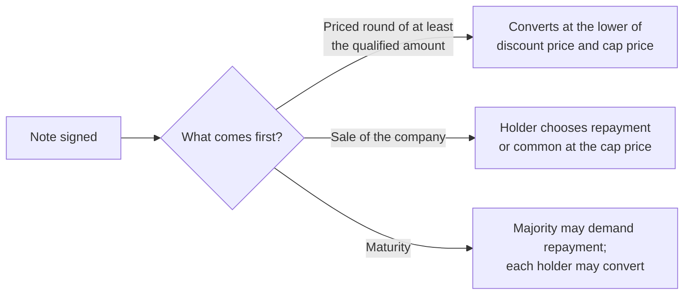

# Convertible Promissory Note

> Legallas is an AI agent for legal work, not a lawyer or law firm. Using it creates no attorney-client relationship. AI can be wrong. Have your own lawyer review before you sign, file or rely on anything.
>
> No lawyer has reviewed this template.

## Before you use this

A note is a loan that turns into stock or units at the next priced round. Unlike a SAFE, it's debt: it earns interest and has a maturity date, when the investor can ask for the money back.

| | |
|---|---|
| **Before signing** | The board approves the series ([financing consents](financing-consents.md)); an LLC uses the vote its operating agreement requires. The [offering record](offering-record.md) is open and each investor has signed an [accredited investor certification](../investors/angels/accredited-investor.md) |
| **Who signs** | The company and each investor. Each investor gets their own note, all on the same terms |
| **Deadline** | Form D within 15 days after the first note is signed ([230.503][e503]); state notices with it |
| **Track** | The maturity date. Before it arrives, convert, extend with the majority holders' consent, or repay |
| **LLC** | Converting into units makes the holder a member. In the Legallas [operating agreement](../founders/colorado-llc-operating-agreement.md), borrowing above its limit and issuing units are Protected Matters (Section 3.3), members have a right to buy new units (Section 2.4), and each new member signs Exhibit 1 |

## The document

<!-- TEMPLATE START -->

**CONVERTIBLE PROMISSORY NOTE**

THIS NOTE AND ANY SECURITIES ISSUED ON ITS CONVERSION HAVE NOT BEEN REGISTERED UNDER THE SECURITIES ACT OF 1933 OR ANY STATE SECURITIES LAW. THEY MAY NOT BE SOLD OR TRANSFERRED UNLESS REGISTERED OR UNLESS AN EXEMPTION FROM REGISTRATION IS AVAILABLE.

Principal: {{PRINCIPAL_AMOUNT}}. Issue date: {{ISSUE_DATE}}.

For value received, {{COMPANY_NAME}}, a {{COMPANY_STATE_AND_TYPE}} (the "**Company**"), promises to pay {{HOLDER_NAME}} (the "**Holder**") the principal above, with interest, on the terms below. This note is one of the Company's {{SERIES_NAME}} (the "**Notes**"), issued on the same terms, up to {{SERIES_MAXIMUM}} in total principal.

**1. Terms used.**

"**Change of Control**" means a sale of all or substantially all of the Company's assets, or a merger, conversion or sale of equity after which the people who held the Company's voting equity just before it hold less than a majority of the voting power of the Company or its successor. A financing whose main purpose is raising money isn't a Change of Control.

"**Fully Diluted Capitalization**" means, immediately before the relevant event and as converted to common, with each share or unit counted once: all of the Company's outstanding shares or units, all shares or units issuable on exercise or conversion of outstanding options, warrants and convertible securities, and all shares or units reserved but not yet granted under any equity plan, but not counting the Notes, any other convertible notes or any simple agreements for future equity.

"**Majority Holders**" means the holders of a majority of the outstanding principal of all Notes.

"**Outstanding Balance**" means the unpaid principal plus accrued and unpaid interest.

"**Qualified Financing**" means the first sale of the Company's equity securities after the issue date, mainly to raise money, in which it receives at least {{QUALIFIED_FINANCING_AMOUNT}} in cash in total, counting all closings of that round and not counting the conversion of the Notes or any other convertible securities.

**2. Interest.** Simple interest accrues on unpaid principal at {{INTEREST_RATE}}% a year, on a 365-day year, from the issue date until the principal is paid or converted. It's payable only at repayment or converts with the principal. It never exceeds the highest rate the governing law allows. Any excess is applied to principal, or refunded if principal is paid.

**3. Conversion in a Qualified Financing.** If a Qualified Financing closes before this note is repaid, the Outstanding Balance converts automatically, at that closing, into the same equity securities sold in it, at a price per share or unit equal to:

[OPTION A: A discount and a cap.]
the lower of (a) the price paid by the cash investors, less {{DISCOUNT_PERCENT}}%, and (b) {{VALUATION_CAP}} divided by the Fully Diluted Capitalization.
[END OPTION A]

[OPTION B: A cap only.]
the lower of (a) the price paid by the cash investors and (b) {{VALUATION_CAP}} divided by the Fully Diluted Capitalization.
[END OPTION B]

[OPTION C: A discount only.]
the price paid by the cash investors, less {{DISCOUNT_PERCENT}}%.
[END OPTION C]

The Holder shall sign the documents that the cash investors sign, on the same terms except price. The Company issues no fractional share or unit; it pays the value of any fraction in cash.

**4. Other financings.** The Company shall give each Holder at least 10 days' notice before closing a sale of equity securities that isn't a Qualified Financing. The Majority Holders may elect, by notice before it closes, to convert all Notes on the terms of section 3.

**5. Change of Control.** The Company shall give the Holder at least 10 days' notice before a Change of Control closes. If it closes before this note is converted or repaid, the Holder may choose, by notice before closing, either (a) payment of the Outstanding Balance at closing, before any payment to holders of equity, or (b) conversion of the Outstanding Balance, just before closing, into common stock or, for an LLC, Capital Units, at a price equal to {{VALUATION_CAP}} divided by the Fully Diluted Capitalization, so that the Holder is paid with the other holders of that equity in whatever form they receive. If the Holder doesn't choose, or there is no valuation cap, (a) applies.

**6. Maturity.** If this note hasn't converted or been repaid by {{MATURITY_DATE}} (the "**Maturity Date**"):

(a) the Majority Holders may extend the Maturity Date for all Notes by written consent;

(b) otherwise, the Majority Holders may, by notice at any time after the Maturity Date, demand payment of all Notes' Outstanding Balances within 30 days, and the Holder may, by its own notice, convert its Outstanding Balance into common stock or, for an LLC, Capital Units, at a price equal to {{VALUATION_CAP}} divided by the Fully Diluted Capitalization at conversion or, if there is no valuation cap, the fair market value per share or unit that the board or managers set in good faith; and

(c) until then, this note stays outstanding and keeps accruing interest.

**7. Prepayment.** The Company may not prepay this note without the Majority Holders' written consent.

**8. Default.** Each of these is an "Event of Default": (a) the Company doesn't pay an amount due within 10 days after notice that it's overdue; or (b) the Company makes an assignment for the benefit of creditors, files for bankruptcy, or has an involuntary bankruptcy petition filed against it that isn't dismissed within 60 days. After an Event of Default, the Majority Holders may declare all Notes immediately due. An Event of Default under (b) makes them due without notice.

**9. Ranking.** This note is an unsecured obligation of the Company, equal in right of payment with the other Notes and ahead of all equity. Any payment on the Notes, other than on conversion, is shared among the Notes in proportion to their Outstanding Balances.

**10. The Holder's statements.** The Holder states that: (a) it is an "accredited investor" as defined in Rule 501(a) of Regulation D, and lives in, or has its principal place of business in, {{HOLDER_STATE}}; (b) it is buying this note for its own account, not to resell it; (c) it understands that this note and any conversion securities aren't registered, can't be resold without registration or an exemption, and will carry a legend; (d) it can bear the loss of its whole investment; (e) it had the chance to ask questions and get answers about the Company; and (f) it didn't learn of this investment through any general solicitation or general advertising, unless the Company told it the offering relies on Rule 506(c).

**11. The Company's statements.** The Company states that: (a) it is validly existing and in good standing in its state; (b) its board or managers have approved this note and the Notes, and they are its valid and binding obligations; and (c) when issued on conversion, the securities will be validly issued and, for a corporation, fully paid and nonassessable. The Company shall keep enough authorized but unissued shares or units to allow conversion.

**12. No equity rights before conversion.** This note gives no vote, dividend or other right of a holder of equity until it converts.

**13. Amendment and waiver.** The Company and the Majority Holders may amend or waive any term of all Notes in writing, and that binds every Holder, as long as it treats all Notes the same way. Changing the principal or interest rate of this note, or its section 9 or this section 13, needs the Holder's own consent.

**14. Transfer.** The Holder may not transfer this note without the Company's written consent and an exemption from registration. A transfer to an affiliate of the Holder needs only the exemption and written notice to the Company.

**15. General.** This note is governed by the laws of {{GOVERNING_STATE}}, without its conflict of law rules. Notices are in writing and go to the Company at {{COMPANY_ADDRESS}} and to the Holder at {{HOLDER_ADDRESS}}, or to a later address given by notice; email counts if the recipient confirms it. If a court finds any term unenforceable, the rest stands. This note may be signed in counterparts and electronically.

Signed on {{SIGNING_DATE}}.

{{COMPANY_NAME}}

By: ______________________________

Accepted and agreed:

______________________________
{{HOLDER_NAME}}

Legallas template raise/convertible-note version 1. Law checked 2026-11-02. Not reviewed by a lawyer. Have your own lawyer review. Delete this line before signing.

<!-- TEMPLATE END -->

## Drafting notes

| Choice | Options | Recommendation and why | Where a lawyer should look |
|---|---|---|---|
| Note or SAFE | Note; SAFE | **Neither is recommended here; see the factors in the [document map](../../docs/design/document-set-and-law.md#choices-on-this-path-1), choice 5.** A note is debt with a maturity date and interest; a SAFE has neither, and the [SAFE ships unmodified](../bundled-forms.md#pinned-files) | Which instrument the round's investors expect |
| Interest rate (2) | A rate filled in | **The company's choice; Legallas doesn't pick a rate.** Practice sources in the document map differ: one gives about 2% to 8%, another 6% to 10% historically and about 4% more recently. In Colorado a written instrument may set more than 8% but not over 45% a year ([5-12-103][t5]). Delaware caps an agreed rate at 5% over the Federal Reserve discount rate ([6 Del. C. 2301(a)][d6c23]), with no limit on a loan over $100,000 not secured by a home ([2301(c)][d6c23]), and a corporation or LLC can't raise usury as a defense ([2306][d6c23]). Section 2 adds a savings clause | A rate near any cap |
| Discount and cap (3) | A, both; B, cap only; C, discount only | **The company's choice; Legallas doesn't pick one.** A cap protects the holder if the round prices high; a discount rewards early money if it prices low. With neither, the note converts at the round price | The cap's interaction with option pool increases in the round |
| Fully Diluted Capitalization (1) | Excludes notes and SAFEs, as drafted; includes them | **As drafted:** the cap is measured before the notes and SAFEs convert, so each holder's share moves as more convertibles are added. Including them gives holders a fixed percentage and dilutes founders more. Say which in the term sheet | Rounds with both notes and SAFEs outstanding |
| Liquidation preference on conversion | Same series, as drafted; a sub-series at the conversion price | **Same series, for simplicity.** A converting holder who pays less per share gets the full preference of the series, which is more than they paid. Some rounds create a sub-series with a lower preference. Investors leading the round may ask | Any round with a large discount |
| Sale of the company (5) | Holder chooses repayment or cap-price conversion, as drafted; a repayment multiple | **As drafted.** A holder who converts is paid alongside the other common holders, in cash or stock as they are, so the payment isn't circular and doesn't jump ahead of earlier preferred stock. Some notes pay a multiple of principal instead, which adds a negotiation | Payment priority and tax treatment at closing |
| Maturity (6) | Majority may demand repayment and each holder may convert, as drafted; each holder may demand | **As drafted.** Leaving demand to the majority stops one holder from being paid in full ahead of the rest, and section 9 shares any payment. Section 6(a) lets the majority extend all notes at once instead | What happens if the company can't repay |
| Majority amendment (13) | Majority Holders, as drafted; each holder | **Majority Holders.** One holdout can't block an extension or a fix, while section 13 protects each holder's principal, rate and equal share | Whether any holder needs a veto |
| Governing law (15) | The company's state; another | **The company's state of formation.** Delaware's statute letting parties pick Delaware law doesn't reach a contract under $100,000 ([6 Del. C. 2708][d6c27]) | A Colorado company choosing Delaware law |
| Tax | Notes accrue interest unpaid until conversion | **Have the holders' tax professionals review.** Interest not unconditionally payable in cash at least annually isn't qualified stated interest ([26 CFR 1.1273-1(c)][e1273]), so it may be original issue discount that a holder includes in income as it accrues ([26 U.S.C. 1272(a)][us1272]). A note isn't stock, so any qualified small business stock holding period starts at conversion ([26 U.S.C. 1202(i)(1)(A)][us1202]) | Each holder's own tax position |

**Fights.** A note is a debt, so a holder can sue to collect after maturity and default, and section 8 lets the majority accelerate. That leverage is why the maturity date matters more than it looks. The [offering record](offering-record.md) holds the proof the sale was exempt.

## What couldn't be checked

- **Typical interest, discount and cap levels** come from practice sources summarized in the document map, not from law. The template sets none.
- **Whether a Colorado court would treat a conversion discount or a change of control payment as "interest"** under [5-12-103(2)][t5]'s broad definition of charges. At ordinary seed terms it's unlikely to approach 45%, but it wasn't researched.
- **Converting into LLC units.** The operating agreement's admission terms control; no LLC-specific case was researched.

## Sources

[C.R.S. Title 5][t5], 2026 edition, read 2026-11-02. [6 Del. C. ch. 23][d6c23] and [ch. 27][d6c27], read 2026-11-02. [26 U.S.C. 1202][us1202], [1272][us1272]. eCFR as of 2026-10-29: [17 CFR 230.503][e503], [26 CFR 1.1273-1][e1273]. Practice ranges: the [document map](../../docs/design/document-set-and-law.md), choice 5.

[t5]: https://olls.info/crs/crs2026-title-05.pdf
[d6c23]: https://delcode.delaware.gov/title6/c023/index.html
[d6c27]: https://delcode.delaware.gov/title6/c027/sc01/index.html
[us1202]: https://uscode.house.gov/us/usc/t26/s1202/
[us1272]: https://uscode.house.gov/us/usc/t26/s1272/
[e503]: https://www.ecfr.gov/current/title-17/section-230.503
[e1273]: https://www.ecfr.gov/current/title-26/section-1.1273-1
