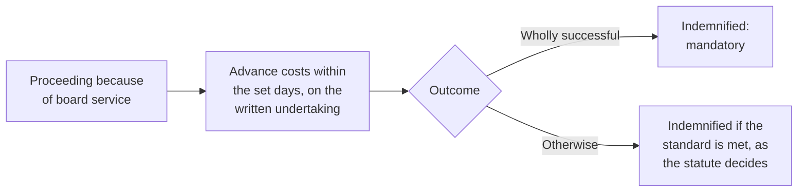

# Director Indemnification Agreement

> Legallas is an AI agent for legal work, not a lawyer or law firm. Using it creates no attorney-client relationship. AI can be wrong. Have your own lawyer review before you sign, file or rely on anything.
>
> No lawyer has reviewed this template.

## Before you use this

The Legallas [Colorado](../founders/colorado-corporation-bylaws.md) and [Delaware](../founders/delaware-corporation-bylaws.md) bylaws, Article 5, already require indemnification and advancement. This agreement makes those rights a contract with each director, so later changes can't take them away, and adds insurance and a rule for directors whose fund also indemnifies them.

| | |
|---|---|
| **Who signs** | The company and each director, for example at a priced round when an investor's director joins |
| **Approve** | By the board; in Colorado a contract approved by the board can obligate the company in advance ([7-109-109(1)][t7]) |
| **Limit** | Only what the statute allows: Colorado says a corporation may indemnify or advance "only as permitted by this article 109" ([7-109-111][t7]); Delaware's limits are in [145][d8s4] |

## The document

<!-- TEMPLATE START -->

**DIRECTOR INDEMNIFICATION AGREEMENT**

This Agreement is between {{COMPANY_NAME}}, a {{COMPANY_STATE_AND_TYPE}} (the "**Company**"), and {{DIRECTOR_NAME}} (the "**Director**"). It takes effect on {{SIGNING_DATE}} and covers acts and omissions before and after that date.

**1. Indemnification.** The Company shall indemnify the Director, to the fullest extent the law of the Company's state of incorporation permits, against expenses, including counsel fees, judgments, fines, penalties and amounts paid in settlement, that the Director reasonably incurs because the Director is or was a director of the Company, or serves at its request as a director, officer or agent of another entity. If the Director is wholly successful, on the merits or otherwise, in defending a proceeding, the Company shall indemnify the Director's reasonable expenses for it without any further determination. For a Delaware corporation, the same applies to success on any claim, issue or matter in a proceeding.

**2. Advancement.** The Company shall pay the Director's reasonable expenses in a proceeding before it ends, within {{ADVANCE_DAYS}} days after receiving a written request with invoices and the Director's written undertaking to repay the amounts advanced if it is finally determined that the Director isn't entitled to them. For a Colorado corporation, the request also includes the Director's written affirmation of a good faith belief that the Director met the required standard of conduct, or that the conduct is one for which liability was eliminated under the articles of incorporation. The undertaking is unsecured and accepted without regard to ability to repay.

[OPTION A: Advancement applies even when the Company sues. Recommended.]
This section applies whoever brings the proceeding, including the Company.
[END OPTION A]

[OPTION B: Not when the Company sues.]
This section doesn't apply to a proceeding the Company brings against the Director, if a majority of the disinterested directors approved bringing it.
[END OPTION B]

**3. Determinations.** Any determination that indemnification is permitted is made in the way the statute of the Company's state of incorporation requires. The Company shall seek it promptly after the Director asks and shall pay within 30 days after a favorable determination. If the Company doesn't pay an advance or indemnification when due, the Director may sue for it, and if the Director succeeds in whole or part, the Company shall pay the Director's reasonable expenses of that suit to the extent the law allows.

**4. What isn't covered.** The Company doesn't owe indemnification or advancement:

(a) for a proceeding the Director starts, unless the board authorized it or it enforces this Agreement;

(b) for amounts the law doesn't allow the Company to pay, including any return of profits under section 16(b) of the Securities Exchange Act of 1934 and any repayment the law requires of incentive pay; or

(c) to the extent insurance or another source has actually paid the Director, except as section 6 provides.

**5. Insurance.**

[OPTION A: The Company keeps directors' and officers' insurance. Recommended once there is an outside director.]
While the Director serves, and for {{TAIL_YEARS}} years after, the Company shall keep directors' and officers' liability insurance covering the Director on terms at least as favorable as for any other director, if it is available at a reasonable cost as the board decides in good faith. If the Company is sold, it may meet this by buying tail coverage for that period.
[END OPTION A]

[OPTION B: No insurance promise.]
The Company may buy directors' and officers' liability insurance, but this Agreement doesn't require it.
[END OPTION B]

**6. The Director's fund.** If a fund or other entity that the Director represents also indemnifies or insures the Director, the Company is the first source of payment for the matters this Agreement covers, and the Company won't seek contribution from that fund or its insurers. If that fund pays something the Company owed, it takes over the Director's rights against the Company for that amount.

**7. Notice to shareholders.** For a Colorado corporation, if the Company indemnifies or advances expenses to the Director in a proceeding by or in the right of the Company, it shall give the shareholders the notice the statute requires.

**8. Rights continue.** These rights don't exclude any other right the Director has under the charter, bylaws, insurance or law; for a Colorado corporation, other indemnification and advancement rights apply only as article 109 of title 7 of the Colorado Revised Statutes permits. A later change to the charter or bylaws can't reduce these rights for an act or omission that happened before the change. They continue after the Director leaves the board and benefit the Director's heirs and estate. This Agreement binds the Company's successors, including in a merger or a sale of substantially all its assets.

**9. General.** This Agreement is governed by the laws of {{GOVERNING_STATE}}, without its conflict of law rules, except that the law of the Company's state of incorporation decides what indemnification is permitted. Only a writing signed by both can change it. If a court finds any term unenforceable, the rest stands and is read to give the Director the most protection the law allows. It may be signed in counterparts and electronically. It doesn't promise the Director a seat on the board.

{{COMPANY_NAME}}

By: ______________________________

______________________________
{{DIRECTOR_NAME}}

Legallas template raise/director-indemnification version 1. Law checked 2026-11-02. Not reviewed by a lawyer. Have your own lawyer review. Delete this line before signing.

<!-- TEMPLATE END -->

## Drafting notes

| Choice | Options | Recommendation and why | Where a lawyer should look |
|---|---|---|---|
| Advancement when the company sues (2) | A, applies; B, not then | **A, matching the bylaws' recommended option.** This is when a director most needs it. In Delaware the statute only permits advancement ([145(e)][d8s4]); in Colorado a contract obligating indemnification to the fullest extent also obligates advancement unless it says otherwise ([7-109-109(1)(b)][t7]) | Keep this the same as the bylaws and charter |
| Colorado affirmation (2) | Include for Colorado | **Include.** Colorado lets a corporation advance only on a written affirmation of good faith belief and a written undertaking ([7-109-104(1)][t7]) | None |
| Determinations (3) | Follow the statute | **Follow it.** Colorado requires a determination by disinterested directors, independent counsel or shareholders before permissive indemnification ([7-109-106][t7]); Delaware lists similar methods ([145(d)][d8s4]). Mandatory indemnification after success needs none: in Colorado only when the director is wholly successful in the defense of the proceeding ([7-109-103][t7]), in Delaware also for success on a claim, issue or matter ([145(c)][d8s4]) | Whether a contract may presume entitlement |
| Insurance (5) | A, required with a tail; B, optional | **A once an outside director joins.** Indemnification is only as good as the company's money; insurance covers a company that can't pay. Both states allow it ([7-109-108][t7]; [145(g)][d8s4]) | Policy terms |
| Fund priority (6) | Company pays first, as drafted; shared | **As drafted.** A fund may ask for it as a condition of its director joining, and it matches who benefits from the service | Whether the company's insurer accepts it |

**Fights.** When investors and founders fight, directors on each side may be sued. This agreement keeps a director's defense costs flowing during the fight, whoever controls the board, and section 8 stops a new majority from changing the rules after the fact.

## What couldn't be checked

- **Whether a contract may presume a director is entitled** to permissive indemnification, or shift the burden, in either state. The agreement doesn't try.
- **Section 6 against an insurer's own terms.** Not researched.
- **The bylaws and charter must match** this agreement on Option A or B in section 2; nothing here checks a company's actual documents.

## Sources

[C.R.S. Title 7, article 109][t7], 2026 edition, read 2026-11-02. [8 Del. C. 145][d8s4], read 2026-11-02.

[t7]: https://olls.info/crs/crs2026-title-07.pdf
[d8s4]: https://delcode.delaware.gov/title8/c001/sc04/index.html
