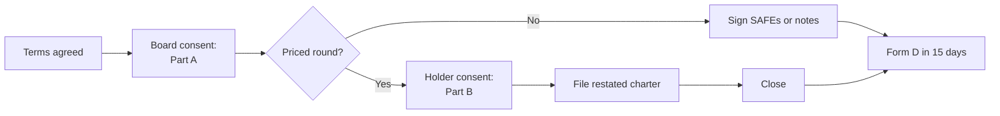

# Board and Stockholder Consents Approving a Financing

> Legallas is an AI agent for legal work, not a lawyer or law firm. Using it creates no attorney-client relationship. AI can be wrong. Have your own lawyer review before you sign, file or rely on anything.
>
> No lawyer has reviewed this template.

## Before you use this

Corporations only. A Colorado LLC approves borrowing or issuing units through its operating agreement's own vote; in Legallas's [operating agreement](../founders/colorado-llc-operating-agreement.md) both are Protected Matters (Section 3.3), and members have a right to buy new units (Section 2.4).

| Instrument | Board | Stockholders |
|---|---|---|
| SAFE or convertible note | Approves the instrument and the round ([7-106-205(2)][t7]; [157][d8s5]) | Usually not, unless the charter, bylaws or an agreement among holders says so |
| Priced round | Adopts the restated charter, recommends it and approves the documents ([7-110-103(2)(a)][t7]; [242(b)(1)][d8s8]) | Approve the restated charter, with any separate class or voting group vote ([7-110-103][t7]; [242(b)][d8s8]) |

| | Colorado | Delaware |
|---|---|---|
| Board consent | Every director, in writing, unless the bylaws require a meeting ([7-108-202(1)][t7]) | Every director, in writing or by electronic transmission, unless the charter or bylaws restrict it ([141(f)][d8s4]) |
| Holder consent | **Everyone entitled to vote,** unless the articles expressly allow the votes a meeting would need ([7-107-104(1)][t7]) | Holders of the votes a meeting would need, unless the certificate says otherwise ([228(a)][d8s7]) |
| Notice to holders who didn't sign | On receipt of all consents ([7-107-104(5.5)][t7]) | Prompt notice ([228(e)][d8s7]) |
| Filing | Articles of restatement with the Secretary of State ([7-110-107(4)][t7]) | Restated certificate with the Division of Corporations ([245][d8s8]) |

## The document

<!-- TEMPLATE START -->

**PART A. ACTION OF THE BOARD OF DIRECTORS OF {{COMPANY_NAME}}, A {{STATE_OF_INCORPORATION}} CORPORATION, BY WRITTEN CONSENT**

The undersigned, being all of the directors of the Company, consent to the following actions without a meeting.

**1. The financing.**

[OPTION A: SAFEs.]
The Company may issue simple agreements for future equity on Y Combinator's {{SAFE_FORM}} form, unmodified except to fill in its blanks and bracketed terms, for up to {{MAXIMUM_AMOUNT}} in total, to the investors in Schedule 1 ({{INVESTOR_LIST}}) or added by a later board consent. The Company may also sign Y Combinator's pro rata side letter, unmodified, with any investor whose purchase amount is at least {{PRO_RATA_MINIMUM}}. The board finds the purchase amounts adequate consideration for these rights.
[END OPTION A]

[OPTION B: Convertible notes.]
The Company may issue its {{SERIES_NAME}}, on the form attached, for up to {{MAXIMUM_AMOUNT}} in total principal, to the investors in Schedule 1 ({{INVESTOR_LIST}}) or added by a later board consent. The board finds the principal adequate consideration for the conversion rights.
[END OPTION B]

[OPTION C: A priced round.]
The board approves the sale of up to {{PREFERRED_SHARES}} shares of {{PREFERRED_SERIES}} at {{PRICE_PER_SHARE}} per share, on the terms in the term sheet dated {{TERM_SHEET_DATE}} and the attached forms of investment agreement and related documents. The board adopts the attached restated {{CHARTER_WORD}}, declares it advisable, recommends it to the {{HOLDER_WORD}}s and submits it to them for approval. Once it is approved and filed, the shares may be issued on receipt of the price, and are then fully paid and nonassessable. The Company shall reserve enough common stock to issue on conversion of those shares.
[END OPTION C]

**2. The exemption.** The Company relies on Rule 506 of Regulation D, under the route recorded in its offering record, and on the matching state exemptions. Before the first sale, the officers shall finish the bad actor inquiry under Rule 506(d) and confirm that no covered person is disqualified. The Company shall pay no one for soliciting investors unless that person is a registered broker-dealer and appropriately licensed in each state where it solicits, and the board approves the payment.

**3. Filings.** The officers shall obtain EDGAR access, file Form D within 15 calendar days after the first sale and amend it as Rule 503 requires, and make each state notice filing that applies. {{AUTHORIZED_OFFICER}} may sign Form D for the Company.

**4. Conversion shares.** The Company shall keep enough authorized but unissued shares to issue on conversion of the instruments approved here. If it doesn't have enough when they convert, the officers shall propose a charter amendment to the board.

**5. Authority.** {{AUTHORIZED_OFFICER}} and each other officer may sign the documents approved here, with changes that officer approves as not material, pay the costs of the financing, and do whatever else is needed to carry out these actions. Anything an officer has already done that fits these actions is ratified.

This consent may be signed in counterparts and electronically. It takes effect when the last director signs.

Directors: {{DIRECTOR_NAMES}}

______________________________  Date: __________

______________________________  Date: __________

**PART B. ACTION OF THE {{HOLDER_WORD}}S OF {{COMPANY_NAME}} BY WRITTEN CONSENT** (priced round, or any other charter change)

The undersigned {{HOLDER_WORD}}s consent to the following action without a meeting:

[OPTION A: Every holder entitled to vote signs. Recommended.]
being all of the {{HOLDER_WORD}}s entitled to vote on it.
[END OPTION A]

[OPTION B: Only the votes needed sign, and the charter allows that.]
holding at least the votes that would be needed at a meeting at which all shares entitled to vote were present and voted, including any separate vote of a class or voting group. The Company shall give notice of this action to each {{HOLDER_WORD}} entitled to vote who didn't sign, as the law requires.
[END OPTION B]

**1. Restated {{CHARTER_WORD}}.** The restated {{CHARTER_WORD}} attached to the board's consent dated __________ is approved.

**2. Waivers.** Each signer waives, for the shares sold in this financing only, any right of first refusal, preemptive right or notice right the signer has under the charter, bylaws or any agreement with the Company.

This consent may be signed in counterparts and electronically. Each signer dates their signature. The action takes effect when the Company has received consents from enough holders, within 60 days after the first one it received.

| {{HOLDER_WORD}} | Shares and class | Signature | Date |
|---|---|---|---|
| | | | |

Legallas template raise/financing-consents version 1. Law checked 2026-11-02. Not reviewed by a lawyer. Have your own lawyer review. Delete this line before signing.

<!-- TEMPLATE END -->

## Drafting notes

| Choice | Options | Recommendation and why | Where a lawyer should look |
|---|---|---|---|
| SAFE form (A1) | Valuation cap only; discount only; most favored nation only | **The company's choice; Legallas doesn't pick one.** All three [ship unmodified](../bundled-forms.md#pinned-files). The resolution says "unmodified", because the form itself states neither party changed it beyond the blanks | A Colorado corporation: the form's company statements say "certificate of incorporation" |
| Pro rata letters (A1) | A minimum amount; every investor; none | **A minimum amount.** Each letter gives a right in the next round that dilutes everyone else, so tie it to a meaningful check | Whether a letter promised before this consent needs ratifying |
| Holder consent (B) | A, every holder signs; B, only the votes needed | **A where practical.** In Colorado, less than unanimous consent works only if the articles expressly allow it ([7-107-104(1)(b)][t7]). In Delaware it works unless the certificate says otherwise, but non-signers must get prompt notice ([228(a), (e)][d8s7]) | Class and voting group votes. In Colorado, creating a new class with distribution or liquidation rights ahead of or equal to the common gives the common its own voting group vote, even if the articles call it nonvoting ([7-110-104(1)(f), (4)][t7]). In Delaware, a class votes separately on a change to its number of authorized shares or par value, or one that adversely alters its powers, preferences or special rights, though the certificate may remove the class vote on the number of authorized shares ([242(b)(2)][d8s8]) |
| Waivers (B2) | Include; leave out | **Include.** The bylaws, a founders' agreement or an earlier side letter may give holders a right to buy or a notice right that would otherwise delay the round. A waiver binds only the holder who signs it | Rights held by anyone who doesn't sign |
| Paid helpers (A2) | No one, unless registered and board-approved; leave out | **Keep.** See the [offering record](offering-record.md): an unregistered finder's contract can be voidable, a paid solicitor is a covered person under the bad actor rule, and Colorado's limited offering exemption allows commissions only to licensed persons ([11-51-308(1)(j)][t11]) | Any success fee |
| Who signs Form D (A3) | A named officer | **Name one.** Form D must be signed by a person duly authorized by the issuer ([230.503(b)(2)][e503]) | None |
| Conversion shares (A4) | Reserve now; amend later | **Reserve, and check the count each time.** A SAFE or note converts into shares that may not yet be authorized; the priced round's charter must authorize enough | Rounds with many SAFEs at different caps |

**Fights.** Signed consents are the proof that a round was authorized. A holder later claiming the round was invalid looks first at who signed, whether the votes were enough, and whether non-signers got notice. Keep every page with the minute book.

## What couldn't be checked

- **Delaware's newer no-vote paths in [242(d)][d8s8].** As read, (d)(1) covers certain minor changes and a stock split when only one class is outstanding, and (d)(2) covers listed classes. Neither appears to reach a restated certificate that creates preferred stock; a lawyer should confirm.
- **Whether a Delaware common class vote is needed** when a new senior series is created. Section 242(b)(2)'s words don't say; case law wasn't researched.

## Sources

[C.R.S. Title 7][t7], 2026 edition, read 2026-11-02. [8 Del. C. ch. 1, subch. IV][d8s4], [V][d8s5], [VII][d8s7] and [VIII][d8s8], read 2026-11-02. eCFR as of 2026-10-29: [17 CFR 230.503][e503].

[t7]: https://olls.info/crs/crs2026-title-07.pdf
[t11]: https://olls.info/crs/crs2026-title-11.pdf
[d8s4]: https://delcode.delaware.gov/title8/c001/sc04/index.html
[d8s5]: https://delcode.delaware.gov/title8/c001/sc05/index.html
[d8s7]: https://delcode.delaware.gov/title8/c001/sc07/index.html
[d8s8]: https://delcode.delaware.gov/title8/c001/sc08/index.html
[e503]: https://www.ecfr.gov/current/title-17/section-230.503
