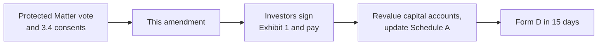

# Amendment to the Operating Agreement Admitting Investors

> Legallas is an AI agent for legal work, not a lawyer or law firm. Using it creates no attorney-client relationship. AI can be wrong. Have your own lawyer review before you sign, file or rely on anything.
>
> No lawyer has reviewed this template.

## Before you use this

For a Colorado LLC that takes investors without becoming a corporation. Some venture funds can't hold LLC units (see choice 5 in the [document map](../../docs/design/document-set-and-law.md#choices-on-this-path-1)), and units of an LLC taxed as a partnership aren't stock in a C corporation, so they can't be qualified small business stock ([26 U.S.C. 1202(c)(1)][us1202]); see [conversion](conversion-to-delaware.md) for the other route.

| | |
|---|---|
| **Approval** | Colorado's default is every member's consent, both to admit a member and to amend the operating agreement ([7-80-701(1)][t7]; [7-80-401(2)(b)][t7]). The Legallas [operating agreement](../founders/colorado-llc-operating-agreement.md) replaces that with a Protected Matter vote (Sections 2.3, 3.3 and 15.3), and Section 3.4 lists changes that need each affected person's own consent |
| **Who signs** | The members giving the vote, and each investor, who also signs Exhibit 1 |
| **With it** | The [offering record](offering-record.md) and Form D: units are securities |
| **Tax** | Investors become partners for tax and get K-1s. Have the company's tax professional review the revaluation and allocations |

## The document

<!-- TEMPLATE START -->

**AMENDMENT TO THE OPERATING AGREEMENT OF {{COMPANY_NAME}}**

This Amendment changes the Operating Agreement of {{COMPANY_NAME}}, a Colorado limited liability company (the "Company"), dated {{AGREEMENT_DATE}} (the "Agreement"). Terms defined in the Agreement have the same meaning here. It takes effect when the Company receives the purchase price from the first Investor.

**1. New Units.** The Company may issue up to {{INVESTOR_UNITS}} {{INVESTOR_UNIT_NAME}}, a new kind of Capital Unit ("**Investor Units**"), at {{PRICE_PER_UNIT}} per Unit, to {{INVESTOR_NAMES}} (each an "**Investor**"). Each Investor is admitted as a Member when it signs Exhibit 1 and pays. Schedule A is updated to show each Investor's Units and contribution, and marks each Investor as an Investing Member.

**2. Rights of Investor Units.** Investor Units have the same rights as other Capital Units, except:

[OPTION A: Investors' contributions come back first.]
(a) **Return of contributions first.** Section 13.4 is amended to add, before its paragraph (a): "(a-1) first, to Investor Units in proportion to the contributions for them that haven't been returned, until the purchase price of each Investor Unit has been returned;". Paragraph (a) then applies to the other Capital Units. Because Sections 8.4, 8.5, 8.7, 15.1 and 15.4 follow Section 13.4, they follow this order too. This Option needs the written consent of each holder of Capital Units under Section 3.4.
[END OPTION A]

[OPTION B: No change to the order.]
(a) **Same order.** Investor Units share in distributions under Section 13.4 as other Capital Units do.
[END OPTION B]

(b) **Information.** Each Investor holding Investor Units bought for at least {{MAJOR_INVESTOR_AMOUNT}} receives the reports in Section 10.4 and, within 45 days after each quarter, a quarterly income statement and balance sheet.

[OPTION A: The Company has Managers under Section 3.1, and investors get a seat.]
(c) **Manager seats.** The holders of a majority of the Investor Units may elect and remove {{INVESTOR_MANAGER_SEATS}} Manager or Managers. The number of Manager seats increases by that number.
[END OPTION A]

[OPTION B: No seat.]
(c) **No seat.** Investor Units carry no right to elect a Manager.
[END OPTION B]

**3. Waiver of the right to buy.** Each Member who signs this Amendment waives its right under Section 2.4 for the Investor Units. Before issuing any Investor Units, the Company shall offer each Member who doesn't sign its share under Section 2.4, on the same terms. Units such a Member buys count toward the limit in section 1.

**4. Capital accounts.** When the Investor Units are issued, the Company shall revalue its property and adjust the capital accounts of the existing holders to reflect the unrealized gain or loss in it, as 26 CFR 1.704-1(b)(2)(iv)(f) allows, so that value built up before the Investors joined stays with the existing holders. The threshold for each outstanding Profits Interest Unit doesn't change.

**5. Investors' statements.** Each Investor states that it is an accredited investor as defined in Rule 501(a) of Regulation D, is buying for its own account and not to resell, understands the Investor Units aren't registered and can't be transferred except as the Agreement and securities law allow, and can bear the loss of its whole investment.

**6. Everything else stays.** Except as this Amendment says, the Agreement is unchanged. If they conflict, this Amendment controls. It may be signed in counterparts and electronically.

Signed on {{SIGNING_DATE}}.

Members (Protected Matter vote and any consents under Section 3.4): ______________________________

Investors: ______________________________

Legallas template raise/llc-investor-admission version 1. Law checked 2026-11-02. Not reviewed by a lawyer. Have your own lawyer review. Delete this line before signing.

<!-- TEMPLATE END -->

## Drafting notes

| Choice | Options | Recommendation and why | Where a lawyer should look |
|---|---|---|---|
| Stay an LLC or convert | Admit investors here; [convert to a Delaware corporation](conversion-to-delaware.md) first | **Neither is recommended here.** Staying an LLC keeps pass-through tax; converting gives a corporation and starts the qualified small business stock clock ([1202(c)(1), (i)(1)(A)][us1202]). See choice 5 in the [document map](../../docs/design/document-set-and-law.md#choices-on-this-path-1) | The investors' own limits on holding LLC units |
| Order of distributions (2(a)) | A, investors' contributions back first; B, same order as other Capital Units | **B unless investors ask.** Section 13.4 already returns every Capital Unit's contribution before profits are shared, so investors get their money back alongside the founders' under B. A moves investors ahead of the founders' contributions, which changes the founders' share and so needs each holder's consent under Section 3.4; Section 15.3 also requires any investor preference to be approved under Sections 3.3 and 3.4 | Allocations under Section 13.3, Profits Interest thresholds and tax distributions |
| Manager seats (2(c)) | A, seats; B, none | **B unless investors ask.** A works only if the Company has Managers under Section 3.1, and adding seats is a Protected Matter (Section 3.3) | Founder seats and vetoes under Sections 3.1 and 3.2 |
| Revaluation (4) | Revalue, as drafted; don't | **Revalue.** Without it, an investor buying at today's value could later share in gain that built up before it joined ([26 CFR 1.704-1(b)(2)(iv)(f)][e704]; [26 U.S.C. 704(b)][us704]). Section 13.2 of the operating agreement allows it | Tax professional: the allocations that follow |
| Members who don't sign (3) | Keep their right, as drafted; amend Section 2.4 away | **Keep it.** A member's right to buy is a reason to have signed the agreement in the first place | Timing, if a member takes the full 15 business days |

**Fights.** Admitting investors changes who votes on Protected Matters and who sits as a Manager. Section 3.4's personal consents and Section 15.3's rule that undisclosed side deals bind only their signers protect founders who didn't sign.

## What couldn't be checked

- **How Option A in 2(a) works with the operating agreement's tax distribution and allocation terms** in every case. Left to the company's tax professional.
- **Colorado securities rules** for units sold only in Colorado. The [offering record](offering-record.md) covers Rule 506 with the Colorado notice.

## Sources

[C.R.S. Title 7][t7], 2026 edition, read 2026-11-02. [26 U.S.C. 704][us704], [1202][us1202]. eCFR as of 2026-10-29: [26 CFR 1.704-1][e704].

[t7]: https://olls.info/crs/crs2026-title-07.pdf
[us704]: https://uscode.house.gov/us/usc/t26/s704/
[us1202]: https://uscode.house.gov/us/usc/t26/s1202/
[e704]: https://www.ecfr.gov/current/title-26/section-1.704-1
